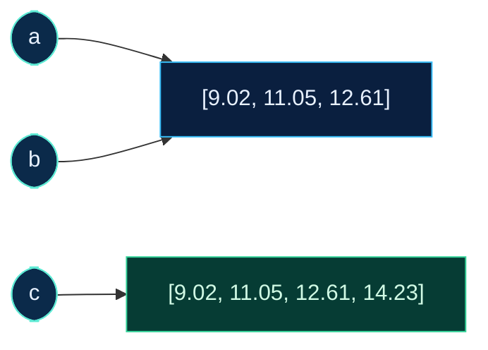

<!--
Parked slides from slides/06_Python_Foundations.md, taken out on 2026-10-06.

They left the deck when it was reworked to open on the handed-out script
scripts/clean_pendulum.py (run in Seminar 4) and to read its clean() line by
line, so that the deck stays inside the 105-145 min band. The format-on-save
part of "The Editor Does the Typing" is now one sentence on the PEP 8 slide;
the notebook paragraph and the links of "Read More" are on the workbook page
lecture_6.md. This file is not in decks.json: it is not built, not gated and
not deployed. A comment before each slide says where it stood. To restore
one, move it back into the lecture file.
-->

<!-- Parked 2026-10-06 from Lecture 06, slide 4, between 'Learning Objectives' and the section 'Running Python': replaced by the opening slide 'The Script from Seminar 4' -->

---
hideInToc: true
---

# Why **Python**

<div class="grid-2 gap-md mt-md">

<div class="card card-primary card-glass pad-compact">

## 🔬 **At CERN**

At ATLAS, CMS, ALICE and LHCb the analysis is written in Python: selecting candidates, filling histograms, fitting, plotting. The libraries underneath are C++. Python is the layer that people type.

</div>

<div class="card card-secondary card-glass pad-compact">

## 🗺️ **Other languages**

R for statistics. C++, Julia and Rust for speed. SQL for databases. Values, types, loops and functions exist in each of them under another spelling. What is learned here carries over.

</div>

<div class="card card-warning card-glass pad-compact">

## 🖱️ **A calculation by clicking**

A spreadsheet shows the result and not the steps. Nobody can see which cells were dragged, and the work cannot be run again on a new file.

</div>

<div class="card card-success card-glass pad-compact">

## 📄 **A calculation as a script**

A script is a text file that states every step. It runs again with one command, gives the same result on Windows, macOS and Linux, and goes into Git next to the README.

</div>

</div>

<!--
Speaker: the reason for a language is the bottom row. A script is the record
of the calculation, in the same way as the README is the record of the data.
Python is free and open source. (~2 min)
-->


<!-- Parked 2026-10-06 from Lecture 06, section 'Code That Can Be Read', after 'PEP 8: One Style for Everyone': format on save moved into the PEP 8 slide -->

---
hideInToc: true
---

# The Editor Does the **Typing**

<div class="grid-3 gap-md mt-md">

<div class="card card-primary card-glass pad-compact">

## ⌨️ **Completion**

Type `per` and a list offers `period_s`. `Tab` accepts it. `Ctrl+Space` opens the list at any time.

A name that was completed is not misspelled.

</div>

<div class="card card-secondary card-glass pad-compact">

## 🧩 **Snippets**

A short word that expands into lines you often type. Command Palette, **Snippets: Configure Snippets**, then `python`.

Example: `hdr` for the first comment lines of a script.

</div>

<div class="card card-accent card-glass pad-compact">

## 🧹 **Format on save**

Install the extension **Black Formatter**. **Format Document** is `Shift+Alt+F` (macOS `Shift+Option+F`).

The setting **Editor: Format On Save** runs it at every save.

</div>

</div>

<div class="card card-info card-glass pad-compact mt-md">

⚙️ A formatter rewrites the layout of the file to PEP 8: spaces, quotes, line length. It does not change what the script does, and it does not choose names.

</div>

<!--
Speaker: show the formatter on a line typed without spaces, x=9.02/10. It
becomes x = 9.02 / 10 at the save. (~2 min)
-->


<!-- Parked 2026-10-06 from Lecture 06, section 'Code That Can Be Read', after 'The Editor Does the Typing', before the Recap: the notebook paragraph moved to lecture_6.md -->

---
hideInToc: true
---

# Script or **Notebook**

<div class="grid-2 gap-md mt-md">

<div class="card card-success card-glass pad-compact">

## 📜 **Script**, a `.py` file

- Plain text, run from top to bottom
- The same order at every run, so the same result
- Git shows what changed, line by line
- One command runs it: `python scripts/periods.py`

</div>

<div class="card card-primary card-glass pad-compact">

## 📓 **Notebook**, an `.ipynb` file

- Cells of code with their output and plots below each
- Cells can be run in any order, and the names of every earlier run stay
- A result may depend on a cell that was changed or deleted since
- Suited to trying things out

</div>

</div>

<div class="card card-info card-glass pad-compact mt-md">

This course writes scripts. A notebook is trusted once it gives the same output after **Restart** and **Run All**. That test is what a script passes every time it runs.

</div>

<!--
Speaker: some of the room know Jupyter. Nothing is wrong with it for a first
look at data. Work that someone has to run again goes into a script. (~2 min)
-->


<!-- Parked 2026-10-06 from Lecture 06, between the Recap and the section 'Check Yourself': the links moved to lecture_6.md -->

---
hideInToc: true
---

# Read **More**

<div class="grid-2 gap-md mt-md">

<div class="card card-primary card-glass pad-compact">

## 📖 **Python**

- [The Python Tutorial](https://docs.python.org/3/tutorial/), chapters 3 to 5: numbers, strings, lists, `if`, `for`, dictionaries
- [Built-in Functions](https://docs.python.org/3/library/functions.html): the full list, one paragraph each
- [String Methods](https://docs.python.org/3/library/stdtypes.html#string-methods)
- [PEP 8](https://peps.python.org/pep-0008/), the style guide

</div>

<div class="card card-secondary card-glass pad-compact">

## 🧰 **VS Code**

- [Getting Started with Python in VS Code](https://code.visualstudio.com/docs/python/python-tutorial)
- [Python debugging in VS Code](https://code.visualstudio.com/docs/python/debugging)
- [Snippets in VS Code](https://code.visualstudio.com/docs/editing/userdefinedsnippets)

</div>

</div>

<div class="card card-info card-glass pad-compact mt-md">

All of these are free. At the prompt, `help(round)` prints the description of a function, and `help(str)` lists every string method.

</div>

<!--
Speaker: the official tutorial covers everything of today in about an hour of
reading. (~1 min)
-->


<!--
Parked 2026-10-13 from Lecture 05 (until that day Lecture 06), when the lecturer
swapped weeks 5 and 6 and the deck was rebuilt on the weather project of
Lectures 01-04 (one line: write the program that computes 7.16 yourself).
Every slide below is the pendulum / LHCb version of 6 to 13 October 2026, in its
old order; the topics that stayed (running Python, types, names, strings, lists,
for, if, dict, f-strings, tracebacks, the debugger) were rewritten on weather.csv.
Not carried over: clean_pendulum.py read line by line, the 97 bytes rebuilt,
aliasing (a second name is not a copy), while and range, comprehensions,
tuples and sets, readable names and PEP 8, and the old quizzes.
-->

<!-- Parked 2026-10-13 from Lecture 05 (old deck), slide 2: 'The goal of this lecture is to **read and write a short Python program**: values and their' -->

---
hideInToc: true
layout: quote
---
# The goal of this lecture is to **read and write a short Python program**: values and their types, names, decisions, loops, lists and dictionaries, and what to do when the program stops with an error.

<!--
Speaker: the three running examples are the pendulum table, the LHCb file
and the short script that cleaned the pendulum table in Seminar 4. One line
of each file is turned into numbers, a loop does it for every row, and every
line of the script is read. (~1 min)
-->

<!-- Parked 2026-10-13 from Lecture 05 (old deck), slide 3: 'Learning **Objectives**' -->

---
hideInToc: true
---
# Learning **Objectives**

<div class="grid-2 gap-md mt-sm">

<div class="card card-primary card-glass pad-compact">

🐍 **Run** Python at the prompt, as a script in the terminal, and from VS Code

</div>

<div class="card card-secondary card-glass pad-compact">

🔢 Name the **type** of a value, `int`, `float`, `str` or `bool`, and say what `+` and `/` do with it

</div>

<div class="card card-accent card-glass pad-compact">

🏷️ Say what a **name** is, and why two names can stand for one list

</div>

<div class="card card-warning card-glass pad-compact">

✂️ Turn one line of a CSV file into **numbers**: strip, split, convert

</div>

<div class="card card-success card-glass pad-compact">

🔁 Repeat a step for every row with **`for`**, decide with **`if`**, skip with **`continue`**

</div>

<div class="card card-info card-glass pad-compact">

📖 Keep a row as a **dictionary**, and count with one

</div>

<div class="card card-primary card-glass pad-compact">

🖨️ Print numbers with **f-strings**: decimals, widths, columns

</div>

<div class="card card-secondary card-glass pad-compact">

🧭 Read a **traceback** from the bottom, and find a bug with `print` and with the **debugger**

</div>

</div>

<!--
Speaker: eight abilities, in the order of the lecture. Functions are called
today and not written. (~1 min)
-->

<!-- Parked 2026-10-13 from Lecture 05 (old deck), slide 4: 'The Script from **Seminar 4**' -->

---
hideInToc: true
---
# The Script from **Seminar 4**

<div class="card card-info card-glass pad-compact mt-sm">

```text
% python3 scripts/clean_pendulum.py data/raw/pendulum.csv data/processed/pendulum_script.csv
PS> python scripts/clean_pendulum.py data/raw/pendulum.csv data/processed/pendulum_script.csv
9 rows written to data/processed/pendulum_script.csv
```

</div>

<div class="grid-2 gap-md mt-sm" style="grid-template-columns: 3fr 2fr;">

<div class="card card-primary card-glass pad-compact">

## 📜 **`scripts/clean_pendulum.py`, lines 25–32**

```python {*}{lines:true,startLine:25}
def clean(lines):
    out = []
    for line in lines:
        if "mean" in line:
            continue
        line = line.replace(",", ".").replace(";", ",")
        out.append(line.split(",", 1)[1])
    return out
```

</div>

<div class="card card-success card-glass pad-compact">

## ✅ **What was checked**

The output has 97 bytes and the SHA-256 `be05af03…fff0870b` on every laptop: the size and checksum that Lecture 04 wrote into the README for the pendulum table.

</div>

</div>

<div class="card card-warning card-glass pad-compact mt-sm">

❓ The script was run and checked, and not read. What does each of these eight lines do?

</div>

<!--
Speaker: open scripts/clean_pendulum.py in VS Code. Seminar 4 ran it once
the installation worked; on a laptop where it failed, the run was on the
projector. Lecture 04 matched four of these lines to the four edits of the
README; nobody read the words. Leave the question on the screen. (~2 min)
-->

<!-- Parked 2026-10-13 from Lecture 05 (old deck), slide 5: 'Running **Python**' -->

---
layout: section
hideInToc: true
---
# Running **Python**

The script was started by one line typed at the shell's prompt. The first word of that line is a program, and the program has a prompt of its own.

<!--
Speaker: everything in this section is done live in VS Code beside the slides.
(~1 min)
-->

<!-- Parked 2026-10-13 from Lecture 05 (old deck), slide 6: 'Python Is a **Program**' -->

---
hideInToc: true
---
# Python Is a **Program**

<div class="grid-2 gap-md mt-md">

<div class="card card-primary card-glass pad-compact">

## 🍎 **macOS · zsh**

```text
% python3 --version
Python 3.13.9
```

</div>

<div class="card card-secondary card-glass pad-compact">

## 🪟 **Windows · PowerShell**

```text
PS> python --version
Python 3.13.9
```

</div>

</div>

<div class="grid-2 gap-md mt-md">

<div class="card card-accent card-glass pad-compact">

## ⚙️ **What it does**

- `python3` or `python` is a program, the **interpreter**, started by the shell like `ls` in Lecture 04
- It reads Python text one statement at a time and carries each one out

</div>

<div class="card card-info card-glass pad-compact">

## 📄 **Two ways in**

Typed at its prompt, one line at a time, or written into a file. These slides write `python`; on macOS type `python3`. Every block here ran with Python 3.13.

</div>

</div>

<!--
Speaker: Seminar 4 checked the version once the installation was done; run
it again live. Another 3.x number is fine; an older version may word a
message slightly differently. Lecture 03 called a list of exact steps an algorithm: a Python
program is an algorithm in a form this program can read. If a laptop answers
"command not found", its owner follows in the browser today and shows the
message afterwards. (~2 min)
-->

<!-- Parked 2026-10-13 from Lecture 05 (old deck), slide 7: 'The `>>>` **Prompt**' -->

---
hideInToc: true
---
# The `>>>` **Prompt**

<div class="grid-2 gap-md mt-sm">

<div class="card card-primary card-glass pad-compact">

## 🍎 **macOS · zsh**

```text
% python3
>>> 9.02 / 10
0.9019999999999999
>>> exit()
%
```

</div>

<div class="card card-secondary card-glass pad-compact">

## 🪟 **Windows · PowerShell**

```text
PS> python
>>> 9.02 / 10
0.9019999999999999
>>> exit()
PS>
```

</div>

</div>

<div class="card card-accent card-glass pad-compact table-compact mt-sm">

## 🔀 **The same line at another prompt**

| Typed at | `9.02 / 10` | `python3 scripts/period.py` |
| --- | --- | --- |
| `%`, zsh | `zsh: command not found: 9.02` | runs the script |
| `PS>`, PowerShell | `0.902` | runs it, typed with `python` |
| `>>>`, Python | `0.9019999999999999` | `SyntaxError: invalid syntax` |

</div>

<div class="note-text mt-sm">The mark says who reads the line: <code>%</code> and <code>PS&gt;</code> the shell, <code>&gt;&gt;&gt;</code> Python. PowerShell divides by itself and prints 15 digits; <code>(9.02 / 10) -eq 0.902</code> still answers False.</div>

<!--
Speaker: type it live in both shells. Lecture 04 read the prompt of the
shell; >>> is the third prompt, and exit() hands the line back to the shell.
Ask the room what the first slip will be: a shell command typed at >>>, or
Python typed at %. Say only that the long decimals of 0.902 are
expected. The PowerShell 0.902 is the same
float shown with fewer digits. (~3 min)
-->

<!-- Parked 2026-10-13 from Lecture 05 (old deck), slide 8: 'The First **Script**' -->

---
hideInToc: true
---
# The First **Script**

<div class="grid-2 gap-md mt-md">

<div class="card card-primary card-glass pad-compact">

## 📄 **A file: `scripts/period.py`**

```python
length_cm = 20
t10_s = 9.02
period_s = t10_s / 10
print(period_s)
```

</div>

<div class="card card-secondary card-glass pad-compact">

## ▶️ **Run from the project folder**

```text
% python3 scripts/period.py
0.9019999999999999

PS> python scripts/period.py
0.9019999999999999
```

</div>

</div>

<div class="card card-info card-glass pad-compact mt-md">

A script is a text file whose name ends in `.py`. It holds the lines that would be typed at `>>>`, and tomorrow it gives the same result. `scripts/period.py` is a relative path (Lecture 04): the line works where the prompt shows the project folder. The numbers are the first row of the pendulum table: 20 cm, 10 swings in 9.02 s.

</div>

<!--
Speaker: write the file live next to hello.py from Seminar 4 and run it.
This is the shape of the line that ran clean_pendulum.py. (~2 min)
-->

<!-- Parked 2026-10-13 from Lecture 05 (old deck), slide 9: 'A Script Runs **Top to Bottom**' -->

---
hideInToc: true
---
# A Script Runs **Top to Bottom**

<div class="card card-primary card-glass pad-compact table-compact mt-sm">

| Line of `period.py` | What Python does | Names after the line |
| --- | --- | --- |
| `length_cm = 20` | Makes the value 20 and gives it the name `length_cm` | `length_cm` |
| `t10_s = 9.02` | Makes the value 9.02 and gives it the name `t10_s` | `length_cm`, `t10_s` |
| `period_s = t10_s / 10` | Looks up `t10_s`, divides by 10, names the result | `length_cm`, `t10_s`, `period_s` |
| `print(period_s)` | Looks up `period_s` and writes it to the terminal | the same three |

</div>

<div class="grid-2 gap-md mt-md">

<div class="card card-secondary card-glass pad-compact">

## ⬇️ **One line after another**

A line can use only the names made above it. With `print(period_s)` moved to line 1 the script stops at once: `NameError: name 'period_s' is not defined`.

</div>

<div class="card card-accent card-glass pad-compact">

## 🖨️ **Only `print` shows something**

The prompt prints every value by itself. A script prints nothing unless it calls `print`. A `#` starts a comment: Python skips the rest of that line.

</div>

</div>

<!--
Speaker: read the table as the interpreter would, line by line. (~2 min)
-->

<!-- Parked 2026-10-13 from Lecture 05 (old deck), slide 10: 'Try It — The First **Script**' -->

---
hideInToc: true
---
# Try It — The First **Script**

```py {monaco-run} {autorun:false}
# The first row of the pendulum table: 20 cm, 10 swings in 9.02 s
length_cm = 20
t10_s = 9.02
period_s = t10_s / 10
print(period_s)          # 0.9019999999999999
```

<div class="card card-info card-glass pad-compact mt-sm">

1. Run it with the play button.
2. Change `t10_s` to `11.05`, the row for 30 cm. It prints `1.105`.
3. Move the `print` line up to line 2 and run again. Read the last line of the message.

</div>

<!--
Speaker: step 3 is the first traceback of the course, made on purpose. The
last line names the problem: the name does not exist yet at that point. (~2 min)
-->

<!-- Parked 2026-10-13 from Lecture 05 (old deck), slide 11: 'Python in **VS Code**' -->

---
hideInToc: true
---
# Python in **VS Code**

<div class="grid-2 gap-md mt-md">

<div class="card card-primary card-glass pad-compact">

## 🧩 **The Python extension**

- Extensions view: `Ctrl+Shift+X` (macOS `Cmd+Shift+X`). Search `Python`, publisher Microsoft, **Install**
- Colours for the parts of the code, and a list of names to complete while typing
- A wavy line under a name that was never made, before the script runs
- The version of Python in the Status Bar. A click on it selects another one

</div>

<div class="card card-secondary card-glass pad-compact">

## ▶️ **Three ways to run**

- **In the terminal:** `python3 scripts/period.py` on macOS, `python scripts/period.py` on Windows. This is the form that goes into a README
- **Run Python File**, the ▶ at the top right of the Editor. VS Code types the same command, with absolute paths
- **`Shift+Enter`** on a line. That line is sent to a prompt in the terminal

</div>

</div>

<div class="card card-warning card-glass pad-compact mt-md">

⚠️ The extension contains no Python. It uses the Python that is installed on the laptop. The terminal runs the file as it is saved: a dot on the tab means that the last changes are not in the file yet.

</div>

<!--
Speaker: install the extension live and run period.py in all three ways. Point
at the command that the ▶ button types: the absolute paths of Lecture 04,
/Users/smilte/... on a Mac and C:\Users\smilte\... on Windows, so it runs from any
folder. The relative form is the one that works on every laptop. (~3 min)
-->

<!-- Parked 2026-10-13 from Lecture 05 (old deck), slide 12: 'Values, Types & **Names**' -->

---
layout: section
hideInToc: true
---
# Values, Types & **Names**

The script printed 0.9019999999999999 for 9.02 / 10. Every value it makes has a type, and the type decides what an operation does with it.

<!--
Speaker: Lecture 03 built integers, floats and text from bits. Python has
the same three, and the long decimals come from the float. (~1 min)
-->

<!-- Parked 2026-10-13 from Lecture 05 (old deck), slide 13: 'Every Value Has a **Type**' -->

---
hideInToc: true
---
# Every Value Has a **Type**

<div class="grid-2 gap-md mt-md">

<div class="card card-primary card-glass pad-compact table-compact">

## 🧱 **Four types**

| Type | Example | Holds |
| --- | --- | --- |
| `int` | `20` | a whole number |
| `float` | `9.02` | a number with a fraction |
| `str` | `"9.02"` | text, between quotes |
| `bool` | `True` | `True` or `False` |

</div>

<div class="card card-secondary card-glass pad-compact">

## 🔎 **Ask with `type`**

```python
type(20)        # <class 'int'>
type(9.02)      # <class 'float'>
type("9.02")    # <class 'str'>
20 + 20         # 40
"20" + "20"     # '2020'
```

</div>

</div>

<div class="card card-info card-glass pad-compact mt-md">

The type decides what an operation does: `+` adds two numbers and joins two texts. Lecture 03 showed it for bytes: the same bits are different values under different types. `9.02` and `"9.02"` look alike on the screen. The first is a number, the second is four characters.

</div>

<!--
Speaker: type the five lines at the prompt. The quotes are the difference
between a number and its text, and most errors of a first data script come
from mixing the two. (~2 min)
-->

<!-- Parked 2026-10-13 from Lecture 05 (old deck), slide 14: '`int`: No Fixed **Width**' -->

---
hideInToc: true
---
# `int`: No Fixed **Width**

<div class="card card-info card-glass pad-compact mt-sm">

In Lecture 03 an 8-bit integer held −128 to 127, and 127 + 1 wrapped round to −128. A Python `int` takes as many bits as the number needs. It does not overflow.

</div>

```py {monaco-run} {autorun:false}
print(127 + 1)                   # 128
print(2 ** 64)                   # 18446744073709551616
print((2 ** 64).bit_length())    # 65: one bit more than a 64-bit integer has
print(2 ** 200)                  # 61 digits, every one of them exact
```

<div class="note-text mt-sm">The price is memory and speed. Files and large tables of numbers keep fixed widths: the original of the data file stores each value in 4 bytes.</div>

<!--
Speaker: ** is the power operator. Ask what an int64 would do at 2 to the 64:
it would wrap to 0. Python counts on. (~2 min)
-->

<!-- Parked 2026-10-13 from Lecture 05 (old deck), slide 15: '`float`: The float64 of **Lecture 03**' -->

---
hideInToc: true
---
# `float`: The float64 of **Lecture 03**

<div class="grid-2 gap-md mt-md">

<div class="card card-primary card-glass pad-compact">

## 🧮 **At the prompt**

```python
9.02 / 10           # 0.9019999999999999
0.1 + 0.2           # 0.30000000000000004
0.1 + 0.2 == 0.3    # False
1e16 + 1            # 1e+16
6.022e23            # 6.022e+23
```

</div>

<div class="card card-secondary card-glass pad-compact">

## 📐 **Why**

- A Python `float` has 64 bits: 53 binary digits, about 16 decimal digits
- 9.02 has no exact binary form, like 0.1. The stored number is its nearest neighbour, and the division shows the difference
- Near 10¹⁶ the step from one float to the next is 2. Adding 1 changes nothing
- `e` writes a power of ten

</div>

</div>

<div class="card card-warning card-glass pad-compact mt-md">

⚠️ Two floats are not compared with `==`. They are compared with a tolerance: `abs(a - b) < 1e-9`. The long decimals are not an error of the script. They are cut for the reader when the number is printed, and kept in the calculation.

</div>

<!--
Speaker: 0.9019999999999999 was on the screen since the >>> prompt. Now it
has a reason: the multiply-by-2 slide of Lecture 03. Nothing is wrong with the
measurement or with Python. PowerShell's 0.902 was this float cut to 15
digits for the reader, which is the last sentence of the bottom card. (~2 min)
-->

<!-- Parked 2026-10-13 from Lecture 05 (old deck), slide 16: '**Arithmetic**' -->

---
hideInToc: true
---
# **Arithmetic**

<div class="grid-2 gap-md mt-md">

<div class="card card-primary card-glass pad-compact table-compact">

## ➗ **Operators**

| Expression | Value | |
| --- | --- | --- |
| `20 + 9.02` | `29.02` | an `int` with a `float` gives a `float` |
| `20 / 100` | `0.2` | `/` always gives a `float` |
| `10 / 2` | `5.0` | also when it divides evenly |
| `7 // 2` | `3` | whole part of the division |
| `7 % 2` | `1` | remainder |
| `2 ** 10` | `1024` | power |

</div>

<div class="card card-secondary card-glass pad-compact">

## 🪜 **Order**

```python
2 + 3 * 4        # 14
(2 + 3) * 4      # 20
-2 ** 2          # -4
20 / 100 ** 2    # 0.002
```

`**` comes first, then `*`, `/`, `//` and `%`, then `+` and `-`. Brackets change the order, and they cost nothing when in doubt.

</div>

</div>

<div class="card card-info card-glass pad-compact mt-md">

`7 // 2` and `7 % 2` answer two questions about 7 swings counted in pairs: 3 full pairs, 1 swing left over. Together they give the 7 back: 3&nbsp;×&nbsp;2&nbsp;+&nbsp;1.

</div>

<!--
Speaker: the two surprises are / giving a float for 10 / 2, and the minus sign
binding less tightly than the power. (~2 min)
-->

<!-- Parked 2026-10-13 from Lecture 05 (old deck), slide 17: '**Names**' -->

---
hideInToc: true
---
# **Names**

<div class="grid-2 gap-md mt-md">

<div class="card card-primary card-glass pad-compact">

## 🏷️ **`name = value`**

```python
t10_s = 9.02
period_s = t10_s / 10
t10_s = 11.05
print(period_s)      # 0.9019999999999999
```

The right side is worked out first. Then the name is put on the result. Line 3 moves the name `t10_s` to a new value. `period_s` is not touched: it names a number, not a formula.

</div>

<div class="card card-secondary card-glass pad-compact">

## 📌 **After line 3**

```text
t10_s     ───▶  11.05
period_s  ───▶  0.9019999999999999
                9.02     no name left
```

- `=` is not the equals sign of mathematics. `n = n + 1` adds one to `n`
- A name has letters, digits and `_`, and no digit first. `T10_s` and `t10_s` are two names

</div>

</div>

<div class="card card-info card-glass pad-compact mt-md">

A name with its value is called a **variable**. The type belongs to the value: after `x = 20`, `x = "twenty"` is allowed.

</div>

<!--
Speaker: for the Excel users. A cell with =A1/10 follows A1. A Python name
does not follow anything: line 2 ran once, with the value t10_s had then. To
get the new period, line 2 has to run again. (~3 min)
-->

<!-- Parked 2026-10-13 from Lecture 05 (old deck), slide 18: 'Calling a **Function**' -->

---
hideInToc: true
---
# Calling a **Function**

<div class="grid-2 gap-md mt-md">

<div class="card card-primary card-glass pad-compact">

## 📞 **Built in**

```python
len("M,PT,TAU,IPCHI2")          # 15
round(0.9019999999999999, 3)    # 0.902
abs(-100.0)                     # 100.0
max(9.02, 11.05)                # 11.05
"m,pt".upper()                  # 'M,PT'
```

A call is a name, brackets, and the **arguments** between them. The function hands back a value. `upper` is a **method**: a function that belongs to a value and is written after a dot.

</div>

<div class="card card-secondary card-glass pad-compact">

## 📦 **From a module**

```python
import math

math.sqrt(2)      # 1.4142135623730951
math.pi           # 3.141592653589793
```

`import math` makes the functions of the module `math` available under the prefix `math.`

</div>

</div>

<div class="card card-info card-glass pad-compact mt-md">

`round(9.02 / 10, 3)` is worked out from the inside: first the argument, 9.02 / 10 = 0.9019999999999999, then the call, which hands back `0.902`. `print` writes to the terminal and hands back nothing.

</div>

<!--
Speaker: a function is used here as a ready-made tool. Read the call aloud:
"round of 9.02 over 10, to 3 places". clean_pendulum.py calls replace,
split and append the same way, as methods after a dot. (~2 min)
-->

<!-- Parked 2026-10-13 from Lecture 05 (old deck), slide 19: '`str`: Unicode **Text**' -->

---
hideInToc: true
---
# `str`: Unicode **Text**

<div class="card card-info card-glass pad-compact mt-sm">

A `str` is a sequence of Unicode characters. `len` counts characters. The bytes of Lecture 03 appear when the text is encoded for a file.

</div>

```py {monaco-run} {autorun:false}
word = "ąžuolas"
print(len(word))                     # 7 characters
print(len(word.encode("utf-8")))     # 9 bytes: ą and ž take two bytes each
print(ord("ą"), hex(ord("ą")))       # 261 0x105: the code point U+0105
print("ą".encode("utf-8"))           # b'\xc4\x85': the two bytes C4 85
print(len("20,9.02\n"))              # 8: \n is one character, the line break
```

<div class="note-text mt-sm">Single and double quotes make the same string. Inside quotes, \n stands for the line break, byte 0A.</div>

<!--
Speaker: the same ą that was encoded by hand in Lecture 03: code point
U+0105, packed by UTF-8 into the two bytes C4 85, both on the slide. Python
keeps characters and bytes apart as two types, str and bytes. (~2 min)
-->

<!-- Parked 2026-10-13 from Lecture 05 (old deck), slide 20: '`bool`: **Comparisons**' -->

---
hideInToc: true
---
# `bool`: **Comparisons**

<div class="grid-2 gap-md mt-md">

<div class="card card-primary card-glass pad-compact">

## ⚖️ **Compare**

```python
t10_s = 9.02
t10_s > 9          # True
t10_s == 9.02      # True
t10_s != 9.02      # False
9 < t10_s < 10     # True
"20" == 20         # False
```

</div>

<div class="card card-secondary card-glass pad-compact">

## 🔗 **Combine**

```python
m = 1880.649
m > 1855 and m < 1875    # False
m < 1855 or m > 1875     # True
not m > 1855             # False
"TAU" in "M,PT,TAU"      # True
```

</div>

</div>

<div class="card card-info card-glass pad-compact mt-md">

`=` puts a name on a value. `==` asks whether two values are equal and answers with a `bool`.<br>A text is never equal to a number: `"20" == 20` is `False`, with no error and no warning.<br>`1880.649` is the mass in the first row of the LHCb file, 15.8&nbsp;MeV/c² above the D⁰ mass of 1864.84.

</div>

<!--
Speaker: = against == is the classic slip. The last comparison of the left
card is the dangerous one, because it fails silently. The `in` of the last
line on the right is line 28 of clean_pendulum.py: "mean" in line. (~2 min)
-->

<!-- Parked 2026-10-13 from Lecture 05 (old deck), slide 21: 'From Text to **Number**' -->

---
hideInToc: true
---
# From Text to **Number**

<div class="grid-2 gap-md mt-md" style="grid-template-columns: 2fr 3fr;">

<div class="card card-primary card-glass pad-compact">

## 🔁 **The type name converts**

```python
float("9.02")     # 9.02
int("20")         # 20
str(20)           # '20'
int(9.99)         # 9, cut off
round(9.99)       # 10
"20" + "9.02"     # '209.02'
"20" * 3          # '202020'
```

</div>

<div class="card card-warning card-glass pad-compact">

## 💥 **What cannot be converted**

- `float("9,02")`<br>`ValueError: could not convert string to float: '9,02'`
- `int("9.02")`<br>`ValueError: invalid literal for int() with base 10: '9.02'`
- `"20" + 9.02`<br>`TypeError: can only concatenate str (not "float") to str`

</div>

</div>

<div class="card card-info card-glass pad-compact mt-md">

**A file holds text. A value becomes a number only by a step the script states, and a wrong step often gives no message.** `float` accepts a decimal point only, so `9,02` is repaired first: line 30 of `clean_pendulum.py` does that.

</div>

<!--
Speaker: the last two lines of the left card are the reason this slide exists.
Text plus text is longer text, with no error. Read the bold sentence aloud:
it is the claim of this lecture. (~3 min)
-->

<!-- Parked 2026-10-13 from Lecture 05 (old deck), slide 22: 'Strings & **Lists**' -->

---
layout: section
hideInToc: true
---
# Strings & **Lists**

`float("9.02")` converts one value. A line of `D0_KPi.csv` holds four, as one string with commas between them; cut at the commas, it is a list.

<!--
Speaker: the central recipe of the lecture: one line of a CSV file becomes
four numbers. (~1 min)
-->

<!-- Parked 2026-10-13 from Lecture 05 (old deck), slide 23: 'Index and **Slice**' -->

---
hideInToc: true
---
# Index and **Slice**

```python
line = "1880.649,3000.9534,0.00041271152,1299.1675"     # line 2 of D0_KPi.csv
```

<div class="grid-2 gap-md mt-sm">

<div class="card card-primary card-glass pad-compact">

## 👉 **One character**

```text
 1  8  8  0  .  6  4  9  ,  3  0  …
 0  1  2  3  4  5  6  7  8  9 10  …
```

```python
len(line)     # 42
line[0]       # '1'
line[8]       # ','
line[-1]      # '5', the last one
```

</div>

<div class="card card-secondary card-glass pad-compact">

## ✂️ **A piece**

```python
line[0:8]     # '1880.649'
line[:8]      # '1880.649'
line[9:18]    # '3000.9534'
line[-9:]     # '1299.1675'
```

`[start:stop]` takes the characters from `start` up to, and not including, `stop`. Its length is stop − start.

</div>

</div>

<div class="card card-info card-glass pad-compact mt-sm">

Positions count from 0, so the last of 42 characters has the index 41. In the file the line takes 43 bytes: 42 characters, one byte each, and the line break `0A`.<br>`line[42]` stops with `IndexError: string index out of range`. A string cannot be changed: `line[0] = "2"` is a `TypeError`.

</div>

<!--
Speaker: draw the positions between the characters on the board: a slice
cuts at two of them. The 43 bytes are digits, points and commas, all ASCII,
so characters and bytes count alike here; the ą of the str slide was the
case where they do not. (~3 min)
-->

<!-- Parked 2026-10-13 from Lecture 05 (old deck), slide 24: 'String **Methods**' -->

---
hideInToc: true
---
# String **Methods**

<div class="grid-2 gap-md mt-md">

<div class="card card-primary card-glass pad-compact">

## 🧰 **Six of them**

```python
"20,9.02\n".strip()            # '20,9.02'
"20,9.02".split(",")           # ['20', '9.02']
"1,20,9.02".split(",", 1)      # ['1', '20,9.02']
"9,02".replace(",", ".")       # '9.02'
"t10_s".startswith("t10")      # True
";".join(["1", "20", "9,02"])  # '1;20;9,02'
```

</div>

<div class="card card-secondary card-glass pad-compact">

## 🔁 **Two replacements, in this order**

```python
raw = "1;20;9,02"
a = raw.replace(",", ".")     # '1;20;9.02'
b = a.replace(";", ",")       # '1,20,9.02'
```

In the other order the result is `'1.20.9.02'`. The decimal comma goes first, as in the Find and Replace of Lecture 02. Line 30 of `clean_pendulum.py` is these two lines in one.

</div>

</div>

<div class="card card-info card-glass pad-compact mt-md">

A method hands back a **new** string: `raw` is still `'1;20;9,02'`. `strip` removes spaces and line breaks at both ends. `split` cuts at the separator; with a second argument, `1`, it cuts once, which is how line 31 drops the column `nr`.

</div>

<!--
Speaker: the right card is the repair of the raw pendulum file as two lines of
code, and line 30 of the script writes them as one:
line.replace(",", ".").replace(";", ","), the second method called on the
result of the first. The order argument is the same as in the editor. (~3 min)
-->

<!-- Parked 2026-10-13 from Lecture 05 (old deck), slide 25: '**Lists**' -->

---
hideInToc: true
---
# **Lists**

<div class="grid-2 gap-md mt-md">

<div class="card card-primary card-glass pad-compact">

## 📋 **Items in order**

```python
t10 = [9.02, 11.05, 12.61]
len(t10)             # 3
t10[0]               # 9.02
t10[1:]              # [11.05, 12.61]
t10.append(14.23)    # now 4 items
t10[0] = 9.03        # the first item replaced
sum(t10)             # 46.92
max(t10)             # 14.23
```

</div>

<div class="card card-secondary card-glass pad-compact">

## 🔀 **Two ways to sort**

```python
x = [12.61, 9.02, 11.05]
sorted(x)    # [9.02, 11.05, 12.61], a new list
x.sort()     # x itself is now sorted
```

`x.sort()` hands back `None`. Writing `x = x.sort()` loses the list.

</div>

</div>

<div class="card card-info card-glass pad-compact mt-md">

A list is indexed and sliced like a string. Unlike a string it **can be changed** in place: `append`, `sort` and `t10[0] = …` alter the list itself. Its items may have any type, and a list of lists is a table.

</div>

<!--
Speaker: square brackets make a list. The difference from a string that
matters is the last card: a list changes in place. out = [] and out.append(...) are lines 26
and 31 of clean_pendulum.py: an empty list, then one item per row. (~2 min)
-->

<!-- Parked 2026-10-13 from Lecture 05 (old deck), slide 26: 'Turn a Line of `D0_KPi.csv` into **Numbers**' -->

---
hideInToc: true
---
# Turn a Line of `D0_KPi.csv` into **Numbers**

```python
line = "1880.649,3000.9534,0.00041271152,1299.1675\n"
clean = line.strip()          # '1880.649,3000.9534,0.00041271152,1299.1675'
parts = clean.split(",")      # ['1880.649', '3000.9534', '0.00041271152', '1299.1675']
m = float(parts[0])           # 1880.649
pt = float(parts[1])          # 3000.9534
tau = float(parts[2])         # 0.00041271152
ipchi2 = float(parts[3])      # 1299.1675
print(m - 1865)               # 15.648999999999887
```

<div class="grid-3 gap-md mt-sm">

<div class="card card-primary card-glass pad-compact">

## 1️⃣ **Strip**

The line break at the end goes. 43 characters become 42.

</div>

<div class="card card-secondary card-glass pad-compact">

## 2️⃣ **Split**

One string becomes a list of four strings. The commas are gone.

</div>

<div class="card card-accent card-glass pad-compact">

## 3️⃣ **Convert**

Each string becomes a `float`. Arithmetic works on it.

</div>

</div>

<div class="note-text mt-sm">Before the conversion, <code>parts[0] - 1865</code> stops with: TypeError: unsupported operand type(s) for -: 'str' and 'int'.</div>

<!--
Speaker: the centre of the lecture. Type it live in scripts/parse_line.py and
print after every line. The four names are the four columns of the header:
M, PT, TAU, IPCHI2. (~4 min)
-->

<!-- Parked 2026-10-13 from Lecture 05 (old deck), slide 27: 'Try It — Parse **Another Line**' -->

---
hideInToc: true
---
# Try It — Parse **Another Line**

```py {monaco-run} {autorun:false}
line = "1818.1002,2978.644,-100.0,9901.186\n"     # line 343 of D0_KPi.csv
parts = line.strip().split(",")
m = float(parts[0])
tau = float(parts[2])
print(parts)
print(m, tau)
print(tau == -100)        # True: this row has no decay time
```

<div class="card card-info card-glass pad-compact mt-sm">

1. Run it. Two methods are chained: `strip` first, then `split` on its result.
2. Change `parts[2]` to `parts[4]` and read the last line of the message.
3. Write the mass with a decimal comma, `1818,1002`, and run again. There is no error. Which number is now `tau`?

</div>

<!--
Speaker: step 3 is the decimal comma of Lecture 02 once more. The split makes
five parts, m is 1818.0 and tau is 2978.644: wrong numbers, no message, the
bold sentence of From Text to Number. (~3 min)
-->

<!-- Parked 2026-10-13 from Lecture 05 (old deck), slide 28: 'A Second Name Is Not a **Copy**' -->

---
hideInToc: true
---
# A Second Name Is Not a **Copy**

<div class="grid-2 gap-md mt-md">

<div class="card card-primary card-glass pad-compact">

## 👥 **`b = a` copies nothing**

```python
a = [9.02, 11.05]
b = a
b.append(12.61)
print(a)       # [9.02, 11.05, 12.61]

c = a.copy()
c.append(14.23)
print(a)       # [9.02, 11.05, 12.61]
```

</div>

<div class="card card-secondary card-glass pad-compact">

## 📌 **Names and objects**



</div>

</div>

<div class="card card-info card-glass pad-compact mt-md">

A value in memory is an **object**. `b = a` puts a second name on the same object. A change made through `b` is seen through `a`, because there is one list. `a.copy()` makes a second list. Numbers and strings cannot be changed, so two names on one of them never show.

</div>

<!--
Speaker: this is the Names slide again, with an object that can change. Ask
the room for the output of the first print before running it. (~3 min)
-->

<!-- Parked 2026-10-13 from Lecture 05 (old deck), slide 29: 'Decisions & **Loops**' -->

---
layout: section
hideInToc: true
---
# Decisions & **Loops**

One line became four numbers. The pendulum table has nine rows and `D0_KPi.csv` 91 583, so the steps for one line have to run once for each line, and skip some.

<!--
Speaker: with for and if a script stops being a calculator. (~1 min)
-->

<!-- Parked 2026-10-13 from Lecture 05 (old deck), slide 30: '`if`: Run a Block or **Skip It**' -->

---
hideInToc: true
---
# `if`: Run a Block or **Skip It**

<div class="grid-2 gap-md mt-md">

<div class="card card-primary card-glass pad-compact">

## 🔀 **One of three blocks**

```python
tau = -100.0
if tau == -100:
    print("decay time missing")
elif tau < 0:
    print("negative: check the file")
else:
    print("decay time", tau)
```

It prints `decay time missing`.

</div>

<div class="card card-secondary card-glass pad-compact">

## 📐 **The rules**

- The condition is a `bool`. The line ends with `:`
- The block is the lines below it that are indented by 4 spaces
- The conditions are tried from the top. The first true one runs its block, and the rest are skipped
- `elif` and `else` can be left out

</div>

</div>

<div class="card card-warning card-glass pad-compact mt-md">

⚠️ The indentation is part of the language. Without it Python stops before the first line runs:<br>`IndentationError: expected an indented block after 'if' statement on line 2`<br>VS Code indents by 4 spaces after a `:`, and when `Tab` is pressed.

</div>

<!--
Speaker: the LHCb file marks a missing decay time with -100. Lecture 04
counted 49 such rows, and Seminar 4 wrote data/processed/D0_valid.csv without
them. With tau = 0.00041271152 the same lines print
"decay time 0.00041271152". (~3 min)
-->

<!-- Parked 2026-10-13 from Lecture 05 (old deck), slide 31: '`for`: Once for **Each Item**' -->

---
hideInToc: true
---
# `for`: Once for **Each Item**

<div class="grid-2 gap-md mt-md">

<div class="card card-primary card-glass pad-compact">

## 🔁 **The loop**

```python
texts = ["9.02", "11.05", "12.61"]
periods = []
for text in texts:
    period_s = float(text) / 10
    periods.append(period_s)
print(periods)
```

It prints `[0.9019999999999999, 1.105, 1.261]`.

</div>

<div class="card card-secondary card-glass pad-compact table-compact">

## 🧾 **Turn by turn**

| Turn | `text` | `period_s` | Items in `periods` |
| --- | --- | --- | --- |
| 1 | `'9.02'` | `0.9019999999999999` | 1 |
| 2 | `'11.05'` | `1.105` | 2 |
| 3 | `'12.61'` | `1.261` | 3 |

</div>

</div>

<div class="card card-info card-glass pad-compact mt-md">

`for text in texts:` puts the name `text` on each item in turn and runs the indented block once for each. The block is written for **one** item. After the last item the script goes on with the first line that is not indented.

</div>

<!--
Speaker: walk the table with a finger on the code. The loop variable is an
ordinary name, moved by the loop. `periods = []` is an empty list. The same
shape is lines 26, 27 and 31 of clean_pendulum.py: out = [], for line in
lines:, out.append(...). (~3 min)
-->

<!-- Parked 2026-10-13 from Lecture 05 (old deck), slide 32: 'The Table as **Lines**' -->

---
hideInToc: true
---
# The Table as **Lines**

<div class="grid-2 gap-md mt-md">

<div class="card card-primary card-glass pad-compact">

## 📥 **The file, pasted**

```python
table = """length_cm,t10_s
20,9.02
30,11.05
40,12.61
50,14.23
60,15.49
70,16.84
80,17.90
90,19.10
100,20.01"""
lines = table.splitlines()
```

</div>

<div class="card card-secondary card-glass pad-compact">

## 📋 **A list of strings**

```python
len(lines)     # 10
lines[0]       # 'length_cm,t10_s'
lines[1]       # '20,9.02'
lines[-1]      # '100,20.01'
lines[1:3]     # ['20,9.02', '30,11.05']
```

- Three quotes open a string that runs over several lines
- `splitlines` cuts it at the line breaks
- `lines[1:]` is every line but the header

</div>

</div>

<div class="note-text mt-sm">The text between the quotes is data/processed/pendulum_script.csv, the file clean_pendulum.py wrote in Seminar 4, copied from the editor.</div>

<!--
Speaker: the table repaired on the projector at the end of Lecture 02 and by
the script in Seminar 4, now inside a script. Ten lines: one header and nine
rows. (~2 min)
-->

<!-- Parked 2026-10-13 from Lecture 05 (old deck), slide 33: 'The Period for **Every Row**' -->

---
hideInToc: true
---
# The Period for **Every Row**

<div class="grid-2 gap-md mt-md">

<div class="card card-primary card-glass pad-compact">

## 🔁 **Five lines**

```python
for line in lines[1:]:
    parts = line.split(",")
    length_cm = float(parts[0])
    period_s = float(parts[1]) / 10
    print(length_cm, period_s)
```

The block is the recipe of the last section, for one line: split, convert, compute. The loop applies it to each of the nine rows.

</div>

<div class="card card-secondary card-glass pad-compact">

## 🖥️ **It prints**

```text
20.0 0.9019999999999999
30.0 1.105
40.0 1.261
50.0 1.423
60.0 1.549
70.0 1.684
80.0 1.7899999999999998
90.0 1.9100000000000001
100.0 2.0010000000000003
```

</div>

</div>

<div class="card card-success card-glass pad-compact mt-md">

⚙️ The same five lines handle 9 rows and 91 583 rows. Four of the nine periods show their float64 digits.

</div>

<!--
Speaker: run it live in scripts/periods.py. A pendulum of 1 m has a period of
about 2 s: the last row is a check that the numbers are sensible. (~3 min)
-->

<!-- Parked 2026-10-13 from Lecture 05 (old deck), slide 34: 'A Sum in a **Loop**' -->

---
hideInToc: true
---
# A Sum in a **Loop**

```py {monaco-run} {autorun:false}
t10 = [9.02, 11.05, 12.61, 14.23, 15.49, 16.84, 17.90, 19.10, 20.01]

total = 0.0
for t in t10:
    total = total + t / 10       # the period of this row, added to the sum
mean = total / len(t10)

print(total)      # 13.625
print(mean)       # 1.5138888888888888
```

<div class="grid-2 gap-md mt-sm">

<div class="card card-primary card-glass pad-compact">

**The pattern:** a start value before the loop, an update inside it, the result after it. `total += t / 10` is the short form of the update.

</div>

<div class="card card-success card-glass pad-compact">

**The check:** the raw file has the line `;mean;15,14`, the one `clean()` skips: 15.14 s for 10 swings, so one swing is 1.514 s.

</div>

</div>

<!--
Speaker: Python has sum() for this. The loop is written out because the same
three places, before, inside and after, carry every count, sum, minimum and
maximum over a file. (~3 min)
-->

<!-- Parked 2026-10-13 from Lecture 05 (old deck), slide 35: '`while` and `range`' -->

---
hideInToc: true
---
# `while` and `range`

<div class="grid-2 gap-md mt-md">

<div class="card card-primary card-glass pad-compact">

## 🔄 **`while`: as long as**

```python
n = 0
while 2 ** n < 91583:
    n = n + 1
print(n)       # 17
```

How many bits number the 91 583 rows of the file? 2¹⁶ = 65 536 is too few. 2¹⁷ = 131 072 is enough.

</div>

<div class="card card-secondary card-glass pad-compact">

## 🔢 **`range`: counting**

```python
list(range(5))
# [0, 1, 2, 3, 4]
list(range(20, 101, 10))
# [20, 30, 40, 50, 60, 70, 80, 90, 100]
for i in range(1, 4):
    print(i, lines[i])
# 1 20,9.02
# 2 30,11.05
# 3 40,12.61
```

</div>

</div>

<div class="card card-warning card-glass pad-compact mt-md">

⚠️ `range(start, stop, step)` leaves out the stop, like a slice. A `while` whose condition never turns false runs without end: `Ctrl+C` in the terminal stops the script.

</div>

<!--
Speaker: for is for "each item", while is for "until". The while example is
the bit count of Lecture 03, found by trying. range(20, 101, 10) gives the
nine lengths of the pendulum table. (~2 min)
-->

<!-- Parked 2026-10-13 from Lecture 05 (old deck), slide 36: 'A List in **One Line**' -->

---
hideInToc: true
---
# A List in **One Line**

<div class="grid-2 gap-md mt-md">

<div class="card card-primary card-glass pad-compact">

## 🔁 **The loop**

```python
periods = []
for t in t10:
    periods.append(t / 10)
```

</div>

<div class="card card-accent card-glass pad-compact">

## ⚡ **The comprehension**

```python
periods = [t / 10 for t in t10]
```

Read it as: the list of `t / 10` for each `t` in `t10`.

</div>

</div>

<div class="card card-secondary card-glass pad-compact mt-md">

## 🎯 **With a condition, and on the parts of a line**

```python
slow = [t / 10 for t in t10 if t > 18]     # [1.9100000000000001, 2.0010000000000003]
values = [float(p) for p in parts]         # ['20', '9.02'] becomes [20.0, 9.02]
```

</div>

<div class="note-text mt-sm">A comprehension is for one short expression per item. A block of several steps stays a loop.</div>

<!--
Speaker: the last line is the convert step of the recipe for a line with any
number of columns. (~2 min)
-->

<!-- Parked 2026-10-13 from Lecture 05 (old deck), slide 37: 'Try It — Skip the **Missing Value**' -->

---
hideInToc: true
---
# Try It — Skip the **Missing Value**

```py {monaco-run} {autorun:false}
rows = """1880.649,3000.9534,0.00041271152,1299.1675
1860.6599,2803.4126,0.0001864154,0.34182164
1818.1002,2978.644,-100.0,9901.186
1913.8755,2542.169,0.00018464602,17.386473"""

n_ok = 0
total = 0.0
for line in rows.splitlines():
    tau = float(line.split(",")[2])
    if tau == -100:
        print("missing:", line)
        continue                 # the rest of the block is skipped for this line
    n_ok += 1
    total += tau
print(n_ok, total / n_ok)        # 3 0.00026125764666666665
```

<div class="note-text mt-sm">Averaged without the <code>if</code>, the four rows give −24.9998: −100 counted as a number, with no message. Lecture 04 saw the same on the whole file, −0.0525 against 0.00098 ns. <code>continue</code> is line 29 of clean_pendulum.py.</div>

<!--
Speaker: a loop, a decision inside it, and two running values. continue ends
this turn of the loop at once and goes on with the next line, so the two
updates below it are skipped for the -100 row. Without the if the mean decay
time is negative, which no time can be. A marker such as -100 has to be
handled before any arithmetic. (~3 min)
-->

<!-- Parked 2026-10-13 from Lecture 05 (old deck), slide 38: '`clean()`, Line by **Line**' -->

---
hideInToc: true
---
# `clean()`, Line by **Line**

<div class="card card-primary card-glass pad-compact table-compact mt-sm">

| Line | Code | What it does |
| --- | --- | --- |
| 25 | `def clean(lines):` | Gives the block below a name, `clean`, and its input a name, `lines` |
| 26 | `out = []` | An empty list for the lines that are kept |
| 27 | `for line in lines:` | Runs lines 28–31 once for each line of the file |
| 28 | `if "mean" in line:` | A `bool`: does the text `mean` occur in this line? |
| 29 | `continue` | If it does, lines 30–31 are skipped for this line |
| 30 | `line = line.replace(",", ".").replace(";", ",")` | Decimal comma to point first, then `;` to `,` |
| 31 | `out.append(line.split(",", 1)[1])` | One cut at the first comma; item `[1]`, the part after it, is kept |
| 32 | `return out` | Hands the list of kept lines back to whoever called `clean` |

</div>

<div class="card card-success card-glass pad-compact mt-sm">

Row 1 of the raw file: `1;20;9,02` → line 30 → `1,20,9.02` → `split(",", 1)` → `['1', '20,9.02']` → item `[1]` → `20,9.02`. The column `nr` is gone, and the line `;mean;15,14` never reaches line 30.

</div>

<!--
Speaker: this answers the question of the opening slide. Let the room read
each line aloud before the right column is shown, and name the slide that
taught it: Lists (26), for (27), bool and if (28), Skip the Missing Value
(29), String Methods (30, 31), Index and Slice for [1] (31). Lines 25 and 32
make clean a function of its own; the slides called functions and did not
write one. main(), which opens the files, is the rest of the script. (~3 min)
-->

<!-- Parked 2026-10-13 from Lecture 05 (old deck), slide 39: 'The 97 Bytes, **Rebuilt**' -->

---
hideInToc: true
---
# The 97 Bytes, **Rebuilt**

```py {monaco-run} {autorun:false}
import hashlib                  # a module of Python: its sha256 is called, not read
raw = ("nr;length_cm;t10_s\n1;20;9,02\n2;30;11,05\n3;40;12,61\n4;50;14,23\n5;60;15,49\n"
       "6;70;16,84\n7;80;17,90\n8;90;19,10\n9;100;20,01\n;mean;15,14\n")   # data/raw/pendulum.csv
out = []
for line in raw.splitlines():
    if "mean" in line:
        continue
    line = line.replace(",", ".").replace(";", ",")
    out.append(line.split(",", 1)[1])
data = ("\n".join(out) + "\n").encode("utf-8")
print(len(out), out[0], out[1])                          # 10 length_cm,t10_s 20,9.02
print(len(data), hashlib.sha256(data).hexdigest()[:8])   # 97 be05af03
```

<div class="grid-2 gap-md mt-sm">

<div class="card card-primary card-glass pad-compact">

Lines 4–9 are the body of `clean()`, run on the 130 bytes of the raw file pasted as text. Two strings side by side in brackets are joined into one.

</div>

<div class="card card-success card-glass pad-compact">

97 bytes and `be05af03`: the size and the start of the checksum from Seminar 4 and the README. `hashlib` comes with Python and is used as given, like `math.sqrt`.

</div>

</div>

<!--
Speaker: run it. Ten lines kept, the header and nine rows, joined with a line
break after each: 97 bytes, and the checksum starts be05af03 as in Seminar 4.
The script was read line by line and gives the same bytes in the browser.
Change "mean" to "means" and run again: 11 lines, 108 bytes, checksum
74e1a2a7, because the line mean,15.14 is kept. One wrong word, no message:
only the known size and checksum show it. (~3 min)
-->

<!-- Parked 2026-10-13 from Lecture 05 (old deck), slide 40: 'Dictionaries & **Tuples**' -->

---
layout: section
hideInToc: true
---
# Dictionaries & **Tuples**

The loops found each value by its position: `parts[2]` is the decay time only because the header says so. A dictionary finds a value by a name.

<!--
Speaker: parts[2] says nothing about what the third value is. A dictionary
keeps the column name with the value. (~1 min)
-->

<!-- Parked 2026-10-13 from Lecture 05 (old deck), slide 41: 'A Row with **Names**: `dict`' -->

---
hideInToc: true
---
# A Row with **Names**: `dict`

<div class="grid-2 gap-md mt-md">

<div class="card card-primary card-glass pad-compact">

## 📖 **Key and value**

```python
row = {"M": 1880.649, "PT": 3000.9534}
row["M"]                    # 1880.649
row["TAU"] = 0.00041271152  # a third pair
len(row)                    # 3
"IPCHI2" in row             # False
row.get("IPCHI2", 0.0)      # 0.0
```

</div>

<div class="card card-secondary card-glass pad-compact">

## 📐 **The rules**

- Curly brackets, and `key: value` pairs with commas between them
- `row["M"]` looks a value up by its key. Keys are mostly strings
- `row[key] = value` adds a pair, or replaces the value of a key that exists
- A key that is not there stops the script with a `KeyError`. `get` hands back a default instead

</div>

</div>

<div class="card card-info card-glass pad-compact mt-md">

`parts[2]` and `row["TAU"]` hold the same number. The second says what it is. A dictionary keeps its pairs in the order in which they were added.

</div>

<!--
Speaker: a dictionary is a small table with two columns, key and value. The
keys here are the column names of the header line. (~2 min)
-->

<!-- Parked 2026-10-13 from Lecture 05 (old deck), slide 42: 'Try It — Header and Line into a **dict**' -->

---
hideInToc: true
---
# Try It — Header and Line into a **dict**

```py {monaco-run} {autorun:false}
names = "M,PT,TAU,IPCHI2".split(",")
parts = "1880.649,3000.9534,0.00041271152,1299.1675".split(",")

row = {}                               # an empty dictionary
for i in range(len(names)):            # i = 0, 1, 2, 3
    row[names[i]] = float(parts[i])

print(row)
for name, value in row.items():        # each pair in turn
    print(name, value)
```

<div class="card card-info card-glass pad-compact mt-sm">

Line 1 of the file gives the keys, line 2 the values. `range(len(names))` counts the positions, and the same `i` picks the name and its value. `items()` hands over each pair, and `name, value` puts one name on each half.

</div>

<!--
Speaker: the output is {'M': 1880.649, 'PT': 3000.9534, 'TAU': 0.00041271152,
'IPCHI2': 1299.1675} and then one pair per line. Add print(row["M"] - 1865)
at the end. (~3 min)
-->

<!-- Parked 2026-10-13 from Lecture 05 (old deck), slide 43: 'Counting with a **dict**' -->

---
hideInToc: true
---
# Counting with a **dict**

```py {monaco-run} {autorun:false}
masses = [1880.649, 1860.6599, 1913.8755, 1888.7571, 1862.51, 1826.5465,
          1871.8599, 1911.6691, 1898.9976, 1827.2965, 1856.4816]

counts = {}
for m in masses:
    low = int(m // 25) * 25                # 1880.649 belongs to the bin that starts at 1875
    counts[low] = counts.get(low, 0) + 1   # one more in that bin

for low in sorted(counts):
    print(low, "#" * counts[low])
```

<div class="grid-2 gap-md mt-sm">

<div class="card card-primary card-glass pad-compact">

`m // 25` is 75.0 for 1880.649: the mass lies in bin number 75 of width 25. `counts.get(low, 0)` is the count so far, or 0 for a bin seen for the first time.

</div>

<div class="card card-success card-glass pad-compact">

The masses of the first 11 rows of the file, counted in bins of 25&nbsp;MeV/c²: 2, 4, 3 and 2. A table of counts per bin is a histogram.

</div>

</div>

<!--
Speaker: the output is four lines, 1825 ##, 1850 ####, 1875 ###, 1900 ##.
Every tool used so far is in these lines: a list, a loop, //, int, a
dictionary, sorted, and a string times a number. (~3 min)
-->

<!-- Parked 2026-10-13 from Lecture 05 (old deck), slide 44: 'untitled' -->

---
hideInToc: true
---
<div class="card card-primary card-glass pad-compact table-compact">

| Container | Written as | Found by | Can be changed | Use |
| --- | --- | --- | --- | --- |
| `list` | `[9.02, 11.05]` | position | yes | the values of one column, the lines of a file |
| `tuple` | `(20, 9.02)` | position | no | a few values that belong together |
| `dict` | `{"M": 1880.649}` | key | yes | one row with named values, counts |
| `set` | `{20, 30}` | | yes | which different values occur |

</div>

<div class="grid-2 gap-md mt-md">

<div class="card card-secondary card-glass pad-compact">

## 📦 **Unpacking a tuple**

```python
pair = (20, 9.02)
length_cm, t10_s = pair     # two names at once
```

`for name, value in row.items()` does this on every turn: each item is a tuple of a key and a value.

</div>

<div class="card card-accent card-glass pad-compact">

## 🧮 **A set drops repeats**

```python
lengths = [20, 30, 20, 40, 30]
len(set(lengths))     # 3 different lengths
```

`pair[0] = 30` is a `TypeError`: a tuple cannot be changed.

</div>

</div>

<!--
Speaker: lists and dictionaries carry almost all of a data script. Tuples
appear without being asked for, in items() and wherever two values travel
together. (~2 min)
-->

<!-- Parked 2026-10-13 from Lecture 05 (old deck), slide 45: 'Readable **Output**' -->

---
layout: section
hideInToc: true
---
# Readable **Output**

The loop printed 1.7899999999999998 s for a time read to 0.01 s over ten swings. A number printed for a person shows the digits the measurement has.

<!--
Speaker: the pendulum loop printed 0.9019999999999999. Printing 0.902 does
not change the stored value. (~1 min)
-->

<!-- Parked 2026-10-13 from Lecture 05 (old deck), slide 46: '**f-strings**' -->

---
hideInToc: true
---
# **f-strings**

<div class="grid-2 gap-md mt-md">

<div class="card card-warning card-glass pad-compact">

## 🖨️ **`print` with commas**

```python
length_cm = 20.0
period_s = 0.9019999999999999
print("T =", period_s, "s")
# T = 0.9019999999999999 s
```

The values are written in full, with a space between them.

</div>

<div class="card card-success card-glass pad-compact">

## ✨ **An f-string**

```python
print(f"T = {period_s:.3f} s")
# T = 0.902 s
print(f"{length_cm:.0f} cm: T = {period_s:.3f} s")
# 20 cm: T = 0.902 s
```

An `f` before the quote makes a template.

</div>

</div>

<div class="card card-info card-glass pad-compact mt-md">

`{period_s}` is replaced by the value. `{period_s:.3f}` is replaced by the value with three decimals: after the colon stands the **format**. The name still holds all 16 digits. Compute with the full value, and round only what is printed.

</div>

<!--
Speaker: the f-string makes a new string. Nothing happens to period_s. Three
decimals suit a time read to a hundredth of a second over ten swings. (~2 min)
-->

<!-- Parked 2026-10-13 from Lecture 05 (old deck), slide 47: 'The **Format** After the Colon' -->

---
hideInToc: true
---
# The **Format** After the Colon

<div class="grid-2 gap-md mt-sm">

<div class="card card-primary card-glass pad-compact">

## 🔢 **Numbers**

```python
f"{0.9019999999999999:.3f}"   # '0.902'
f"{91583:,}"                  # '91,583'
f"{49 / 91583:.2%}"           # '0.05%'
f"{0.00041271152:.2e}"        # '4.13e-04'
```

</div>

<div class="card card-accent card-glass pad-compact">

## 📏 **Width**

```python
f"{20:>6}"       # '    20'  to the right
f"{'cm':<6}"     # 'cm    '  to the left
f"{7:03d}"       # '007'     filled with zeros
```

</div>

</div>

```py {monaco-run} {autorun:false}
lengths = [20, 30, 40]
t10 = [9.02, 11.05, 12.61]

print(f"{'length_cm':>10}{'T_s':>8}")
for i in range(3):
    print(f"{lengths[i]:>10}{t10[i] / 10:>8.3f}")     # width 10, then width 8 with 3 decimals
```

<!--
Speaker: a fixed width for every column lines the numbers up. The output is a
header line and three rows: 20 0.902, 30 1.105, 40 1.261. 49 of 91 583 is the
share of rows without a decay time. (~3 min)
-->

<!-- Parked 2026-10-13 from Lecture 05 (old deck), slide 48: 'Errors & **Debugging**' -->

---
layout: section
hideInToc: true
---
# Errors & **Debugging**

Every error so far was made on purpose, and Python named each one in its last line. The lines above it say where, and a wrong result has no line at all.

<!--
Speaker: every script fails many times before it works. Reading the message
is a skill of its own, and it is quick to learn. (~1 min)
-->

<!-- Parked 2026-10-13 from Lecture 05 (old deck), slide 49: 'Three Kinds of **Error**' -->

---
hideInToc: true
---
# Three Kinds of **Error**

<div class="card card-primary card-glass pad-compact table-compact mt-sm">

| Kind | When | What appears | Example |
| --- | --- | --- | --- |
| **Syntax error**: the text is not valid Python | Before the first line runs | `SyntaxError` with the line. No output at all | `if t10_s > 0` without the `:` |
| **Exception**: one line cannot be carried out | While running | The output so far, then a traceback | `float("9,02")` |
| **Wrong result** | Never | Output that looks fine | a sum divided by 10 instead of 9 |

</div>

<div class="grid-2 gap-md mt-md">

<div class="card card-secondary card-glass pad-compact">

## 🛑 **An exception stops the script there**

```python
print("start")
print(9.02 / 0)
print("end")
```

It prints `start`, then a traceback that ends with<br>`ZeroDivisionError: float division by zero`.<br>The third line never runs.

</div>

<div class="card card-warning card-glass pad-compact">

## 🔇 **The third kind has no message**

Python finds the first two and names the line. The third is found only by a value known in advance: 1.514 s for the mean period, 97 bytes and `be05af03` for the cleaned table.

</div>

</div>

<!--
Speaker: the first two kinds are the friendly ones. The mean of the pendulum
periods had an expected value, 1.514 s, before any code was written. (~3 min)
-->

<!-- Parked 2026-10-13 from Lecture 05 (old deck), slide 50: 'Anatomy of a **Traceback**' -->

---
hideInToc: true
---
# Anatomy of a **Traceback**

<div class="grid-2 gap-md mt-sm" style="grid-template-columns: 2fr 3fr;">

<div class="card card-primary card-glass pad-compact">

## 📄 **`scripts/period.py`**

```python {*}{lines:true}
line = "20,9.02"
parts = line.split(",")
t10_s = parts[1]
period_s = t10_s / 10
print(period_s)
```

</div>

<div class="card card-warning card-glass pad-compact">

## 💥 **The terminal shows**

<pre class="slidev-code"><code>Traceback (most recent call last):
  File "…/scripts/period.py", line 4, in &lt;module&gt;
    period_s = t10_s / 10
               &#126;~~~~~^~~~
TypeError: unsupported operand type(s) for /: 'str' and 'int'</code></pre>

</div>

</div>

<div class="grid-3 gap-md mt-sm">

<div class="card card-secondary card-glass pad-compact">

**1. The last line: what.** The kind of error and the reason. Here `/` was given a `str` and an `int`.

</div>

<div class="card card-accent card-glass pad-compact">

**2. Above it: where.** The file by its absolute path (on Windows `C:\Users\smilte\…`), line 4, the line itself, marks under the part that failed.

</div>

<div class="card card-success card-glass pad-compact">

**3. Then upwards in the script.** `t10_s` was made on line 3 from `parts[1]`, a string. The repair is `float(parts[1])`.

</div>

</div>

<!--
Speaker: read from the bottom. The line that fails is often not the line that
is wrong: line 4 is correct, line 3 forgot the conversion. The path before
scripts/ is the absolute path of the project on each laptop:
/Users/smilte/.../scripts/period.py on a Mac,
C:\Users\smilte\...\scripts\period.py on Windows. (~4 min)
-->

<!-- Parked 2026-10-13 from Lecture 05 (old deck), slide 51: 'Common Error **Messages**' -->

---
hideInToc: true
---
# Common Error **Messages**

<div class="card card-primary card-glass pad-compact table-compact mt-sm">

| The last line of the traceback | The usual cause |
| --- | --- |
| `NameError: name 'perid_s' is not defined. Did you mean: 'period_s'?` | A typing mistake, or a name used too early |
| `TypeError: unsupported operand type(s) for /: 'str' and 'int'` | A text that was never converted to a number |
| `ValueError: could not convert string to float: '9,02'` | The right type with a value that cannot be used |
| `IndexError: list index out of range` | `parts[4]` in a list of four items |
| `KeyError: 'TAU'` | A key that is not in the dictionary |
| `SyntaxError: '(' was never closed` | A bracket or a quote without its partner |

</div>

<div class="card card-info card-glass pad-compact mt-md">

The message is exact. `'9,02'` in the third line is the text that `float` was given, in quotes, so a space or a comma in it can be seen. Copy the last line as it stands when searching for it or asking someone.

</div>

<!--
Speaker: all six are real messages of Python 3.13. Let the room guess the
cause from the message before showing the right column. (~3 min)
-->

<!-- Parked 2026-10-13 from Lecture 05 (old deck), slide 52: 'Fix It — **NameError**' -->

---
hideInToc: true
---
# Fix It — **NameError**

<div class="card card-warning card-glass pad-compact mt-sm">

Run it, read the last line of the message, then repair the script.

</div>

```py {monaco-run} {autorun:false}
t10_s = 9.02
period_s = t10_s / 10
print(f"T = {perid_s:.3f} s")
```

<div class="card card-info card-glass pad-compact mt-sm">

Python names the nearest name it knows: `Did you mean: 'period_s'?` In VS Code the extension underlines `perid_s` before the script is run, and completing a name from the list avoids the mistake. Repaired, the script prints `T = 0.902 s`.

</div>

<!--
Speaker: let the room read the message aloud before anyone repairs it. The
loop is run, read, repair. (~2 min)
-->

<!-- Parked 2026-10-13 from Lecture 05 (old deck), slide 53: 'Fix It — **ValueError**' -->

---
hideInToc: true
---
# Fix It — **ValueError**

<div class="card card-warning card-glass pad-compact mt-sm">

A row of the raw pendulum file of Lecture 02: `;` between the values and a decimal comma.

</div>

```py {monaco-run} {autorun:false}
line = "1;20;9,02"
parts = line.split(";")
length_cm = float(parts[1])
t10_s = float(parts[2])
print(length_cm, t10_s / 10)
```

<div class="card card-info card-glass pad-compact mt-sm">

The message names the text that failed: `'9,02'`. One repair is `float(parts[2].replace(",", "."))`.<br>The script then prints `20.0 0.9019999999999999`.

</div>

<!--
Speaker: line 3 works, line 4 fails: the traceback says which. The repair is
made in the script and the raw file stays as it is. (~2 min)
-->

<!-- Parked 2026-10-13 from Lecture 05 (old deck), slide 54: 'Find a Bug with **print**' -->

---
hideInToc: true
---
# Find a Bug with **print**

```py {monaco-run} {autorun:false}
lines = ["length_cm,t10_s", "20,9.02", "30,11.05", "40,12.61"]

total = 0.0
for line in lines[1:]:
    parts = line.split(",")
    total = total + float(parts[1]) / 10
mean = total / len(lines)
print(mean)       # 0.817
```

<div class="grid-2 gap-md mt-sm">

<div class="card card-warning card-glass pad-compact">

No message, and a wrong number. The three periods are 0.902, 1.105 and 1.261 s. Their mean cannot lie below the smallest of them.

</div>

<div class="card card-success card-glass pad-compact">

Put `print(f"{total=} {len(lines)=}")` above the division. It prints `total=3.268 len(lines)=4`. In an f-string, `{name=}` writes the name and the value.

</div>

</div>

<!--
Speaker: the sum is right and the count is wrong: four lines, three rows. The
header is counted. The repair is len(lines) - 1, and the mean is 1.089. Take
the print out again afterwards. (~3 min)
-->

<!-- Parked 2026-10-13 from Lecture 05 (old deck), slide 55: 'The Debugger: Stop at a **Line**' -->

---
hideInToc: true
---
# The Debugger: Stop at a **Line**


<div class="grid-2 gap-md mt-sm">

<div class="card card-primary card-glass pad-compact">

1. Click to the left of line number 16. A red dot appears: a **breakpoint**
2. Press `F5`. Choose **Python Debugger**, then **Python File**

</div>

<div class="card card-secondary card-glass pad-compact">

3. The script runs and stops **before** line 16, which is marked
4. **Variables** lists every name with its value at this moment

</div>

</div>

<!--
Speaker: this is the same script on the full table, scripts/mean_period.py,
shown live. The Variables panel is the "names after the line" column of the
slide A Script Runs Top to Bottom, kept up to date by VS Code. (~3 min)
-->

<!-- Parked 2026-10-13 from Lecture 05 (old deck), slide 56: 'Step, Continue, **Inspect**' -->

---
hideInToc: true
---
# Step, Continue, **Inspect**

<div class="grid-2 gap-md mt-md">

<div class="card card-primary card-glass pad-compact table-compact">

## ⏯️ **While the script is stopped**

| Key | Name | What it does |
| --- | --- | --- |
| `F10` | Step Over | Runs the marked line and stops at the next |
| `F5` | Continue | Runs on to the next breakpoint |
| `Shift+F5` | Stop | Ends the run |
| | Hover | The mouse on a name shows its value |
| | Debug Console | Type an expression, such as `total / 9` |

</div>

<div class="card card-secondary card-glass pad-compact table-compact">

## 👀 **`total` at each stop on line 16**

| Turn | `line` | `total` before the line |
| --- | --- | --- |
| 1 | `'20,9.02'` | `0.0` |
| 2 | `'30,11.05'` | `0.9019999999999999` |
| 3 | `'40,12.61'` | `2.0069999999999997` |

</div>

</div>

<div class="card card-success card-glass pad-compact mt-md">

✅ After the loop `total` is 13.625, and `lines` opens to ten items with `len(): 10`. Ten lines and nine rows: the script prints 13.625 / 10 = 1.3625, the header counted as a row. In the Debug Console, `total / 9` gives 1.5138888888888888, the 1.514 s expected.

</div>

<!--
Speaker: press F5 three times and let the room read total each time. Then
move the breakpoint to line 17, the division, and open `lines` in Variables.
print asks one question per run. The debugger answers every question in one
run. On a Mac the function keys may need the Fn key. (~4 min)
-->

<!-- Parked 2026-10-13 from Lecture 05 (old deck), slide 57: 'When a Script **Fails**' -->

---
hideInToc: true
---
# When a Script **Fails**

<div class="grid-2 gap-md mt-md">

<div class="card card-primary card-glass pad-compact">

## 1️⃣ **Read the last line**

The kind of error and the reason, in the words of Python. Read all of it before changing anything.

</div>

<div class="card card-secondary card-glass pad-compact">

## 2️⃣ **Go to the line**

The traceback names the file and the line. Then follow the values on that line upwards to where they were made.

</div>

<div class="card card-accent card-glass pad-compact">

## 3️⃣ **Look at the values**

A `print(f"{name=}")` above the line, or a breakpoint on it. Compare what is there with what was expected.

</div>

<div class="card card-success card-glass pad-compact">

## 4️⃣ **Change one thing and run again**

One change per run. Two changes at once leave it open which of them helped.

</div>

</div>

<div class="card card-info card-glass pad-compact mt-md">

For a wrong result without a message the steps begin at 3, with a value that is known in advance: one row worked out by hand, or a number from the source of the data.

</div>

<!--
Speaker: the four steps are the same for every error, whatever the script
does. (~2 min)
-->

<!-- Parked 2026-10-13 from Lecture 05 (old deck), slide 58: 'Code That Can Be **Read**' -->

---
layout: section
hideInToc: true
---
# Code That Can Be **Read**

The wrong mean was found by comparing what each name held with what it should hold. That is quick when the name says what it holds, and in which unit.

<!--
Speaker: Python accepts any name and almost any layout. The reader does not,
and the reader is most often the author, some months later. (~1 min)
-->

<!-- Parked 2026-10-13 from Lecture 05 (old deck), slide 59: 'Name Every Value and Its **Unit**' -->

---
hideInToc: true
---
# Name Every Value and Its **Unit**

<div class="grid-2 gap-md mt-md">

<div class="card card-warning card-glass pad-compact">

## 🚫 **It runs**

```python
a = 9.02
b = a / 10
c = 20 / 100
print(b, c)
```

It prints `0.9019999999999999 0.2`. What is `a`? Why 10, and why 100?

</div>

<div class="card card-success card-glass pad-compact">

## ✅ **It can be read**

```python
N_SWINGS = 10
CM_PER_M = 100

t10_s = 9.02
length_cm = 20
period_s = t10_s / N_SWINGS
length_m = length_cm / CM_PER_M
print(period_s, length_m)
```

</div>

</div>

<div class="grid-2 gap-md mt-md">

<div class="card card-info card-glass pad-compact">

🏷️ **The unit goes into the name:** `t10_s`, `length_cm`, `length_m`. A sum of `length_cm` and `length_m` then looks wrong on the page.

</div>

<div class="card card-accent card-glass pad-compact">

🔢 **A number with a meaning gets a name**, once, in capitals, at the top of the script: `N_SWINGS = 10`, `MISSING = -100`. A change is then made in one place.

</div>

</div>

<!--
Speaker: the column names of the pendulum table already follow this rule,
length_cm and t10_s. The script continues what the file started. (~2 min)
-->

<!-- Parked 2026-10-13 from Lecture 05 (old deck), slide 60: 'PEP 8: Python's **Style Guide**' -->

---
hideInToc: true
---
# PEP 8: Python's **Style Guide**

<div class="grid-2 gap-md mt-md">

<div class="card card-primary card-glass pad-compact">

## 📏 **Names**

- `lower_case_with_underscores` for names: `period_s`, `n_missing`
- `CAPITALS` for values that never change: `N_SWINGS`
- A script file is named like a data file: `mean_period.py`, with no spaces

</div>

<div class="card card-accent card-glass pad-compact">

## 🧱 **Layout**

- 4 spaces for each level of indentation, no tabs
- A space on both sides of `=`, `+`, `/`, `==`, and after a comma
- One statement on a line. Lines up to 79 characters
- An empty line between the parts of a script

</div>

</div>

<div class="card card-info card-glass pad-compact mt-md">

PEP 8 is the style guide of the Python project. Python runs code that ignores it, but people read code faster when every script looks alike. In VS Code the extension **Black Formatter** with **Editor: Format On Save** applies the layout at every save.

</div>

<!--
Speaker: nobody learns PEP 8 by heart. The layout half of it is applied by a
program: show it on a line typed without spaces, x=9.02/10, which becomes
x = 9.02 / 10 at the save. The names half is up to the author. In Git, a file
kept in one layout shows what was changed and not how it was spaced. (~2 min)
-->

<!-- Parked 2026-10-13 from Lecture 05 (old deck), slide 61: '**Recap**' -->

---
hideInToc: true
---
# **Recap**

<div class="grid-2 gap-md mt-sm">

<div class="card card-primary card-glass pad-compact">

## 📜 **The script from Seminar 4, read**

`clean()` keeps an empty list, loops over the lines, skips the one with `mean` by `continue`, makes two replacements in order, cuts once at the first comma and keeps the rest. Run in the browser, its lines gave the same 97 bytes and `be05af03`.

</div>

<div class="card card-success card-glass pad-compact">

## ✅ **Two values known in advance**

1.514 s, from the `;mean;15,14` of the raw file, showed that a mean of 1.3625 s had counted the header as a row. 97 bytes and `be05af03` showed that the lines read today are the lines that ran.

</div>

</div>

<div class="card card-warning card-glass pad-compact mt-md">

**A file holds text. A value becomes a number only by a step the script states, and a wrong step often gives no message:** text joined to text, a decimal comma split into five parts, −100 in a mean, a header counted as a row.

</div>

<div class="card card-info card-glass pad-compact mt-md">

<div class="grid-2 gap-md">

<div>

📝 `period.py`, `parse_line.py` and `periods.py` go into Git like the README. The two lines are the same in zsh and in PowerShell.

</div>

```text
git add scripts
git commit -m "First scripts"
```

</div>

</div>

<!--
Speaker: this slide answers the opening slide, do not cut it. Ask the room to
read clean() aloud once more, line by line, from the script open in VS Code.
The two known values are the habit to take away: decide on a number before
the script runs. Commit the scripts live. (~2 min)
-->

<!-- Parked 2026-10-13 from Lecture 05 (old deck), slide 62: 'Check **Yourself**' -->

---
layout: section
hideInToc: true
---
# Check **Yourself**

Questions on this lecture, for after it. They are not part of the lecture time.

<!-- Parked 2026-10-13 from Lecture 05 (old deck), slide 63: 'MCQ' -->

---
hideInToc: true
---
<MCQ
  question="A script has `x = '30'` and `y = '11.05'`. What is `x + y`?"
  :options="[
    'The number 41.05',
    'The text 3011.05',
    'A TypeError, because text cannot be added',
    'The text 30 + 11.05'
  ]"
  :correct="1"
  explanation="Both values are strings, and + joins two strings. No error is reported. To add the numbers, convert first: float(x) + float(y) gives 41.05. A TypeError appears only when a string meets a number, as in '30' + 11.05."
/>

<!-- Parked 2026-10-13 from Lecture 05 (old deck), slide 64: 'MCQ' -->

---
hideInToc: true
---
<MCQ
  question="After `a = [1, 2, 3]`, then `b = a`, then `b.append(4)`: what is `a`?"
  :options="[
    '[1, 2, 3], because b is a copy',
    '[1, 2, 3, 4], because a and b name the same list',
    'An error: a list cannot have two names',
    '[4], because b replaces the content of a'
  ]"
  :correct="1"
  explanation="b = a puts a second name on the same list. It copies nothing. A change made through either name is seen through both. An independent list is made with b = a.copy() or b = list(a)."
/>

<!-- Parked 2026-10-13 from Lecture 05 (old deck), slide 65: 'MCQ' -->

---
hideInToc: true
---
<MCQ
  question="`masses = [1866, 1810, 1871]`, then `result = masses.sort()`. What are `result` and `masses` now?"
  :options="[
    'result is [1810, 1866, 1871] and masses is unchanged',
    'result is None and masses is unchanged',
    'result is None and masses is [1810, 1866, 1871]',
    'Both are [1810, 1866, 1871]'
  ]"
  :correct="2"
  explanation="sort() changes the list in place and hands back None. sorted(masses) leaves the list as it is and hands back a new, sorted list. Use sort() when the original order is not needed again."
/>

<!-- Parked 2026-10-13 from Lecture 05 (old deck), slide 66: 'MCQ' -->

---
hideInToc: true
---
<MCQ
  question="`lines` is a list of 250 strings: one header line and 249 rows. How many times does the block of `for line in lines[2:]:` run?"
  :options="[
    '250 times',
    '249 times',
    '248 times',
    '2 times'
  ]"
  :correct="2"
  explanation="lines[2:] starts at index 2, the third item, and runs to the end: 250 - 2 = 248 items. The slice that skips only the header is lines[1:], with 249 items. A loop that silently drops the first row gives a result that looks right and is not."
/>

<!-- Parked 2026-10-13 from Lecture 05 (old deck), slide 67: 'MCQ' -->

---
hideInToc: true
---
<MCQ
  question="A script prints `rows read: 6`, then a traceback that names line 12 and ends with `ValueError: could not convert string to float: '12,61'`. What do you know?"
  :options="[
    'Nothing ran: Python checks the whole file first',
    'Lines above line 12 ran, and on line 12 float() was given a text with a decimal comma',
    'The number 12.61 is too large for a float',
    'The script file itself is damaged at line 12'
  ]"
  :correct="1"
  explanation="An exception stops the script at one line. Everything before it has run, which is why there is output. The last line of the traceback gives the kind of error and the exact text that failed: '12,61' has a comma where float() needs a point. Replace it first, or repair the file."
/>

<!-- Parked 2026-10-13 from Lecture 05 (old deck), slide 68: 'MCQ' -->

---
hideInToc: true
---
<MCQ
  question="`period_s` holds 1.7899999999999998. What does `print(f'{period_s:.2f} s')` write, and what does `period_s` hold afterwards?"
  :options="[
    '1.78 s, and period_s is now 1.78',
    '1.79 s, and period_s is now 1.79',
    '1.79 s, and period_s is unchanged',
    '1.7899999999999998 s, and period_s is unchanged'
  ]"
  :correct="2"
  explanation="The format .2f writes the value rounded to two decimals: 1.79. The f-string builds a new string. The name period_s still holds the full float64 value, so later calculations lose nothing."
/>

<!-- Parked 2026-10-13 from Lecture 05, slide 23, between 'Cut at the Commas: split' and 'Convert Each Part': a detour from the line of weather.csv into the spreadsheet export -->

---
hideInToc: true
---

# Methods of a `str`

```py {monaco-run} {autorun:false}
row = "1;2025-10-01;6,3"            # a line of daily_export.csv
parts = row.split(";")
print(parts)                        # ['1', '2025-10-01', '6,3']
print(parts[2].replace(",", "."))   # 6.3
print(parts[1].startswith("2025"))  # True
print("2.5\n".strip() == "2.5")     # True: the line end is gone
```

<div class="note-text mt-md">A method hands back a new string: <code>parts[2]</code> is still <code>'6,3'</code>. <code>float("6,3")</code> stops with a <code>ValueError</code>; the decimal comma is replaced first.</div>

<!--
**Say:** the spreadsheet export of Lecture 02 again: `;` between values, a decimal comma. `clean_export.py` does these replacements on every line.
**If asked:** `strip` removes spaces and line ends at both ends of a string.
(~2 min)
-->

<!-- Parked 2026-10-13 from Lecture 05, slide 36, after 'The Mean Without the −999 Rows': the rounding of a long float sum, a detour inside Step 5 (the float slide keeps 0.1 + 0.2) -->

---
hideInToc: true
---

# The Rounding in a **Sum**

```py {monaco-run} {autorun:false}
tenths = [0.1] * 10          # a list of ten 0.1
total = 0.0
for x in tenths:
    total = total + x
print(total)                 # 0.9999999999999999
import math
print(math.fsum(tenths))     # 1.0
print(sum(tenths))           # 1.0
```

<div class="note-text mt-md">Each <code>+</code> rounds to the nearest float64. The loop of <code>mean_temp.py</code> ends with 626 869.3000000009; the exact sum is 626 869.3, and the mean differs in the 15th digit: 7.15996550621346 against …45.</div>

<!--
**Ask:** ten times 0.1: does the loop reach 1.0?
**Say:** the 71.69999999999999 of Lecture 03, once more. `math.fsum` and, since Python 3.12, `sum` keep track of the lost digits; `column_stats.py` uses `math.fsum`.
(~2 min)
-->
<!--
Parked on 2026-10-18 from slides/05_Python_Foundations.md (the slides below
this comment, down to the end of the file).

The lecturer split week 5 into a ~60-minute lecture and a ~3-hour seminar
(18 Oct 2026): the lecture became theory in three parts (objects and types;
for and if combining them, to the mean 7.16; packages, environments and
versions), with every code idea built by Shiki magic move. The tool slides
(the interpreter, the prompt, scripts, VS Code, tracebacks, the debugger,
the complete mean_temp.py) went to Seminar 5, which now shows them live;
the runner versions of slides that became magic moves, and the readable
output, function and per-year sections, left to keep the lecture in its
53-73 min band. A comment before each slide says where it stood.
-->

<!-- Parked 2026-10-18 from Lecture 05, slide 4, 'A Program for 7.16, Step by Step': replaced by the three parts of the new order, objects, control flow, packages (lecturer, 18 Oct 2026) -->

---
hideInToc: true
---
# A Program for 7.16, Step by **Step**

<div class="card card-primary card-glass pad-compact table-compact mt-sm">

| Step | Question | Answer |
| --- | --- | --- |
| 1 | What runs a `.py` file, and in which order? | ? |
| 2 | Is `-4.4` in `weather.csv` a number? | ? |
| 3 | What are the four values of one line? | ? |
| 4 | What is the mean of all 87 672 rows? | ? |
| 5 | What is it without the −999 rows? | ? |
| 6 | How does 7.15996550621346 become 7.16 on the screen? | ? |
| 7 | Which year was the warmest? | ? |
| 8 | Where and why does a script stop? | ? |

</div>

<!--
**Say:** one question per part of the lecture, each answered by a short piece of Python.
(~2 min)
-->

<!-- Parked 2026-10-18 from Lecture 05, slide 5, 'Running Python': section slide of the old order; moved to Seminar 5, which now shows the interpreter, scripts and the editor live (lecturer, 18 Oct 2026: a ~60 min theory lecture, a ~3 h seminar) -->

---
layout: section
hideInToc: true
---
# Running **Python**

Step 1: what runs a `.py` file, and in which order?

<!--
(~1 min)
-->

<!-- Parked 2026-10-18 from Lecture 05, slide 6, '`python` Is a Program': moved to Seminar 5, which now shows the interpreter, scripts and the editor live (lecturer, 18 Oct 2026: a ~60 min theory lecture, a ~3 h seminar) -->

---
hideInToc: true
---
# `python` Is a **Program**

<div class="card card-primary card-glass pad-compact mt-sm">

## 🍎 **macOS · zsh**

```text
% type python
python is /opt/homebrew/Caskroom/miniforge/base/bin/python
% python --version
Python 3.14.7
```

</div>

<div class="card card-secondary card-glass pad-compact mt-sm">

## 🪟 **Windows · Git Bash**

```text
$ type python
python is /c/Users/smilte/miniforge3/python
$ python --version
Python 3.14.7
```

</div>

<div class="note-text mt-md">The <strong>interpreter</strong>: a program that reads Python text and carries out one statement after another. The processor runs only machine code (Lecture 03); <code>python</code> is machine code that reads yours.</div>

<!--
**Say:** the same `type` line as in Lecture 04: `python` is a file in a folder on `PATH`, installed with Miniforge. "Python" names the language, `python` the program.
**If asked:** C or Rust are translated into machine code once, before they run, by a compiler. Python translates each file when it starts, every time.
(~2 min)
-->

<!-- Parked 2026-10-18 from Lecture 05, slide 7, 'The `>>>` Prompt': moved to Seminar 5, which now shows the interpreter, scripts and the editor live (lecturer, 18 Oct 2026: a ~60 min theory lecture, a ~3 h seminar) -->

---
hideInToc: true
---
# The `>>>` **Prompt**

<div class="grid-2 mt-md gap-md">

<div class="card card-primary card-glass pad-compact">

## 💻 **zsh · Git Bash**

```text
$ python
Python 3.14.7 | packaged by conda-forge | …
>>> 365 * 10 + 3
3653
>>> 7.16 * 9 / 5 + 32
44.888
>>> exit()
$
```

</div>

<div class="card card-secondary card-glass pad-compact table-compact">

## 🔀 **Who reads the line**

| Prompt | Read by | `7.16 * 9 / 5 + 32` |
| --- | --- | --- |
| `$`, `%` | the shell | `command not found: 7.16` |
| `>>>` | Python | `44.888` |

</div>

</div>

<div class="note-text mt-md">At <code>&gt;&gt;&gt;</code> Python works out one line and prints its value. 3653 days in ten years, three of them leap years; 7.16 °C is 44.888 °F.</div>

<!--
**Live:** `python`, then the two lines, then `exit()`.
**Ask:** before `Enter` on the second line: what will Python print?
**Say:** the first slip of everyone: Python typed at the shell's prompt, or a shell command typed at `>>>`. The prompt says who reads.
(~3 min)
-->

<!-- Parked 2026-10-18 from Lecture 05, slide 8, 'A Script: Lines in a File': moved to Seminar 5, which now shows the interpreter, scripts and the editor live (lecturer, 18 Oct 2026: a ~60 min theory lecture, a ~3 h seminar) -->

---
hideInToc: true
---
# A Script: Lines in a **File**

<div class="grid-2 mt-md gap-md">

<div class="card card-primary card-glass pad-compact">

## 📄 **`scripts/hours.py`**

```python
days = 365 * 10 + 3    # 2016, 2020, 2024
hours = days * 24
print(hours)
```

</div>

<div class="card card-secondary card-glass pad-compact">

## 💻 **zsh · Git Bash**

```text
$ python scripts/hours.py
```

<v-click>

```text
87672
```

</v-click>

</div>

</div>

<div class="note-text mt-md">A script is a text file whose name ends in <code>.py</code>. The shell starts <code>python</code>, and <code>python</code> reads the file. Only <code>print</code> writes to the terminal. <code>#</code> starts a comment: the rest of the line is skipped.</div>

<!--
**Say:** the lines of the prompt, kept in a file; they give the same 87 672 tomorrow. 87 672 is the number of rows Lecture 04 counted with `wc -l`, less the header.
**Ask:** what does the script print without its last line? Nothing: at `>>>` values are shown by themselves, in a script only `print` shows them.
(~2 min)
-->

<!-- Parked 2026-10-18 from Lecture 05, slide 9, 'Python in VS Code': moved to Seminar 5, which now shows the interpreter, scripts and the editor live (lecturer, 18 Oct 2026: a ~60 min theory lecture, a ~3 h seminar) -->

---
hideInToc: true
---
# Python in **VS Code**

<div class="grid-2 mt-md gap-md">

<div class="card card-primary card-glass pad-compact">

## 🧩 **The Python extension**

- Extensions view, `Python` by Microsoft, **Install**
- Colours the code, completes names, underlines a name that was never made
- Status Bar: `3.14.7`, the interpreter it uses. A click selects another one

</div>

<div class="card card-secondary card-glass pad-compact">

## ▶️ **Run Python File**

The ▶ at the top right of the editor types one line into the terminal: the full path of the interpreter, then the full path of the file.

```text
$ /opt/homebrew/…/base/bin/python /Users/smilte/weather-project/scripts/hours.py
87672
```

</div>

</div>

<div class="card card-warning card-glass pad-compact mt-md">

⚠️ The extension contains no Python: it runs the interpreter it shows. The file runs as it is saved; a dot on the editor tab means unsaved changes.

</div>

<!--
**Say:** the ▶ button and the typed line do the same thing. The typed line, with relative paths, is the one that goes into a README.
**If asked:** Windows shows `C:\Users\smilte\miniforge3\python.exe` and `C:\Users\smilte\weather-project\scripts\hours.py`.
(~2 min)
-->

<!-- Parked 2026-10-18 from Lecture 05, slide 10, 'What `python` Does with a File': moved to Seminar 5, which now shows the interpreter, scripts and the editor live (lecturer, 18 Oct 2026: a ~60 min theory lecture, a ~3 h seminar) -->

---
hideInToc: true
---
# What `python` Does with a **File**

<div class="card card-primary card-glass pad-compact table-compact mt-sm">

| | `python` | With `scripts/hours.py` |
| --- | --- | --- |
| 1 | reads the file's bytes as UTF-8 text | 73 bytes, 3 lines |
| 2 | checks the grammar of the whole file | a missing `)` stops it here: `SyntaxError`, nothing runs |
| 3 | translates it into bytecode, simple steps for itself | |
| 4 | runs the statements from the top, one at a time | line 1, line 2, line 3 |
| 5 | at an error: stops and prints a traceback | exit status 1 |
| 6 | after the last statement: ends | exit status 0, `echo $?` prints `0` |

</div>

<!--
**Say:** the same six-step reading as the shell's in Lecture 04, one level up. Step 2 is why one missing bracket on line 30 means not even line 1 runs.
**Ask:** `print(hours` without its `)` on line 3: does line 1 run? No. Python says `SyntaxError: '(' was never closed` and runs nothing.
**If asked:** the bytecode is kept in `__pycache__` folders for imported modules, so a second start is quicker.
(~3 min)
-->

<!-- Parked 2026-10-18 from Lecture 05, slide 11, 'The Run Stops at the First Error': moved to Seminar 5, which now shows the interpreter, scripts and the editor live (lecturer, 18 Oct 2026: a ~60 min theory lecture, a ~3 h seminar) -->

---
hideInToc: true
---
# The Run Stops at the First **Error**

```py {monaco-run} {autorun:false}
print("start")
hours = 87672
print(hours / 24)    # 3653.0
print(hours / 0)     # ZeroDivisionError
print("end")         # never runs
```

<div class="card card-success card-glass pad-compact mt-md">

✅ Step 1: `python`, the interpreter, checks the whole file, runs it from the top one statement at a time, and stops at the first error.

</div>

<!--
**Ask:** which lines appear before ▶? `start`, `3653.0`, then the error; `end` never.
**Say:** the output before the error is real: those lines ran. The traceback's last line says what stopped the run.
(~2 min)
-->

<!-- Parked 2026-10-18 from Lecture 05, slide 12, 'Values and Types': section slide of the old order; left out to keep the 60-minute lecture in its band (lecturer, 18 Oct 2026) -->

---
layout: section
hideInToc: true
---
# Values and **Types**

Step 2: is `-4.4` in `weather.csv` a number?

<!--
**Say:** Lecture 03 built integers, floats and text out of bits. Python has the same three.
(~1 min)
-->

<!-- Parked 2026-10-18 from Lecture 05, slide 13, 'Every Value Has a Type': replaced by a magic-move slide that builds the same code step by step (lecturer, 18 Oct 2026) -->

---
hideInToc: true
---
# Every Value Has a **Type**

```py {monaco-run} {autorun:false}
print(type(87672))      # <class 'int'>
print(type(7.16))       # <class 'float'>
print(type("-4.4"))     # <class 'str'>
print(type(7.16 > 0))   # <class 'bool'>
print(87672 / 24)       # 3653.0: / always gives a float
print(87672 // 24)      # 3653: the whole part, an int
```

<div class="note-text mt-md">The type decides what an operation does with a value. Lecture 03: the same bits mean another value under another type.</div>

<!--
**Ask:** the last two lines: the same division, what does each print? `/` gives a float even when it divides evenly; `//` keeps the whole part.
**Say:** quotes make text. `"-4.4"` is four characters, `-4.4` a number.
(~2 min)
-->

<!-- Parked 2026-10-18 from Lecture 05, slide 14, '`int` Has No Fixed Width': left out to keep the 60-minute lecture in its band (lecturer, 18 Oct 2026) -->

---
hideInToc: true
---
# `int` Has No Fixed **Width**

```py {monaco-run} {autorun:false}
print(127 + 1)                  # 128: no wrap to -128
print(2 ** 63)                  # 9223372036854775808
print(2 ** 100)                 # 1267650600228229401496703205376
print((2 ** 100).bit_length())  # 101 bits
```

<div class="note-text mt-md">In Lecture 03, 8 bits held −128 to 127 and 127 + 1 wrapped to −128. A Python <code>int</code> takes as many bits as its number needs.</div>

<!--
**Ask:** 127 + 1 in Python: 128 or −128?
**Say:** `**` is the power. 2⁶³ does not fit a signed 64-bit integer; Python's `int` grows to 64 bits, then 101, and stays exact.
**If asked:** the price is memory and speed. Large tables of numbers are kept in fixed widths, as the files of Lecture 03 were.
(~2 min)
-->

<!-- Parked 2026-10-18 from Lecture 05, slide 15, '`float` Is the float64 of Lecture 03': replaced by a magic-move slide that builds the same code step by step (lecturer, 18 Oct 2026) -->

---
hideInToc: true
---
# `float` Is the float64 of Lecture 03

```py {monaco-run} {autorun:false}
print(0.1 + 0.2)          # 0.30000000000000004
print(0.1 + 0.2 == 0.3)   # False
print(f"{7.16:.20f}")     # 7.16000000000000014211
print(-4.4 + 1)           # -3.4000000000000004
```

<div class="note-text mt-md">64 bits: 53 binary digits, about 16 decimal digits. 7.16 has no end in binary, so the nearest float64 is stored, and every sum is rounded.</div>

<!--
**Ask:** −4.4 + 1: what does Python print?
**Say:** the long tails are float64 showing through, not a fault of Python. Measured values are compared with a tolerance, never with `==`.
**If asked:** `:.20f` asks for 20 decimals of the stored value.
(~2 min)
-->

<!-- Parked 2026-10-18 from Lecture 05, slide 16, '`str` Is Unicode Text': left out to keep the 60-minute lecture in its band (lecturer, 18 Oct 2026) -->

---
hideInToc: true
---
# `str` Is Unicode **Text**

```py {monaco-run} {autorun:false}
temp = "-4.4"
print(len(temp))                  # 4 characters
print(temp + "1")                 # -4.41: text joined to text
unit = "°C"
print(len(unit))                  # 2 characters
print(len(unit.encode("utf-8")))  # 3 bytes: ° is C2 B0
```

<div class="note-text mt-md">A <code>str</code> is a row of Unicode characters. Its bytes appear when it is encoded, as in Lecture 03.</div>

<!--
**Ask:** `temp + "1"`: what comes out? Text plus text is longer text, with no error.
**Say:** `len` counts characters; the bytes of UTF-8 are a different count.
(~2 min)
-->

<!-- Parked 2026-10-18 from Lecture 05, slide 17, 'A Name Points to a Value': left out to keep the 60-minute lecture in its band (lecturer, 18 Oct 2026) -->

---
hideInToc: true
---
# A Name Points to a **Value**

<div class="grid-2 mt-md gap-md">

<div>

```py {monaco-run} {autorun:false}
mean = 7.16
old = mean
mean = mean * 9 / 5 + 32
print(mean)   # 44.888
print(old)    # 7.16
```

</div>

<div class="card card-secondary card-glass pad-compact">

## 📌 **After line 3**

```text
mean ───▶ 44.888
old  ───▶ 7.16
```

`=` works out the right side first, then puts the name on the result. A name with its value is a **variable**.

</div>

</div>

<div class="note-text mt-md">A spreadsheet cell <code>=A1*9/5+32</code> follows A1. A Python name does not follow anything: line 3 ran once, with the value <code>mean</code> had then.</div>

<!--
**Ask:** what does `old` hold after line 3?
**Say:** line 3 moves the name `mean` to a new value. `old` still points to 7.16. `=` is not the equals of mathematics: `count = count + 1` adds one.
**If asked:** a name has letters, digits and `_`, no digit first, and case counts: `Mean` and `mean` are two names.
(~3 min)
-->

<!-- Parked 2026-10-18 from Lecture 05, slide 18, '`bool`: Comparisons': left out to keep the 60-minute lecture in its band (lecturer, 18 Oct 2026) -->

---
hideInToc: true
---
# `bool`: **Comparisons**

```py {monaco-run} {autorun:false}
temp = -999.0
print(temp == -999)      # True: -999.0 equals -999
print(temp < -50)        # True
print(-50 < temp < 50)   # False
print("-999" == -999)    # False: text is never a number
```

<div class="note-text mt-md"><code>=</code> puts a name on a value. <code>==</code> asks whether two values are equal and answers <code>True</code> or <code>False</code>.</div>

<!--
**Ask:** the last line: True or False?
**Say:** the last comparison is the dangerous one: it fails with no error and no warning.
(~2 min)
-->

<!-- Parked 2026-10-18 from Lecture 05, slide 19, 'From Text to Number: `float` and `int`': replaced by a magic-move slide that builds the same code step by step (lecturer, 18 Oct 2026) -->

---
hideInToc: true
---
# From Text to **Number**: `float` and `int`

```py {monaco-run} {autorun:false}
print(float("-4.4"))       # -4.4
print(float("-4.4") + 1)   # -3.4000000000000004
print(int("93") + 1)       # 94
print(float("-999"))       # -999.0
print("-4.4" + 1)          # TypeError
```

<div class="card card-success card-glass pad-compact mt-md">

✅ Step 2: no. In the file `-4.4` is text, four characters. `float("-4.4")` makes the float64 that arithmetic works on.

</div>

<!--
**Ask:** the last line: `-3.4`, `-4.41` or an error? Text and a number do not add: `TypeError: can only concatenate str (not "int") to str`.
**Say:** the type name converts: `float(...)`, `int(...)`, `str(...)`. A file holds text; a value becomes a number only by a step the program states.
(~2 min)
-->

<!-- Parked 2026-10-18 from Lecture 05, slide 20, 'One Line': section slide of the old order; left out to keep the 60-minute lecture in its band (lecturer, 18 Oct 2026) -->

---
layout: section
hideInToc: true
---
# One **Line**

Step 3: what are the four values of one line of `weather.csv`?

<!--
(~1 min)
-->

<!-- Parked 2026-10-18 from Lecture 05, slide 21, 'Index and Slice': replaced by a magic-move slide that builds the same code step by step (lecturer, 18 Oct 2026) -->

---
hideInToc: true
---
# Index and **Slice**

```py {monaco-run} {autorun:false}
line = "2016-01-01T00:00,-4.4,93,2.5"
print(len(line))    # 28
print(line[0])      # 2
print(line[0:4])    # 2016: the year
print(line[5:7])    # 01: the month
print(line[-3:])    # 2.5
```

<div class="note-text mt-md">Positions count from 0. <code>[start:stop]</code> stops before <code>stop</code>; a negative position counts from the end. In the file the line has 29 bytes: 28 characters and LF.</div>

<!--
**Do:** draw the first ten characters on the board with their positions 0 to 9 below them.
**Ask:** what is `line[5:7]`? Positions 5 and 6: `01`.
**Say:** the 29 bytes are the row of Lecture 03; every character here is ASCII, one byte each.
(~3 min)
-->

<!-- Parked 2026-10-18 from Lecture 05, slide 22, 'Cut at the Commas: `split`': replaced by a magic-move slide that builds the same code step by step (lecturer, 18 Oct 2026) -->

---
hideInToc: true
---
# Cut at the Commas: `split`

```py {monaco-run} {autorun:false}
line = "2016-01-01T00:00,-4.4,93,2.5"
parts = line.split(",")
print(parts)           # ['2016-01-01T00:00', '-4.4', '93', '2.5']
print(len(parts))      # 4
print(parts[1])        # -4.4
print(type(parts[1]))  # <class 'str'>
```

<div class="note-text mt-md"><code>split</code> is a <strong>method</strong>: a function that belongs to a value and is written after a dot. It hands back a <strong>list</strong> of four strings.</div>

<!--
**Ask:** after the split, is `parts[1]` a number?
**Say:** the commas are gone; the four pieces are still text. A list is written in square brackets and indexed like a string.
(~2 min)
-->

<!-- Parked 2026-10-18 from Lecture 05, slide 23, 'Convert Each Part': left out to keep the 60-minute lecture in its band (lecturer, 18 Oct 2026) -->

---
hideInToc: true
---
# Convert Each **Part**

```py {monaco-run} {autorun:false}
line = "2016-01-01T00:00,-4.4,93,2.5"
parts = line.split(",")
time = parts[0]
temp_c = float(parts[1])
humidity_pct = int(parts[2])
wind_ms = float(parts[3])
print(time, temp_c, humidity_pct, wind_ms)  # 2016-01-01T00:00 -4.4 93 2.5
print(temp_c * 9 / 5 + 32)                  # 24.08
```

<div class="card card-success card-glass pad-compact mt-sm">

✅ Step 3: `'2016-01-01T00:00'`, `-4.4`, `93`, `2.5`: a `str`, a `float`, an `int` and a `float`, under the names of the columns.

</div>

<!--
**Ask:** which of the four stays text, and why? The time: nothing is computed with it today.
**Say:** cut, then convert: two steps for every line of the file. The names are the header's, with their units.
(~2 min)
-->

<!-- Parked 2026-10-18 from Lecture 05, slide 24, 'Lists and Loops': section slide of the old order; left out to keep the 60-minute lecture in its band (lecturer, 18 Oct 2026) -->

---
layout: section
hideInToc: true
---
# Lists and **Loops**

Step 4: what is the mean of all 87 672 rows?

<!--
**Say:** one line is done. A loop does the same for 87 672 lines.
(~1 min)
-->

<!-- Parked 2026-10-18 from Lecture 05, slide 25, 'A List Holds Values in Order': replaced by a magic-move slide that builds the same code step by step (lecturer, 18 Oct 2026) -->

---
hideInToc: true
---
# A List Holds Values in **Order**

```py {monaco-run} {autorun:false}
temps = [-4.4, -4.8, -5.5, -6.0]   # 1 January 2016, 00:00 to 03:00
print(len(temps))                  # 4
print(temps[0], temps[-1])         # -4.4 -6.0
temps.append(-5.9)                 # 04:00
print(temps)                       # [-4.4, -4.8, -5.5, -6.0, -5.9]
print(min(temps), sum(temps))      # -6.0 -26.6
```

<div class="note-text mt-md">A list is indexed and sliced like a <code>str</code>, and it can be changed: <code>append</code> adds an item at the end.</div>

<!--
**Ask:** what does `temps[-1]` give before the `append`?
**Say:** `len`, `min`, `max` and `sum` work on any list of numbers.
(~2 min)
-->

<!-- Parked 2026-10-18 from Lecture 05, slide 26, '`for`: Once for Each Item': replaced by a magic-move slide that builds the same code step by step (lecturer, 18 Oct 2026) -->

---
hideInToc: true
---
# `for`: Once for Each **Item**

<div class="grid-2 mt-md gap-md">

<div>

```py {monaco-run} {autorun:false}
temps = [-4.4, -4.8, -5.5, -6.0]
total = 0.0
for t in temps:
    total = total + t
    print(t, total)
print(total / len(temps))   # -5.175
```

</div>

<div class="card card-secondary card-glass pad-compact">

## 📐 **The rules**

- The `for` line ends with `:`
- The **block** is the lines below it, indented by 4 spaces
- `t` names each item in turn, and the block runs once for it
- After the last item Python goes on with the first line that is not indented

</div>

</div>

<!--
**Ask:** how many lines does it print? Four from inside the loop, one after it.
**Say:** a start value before the loop, an update inside it, the result after it. Every count and sum over a file has these three places.
(~3 min)
-->

<!-- Parked 2026-10-18 from Lecture 05, slide 27, 'Every Line of `weather.csv` in a List': moved to Seminar 5, which now shows the interpreter, scripts and the editor live (lecturer, 18 Oct 2026: a ~60 min theory lecture, a ~3 h seminar) -->

---
hideInToc: true
---
# Every Line of `weather.csv` in a **List**

<div class="card card-primary card-glass pad-compact mt-sm">

## 💻 **zsh · Git Bash**

```text
$ python
>>> lines = open("data/raw/weather.csv").read().splitlines()
>>> len(lines)
87673
>>> lines[0]
'time,temp_c,humidity_pct,wind_ms'
>>> lines[1]
'2016-01-01T00:00,-4.4,93,2.5'
```

</div>

<div class="note-text mt-md"><code>open</code> opens the file, <code>read</code> hands back its text as one <code>str</code> of 2 515 215 characters, <code>splitlines</code> cuts it at the line ends. 87 673 lines: the count of <code>wc -l</code>, the header first.</div>

<!--
**Say:** three calls joined by dots, each on the result of the one before. The path is relative: it starts at the folder the terminal is in, the project folder.
**If asked:** the slides' Python blocks run in the browser and cannot read a file on the laptop; reading a file is shown at the prompt.
(~2 min)
-->

<!-- Parked 2026-10-18 from Lecture 05, slide 28, 'A Loop over Lines': replaced by a magic-move slide that builds the same code step by step (lecturer, 18 Oct 2026) -->

---
hideInToc: true
---
# A Loop over **Lines**

```py {monaco-run} {autorun:false}
text = """time,temp_c,humidity_pct,wind_ms
2016-01-01T00:00,-4.4,93,2.5
2016-01-01T01:00,-4.8,95,2.6
2016-01-01T02:00,-5.5,95,2.7"""
lines = text.splitlines()
total = 0.0
for line in lines[1:]:
    total = total + float(line.split(",")[1])
print(len(lines) - 1, total)    # 3 -14.7
```

<div class="note-text mt-md">The first four lines of <code>weather.csv</code>, pasted between three quotes. <code>lines[1:]</code> is every line but the first, the header.</div>

<!--
**Ask:** why `lines[1:]` and not `lines`? What would `float` do with the header's second part, `temp_c`?
**Say:** inside the loop: cut, pick part 1, convert, add. The same three lines run on 3 lines and on 87 672.
(~3 min)
-->

<!-- Parked 2026-10-18 from Lecture 05, slide 30, 'Decide with `if`': section slide of the old order; left out to keep the 60-minute lecture in its band (lecturer, 18 Oct 2026) -->

---
layout: section
hideInToc: true
---
# Decide with **`if`**

Step 5: what is the mean without the −999 rows?

<!--
(~1 min)
-->

<!-- Parked 2026-10-18 from Lecture 05, slide 31, '`if`: Run a Block or Skip It': replaced by a magic-move slide that builds the same code step by step (lecturer, 18 Oct 2026) -->

---
hideInToc: true
---
# `if`: Run a Block or Skip **It**

```py {monaco-run} {autorun:false}
for temp in [23.6, -999.0, -4.4]:
    if temp == -999:
        print(temp, "missing")
    elif temp < 0:
        print(temp, "below freezing")
    else:
        print(temp, "measured")
```

<div class="note-text mt-md">The conditions are tried from the top. The first true one runs its block, and the others are skipped. <code>elif</code> and <code>else</code> can be left out.</div>

<!--
**Ask:** what is printed for −999.0? It is below freezing too, but the first true condition wins.
**Say:** 23.6 is 23:00 on 21 July 2019, the hour before the gap.
(~2 min)
-->

<!-- Parked 2026-10-18 from Lecture 05, slide 32, 'The Indentation Is the Block': left out to keep the 60-minute lecture in its band (lecturer, 18 Oct 2026) -->

---
hideInToc: true
---
# The Indentation Is the **Block**

<div class="grid-2 mt-md gap-md">

<div>

```py {monaco-run} {autorun:false}
count = 0
for temp in [23.6, -999.0, -4.4]:
    if temp != -999:
        count = count + 1
        print(count)
```

</div>

<div>

```py {monaco-run} {autorun:false}
count = 0
for temp in [23.6, -999.0, -4.4]:
    if temp != -999:
        count = count + 1
print(count)
```

</div>

</div>

<div class="note-text mt-md">The same five lines; only the spaces before <code>print</code> differ. In Python the spaces at the start of a line decide which block the line belongs to.</div>

<!--
**Ask:** what does each print? Left: 1 and 2, the `print` is inside the `if`. Right: 2, once, after the loop.
**Say:** `!=` means "not equal". VS Code indents by 4 spaces after a `:`.
**If asked:** a line after `if …:` with no indented block stops Python before anything runs: `IndentationError`.
(~3 min)
-->

<!-- Parked 2026-10-18 from Lecture 05, slide 33, 'Skip the −999 Rows: `continue`': replaced by a magic-move slide that builds the same code step by step (lecturer, 18 Oct 2026) -->

---
hideInToc: true
---
# Skip the −999 Rows: `continue`

```py {monaco-run} {autorun:false}
temps = [23.6, -999.0, -999.0, 21.9]   # 21 July 2019 23:00, two marks, 27 July 00:00
total = 0.0
count = 0
for temp in temps:
    if temp == -999:
        continue                       # on to the next item at once
    total = total + temp
    count = count + 1
print(count, total / count)            # 2 22.75
print(sum(temps) / len(temps))         # -488.125
```

<div class="note-text mt-md"><code>continue</code> ends this turn of the loop: the two lines below it are skipped for a −999 row.</div>

<!--
**Ask:** the last line averages all four. What comes out? −488.125 °C: two marks among four rows.
**Say:** the two hours around the gap give 22.75, a July night. The marks must be left out before any arithmetic.
(~3 min)
-->

<!-- Parked 2026-10-18 from Lecture 05, slide 34, 'The Mean Without the −999 Rows': the version before the rework of 18 Oct 2026; the deck keeps a shorter one (lecturer, 18 Oct 2026) -->

---
hideInToc: true
---
# The Mean Without the −999 **Rows**

````md magic-move {lines: true}
```py {4-7}
lines = open("data/raw/weather.csv").read().splitlines()
total = 0.0
count = 0
for line in lines[1:]:
    parts = line.split(",")
    total = total + float(parts[1])
    count = count + 1
print(count, total / count)
```
```py {6-10}
lines = open("data/raw/weather.csv").read().splitlines()
total = 0.0
count = 0
for line in lines[1:]:
    parts = line.split(",")
    temp = float(parts[1])
    if temp == -999:
        continue
    total = total + temp
    count = count + 1
print(count, total / count)
```
````

<div class="card card-secondary card-glass pad-compact mt-sm">

## 💻 **zsh · Git Bash**

```text
$ python scripts/mean_temp.py
```

<v-click>

```text
87552 7.15996550621346
```

</v-click>

</div>

<v-click>

<div class="card card-success card-glass pad-compact mt-sm">

✅ Step 5: 7.15996550621346, from 87 552 rows; 87 672 − 87 552 = 120 left out. <code>column_stats.py</code> on <code>weather_valid.csv</code>: 7.15997.

</div>

</v-click>

<!--
**Do:** start from the loop of Step 4, then click: the temperature gets a name, and three lines leave out the mark.
**Ask:** how many rows will be counted now?
**Say:** our own program gives Smiltė's number, and agrees with a program written by someone else.
(~3 min)
-->

<!-- Parked 2026-10-18 from Lecture 05, slide 35, 'Readable Output': section slide of the old order; left out to keep the 60-minute lecture in its band (lecturer, 18 Oct 2026) -->

---
layout: section
hideInToc: true
---
# Readable **Output**

Step 6: how does 7.15996550621346 become 7.16 on the screen?

<!--
(~1 min)
-->

<!-- Parked 2026-10-18 from Lecture 05, slide 36, 'f-strings': left out to keep the 60-minute lecture in its band (lecturer, 18 Oct 2026) -->

---
hideInToc: true
---
# **f-strings**

```py {monaco-run} {autorun:false}
mean = 7.15996550621346
count = 87552
print("mean", mean)                       # mean 7.15996550621346
print(f"mean {mean:.2f} °C")              # mean 7.16 °C
print(f"{count} rows, {count:,} rows")    # 87552 rows, 87,552 rows
print(f"{120 / 87672:.2%} of the rows")   # 0.14% of the rows
print(mean)                               # 7.15996550621346
```

<div class="note-text mt-md">An <code>f</code> before the quote makes a template: <code>{mean}</code> is replaced by the value, <code>{mean:.2f}</code> by the value with two decimals. After the colon stands the <strong>format</strong>.</div>

<!--
**Ask:** after the f-string, what does `mean` hold? Still all 15 digits: the f-string makes a new string and changes nothing.
**Say:** compute with every digit, round only what is printed.
(~3 min)
-->

<!-- Parked 2026-10-18 from Lecture 05, slide 37, 'A Width for Columns': left out to keep the 60-minute lecture in its band (lecturer, 18 Oct 2026) -->

---
hideInToc: true
---
# A Width for **Columns**

```py {monaco-run} {autorun:false}
print(f"[{7.16:8.2f}]")      # [    7.16]
print(f"[{-16.3:8.2f}]")     # [  -16.30]
print(f"[{87552:>8}]")       # [   87552]
print(f"[{'temp_c':<8}]")    # [temp_c  ]
print(f"[{7:03d}]")          # [007]
```

<div class="card card-success card-glass pad-compact mt-md">

✅ Step 6: `f"{mean:.2f}"` prints 7.16; `mean` keeps 7.15996550621346. `8.2f`: 8 characters wide, 2 decimals; `>` and `<` push to the right or left.

</div>

<!--
**Ask:** how many spaces before 7.16 in a width of 8? Four: `7.16` is four characters.
**Say:** a fixed width per column lines numbers up under each other, as in a table. The brackets only show where the spaces are.
(~2 min)
-->

<!-- Parked 2026-10-18 from Lecture 05, slide 38, 'Functions and Dictionaries': section slide of the old order; left out to keep the 60-minute lecture in its band (lecturer, 18 Oct 2026) -->

---
layout: section
hideInToc: true
---
# Functions and **Dictionaries**

Step 7: which year was the warmest?

<!--
(~1 min)
-->

<!-- Parked 2026-10-18 from Lecture 05, slide 39, 'Calling a Function': left out to keep the 60-minute lecture in its band (lecturer, 18 Oct 2026) -->

---
hideInToc: true
---
# Calling a **Function**

```py {monaco-run} {autorun:false}
print(len("2016-01-01T00:00"))      # 16
print(round(7.15996550621346, 2))   # 7.16
print(max([-4.4, 32.4, -16.3]))     # 32.4
print(abs(-999))                    # 999
import math
print(math.isclose(7.15996550621346, 7.16, abs_tol=0.005))   # True
```

<div class="note-text mt-md">A call is a name, brackets, and the <strong>arguments</strong> between them; the function hands back a value. <code>import math</code> brings in a module of functions, used as <code>math.…</code></div>

<!--
**Say:** `print`, `float`, `len` were calls from the first slide on. A call is worked out from the inside: first the arguments, then the function.
**If asked:** `abs_tol=0.005` is an argument given by name: "close if they differ by less than 0.005".
(~2 min)
-->

<!-- Parked 2026-10-18 from Lecture 05, slide 40, 'Write a Function: `def`': replaced by a magic-move slide that builds the same code step by step (lecturer, 18 Oct 2026) -->

---
hideInToc: true
---
# Write a Function: `def`

```py {monaco-run} {autorun:false}
def to_fahrenheit(celsius):
    return celsius * 9 / 5 + 32

print(to_fahrenheit(7.16))    # 44.888
print(to_fahrenheit(-16.3))   # 2.6599999999999966
print(to_fahrenheit(32.4))    # 90.32
```

<div class="note-text mt-md"><code>def</code> gives the block below it a name and names its input, the <strong>parameter</strong>. <code>return</code> hands the result back. The block runs only when the function is called, once per call.</div>

<!--
**Ask:** the coldest hour of ten years, −16.3 °C: what does the function return? 2.66 °F, with the float64 tail.
**Say:** −16.3 and 32.4 are the min and max of `column_stats.py`. The formula is written once and used three times.
(~3 min)
-->

<!-- Parked 2026-10-18 from Lecture 05, slide 41, 'A Function for One Line': replaced by a magic-move slide that builds the same code step by step (lecturer, 18 Oct 2026) -->

---
hideInToc: true
---
# A Function for One **Line**

```py {monaco-run} {autorun:false}
def temp_of(line):
    """The temp_c of one line of weather.csv."""
    fields = line.split(",")
    return float(fields[1])

print(temp_of("2016-01-01T00:00,-4.4,93,2.5"))   # -4.4
print(temp_of("2019-07-22T00:00,-999,76,3.2"))   # -999.0
print(fields)                                    # NameError
```

<div class="note-text mt-md">A name made inside a function lives only while the function runs. The text in three quotes under <code>def</code> says what the function does.</div>

<!--
**Ask:** the last line: what does it print? `fields` was made inside `temp_of` and is gone after each call.
**Say:** a function packs a step with a name: the loop can say `temp = temp_of(line)`.
(~2 min)
-->

<!-- Parked 2026-10-18 from Lecture 05, slide 42, 'A Dictionary: Values Found by a Key': replaced by a magic-move slide that builds the same code step by step (lecturer, 18 Oct 2026) -->

---
hideInToc: true
---
# A Dictionary: Values Found by a **Key**

```py {monaco-run} {autorun:false}
hours = {"2016": 8784, "2017": 8760}
print(hours["2016"])          # 8784
hours["2018"] = 8760          # a new key and its value
print(len(hours))             # 3
print("2019" in hours)        # False
print(hours.get("2019", 0))   # 0
print(hours["2019"])          # KeyError
```

<div class="note-text mt-md">A <code>dict</code> holds <code>key: value</code> pairs in curly brackets. A list finds a value by its position, a dictionary by its key.</div>

<!--
**Ask:** `hours.get("2019", 0)` against `hours["2019"]`: what does each do?
**Say:** `get` hands back a default for a key that is not there; square brackets stop with `KeyError`. 8784 = 366 × 24: 2016 is a leap year.
(~2 min)
-->

<!-- Parked 2026-10-18 from Lecture 05, slide 43, 'Count Rows per Year': left out to keep the 60-minute lecture in its band (lecturer, 18 Oct 2026) -->

---
hideInToc: true
---
# Count Rows per **Year**

```py {monaco-run} {autorun:false}
lines = ["2016-12-31T22:00,-0.9,78,4.7",
         "2016-12-31T23:00,-1.3,81,4.3",
         "2017-01-01T00:00,-1.9,83,4.8"]
hours = {}
for line in lines:
    year = line[:4]
    hours[year] = hours.get(year, 0) + 1
print(hours)    # {'2016': 2, '2017': 1}
```

<div class="note-text mt-md">The count so far, or 0 for a year not seen yet, plus one. The first time a year appears, the key is made.</div>

<!--
**Ask:** what does the dictionary hold after the loop?
**Say:** the three lines around New Year 2017. A dictionary of counts is the `uniq -c` of Lecture 04, inside a program.
(~3 min)
-->

<!-- Parked 2026-10-18 from Lecture 05, slide 44, 'The Mean of Each Year': left out to keep the 60-minute lecture in its band (lecturer, 18 Oct 2026) -->

---
hideInToc: true
---
# The Mean of Each **Year**

<div class="grid-2 mt-md gap-md" style="grid-template-columns: 3fr 2fr;">

<div class="card card-primary card-glass pad-compact">

## 📄 **`scripts/year_means.py`**

```python
lines = open("data/raw/weather.csv").read().splitlines()
sums = {}
counts = {}
for line in lines[1:]:
    parts = line.split(",")
    temp = float(parts[1])
    if temp == -999:
        continue
    year = parts[0][:4]
    sums[year] = sums.get(year, 0.0) + temp
    counts[year] = counts.get(year, 0) + 1
for year in sums:
    mean = sums[year] / counts[year]
    print(f"{year} {counts[year]} {mean:.2f}")
```

</div>

<div class="card card-secondary card-glass pad-compact">

## 💻 **zsh · Git Bash**

```text
$ python scripts/year_means.py
```

<v-click>

```text
2016 8784 7.60
2017 8760 6.51
2018 8760 7.97
2019 8640 7.27
2020 8784 6.83
2021 8760 7.25
2022 8760 6.60
2023 8760 8.31
2024 8784 7.27
2025 8760 5.98
```

</v-click>

</div>

</div>

<!--
**Ask:** which year is short, and by how much? 2019: 8640 = 8760 − 120, the five days of marks.
**Say:** two dictionaries with the same keys: one for the sums, one for the counts. A `for` over a dictionary goes through its keys in the order they were added.
(~3 min)
-->

<!-- Parked 2026-10-18 from Lecture 05, slide 45, 'The Warmest and the Coldest Year': left out to keep the 60-minute lecture in its band (lecturer, 18 Oct 2026) -->

---
hideInToc: true
---
# The Warmest and the Coldest **Year**

<div class="card card-primary card-glass pad-compact table-compact mt-sm">

| | Year | Measured hours | Mean, °C |
| --- | --- | --- | --- |
| warmest | 2023 | 8760 | 8.31 |
| coldest | 2025 | 8760 | 5.98 |
| all ten years | | 87 552 | 7.16 |

</div>

<div class="card card-success card-glass pad-compact mt-md">

✅ Step 7: 2023, at 8.31 °C. The ten yearly means lie between 5.98 and 8.31 °C, 2.33 °C apart.

</div>

<!--
**Ask:** is 7.16 the mean of the ten yearly means? Nearly: 7.16005. The leap years have 24 hours more and 2019 has 120 fewer, so the years do not weigh the same.
**Say:** one more `for`, one more dictionary, and the question of a whole decade has an answer per year.
(~2 min)
-->

<!-- Parked 2026-10-18 from Lecture 05, slide 46, 'Read a Traceback': section slide of the old order; moved to Seminar 5, which now shows the interpreter, scripts and the editor live (lecturer, 18 Oct 2026: a ~60 min theory lecture, a ~3 h seminar) -->

---
layout: section
hideInToc: true
---
# Read a **Traceback**

Step 8: where and why does a script stop?

<!--
**Say:** every program fails many times before it works. Python says where and why, in its last lines.
(~1 min)
-->

<!-- Parked 2026-10-18 from Lecture 05, slide 47, 'Three Kinds of Error': moved to Seminar 5, which now shows the interpreter, scripts and the editor live (lecturer, 18 Oct 2026: a ~60 min theory lecture, a ~3 h seminar) -->

---
hideInToc: true
---
# Three Kinds of **Error**

<div class="card card-primary card-glass pad-compact table-compact mt-sm">

| Kind | When | What appears | Example |
| --- | --- | --- | --- |
| **Syntax error**: not valid Python | before line 1 runs | `SyntaxError` and the line, no output | `print(hours` |
| **Exception**: a line cannot be carried out | while it runs | the output so far, then a traceback | `float("temp_c")` |
| **Wrong result** | never | a number that looks fine | 5.78 instead of 7.16 |

</div>

<div class="note-text mt-md">Python finds the first two and names the line. The third is found only by a number known beforehand: 7.15997 from <code>column_stats.py</code>, 87 672 rows from the calendar.</div>

<!--
**Say:** step 2 and step 5 of what `python` does with a file: the grammar check, and the stop at an error.
**Ask:** which kind was `mean_all.py`? The third: no message, and the marks counted as temperatures.
(~2 min)
-->

<!-- Parked 2026-10-18 from Lecture 05, slide 48, 'Anatomy of a Traceback': moved to Seminar 5, which now shows the interpreter, scripts and the editor live (lecturer, 18 Oct 2026: a ~60 min theory lecture, a ~3 h seminar) -->

---
hideInToc: true
---
# Anatomy of a **Traceback**

<div class="grid-2 mt-md gap-md" style="grid-template-columns: 2fr 3fr;">

<div class="card card-primary card-glass pad-compact">

## 📄 **`scripts/mean_temp.py`, `[1:]` left out**

```python {*}{lines:true,startLine:4}
for line in lines:
    parts = line.split(",")
    temp = float(parts[1])
```

</div>

<div class="card card-warning card-glass pad-compact">

## 💥 **The terminal shows**

```text
$ python scripts/mean_temp.py
```

<v-click>

```text
Traceback (most recent call last):
  File "/Users/smilte/weather-project/
    scripts/mean_temp.py", line 6, in <module>
    temp = float(parts[1])
ValueError: could not convert string to
float: 'temp_c'
```

</v-click>

</div>

</div>

<div v-click class="grid-3 mt-md gap-md">

<div class="card card-secondary card-glass pad-compact">

**1. The last line: what.** The kind of error and the text that failed: `'temp_c'`.

</div>

<div class="card card-accent card-glass pad-compact">

**2. Above it: where.** The file by its full path, line 6, and the line.

</div>

<div class="card card-success card-glass pad-compact">

**3. Then upwards: why.** Line 4 starts the loop at the header. `lines[1:]` skips it.

</div>

</div>

<!--
**Say:** read from the bottom. The line that fails is often not the line that is wrong: line 6 is right, line 4 forgot `[1:]`.
**If asked:** the long lines are wrapped here for the slide; the terminal shows each on one line. On Windows the path is `C:\Users\smilte\weather-project\scripts\mean_temp.py`.
(~3 min)
-->

<!-- Parked 2026-10-18 from Lecture 05, slide 49, 'The Wrong Folder: `FileNotFoundError`': moved to Seminar 5, which now shows the interpreter, scripts and the editor live (lecturer, 18 Oct 2026: a ~60 min theory lecture, a ~3 h seminar) -->

---
hideInToc: true
---
# The Wrong **Folder**: `FileNotFoundError`

<div class="card card-primary card-glass pad-compact mt-sm">

## 💻 **zsh · Git Bash**

```text
$ cd scripts
$ python mean_temp.py
```

<v-click>

```text
Traceback (most recent call last):
  File "/Users/smilte/weather-project/scripts/mean_temp.py", line 1, in <module>
    lines = open("data/raw/weather.csv").read().splitlines()
FileNotFoundError: [Errno 2] No such file or directory: 'data/raw/weather.csv'
$ cd ..
$ python scripts/mean_temp.py
87552 7.15996550621346
```

</v-click>

</div>

<div class="note-text mt-md">A relative path starts at the folder the terminal is in, not at the script (Lecture 04).</div>

<!--
**Ask:** the file is there. Why does Python not find it?
**Say:** from `scripts`, `data/raw/weather.csv` would be `scripts/data/raw/weather.csv`. Run every script from the project folder, as the README says.
**If asked:** Python 3.14 also prints a row of `~` and `^` under the line, pointing at the call that failed; it is left out here.
(~2 min)
-->

<!-- Parked 2026-10-18 from Lecture 05, slide 50, 'A Name Never Made: `NameError`': moved to Seminar 5, which now shows the interpreter, scripts and the editor live (lecturer, 18 Oct 2026: a ~60 min theory lecture, a ~3 h seminar) -->

---
hideInToc: true
---
# A Name Never Made: `NameError`

```py {monaco-run} {autorun:false}
total = 626869.3
count = 87552
print(totl / count)    # NameError
```

<div class="note-text mt-md">The last line names the nearest name Python knows: <code>Did you mean: 'total'?</code> In VS Code the extension underlines <code>totl</code> before the script runs.</div>

<!--
**Ask:** run it and read the last line aloud. What is the repair?
**Say:** a typo, or a name used above the line that makes it: Python reads from the top.
(~2 min)
-->

<!-- Parked 2026-10-18 from Lecture 05, slide 51, 'Common Error Messages': moved to Seminar 5, which now shows the interpreter, scripts and the editor live (lecturer, 18 Oct 2026: a ~60 min theory lecture, a ~3 h seminar) -->

---
hideInToc: true
---
# Common Error **Messages**

<div class="card card-primary card-glass pad-compact table-compact mt-sm">

| The last line of the traceback | The usual cause |
| --- | --- |
| `NameError: name 'totl' is not defined. Did you mean: 'total'?` | a typo, or a name used too early |
| `TypeError: can only concatenate str (not "int") to str` | a text never converted to a number |
| `ValueError: could not convert string to float: 'temp_c'` | the right type, a value that cannot be used |
| `IndexError: list index out of range` | `parts[4]` in a list of four |
| `KeyError: '2019'` | a key that is not in the dictionary |
| `SyntaxError: '(' was never closed` | a bracket or a quote without its partner |
| `FileNotFoundError: [Errno 2] No such file or directory` | a path from the wrong folder |

</div>

<div class="note-text mt-md">The text in quotes is exactly what Python was given, so a space or a comma in it shows. Copy the last line as it stands when asking someone.</div>

<!--
**Ask:** cover the right column. Which cause goes with each line?
**Say:** six of the seven were on earlier slides; `IndexError` comes from a position past the end, `parts[4]` in a list of four.
(~2 min)
-->

<!-- Parked 2026-10-18 from Lecture 05, slide 52, 'A Wrong Number Without a Message': moved to Seminar 5, which now shows the interpreter, scripts and the editor live (lecturer, 18 Oct 2026: a ~60 min theory lecture, a ~3 h seminar) -->

---
hideInToc: true
---
# A Wrong Number Without a **Message**

```py {monaco-run} {autorun:false}
lines = ["time,temp_c,humidity_pct,wind_ms",
         "2016-01-01T00:00,-4.4,93,2.5",
         "2016-01-01T01:00,-4.8,95,2.6",
         "2016-01-01T02:00,-5.5,95,2.7"]
total = 0.0
for line in lines[1:]:
    total = total + float(line.split(",")[1])
print(total / len(lines))    # -3.675
```

<div class="note-text mt-md">−4.4, −4.8 and −5.5 cannot have a mean above −4.4. <code>print(f"{total=} {len(lines)=}")</code> above the last line prints <code>total=-14.7 len(lines)=4</code>: the header was counted.</div>

<!--
**Ask:** no traceback. Is the number right? Which of the two, the sum or the count, is wrong?
**Say:** `{name=}` in an f-string prints the name and its value. The repair is `len(lines) - 1`: −4.9.
(~3 min)
-->

<!-- Parked 2026-10-18 from Lecture 05, slide 53, 'Stop at a Line: the Debugger': moved to Seminar 5, which now shows the interpreter, scripts and the editor live (lecturer, 18 Oct 2026: a ~60 min theory lecture, a ~3 h seminar) -->

---
hideInToc: true
---
# Stop at a Line: the **Debugger**


<div class="card card-primary card-glass pad-compact table-compact mt-sm">

| | |
| --- | --- |
| click left of line 9 | a red dot: a **breakpoint** |
| `F5`, **Python Debugger: Python File** | the script runs and stops **before** line 9 |
| `F10` / `F5` / `Shift+F5` | one line on / to the next stop / end |

</div>

<div class="card card-success card-glass pad-compact mt-sm">

✅ Step 8: the last line of the traceback says what stopped Python; the lines above it say where. The cause is often a line higher up.

</div>

<!--
**Say:** third stop at line 9: `temp` is −5.5, `total` holds the first two hours, −9.2. The Variables panel lists every name with its value at that moment.
**If asked:** on a Mac the function keys may need `fn`.
(~3 min)
-->

<!-- Parked 2026-10-18 from Lecture 05, slide 54, '`mean_temp.py`, Complete': moved to Seminar 5, which now shows the interpreter, scripts and the editor live (lecturer, 18 Oct 2026: a ~60 min theory lecture, a ~3 h seminar) -->

---
hideInToc: true
---
# `mean_temp.py`, **Complete**

````md magic-move {lines: true}
```py {6-8}
lines = open("data/raw/weather.csv").read().splitlines()
total = 0.0
count = 0
for line in lines[1:]:
    parts = line.split(",")
    temp = float(parts[1])
    if temp == -999:
        continue
    total = total + temp
    count = count + 1
print(count, total / count)
```
```py {1-3,10}
def temp_of(line):
    """The temp_c of one line of weather.csv."""
    return float(line.split(",")[1])

lines = open("data/raw/weather.csv").read().splitlines()
total = 0.0
count = 0
for line in lines[1:]:
    temp = temp_of(line)
    if temp == -999:
        continue
    total = total + temp
    count = count + 1
print(count, total / count)
```
```py {1,12,17-18}
MISSING = -999      # the mark for an hour without a reading

def temp_of(line):
    """The temp_c of one line of weather.csv."""
    return float(line.split(",")[1])

lines = open("data/raw/weather.csv").read().splitlines()
total = 0.0
count = 0
for line in lines[1:]:
    temp = temp_of(line)
    if temp == MISSING:
        continue
    total = total + temp
    count = count + 1

print(f"{count} hours, {len(lines) - 1 - count} left out")
print(f"mean temp_c: {total / count:.2f} °C")
```
````

<!--
**Do:** click through: the line's step becomes a function, then the mark gets a name and the output an f-string.
**Ask:** what will the last two lines print?
(~2 min)
-->

<!-- Parked 2026-10-18 from Lecture 05, slide 55, 'Run `mean_temp.py`': moved to Seminar 5, which now shows the interpreter, scripts and the editor live (lecturer, 18 Oct 2026: a ~60 min theory lecture, a ~3 h seminar) -->

---
hideInToc: true
---
# Run `mean_temp.py`

<div class="card card-primary card-glass pad-compact mt-sm">

## 💻 **zsh · Git Bash**

```text
$ python scripts/mean_temp.py
```

<v-click>

```text
87552 hours, 120 left out
mean temp_c: 7.16 °C
```

</v-click>

</div>

<div v-click class="card card-success card-glass pad-compact mt-md">

✅ 7.16 °C: the number in Smiltė's e-mail, from 18 lines read on these slides. `awk` and `column_stats.py` give the same 7.15997.

</div>

<!--
**Live:** `python scripts/mean_temp.py` in the project folder.
**Ask:** which one change gives the mean wind speed? `[1]` becomes `[3]` in `temp_of`: 3.50 m/s.
**Say:** a number with a meaning gets a name, once, at the top: `MISSING`. Every line of the program was on an earlier slide.
(~3 min)
-->

<!-- Parked 2026-10-18 from Lecture 05, slide 56, 'The Eight Steps, Answered': replaced by the three parts of the new order, objects, control flow, packages (lecturer, 18 Oct 2026) -->

---
hideInToc: true
---
# The Eight Steps, **Answered**

<div class="card card-success card-glass pad-compact table-compact mt-sm">

| Step | Question | Answer |
| --- | --- | --- |
| 1 | What runs a `.py` file, and in which order? | `python`: the whole file checked, then run from the top |
| 2 | Is `-4.4` in `weather.csv` a number? | No, text; `float("-4.4")` makes it one |
| 3 | The four values of one line? | `'2016-01-01T00:00'`, `-4.4`, `93`, `2.5` |
| 4 | The mean of all 87 672 rows? | 5.782796103659093 |
| 5 | Without the −999 rows? | 7.15996550621346, from 87 552 rows |
| 6 | 7.16 on the screen? | `f"{mean:.2f}"` |
| 7 | The warmest year? | 2023, 8.31 °C |
| 8 | Where and why does a script stop? | the traceback: the last line says what, the lines above it where |

</div>

<!--
**Say:** 7.16 now comes from 18 lines anyone here can read, and agrees with `column_stats.py` and with `awk`.
(~2 min)
-->

<!-- Parked 2026-10-18 from Lecture 05, slide 57, 'Recap: You Can Now…': replaced by the three parts of the new order, objects, control flow, packages (lecturer, 18 Oct 2026) -->

---
hideInToc: true
---
# **Recap**: You Can Now…

<div class="stack-tight mt-sm">

<div class="card card-success card-glass pad-compact">

✅ Run Python at `>>>`, as a script from the terminal, and from VS Code, and say what the interpreter does with a file

</div>

<div class="card card-success card-glass pad-compact">

✅ Name the type of a value, `int`, `float`, `str` or `bool`, and convert text to a number

</div>

<div class="card card-success card-glass pad-compact">

✅ Cut a line into parts with `split`, and repeat a step for every line with `for`

</div>

<div class="card card-success card-glass pad-compact">

✅ Leave out rows with `if` and `continue`, and count by key in a `dict`

</div>

<div class="card card-success card-glass pad-compact">

✅ Write a function, and print numbers with an f-string

</div>

<div class="card card-success card-glass pad-compact">

✅ Read a traceback from the bottom, and catch a wrong number by a value known beforehand

</div>

</div>

<!--
(~1 min)
-->

<!-- Parked 2026-10-18 from Lecture 05, slide 63, 'quiz: `a = 5`, then `b = a`, then `a = a + 1`. What does `print(b)': a quiz on content that left the deck -->

---
hideInToc: true
---
<MCQ
  question="`a = 5`, then `b = a`, then `a = a + 1`. What does `print(b)` show?"
  :options="[
    '6, because b follows a',
    '5, because b still points to the value 5',
    'An error, because a changed',
    '11'
  ]"
  :correct="1"
  explanation="b = a puts the name b on the value 5. a = a + 1 makes a new value, 6, and moves the name a to it. b still points to 5. A Python name does not follow another name, as a spreadsheet cell follows a formula."
/>

<!-- Parked 2026-10-18 from Lecture 05, slide 64, 'quiz: In mean_temp.py, `count = count + 1` is moved above the `if ': a quiz on content that left the deck -->

---
hideInToc: true
---
<MCQ
  question="In mean_temp.py, `count = count + 1` is moved above the `if temp == -999:` line. The sum is unchanged. What does the script print as the mean?"
  :options="[
    '7.15996550621346, unchanged',
    '5.782796103659093',
    '7.150165389177845',
    'A ValueError'
  ]"
  :correct="2"
  explanation="The sum still leaves out the 120 marks, 626 869.3, but the count now has every row, 87 672. 626 869.3 / 87 672 = 7.150165389177845. No message: a wrong result is found only by a number known beforehand."
/>

<!-- Parked 2026-10-18 from Lecture 05, slide 65, 'quiz: A script prints `rows read: 6`, then a traceback that names ': a quiz on content that left the deck -->

---
hideInToc: true
---
<MCQ
  question="A script prints `rows read: 6`, then a traceback that names line 12 and ends with `ValueError: could not convert string to float: ''`. What do you know?"
  :options="[
    'Nothing ran: Python checks the whole file first',
    'The lines above line 12 ran; on line 12 float() was given an empty text, an empty field in the file',
    'The number is too large for a float',
    'The script file is damaged at line 12'
  ]"
  :correct="1"
  explanation="An exception stops the script at one line; everything before it ran, which is why there is output. The text in quotes is what float received: '' is an empty string, a value missing between two commas."
/>

<!-- Parked 2026-10-18 from Lecture 05, slide 66, 'quiz: `t = 2.6599999999999966`. What does `print(f'{t:.1f} °F')` w': a quiz on content that left the deck -->

---
hideInToc: true
---
<MCQ
  question="`t = 2.6599999999999966`. What does `print(f'{t:.1f} °F')` write, and what does `t` hold afterwards?"
  :options="[
    '2.6 °F, and t is now 2.6',
    '2.7 °F, and t is now 2.7',
    '2.7 °F, and t is unchanged',
    '2.6599999999999966 °F, and t is unchanged'
  ]"
  :correct="2"
  explanation="The format .1f writes the value rounded to one decimal: 2.7. The f-string builds a new string; the name t still holds the full float64."
/>

<!-- ===== Parked 18 Oct 2026 (afternoon), from the deck of the morning, after "the code blocks need to be built up gradually, a bit more theoretical content. It gets complicated too soon" ===== -->

---
hideInToc: true
---

<!-- Parked: opened the lecture (slide 3) until the rework of 18 Oct, afternoon: it carried Lecture 4 over -->

# The Mean from `column_stats.py`

<div class="card card-primary card-glass pad-compact mt-sm">

## 💻 **zsh · Git Bash**

```text
$ python scripts/column_stats.py data/raw/weather.csv temp_c
file    data/raw/weather.csv
column  temp_c
rows    87672
min     -999.0
max     32.4
mean    5.7828
```

</div>

<div class="card card-secondary card-glass pad-compact table-compact mt-md">

| File | rows | mean |
| --- | --- | --- |
| `data/raw/weather.csv` | 87 672 | 5.7828 |
| `data/processed/weather_valid.csv`, without the −999 rows | 87 552 | 7.15997 |

</div>

<div class="note-text mt-md"><code>column_stats.py</code> is 53 lines of Python. Lecture 04 ran it without reading it.</div>

<!--
**Say:** the two numbers of Lecture 04: 5.78 with the 120 marked rows, 7.16 without them. Both came out of a program nobody here has read.
**Ask:** what does a program need to get 7.16 out of `weather.csv`? Collect on the board: the file's text, a number per line, a sum, a count, a rule that leaves out −999.
(~2 min)
-->

---
hideInToc: true
---

<!-- Parked: slide 4, the three-question table -->

<div class="card card-primary card-glass pad-compact table-compact mt-lg">

| Part | Question | Answer |
| --- | --- | --- |
| 1 | What kinds of values does Python have, and what can each do? | ? |
| 2 | How do `for` and `if` turn 87 672 lines into 7.16? | ? |
| 3 | Where do the objects come from that Python does not have, and which version arrives? | ? |

</div>

<!--
**Say:** one question per part; the answers fill the last column at the end.
(~1 min)
-->

---
hideInToc: true
---

<!-- Parked: slide 6, the first code slide: replaced by print, =, types and methods, one slide each -->

# Every Value Is an **Object**

<div class="grid-2 mt-md gap-md" style="grid-template-columns: 3fr 2fr;">

<div>

````md magic-move {lines: true}
```py
temp = -4.4
print(type(temp))
```
```py
temp = -4.4
print(type(temp))        # <class 'float'>
```
```py {3}
temp = -4.4
print(type(temp))        # <class 'float'>
print(temp.is_integer()) # False
```
```py {4}
temp = -4.4
print(type(temp))        # <class 'float'>
print(temp.is_integer()) # False
print(round(temp))       # -4
```
````

</div>

<div class="card card-secondary card-glass pad-compact">

## 📦 **An object has**

- a **type**: `float`
- a **value**: −4.4
- **methods**, written after a dot: `temp.is_integer()`

`temp = -4.4` puts the name `temp` on the object.

</div>

</div>

<!--
**Do:** click line by line; before each comment appears, ask for the output.
**Say:** `type()` and `round()` are functions; `is_integer()` is a method, a function that belongs to the float and is written after a dot.
**If asked:** `dir(temp)` lists every method a float has.
(~2 min)
-->

---
hideInToc: true
---

<!-- Parked: slide 7: five ideas on one slide, split into arithmetic, rounding and comparisons -->

# Numbers: `int`, `float`, `bool`

````md magic-move {lines: true}
```py
hours = 87672                 # ten years of hours
print(type(hours))            # <class 'int'>
```
```py {3}
hours = 87672                 # ten years of hours
print(type(hours))            # <class 'int'>
print(hours / 24)
```
```py {3-4}
hours = 87672                 # ten years of hours
print(type(hours))            # <class 'int'>
print(hours / 24)             # 3653.0: / always gives a float
print(hours // 24)            # 3653: the whole part, an int
```
```py {5}
hours = 87672                 # ten years of hours
print(type(hours))            # <class 'int'>
print(hours / 24)             # 3653.0: / always gives a float
print(hours // 24)            # 3653: the whole part, an int
print(2 ** 100)               # 1267650600228229401496703205376
```
```py {6-7}
hours = 87672                 # ten years of hours
print(type(hours))            # <class 'int'>
print(hours / 24)             # 3653.0: / always gives a float
print(hours // 24)            # 3653: the whole part, an int
print(2 ** 100)               # 1267650600228229401496703205376
print(hours > 80000)          # True
print(type(hours > 80000))    # <class 'bool'>
```
```py {8}
hours = 87672                 # ten years of hours
print(type(hours))            # <class 'int'>
print(hours / 24)             # 3653.0: / always gives a float
print(hours // 24)            # 3653: the whole part, an int
print(2 ** 100)               # 1267650600228229401496703205376
print(hours > 80000)          # True
print(type(hours > 80000))    # <class 'bool'>
print(0.1 + 0.2)              # 0.30000000000000004
```
````

<div class="note-text mt-md">An <code>int</code> takes as many bits as its number needs: 2¹⁰⁰ needs 101, and nothing wraps. A <code>float</code> is the float64 of Lecture 03, rounded to about 16 digits. A comparison gives a <code>bool</code>.</div>

<!--
**Ask:** before the third step: 87672 / 24, is it 3653 or 3653.0?
**Say:** `**` is the power. 3653 days: ten years with three leap years. The last line is float64 showing through: measured values are compared with a tolerance, never with `==`.
(~2 min)
-->

---
hideInToc: true
---

<!-- Parked: slide 8: split into list, str positions, float() and methods -->

# A Line of `weather.csv` Is a `str`

````md magic-move {lines: true}
```py
line = "2016-01-01T00:00,-4.4,93,2.5"
print(line[0:4])                  # 2016
```
```py {3-4}
line = "2016-01-01T00:00,-4.4,93,2.5"
print(line[0:4])                  # 2016
parts = line.split(",")
print(parts)                      # ['2016-01-01T00:00', '-4.4', '93', '2.5']
```
```py {5}
line = "2016-01-01T00:00,-4.4,93,2.5"
print(line[0:4])                  # 2016
parts = line.split(",")
print(parts)                      # ['2016-01-01T00:00', '-4.4', '93', '2.5']
print(parts[1], type(parts[1]))   # -4.4 <class 'str'>
```
```py {6}
line = "2016-01-01T00:00,-4.4,93,2.5"
print(line[0:4])                  # 2016
parts = line.split(",")
print(parts)                      # ['2016-01-01T00:00', '-4.4', '93', '2.5']
print(parts[1], type(parts[1]))   # -4.4 <class 'str'>
print(parts[1] + 1)               # TypeError: can only concatenate str (not "int") to str
```
```py {6-7}
line = "2016-01-01T00:00,-4.4,93,2.5"
print(line[0:4])                  # 2016
parts = line.split(",")
print(parts)                      # ['2016-01-01T00:00', '-4.4', '93', '2.5']
print(parts[1], type(parts[1]))   # -4.4 <class 'str'>
temp = float(parts[1])
print(temp + 1)                   # -3.4000000000000004
```
````

<div class="note-text mt-md">Positions count from 0; <code>[0:4]</code> stops before 4. <code>split(",")</code> cuts at the commas and hands back a list of four strings. In the file <code>-4.4</code> is text, four characters, until <code>float()</code> makes the number.</div>

<!--
**Do:** draw the first ten characters on the board with their positions 0 to 9 below them.
**Ask:** after the split, is `parts[1]` a number? What does `parts[1] + 1` do?
**Say:** cut, then convert: two steps for every line of the file.
(~3 min)
-->

---
hideInToc: true
---

<!-- Parked: slide 9: the list got its own slide; the tuple went into the table of four containers -->

# Containers: `list` and `tuple`

````md magic-move {lines: true}
```py
temps = [-4.4, -4.8, -5.5]         # 00:00 to 02:00, 1 Jan 2016
print(temps[0], len(temps))        # -4.4 3
```
```py {3-4}
temps = [-4.4, -4.8, -5.5]         # 00:00 to 02:00, 1 Jan 2016
print(temps[0], len(temps))        # -4.4 3
temps.append(-6.0)                 # 03:00
print(temps)                       # [-4.4, -4.8, -5.5, -6.0]
```
```py {5-6}
temps = [-4.4, -4.8, -5.5]         # 00:00 to 02:00, 1 Jan 2016
print(temps[0], len(temps))        # -4.4 3
temps.append(-6.0)                 # 03:00
print(temps)                       # [-4.4, -4.8, -5.5, -6.0]
row = ("2016-01-01T00:00", -4.4, 93, 2.5)
print(row[1])                      # -4.4
```
```py {7}
temps = [-4.4, -4.8, -5.5]         # 00:00 to 02:00, 1 Jan 2016
print(temps[0], len(temps))        # -4.4 3
temps.append(-6.0)                 # 03:00
print(temps)                       # [-4.4, -4.8, -5.5, -6.0]
row = ("2016-01-01T00:00", -4.4, 93, 2.5)
print(row[1])                      # -4.4
row[1] = 0.0                       # TypeError: 'tuple' object does not support item assignment
```
````

<div class="note-text mt-md">A <strong>list</strong> <code>[…]</code> holds values in order and can grow. A <strong>tuple</strong> <code>(…)</code> holds values in order and never changes: one row of the file, fixed.</div>

<!--
**Ask:** after the `append`, what is `temps[-1]`? A negative position counts from the end: −6.0.
**Say:** both are indexed like a string. The list is for values that come in one by one; the tuple for a record that must stay as it was read.
(~2 min)
-->

---
hideInToc: true
---

<!-- Parked: slide 10: the dict got its own slide; get and set left out -->

# Containers: `dict` and `set`

````md magic-move {lines: true}
```py
row = {"time": "2016-01-01T00:00", "temp_c": -4.4,
       "humidity_pct": 93, "wind_ms": 2.5}
print(row["temp_c"])              # -4.4
```
```py {4-5}
row = {"time": "2016-01-01T00:00", "temp_c": -4.4,
       "humidity_pct": 93, "wind_ms": 2.5}
print(row["temp_c"])              # -4.4
row["temp_f"] = row["temp_c"] * 9 / 5 + 32
print(row["temp_f"])              # 24.08
```
```py {6-7}
row = {"time": "2016-01-01T00:00", "temp_c": -4.4,
       "humidity_pct": 93, "wind_ms": 2.5}
print(row["temp_c"])              # -4.4
row["temp_f"] = row["temp_c"] * 9 / 5 + 32
print(row["temp_f"])              # 24.08
print(row.get("rain_mm", 0))      # 0: no such key
print(row["rain_mm"])             # KeyError: 'rain_mm'
```
```py {8-9}
row = {"time": "2016-01-01T00:00", "temp_c": -4.4,
       "humidity_pct": 93, "wind_ms": 2.5}
print(row["temp_c"])              # -4.4
row["temp_f"] = row["temp_c"] * 9 / 5 + 32
print(row["temp_f"])              # 24.08
print(row.get("rain_mm", 0))      # 0: no such key
print(row["rain_mm"])             # KeyError: 'rain_mm'
years = {"2016", "2016", "2017"}
print(len(years))                 # 2
```
````

<div class="note-text mt-md">A <strong>dict</strong> <code>{key: value}</code> finds a value by its key, here by the name of the column. A <strong>set</strong> <code>{…}</code> keeps each value once. Containers hold any objects, other containers too: a list of tuples, a dictionary of dictionaries.</div>

<!--
**Ask:** `row.get("rain_mm", 0)` against `row["rain_mm"]`: what does each do?
**Say:** the dictionary is the row with its header attached: `row["temp_c"]` instead of `parts[1]`. Assigning to a new key adds it.
(~2 min)
-->

---
hideInToc: true
---

<!-- Parked: slide 11: the figure, rebuilt without figsize and ax.set -->

# A matplotlib Figure, Built Line by **Line**

<div class="grid-2 mt-md gap-md" style="grid-template-columns: 3fr 2fr;">

<div>

````md magic-move {lines: true}
```py
import matplotlib.pyplot as plt
fig, ax = plt.subplots(figsize=(6, 1.3), layout="constrained")
```
```py {3}
import matplotlib.pyplot as plt
fig, ax = plt.subplots(figsize=(6, 1.3), layout="constrained")
print(type(fig))   # <class 'matplotlib.figure.Figure'>
```
```py {4-5}
import matplotlib.pyplot as plt
fig, ax = plt.subplots(figsize=(6, 1.3), layout="constrained")
print(type(fig))   # <class 'matplotlib.figure.Figure'>
hours = [0, 1, 2, 3]
ax.plot(hours, [-4.4, -4.8, -5.5, -6.0])
```
```py {6-7}
import matplotlib.pyplot as plt
fig, ax = plt.subplots(figsize=(6, 1.3), layout="constrained")
print(type(fig))   # <class 'matplotlib.figure.Figure'>
hours = [0, 1, 2, 3]
ax.plot(hours, [-4.4, -4.8, -5.5, -6.0])
ax.set(xlabel="hour", ylabel="temp_c")
plt.show()
```
````

</div>

<div class="card card-secondary card-glass pad-compact">

## 🖼️ **Objects inside objects**

```text
Figure          the image
└─ Axes         one plot area
   └─ Line2D    one line of data
```

Each has its own methods: `ax.plot`, `ax.set`, `fig.savefig`.

</div>

</div>

<!--
**Say:** `matplotlib` is a package, not part of Python; Part 3 is about where it comes from. A figure is an object like −4.4, only with more inside it.
**If asked:** `plt.subplots` hands back two objects at once, a figure and its axes, and `fig, ax =` names both.
(~2 min)
-->

<!--
Parked 2026-10-21 from Lecture 05 (the deck delivered on 20 Oct 2026), when it was
reworked on the thread "why Python, not Excel" (lecturer, 20 Oct: "what's with the
first 5 slides? I don't need them"; "L5 was quite dry"). The deck now opens on
weather.csv in a spreadsheet. The interpreter is said on the slide "A First Line:
print"; the columns of the file are on the spreadsheet slide. Writing a class moved
to the section For the Curious at the end of the deck, so the scripts of Parts 4
and 5 no longer use Hour.
-->

<!-- Parked 2026-10-21 from Lecture 05, slide 2, the quote after the cover: the deck opens on the spreadsheet problem -->

---
hideInToc: true
layout: quote
---

# A program is a text of instructions that the computer carries out one after another. Python is a language for writing that text

<!--
**Say:** a recipe for the computer, written in a language strict enough that a program can follow it.
(~1 min)
-->


<!-- Parked 2026-10-21 from Lecture 05, slide 3, 'What Happens When Python Runs': the interpreter is now one sentence on 'A First Line: print' -->

---
hideInToc: true
---

# What Happens When Python Runs

<div class="grid-2 mt-md gap-md">

<div class="card card-primary card-glass pad-compact">

## 📄 **A program of three lines**

```py
mean = 7.16
fahrenheit = mean * 9 / 5 + 32
print(fahrenheit)
```

```text
44.888
```

</div>

<div class="card card-secondary card-glass pad-compact">

## ⚙️ **The interpreter**

1. reads the text from the top, one line at a time
2. carries out each line before it reads the next
3. writes to the screen only what `print` gives it

</div>

</div>

<div class="note-text mt-md"><strong>Python</strong> is the language; <code>python</code> is the program that reads it, the <strong>interpreter</strong>. Lines can be typed into it one by one, or kept in a text file ending in <code>.py</code>, a <strong>script</strong>.</div>

<!--
**Say:** the processor itself only runs machine code (Lecture 03); `python` is machine code that reads Python text and does what it says.
**Ask:** what does the program print? 7.16 °C in Fahrenheit, 44.888.
(~2 min)
-->


<!-- Parked 2026-10-21 from Lecture 05, slide 4, 'The File of Today: weather.csv': the file and its columns are now on the opening slide 'The Mean of weather.csv in a Spreadsheet' -->

---
hideInToc: true
---

# The File of Today: `weather.csv`

<div class="grid-2 mt-md gap-md" style="grid-template-columns: 3fr 2fr;">

<div class="card card-primary card-glass pad-compact">

## 📄 **The first four lines**

```text
time,temp_c,humidity_pct,wind_ms
2016-01-01T00:00,-4.4,93,2.5
2016-01-01T01:00,-4.8,95,2.6
2016-01-01T02:00,-5.5,95,2.7
```

</div>

<div class="card card-secondary card-glass pad-compact table-compact">

## 🔢 **What it holds**

| | |
| --- | --- |
| rows | 87 672, one per hour |
| years | 2016 to 2025 |
| missing hours | 120, written as −999 |
| mean temperature | 7.16 °C |

</div>

</div>

<div class="note-text mt-md">One weather station, one line of text per hour: the time, the temperature in °C, the humidity in % and the wind in m/s, separated by commas.</div>

<!--
**Say:** today's examples come from this file; Part 3 computes 7.16 in twelve lines of Python.
**Ask:** what would a mean over all rows give, with the −999 hours counted as temperatures? Lower: 5.78.
(~2 min)
-->


<!-- Parked 2026-10-21 from Lecture 05, slide 5, the table of the six parts: no table of parts at the opening (design of 21 Oct 2026) -->

---
hideInToc: true
---

<div class="card card-primary card-glass pad-compact table-compact mt-lg">

| Part | Question | Answer |
| --- | --- | --- |
| 1 | What is a value in Python, and what can it do? | ? |
| 2 | How are values kept by name, and in larger objects? | ? |
| 3 | How do `for` and `if` turn 87 672 lines into 7.16? | ? |
| 4 | How is a step written once and used again? | ? |
| 5 | How do several scripts share one file of functions? | ? |
| 6 | Where does the rest of Python come from, and which version arrives? | ? |

</div>

<!--
**Say:** one question per part; the last column is filled at the end.
(~1 min)
-->


<!-- Parked 2026-10-21 from Lecture 05, slide 37, 'The Same Lines in Two Scripts', the first slide of Part 4: two 13-line blocks side by side; replaced by 'The Coldest Hour, from a Copy of mean_temp.py', the copy built by magic move -->

---
hideInToc: true
---

# The Same Lines in Two Scripts

<div class="grid-2 mt-sm gap-md">

<div class="card card-primary card-glass pad-compact">

## 📄 **`mean_temp.py`**

```py {1,2,5-9}
text = open("data/raw/weather.csv").read()
lines = text.splitlines()
total = 0.0
count = 0
for line in lines[1:]:
    parts = line.split(",")
    temp = float(parts[1])
    if temp == -999:
        continue
    total = total + temp
    count = count + 1
print(count, total / count)
```

</div>

<div class="card card-secondary card-glass pad-compact">

## 📄 **`coldest_hour.py`**

```py {1,2,5-9}
text = open("data/raw/weather.csv").read()
lines = text.splitlines()
coldest = 100.0
coldest_time = ""
for line in lines[1:]:
    parts = line.split(",")
    temp = float(parts[1])
    if temp == -999:
        continue
    if temp < coldest:
        coldest = temp
        coldest_time = parts[0]
print(coldest_time, coldest)
```

</div>

</div>

<div class="note-text mt-sm">Seven lines are the same. A new column before <code>temp_c</code>, or a new mark for a missing hour, is an edit in every copy; a copy that is missed gives a wrong number, with no error.</div>

<!--
**Do:** point at the lit lines in both scripts: reading the file, cutting a line, the temperature, the −999 test.
**Ask:** a third script, for the mean wind: how many of its lines would be copied from these two?
**Say:** copies drift apart. One gets a fix, the other does not, and both still run.
(~2 min)
-->


<!-- Parked 2026-10-21 from Lecture 05, slide 48, 'Every Script Imports the Module': its coldest_hour.py used the class Hour, now in For the Curious; replaced by the same slide with the two scripts run -->

---
hideInToc: true
---

# Every Script Imports the Module

<div class="grid-2 mt-md gap-md" style="grid-template-columns: 2fr 3fr;">

<div class="card card-primary card-glass pad-compact">

## 📁 **The project**

```text
weather-project/
├── data/raw/weather.csv
└── scripts/
    ├── weather.py
    ├── mean_temp.py
    └── coldest_hour.py
```

</div>

<div class="card card-secondary card-glass pad-compact">

## 📄 **`coldest_hour.py`**

```py
import weather

lines = weather.read_lines("data/raw/weather.csv")
coldest = weather.Hour(lines[0])
for line in lines[1:]:
    h = weather.Hour(line)
    if not h.is_missing() and h.temp < coldest.temp:
        coldest = h
print(coldest.time, coldest.temp)
```

</div>

</div>

<div class="note-text mt-sm">Functions and classes are written once, in <code>weather.py</code>; each script imports them and holds only its own question. A new column in the file is one edit, in <code>weather.py</code>, and every script follows.</div>

<!--
**Ask:** the station adds a column `pressure_hpa` after `time`. Which files change? Only `weather.py`: `parts[1]` becomes `parts[2]`.
**Say:** the rule of every programming project: what is used twice goes into a module; a script imports it and does not define it again.
(~2 min)
-->


<!-- Parked 2026-10-21 from Lecture 05, slide 59, the six questions answered: no table of parts any more; replaced by 'What the Sheet and the Script Leave Behind for 7.16' -->

---
hideInToc: true
---

<div class="card card-success card-glass pad-compact table-compact mt-md">

| Part | Answer |
| --- | --- |
| 1 · a value | an object with a type, `int`, `float`, `bool`, `str`; methods after a dot: `line.split(",")` |
| 2 · containers | `list` by position, `dict` by key, `tuple`, `set`; a `Figure` is a container of objects |
| 3 · `for` and `if` | a loop over the lines, `split` and `float`, `continue` for −999: 7.15996550621346 |
| 4 · write it once | a function, `def`; the values of one hour together in an object of a class, `Hour` |
| 5 · share it | a module, `weather.py`, written once; each script says `import weather` |
| 6 · the rest | the standard library; packages from conda-forge or PyPI, one environment per project |

</div>

<!--
**Say:** 7.16 now comes from a script of eight lines and a module that every script of the project imports.
(~1 min)
-->
