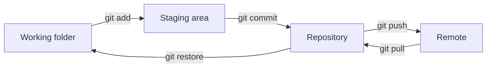
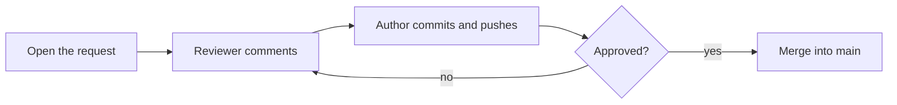

<!--
Parked slides from slides/05_Version_Control.md, taken out on 2026-10-06.

They left the deck when it was rebuilt to open on the two copies of the
pendulum table and close on the same question answered from the history. Both
were on the skip list of the 90-minute plan. This file is not in decks.json:
it is not built, not gated and not deployed. A comment before each slide says
where it stood. To restore one, move it back into the lecture file.
-->

<!-- Parked 2026-10-06 from Lecture 05, after slide 'A History of Changes' and before 'Git Is Installed: a Check': merging was described before commits, branches or diffs exist; Branches & Merging builds it from the model -->

---
hideInToc: true
---

# Two Lines of Work, **Joined**

<div class="card card-primary card-glass pad-compact mt-sm">

Two people, or one person on two days, change the same starting state in different ways. The histories diverge. Git joins them: changes to different lines are combined without help, and changes to the same line are shown to a person who decides.

</div>

<div class="grid-2 gap-md mt-md">

<div class="text-center">


</div>

<div class="text-center">


</div>

</div>

<!-- Parked 2026-10-06 from Lecture 05, section Tags & Stash, after slide 'When Git Says No': its diagram repeated Three Areas with push and pull added; the deck now closes on The Three Questions, Answered -->

---
hideInToc: true
---

# The Whole **Picture**

<div class="mt-md" style="display: flex; justify-content: center;">



</div>

<div class="grid-3 gap-md mt-md">

<div class="card card-primary card-glass pad-compact">

`git status` and `git diff` look and change nothing. Run them before every step.

</div>

<div class="card card-secondary card-glass pad-compact">

`git switch` exchanges the files of the working folder for the snapshot of another branch.

</div>

<div class="card card-success card-glass pad-compact">

`git merge` joins another branch into the one in use. A pull is a fetch and a merge.

</div>

</div>


<!-- Parked 2026-10-13 from Lecture 05 when the deck was reworked around the weather project and cut to one line (model, first commits, data, history, undoing, remotes, branches, a result and its commit). These slides stood as follows: 'The README Says How to Fetch It' closed 'Data in a Repository'; 'Put Work Aside: stash' closed 'Undoing'; 'Line Endings Change the Blob Id', 'A Clone on Windows' and 'SSH: the Alternative' closed 'Remotes'; the section 'Working with Others' (pull request, review flow, giving and receiving review, issue/fork/GitLab) stood between 'Branches & Merging' and 'A Result and Its Commit'; the three quizzes on pull requests, forks and stash were in 'Check Yourself'. They still use the pendulum table and the LHCb file of the old deck. -->

---
hideInToc: true
---

# The README Says How to **Fetch** It

<div class="card card-primary card-glass pad-compact mt-md">

## ✍️ **Added to `README.md`**

```md
## Data not stored here

- **File:** `MasterclassData.root`, 1 289 541 bytes, the original of `D0_KPi.csv`
- **Fetch from:** https://opendata.cern.ch/record/401
- **SHA-256:** `8694a2ed518472b02994629154de3077fdff4aef1065691fa13ae9f6b23b039b`
```

</div>

<div class="grid-2 gap-md mt-md">

<div class="card card-secondary card-glass pad-compact">

## 🧾 **Three facts**

Where the file comes from, how large it is, and its SHA-256. Whoever fetches it computes the checksum as in Lecture 4, `shasum -a 256` in zsh or `Get-FileHash` in PowerShell, and knows that it is the same file.

</div>

<div class="card card-info card-glass pad-compact">

## ♻️ **The same for 3 GB**

These three lines serve a file of any size. A repository with this README and a `.gitignore` can be rebuilt by a stranger: clone it, read the README, fetch the file, check the hash.

</div>

</div>

<!--
Speaker: this is the provenance note of Lecture 02 with one more job. The
ROOT file is not in the project at all; the record keeps it. Commit the
section: "Say how to fetch the ROOT file", the commit c0f7f81 of the branch
slide. (~2 min)
-->

---
hideInToc: true
---

# Put Work Aside: **stash**

<div class="card card-primary card-glass pad-compact mt-md">

```text
git stash
Saved working directory and index state WIP on main: fc2061c Revert "Use 9.03 s for 20 cm, as in the lab book"
git status
On branch main
nothing to commit, working tree clean
```

</div>

<div class="grid-2 gap-md mt-md">

<div class="card card-secondary card-glass pad-compact">

## 🧰 **When**

An edit is half done, and something else has to be committed first. The command stores the edit and puts the working folder back to the last commit, without a commit.

</div>

<div class="card card-accent card-glass pad-compact">

## ⌨️ **Bring the edit back**

`git stash pop` brings the edit back. `git stash list` shows what is stored. In the view: **...** on the **Changes** header, then **Stash**.

</div>

</div>

---
hideInToc: true
---

# Line Endings Change the **Blob Id**

<div class="grid-2 gap-md mt-md">

<div class="card card-primary card-glass pad-compact">

## 🔢 **Two ids for one table**

```text
git hash-object pendulum.csv copy.csv
2b7ca66d176fcac71f435dd3a99efeedb54704cd
d4bcd752bacfab6385be8697187be942d64118d3
git diff --no-index --stat pendulum.csv copy.csv
 pendulum.csv => copy.csv | 20 ++++++++++----------
 1 file changed, 10 insertions(+), 10 deletions(-)
```

</div>

<div class="card card-secondary card-glass pad-compact">

## 📄 **The same ten lines**

`copy.csv` is the copy that PowerShell wrote in Lecture 4: the ten lines of `pendulum.csv`, each ended by `0d 0a` in place of `0a`. 97 + 10 = 107 bytes. The editor shows the same table, with `LF` against `CRLF` in the Status Bar (Lecture 3).

</div>

</div>

<div class="card card-warning card-glass pad-compact mt-md">

For Git the ten lines are ten other lines: other bytes, another blob, and a diff in which every line changed. A line ending is part of the line, as the `0d 0a` of PowerShell was part of `hello` in the model.

</div>

<!--
Speaker: run the two lines in a folder that holds both files. Ask before the
second line: how many lines will Git call changed? The room expects none.
On a laptop still at core.autocrlf true the first line prints 2b7ca66d twice:
Git takes the 0d out while it reads. (~2 min)
-->

---
hideInToc: true
---

# A Clone on **Windows**

<div class="card card-primary card-glass pad-compact mt-sm">

## 🪟 **Git for Windows as installed: `core.autocrlf` is `true`**

```text
PS> git clone https://github.com/mindaugassarpis/analysis-project.git crlf
Cloning into 'crlf'...
…
PS> (Get-Item crlf/data/raw/D0_KPi.csv).Length
4017726
PS> (Get-FileHash crlf/data/raw/D0_KPi.csv).Hash
CD1B75934BD8DA44EBD2C9E22A909297E7EA5B2C690FB46B3CBFCAFFC9962F68
PS> cd crlf
PS> git status
On branch main
Your branch is up to date with 'origin/main'.

nothing to commit, working tree clean
```

</div>

<div class="card card-warning card-glass pad-compact mt-md">

`core.autocrlf true` writes `0d 0a` at the end of every line that Git puts into the folder: 91 584 lines, 91 584 bytes more, and the checksum list of Lecture 4 fails. Yet `git status` sees no change. Git takes the `0d` out again when it reads, so the blob is still `4a45f2be…`. With `false` the disk holds the bytes of the repository.

</div>

<!--
Speaker: this is the third setting of the check slide, and the surprise is the
last line: Git says clean while the checksum fails. The cleaned table becomes
the 107 bytes of copy.csv (C06D…), not be05af03. Measured on Windows with
Git 2.51 and PowerShell 7.6: core.autocrlf is true in the system configuration
that the installer writes. A clone with core.autocrlf false has 3 926 142
bytes and 25C3C972. (~3 min)
-->

---
hideInToc: true
---

# SSH: the **Alternative**

<div class="grid-2 gap-md mt-md">

<div class="card card-primary card-glass pad-compact">

## 🔑 **Two addresses for one repository**

```text
https://github.com/<user>/analysis-project.git
git@github.com:<user>/analysis-project.git
```

- The first asks for a sign-in. The second uses a pair of keys
- The private key stays on the computer. The public key is given to GitHub once
- Use SSH on a computer without a browser, such as a computing cluster

</div>

<div class="card card-secondary card-glass pad-compact">

## ⚙️ **Setup**

```text
ssh-keygen -t ed25519 -C "you@example.com"
cat ~/.ssh/id_ed25519.pub
```

The same two lines in both shells. Paste the printed line into GitHub: **Settings** > **SSH and GPG keys** > **New SSH key**.

An existing repository changes over with `git remote set-url`, the name `origin` and the second address.

</div>

</div>

---
layout: section
hideInToc: true
---

# Working with **Others**

One person joined two branches on one laptop. In a team the same merge waits until a second person has read the diff.

<!--
Speaker: a branch and a remote together give the way teams work: nobody
commits to main directly, and every change is read by a second person.
(~30 sec)
-->

---
hideInToc: true
---

# A Pull **Request**

<div class="card card-primary card-glass pad-compact mt-md">

A pull request asks the owners of a repository to merge a branch. The branch `wording` would be pushed with `git push -u origin wording`, the request opened on the website, and a second person would read its one changed line before it reached `main`.

</div>

<div class="grid-3 gap-md mt-md">

<div class="card card-secondary card-glass pad-compact">

## 🔍 **What it shows**

- The diff of every changed file
- The commits of the branch
- A discussion, beside the lines it is about

</div>

<div class="card card-accent card-glass pad-compact">

## 📝 **Draft**

- Opened early, to ask whether the direction is right
- Marked **Ready for review** when the work is done

</div>

<div class="card card-success card-glass pad-compact">

## 🎯 **Small**

- One request, one purpose
- 50 changed lines are read with care
- 2000 changed lines are not read

</div>

</div>

<div class="note-text mt-sm">After the push of a new branch GitHub prints the address at which the pull request is opened.</div>

---
hideInToc: true
---

# The Review **Flow**

<div class="mt-md" style="display: flex; justify-content: center;">



</div>

<div class="card card-info card-glass pad-compact mt-md">

A comment leads to a commit on the same branch. The push adds it to the open request, and the reviewer reads the new diff. Only an approved change reaches `main`. At CERN no line of analysis code enters the shared software without this loop ♻️.

</div>

---
hideInToc: true
---

# Giving & Receiving **Review**

<div class="grid-2 gap-md mt-md">

<div class="card card-primary card-glass pad-tight">

## 🧑‍🏫 **As a reviewer**

- Review the change, not the person
- Ask before you demand: "why are the 49 rows with `TAU = -100` left out?"
- Check the method first, then the names and the comments
- Answer within a day. A waiting request blocks the author

</div>

<div class="card card-secondary card-glass pad-tight">

## ✍️ **As an author**

- Write what changed and why
- Answer every comment, if only with "done"
- Push corrections as new commits, so the reviewer sees what moved
- Disagree with reasons

</div>

</div>

<div class="card card-info card-glass pad-compact mt-md">

A program can check that code runs. Only a reader can ask whether the method is right for the question.

</div>

---
hideInToc: true
---

<div class="grid-3 gap-md">

<div class="card card-primary card-glass pad-compact">

## 🐛 **Issue**

A numbered note on the repository: a fault, a task, a question. `Fixes #12` in a commit message closes issue 12 when the commit reaches `main`. The closed issue keeps the record of what was wrong.

</div>

<div class="card card-secondary card-glass pad-compact">

## 🍴 **Fork**

Your own copy, on the host, of a repository that belongs to someone else. You push to the fork and open a pull request to the original. It is the way to contribute without the right to write.

</div>

<div class="card card-accent card-glass pad-compact">

## 🦊 **GitLab**

CERN runs its own GitLab at `gitlab.cern.ch`. Git is the same there. A pull request is called a **merge request**, and only the address of the remote differs 🔧.

</div>

</div>

<div class="card card-info card-glass pad-compact mt-md">

Inside a team everyone pushes branches to one repository. A fork is for a repository you may read and not write, such as the software of an experiment.

</div>

---
hideInToc: true
---

<MCQ
  question="Your branch corrects a plot, renames three functions and adds a new script. The three have nothing to do with each other. How do you open the pull request?"
  :options="[
    'One large request, to save clicks',
    'Three requests, one for each change',
    'No request: push to main',
    'One request, with the diff hidden'
  ]"
  :correct="1"
  explanation="A pull request holds one change that can be read and judged on its own. Three small requests are read with care, approved fast, and each can be taken back alone. One large request hides faults among unrelated lines."
/>


---
hideInToc: true
---

<MCQ
  question="You want to correct a fault in a large open-source package. You may read its repository and not write to it. Which way works?"
  :options="[
    'Fork it, commit on a branch of the fork, open a pull request to the original',
    'Wait until an owner grants the right to write',
    'Send the changed files by e-mail',
    'Clone it and push to its main branch'
  ]"
  :correct="0"
  explanation="Without the right to write, a push to the original is refused. A fork is your own copy on the host. You push there and open a pull request from the fork to the original, and the owners review it like any other."
/>


---
hideInToc: true
---

<MCQ
  question="An edit is half done when a fault on main has to be corrected at once. The edit is not ready for a commit. What do you do?"
  :options="[
    'git stash, correct the fault and commit it, then git stash pop',
    'Commit the half-done edit to be able to go on',
    'Copy the whole folder somewhere, then edit',
    'git reset --hard and the edit again later'
  ]"
  :correct="0"
  explanation="git stash stores the unfinished edit and puts the working folder back to the last commit. After the correction, git stash pop brings the edit back. A half-done commit spoils the history, a copied folder is what Git replaces, and reset --hard destroys the edit."
/>

