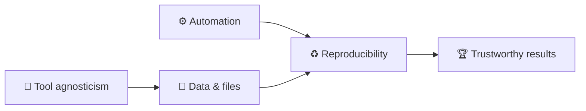

# Dr. Mindaugas Šarpis

# Best Research and Data Analysis Practices from CERN

## Orientation & Motivation

##### <span class="aims-badge">🔧 tool-agnostic · ♻️ reproducible · ⚙️ automation · 📁 data & files</span>

<!--
**Do:** play the cold open first; welcome the room only after it.
**Say:** the whole grade is one project of your own; the seminars are where the skills get practised. No seminar today.
(~2 min)
-->

---
hideInToc: true
---

<VideoPlayer src="ff_zoom_master.mp4" :autoplay="false" hq />

<!-- Release asset ff_zoom_master.mp4 (1080p60 H.264, from the 2026-09-06 master). Does not auto-start. -->

<!--
**Do:** press play when the room is settled and let it run before a word of admin.
**If asked:** a Google Earth pull-back from the roof of the Physics Faculty at Saulėtekis, Vilnius, out to the cosmic web.
(~5 min, the film is 4:42)
-->

---
hideInToc: true
layout: fact
---

# Who am I talking to?

<!--
**Ask:** three shows of hands: your field; Windows, macOS or Linux; who has written code before.
**Say:** the operating systems tell what the first seminar's installation meets; seat an experienced student next to a beginner from week 2.
(~2 min)
-->

---
hideInToc: true
layout: quote
---

# The goal of this course is to build **intuition**, **competence** and **confidence** in working with data, with the tools and practices of modern science

<!--
**Say:** all three start with one file.
(~1 min)
-->

---
hideInToc: true
---

# Ten Years from a **Weather Station**

<div class="grid-2 mt-md gap-md">

<div class="card card-primary card-glass pad-tight">

## 📄 **The file, as it arrived**

```text
time,temp_c,humidity_pct,wind_ms
2016-01-01T00:00,-4.4,93,2.5
2016-01-01T01:00,-4.8,95,2.6
2016-01-01T02:00,-5.5,95,2.7
…
2025-12-31T22:00,-9.9,98,4.1
2025-12-31T23:00,-11.3,100,4.2
```

</div>

<div class="card card-secondary card-glass pad-tight">

## 🌡️ **What it holds**

- One row per hour, 2016 to 2025: **87 672 rows**
- Temperature in °C, humidity in %, wind in m/s
- While the sensor was down, the logger wrote **−999**

</div>

</div>

<div class="card card-info card-glass pad-compact mt-md" style="text-align: center;">

❓ From these 87 672 rows: **what was the mean temperature?**

</div>

<!--
**Do:** read the first two rows aloud with the room: the time, then three readings.
**Ask:** what was the mean temperature of the ten years? Let two or three people say how they would start.
**If asked:** 10 years × 365 days × 24 hours = 87 600, plus 3 leap days × 24 = 87 672.
(~3 min)
-->

---
hideInToc: true
---

# The Mean Temperature, Computed **Two Ways**

<div class="grid-2 mt-md gap-md">

<div class="card card-primary card-glass pad-tight">

## 🧮 **Smiltė: the average of every hour**

She leaves out the 120 hours marked −999 and averages the other 87 552 readings.

Smiltė reports **7.16 °C**.

</div>

<div class="card card-secondary card-glass pad-tight">

## 📅 **Ben: the middle of each day**

For each day he takes the value halfway between the lowest and the highest reading. Then he averages the 3 648 days.

Ben reports **7.11 °C**.

</div>

</div>

<div class="card card-warning card-glass pad-compact mt-md">

Same file, no mistake by either. **I send you only 7.16. How do you check it?**

</div>

<div class="note-text mt-sm">“The first principle is that you must not fool yourself, and you are the easiest person to fool.” Richard Feynman, Caltech, 1974</div>

<!--
**Do:** give the room two or three minutes and write their answers on the board.
**Say:** sort the answers into four piles: the file as it was received; every step done to it; the program and what it ran on; a form anyone can open.
**If asked:** (lowest + highest) / 2 is a common definition of a day's mean temperature at weather services. 3 653 days minus the 5 days with no reading = 3 648.
(~4 min)
-->

---
hideInToc: true
---

# What Each Choice Gives for the **Mean**

<div class="grid-2 mt-md gap-md" style="grid-template-columns: 3fr 2fr;">

<div class="card card-primary card-glass pad-tight table-compact">

| **What was done to the 87 672 rows** | **Mean, °C** |
| --- | --- |
| Smiltė: the average of every valid hour | 7.16 |
| Ben: the middle of each day, averaged | 7.11 |
| The average of the 120 monthly means | 7.14 |
| Smiltė's way, one of the ten years left out | 7.03 to 7.29 |
| The middle hour: half colder, half warmer | 6.70 |
| The 120 hours of −999 read as temperatures | 5.78 |
| The humidity column taken by mistake | 79.10 |

</div>

<div class="card card-secondary card-glass pad-tight">

## 🔍 **Choices and slips**

Each line is one honest-looking choice about the same file.

The last two lines are slips and easy to spot. Any of the first five could be the number in your inbox.

</div>

</div>

<!--
**Say:** every value was computed from weather.csv.
**If asked:** one year left out in turn: 2016 7.11, 2017 7.23, 2018 7.07, 2019 7.15, 2020 7.20, 2021 7.15, 2022 7.22, 2023 7.03, 2024 7.15, 2025 7.29. The 120 marks pull the mean down by 999 × 120 / 87 672 ≈ 1.37 °C, and the 120 real summer hours they replace are missing as well: 7.16 becomes 5.78.
(~3 min)
-->

---
hideInToc: true
---

# The Four <span class="gradient-text">Aims</span>

<div class="note-text mt-sm">Every answer to “how do you check 7.16?” lands in one of four piles. Each pile is one aim of this course, and your project is graded on them.</div>

<div class="grid-2 mt-md gap-md">

<div class="card card-primary card-glass pad-tight reveal-scale">

## 🔧 **Tool agnosticism**

A file anyone can open: plain text, read by any editor and any language, not only by the program I happen to own.

</div>

<div class="card card-secondary card-glass pad-tight reveal-scale">

## ♻️ **Reproducibility**

The file exactly as received, the code that gave 7.16 and the versions it ran on. With those you get 7.16 too.

</div>

<div class="card card-accent card-glass pad-tight reveal-scale">

## ⚙️ **Automation**

Every step written as a program, not done by hand: which rows were left out, how the mean was taken. A program repeats them exactly.

</div>

<div class="card card-success card-glass pad-tight reveal-scale">

## 📁 **Efficient work with data & files**

Knowing which file is which: the one as received, never edited, kept apart from the cleaned copy that a program wrote.

</div>

</div>

<!--
**Do:** point from each pile on the board to its card.
**Say:** the 🔧 ♻️ ⚙️ 📁 icons mark the aims in every lecture.
(~2 min)
-->

---
hideInToc: true
---

# 🔧 Before and After: **Tool Agnosticism**

<div class="grid-2 mt-md gap-md">

<div class="card card-warning card-glass pad-tight">

## ❌ **weather.xlsx**

- The same 87 672 rows saved as a spreadsheet: **1 922 248 bytes**
- An `.xlsx` is a zip archive, here of 9 files. A text editor shows `PK` and then noise
- Reading one number needs a program that knows the format

</div>

<div class="card card-success card-glass pad-tight">

## ✅ **weather.csv**

- Plain text: **2 515 215 bytes**, one line per hour
- Opens in Notepad, TextEdit, VS Code, a spreadsheet, Python or R
- Every number is readable by eye: `2016-01-01T00:00,-4.4,93,2.5`

</div>

</div>

<!--
**Ask:** a show of hands at each "before": who has done this?
**Say:** we use specific tools (Python, VS Code, Git), and every skill is chosen to work beyond them.
**If asked:** the .xlsx is smaller because it is a zip; size is not the point. It was written with Python's openpyxl 3.1.5. Excel writes the same kind of file, a zip of XML files, with another byte count.
(~2 min)
-->

---
hideInToc: true
---

# ♻️ Before and After: **Reproducibility**

<div class="grid-2 mt-md gap-md">

<div class="card card-warning card-glass pad-tight">

## ❌ **A screenshot of 7.16**

- The same file gave seven different means
- The screenshot cannot say which choice it shows
- Nor which rows went into it
- Six months later even the author cannot say

</div>

<div class="card card-success card-glass pad-tight">

## ✅ **The folder that made it**

- The file as received, the code, the versions it ran on
- Run it, on any laptop: 7.16 again
- Change the method in one place: 7.11, and the difference is explained
- “What changed?” has an exact answer

</div>

</div>

<div class="note-text mt-md">If someone else, or future you, cannot rebuild your result, it is not yet a result.</div>

<!--
**Say:** Ben's method is one setting in the folder; switching it shows exactly where 7.16 and 7.11 part.
(~2 min)
-->

---
hideInToc: true
---

# ⚙️ Before and After: **Automation**

<div class="note-text mt-sm">The station also sends a spreadsheet export: nine daily means, as a spreadsheet with European settings writes them.</div>

<div class="grid-2 mt-sm gap-md">

<div class="card card-warning card-glass pad-tight">

## ❌ **Four edits by hand**

```text
nr;date;temp_c
1;2025-10-01;6,3
2;2025-10-02;5,0
…
9;2025-10-09;9,8
;mean;7,97
```

Delete the mean line, replace **9** commas by points and **20** semicolons by commas, delete `nr`. The next export needs all four again.

</div>

<div class="card card-success card-glass pad-tight">

## ✅ **One script**

- The four edits written down once, in the right order
- Run on the next export: done
- The output is the same **148 bytes** on Windows, macOS and Linux
- Anyone can read what was done

</div>

</div>

<!--
**Do:** count the edits with the room: 11 lines with 2 semicolons each, 22; 10 decimal commas. The mean line goes first, which leaves 20 semicolons and 9 commas.
**Say:** do it once by hand, twice by script.
(~2 min)
-->

---
hideInToc: true
---

# The Same Edits in the **Wrong Order**

<div class="grid-2 mt-md gap-md">

<div class="card card-success card-glass pad-tight">

## ✅ **Decimal commas first**

Replace `,` by `.`, then `;` by `,`:

```text
nr,date,temp_c
1,2025-10-01,6.3
2,2025-10-02,5.0
3,2025-10-03,5.6
```

Every decimal comma is a point before the semicolons become commas.

</div>

<div class="card card-warning card-glass pad-tight">

## ❌ **Semicolons first**

Replace `;` by `,`, then `,` by `.`:

```text
nr.date.temp_c
1.2025-10-01.6.3
2.2025-10-02.5.0
3.2025-10-03.5.6
```

After the first step, separators and decimal signs are the same character.

</div>

</div>

<!--
**Ask:** which replacement comes first? Take a vote before showing the columns.
**Say:** by hand, the order has to be remembered every time; a script remembers it. In the right order, with the mean line and nr gone, the table is 148 bytes.
**If asked:** in the wrong order the mean line would become ".mean.7.97".
(~2 min)
-->

---
hideInToc: true
---

# 📁 Before and After: **Data & Files**

<div class="grid-2 mt-md gap-md">

<div class="card card-warning card-glass pad-tight">

## ❌ **The Desktop**

- `daily.csv`, `daily(1).csv`, `daily_final_v2.csv`
- Which still has the mean line? Which has the commas? Only opening each one tells
- The export as received was edited in place: the original is gone

</div>

<div class="card card-success card-glass pad-tight">

## ✅ **Two folders**

- `data/raw/daily_export.csv`: **180 bytes**, as received, never edited
- `data/processed/daily.csv`: **148 bytes**, written by the script
- The size alone tells them apart
- The processed copy can be deleted at any time: the script writes it again

</div>

</div>

<!--
**Ask:** who has a folder of files named final, final2, final_really?
**If asked:** 180 − 148 = 32 bytes: the mean line, 11 bytes, and the column nr, 3 bytes in the header and 2 in each of the nine rows, 21. The other edits swap one character for one character.
(~2 min)
-->

---
hideInToc: true
---

# The Aims **Reinforce** Each Other



<div class="grid-2 mt-md gap-md">

<div class="card card-primary card-glass pad-compact">

## 🔗 **On the weather log**

The script (⚙️) lets anyone rebuild 7.16 (♻️). Two folders (📁) keep the script simple: it reads `data/raw`, writes `data/processed`. Plain CSV (🔧) keeps every step readable anywhere.

</div>

<div class="card card-secondary card-glass pad-compact">

## 🧭 **A rule for choosing**

Of two ways to do the same thing, take the one that serves more of the four aims. Most practical choices in this course are made that way.

</div>

</div>

<!--
**Say:** read the diagram left to right: automation and tidy files make a result reproducible; plain text makes tidy files possible.
(~2 min)
-->

---
layout: section
hideInToc: true
---

# How This Course **Works**

Every Tuesday a lecture and a seminar on the same topic.

---
hideInToc: true
---

# Course **Structure**

<div class="grid-2 mt-md gap-md">

<div class="card card-primary card-glass pad-tight">

## 📖 **The lecture, 2 h**

- Why a practice matters and how to think about it, on worked examples, some of them from CERN
- Questions, votes, short reflections
- Intuition first. Some parts stay a “black box”; others are worked out in detail

</div>

<div class="card card-secondary card-glass pad-tight">

## 🔬 **The seminar, 2 h, same day**

- You do it yourself, in your own project folder
- You type, break things and fix them; the instructor circulates
- The goal is a **working result**, saved before you leave

</div>

</div>

<div class="card card-info card-glass pad-tight mt-md">

<div class="stat-grid">
  <div class="stat">
    <span class="stat-num gradient-text">64</span><span class="stat-unit">h</span>
    <div class="stat-label">Contact hours</div>
  </div>
  <div class="stat">
    <span class="stat-num gradient-text energy">76</span><span class="stat-unit">h</span>
    <div class="stat-label">Self study</div>
  </div>
  <div class="stat">
    <span class="stat-num gradient-text">1</span>
    <div class="stat-label">Semester project</div>
  </div>
</div>

</div>

<!--
**Say:** the lecture and the seminar are one unit: the seminar the same afternoon practises what the lecture showed.
**If asked:** the course is 5 credits, 140 h: 64 h in class, 16 sessions of 4 h, and 76 h of self-study.
(~2 min)
-->

---
hideInToc: true
---

# **Schedule**

Every **Tuesday**: **2 h lecture** + **2 h seminar**, **8 Sep to 22 Dec 2026**. Week 1 is lecture only; seminars start with the second session. No session on 15 Sep, 22 Sep and 24 Nov.

<div class="grid-2 gap-sm mt-sm">

| | **Tue** | **Lecture** |
| --- | --- | --- |
| 1 | 8 Sep | **A** · Orientation & Motivation |
| 2 | 29 Sep | **A** · Introduction to Data |
| 3 | 6 Oct | **A** · How Computers Work |
| 4 | 13 Oct | **A** · Command Line & File Handling |
| 5 | 20 Oct | **A** · Version Control with Git |
| 6 | 27 Oct | **B** · Python Foundations |
| 7 | 3 Nov | **B** · Python for Data & NumPy |

| | **Tue** | **Lecture** |
| --- | --- | --- |
| 8 | 10 Nov | **C** · Data Visualisation |
| 9 | 17 Nov | **C** · Probability & Statistics |
| 10 | 1 Dec | **C** · Data Fitting from First Principles |
| 11 | 8 Dec | **C** · The Perceptron |
| 12 | 15 Dec | **D** · Pandas & Data Cleaning |
| 13 | 22 Dec | **D** · Reproducible Workflows & Automation |

</div>

<div class="note-text mt-sm">Blocks: <strong>A</strong> Foundations & Tooling · <strong>B</strong> Programming · <strong>C</strong> Data Analysis Core · <strong>D</strong> Practical Data Work. Block <strong>E</strong>, Further Topics (concepts of data analysis, computing infrastructure, machine learning), is extra material. <strong>Final project presentations</strong> are in the exam session.</div>

<style scoped>
table {
  font-size: 0.95em;
  width: 100%;
}
table td, table th {
  padding: 0.3em 0.5em;
}
table td:nth-child(1),
table th:nth-child(1) {
  text-align: right;
  white-space: nowrap;
}
table td:nth-child(2),
table th:nth-child(2),
table td:nth-child(3),
table th:nth-child(3) {
  white-space: nowrap;
}
</style>

<!--
**Say:** point at the gaps: no session on 15 and 22 September or 24 November.
(~1 min)
-->

---
hideInToc: true
---

# The Path of the **Course**

<div class="card card-primary card-glass pad-tight table-compact mt-sm">

| **Lectures** | **What you learn** | **What your folder gains** |
| --- | --- | --- |
| 02 | The editor VS Code, the project folder, Markdown | A README |
| 03 | What a file is: bytes and text; first commands in a terminal | Files measured, byte by byte |
| 04 | zsh and Git Bash, package managers, conda environments, checksums | Files made by typed lines, an `environment.yml` |
| 05 | Git | A history of every change |
| 06–07 | Python, then arrays of numbers | Scripts of your own |
| 08–13 | Plots, statistics, fitting, cleaning, one command for all | Results that rebuild |

</div>

<div class="note-text mt-md">Each step uses the one before. Markdown is written in the editor, the terminal opens in the same folder, Git keeps the text files, Python runs from the terminal.</div>

<!--
**Say:** VS Code, Markdown, files, the command line, Git, Python: in that order, each one needs the one before. Your project repeats each step on data of your own.
(~2 min)
-->

---
hideInToc: true
---

# Learning **Outcomes**

<div class="grid-2 mt-md gap-md">

<div class="card card-primary card-glass pad-tight">

## 🧠 **Know**

- The main concepts of **computing**
- The **mathematics and statistics** of data analysis
- Which **tools** fit a task
- The basics of **machine learning and AI**

</div>

<div class="card card-secondary card-glass pad-tight">

## 🛠️ **Be able to**

- Build a simple **data analysis workflow** on the fly
- Work **independent of platform and tool**
- Avoid **common pitfalls** in working with computers
- **Adapt** to new tools and technologies quicker

</div>

</div>

<!--
**Say:** these are the course's official outcomes; the four aims are how we get there.
(~1 min)
-->

---
hideInToc: true
---

# What **“Done”** Looks Like Each Week

<div class="grid-3 gap-md mt-md">

<div class="card card-primary card-glass pad-tight">

## 📦 **Saved**

The new work is in your project folder, not in a stray file on the desktop.

</div>

<div class="card card-secondary card-glass pad-tight">

## 🔁 **Runs again**

You can run it again in a fresh terminal and get the same result.

</div>

<div class="card card-accent card-glass pad-tight">

## 📝 **Explainable**

You can say, in one sentence, what it does and why.

</div>

</div>

<!--
**Say:** each week one step, saved and dated. The three tests are the ones 7.16 has to pass.
(~1 min)
-->

---
hideInToc: true
---

# Habits for This **Course**

<div class="grid-2 mt-md gap-md">

<div class="card card-success card-glass pad-tight">

## 🌱 **Do this**

- **Come to the seminar**: the doing is where it sticks
- **Type it yourself**, even when copy and paste would be faster
- Keep one project and grow it; do not restart every week
- Ask early: a five-minute question saves a lost evening

</div>

<div class="card card-warning card-glass pad-tight">

## 🚧 **Avoid this**

- Catching up on every lecture the night before the presentation
- Collecting tools you never use on your data
- Hiding a broken step instead of asking about it
- Taking “it ran once” for “it is reproducible”

</div>

</div>

<!--
**Say:** the course teaches practices that work in any language; the programming goes only as deep as they need.
**If asked:** already code well? The challenge moves from syntax to doing it reproducibly.
(~2 min)
-->

---
hideInToc: true
---

# What to **Expect**

<div class="grid-3 gap-md mt-md">

<div class="card card-primary card-glass pad-tight">

## ⌨️ **You will type a lot**

Commands feel slow at first. Two weeks in, they are faster than clicking.

</div>

<div class="card card-info card-glass pad-tight">

## 💥 **You will break things**

Errors are the normal state of programming. Read them: they usually name the fix.

</div>

<div class="card card-secondary card-glass pad-tight">

## 🙋 **Stuck for 15 minutes? Ask**

The instructor, your neighbour, a search engine, the documentation, and AI assistants, as long as you understand what they hand you.

</div>

</div>

<!--
**Ask:** who has seen an error message and closed the window without reading it?
(~1 min)
-->

---
layout: section
hideInToc: true
---

# Seminars & **Your Project**

Your project: the steps of the seminars, on a question and data of your own, graded on the four aims.

---
hideInToc: true
---

<div class="card card-success card-glass pad-tight glow">

## 🎯 **The grade: one course-long project, 100%**

The whole grade is a project you carry through the course. It is graded relative to where you start: beginners and experienced coders are both welcome.

</div>

<div class="grid-2 mt-md gap-md">

<div class="card card-primary card-glass pad-tight reveal-left">

## 🧭 **Any field, any form**

Topic, data and form are your call: a data analysis, an app or dashboard, or a piece that explains a method, from physics, biology, economics or a hobby. It includes real **data analysis or automation**, built with Python.

</div>

<div class="card card-secondary card-glass pad-tight reveal-left">

## ✅ **Graded on the four aims**

- 🔧 **Tool-agnostic**, reasoned choices
- ♻️ **Reproducible**: someone else can rebuild your results
- ⚙️ **Automated** where it counts
- 📁 **Well-organised** data and files, clearly documented

</div>

</div>

<!--
**Say:** graded relative to where you start: a beginner who reaches a clean, rebuildable analysis does as well as an expert who does the same.
(~2 min)
-->

---
hideInToc: true
---

# What You **Hand In**

<div class="grid-2 mt-md gap-md">

<div class="card card-primary card-glass pad-tight">

## 📋 **Requirements**

- A well-developed project
- Can be functional: an app, a dashboard, a website
- Can be educational: a method, such as a neural network, applied and explained
- AI tools are allowed; you must understand your code and be able to explain it

</div>

<div class="card card-secondary card-glass pad-tight">

## 📦 **Deliverables**

- The code in the course repository (details in eMokymai)
- A **one-page report**, added to the repository
- A 10 to 30 second video showing the project, linked from the repository
- A final **presentation**, graded on the spot

</div>

</div>

<!--
**Say:** the report, the video and the presentation all describe the one repository. Talk a first idea through at an early seminar.
(~2 min)
-->

---
hideInToc: true
---

# Open **Data**

<div class="grid-2 mt-md gap-md">

<div class="card card-primary card-glass pad-tight">

## 🌍 **Open by principle**

CERN publishes its data so that anyone can check the science. Portals such as CERN Open Data, Eurostat and data.europa.eu hold data on physics, health, prices and weather: a source for your project.

</div>

<div class="card card-secondary card-glass pad-tight">

## 🧪 **Practice files with real faults**

Lectures and seminars use small files with the faults real files have: a mean line, decimal commas, a mark for a missing value.

</div>

</div>

<!--
**Ask:** what data would you like to look at? Collect two or three answers.
(~2 min)
-->

---
hideInToc: true
---

# The Folder of a Finished **Analysis**

<div class="grid-2 mt-md gap-md" style="grid-template-columns: 2fr 3fr;">

<div class="card card-primary card-glass pad-tight">

## 📦 **What you hand in**

One versioned repository. The report, video and presentation all describe this one thing.

A finished analysis has this shape, whatever its data.

</div>

<div class="card card-secondary card-glass pad-tight">

```text
analysis-project/
├── data/raw/          as received, never edited
├── data/processed/    written by clean.py
├── scripts/           clean.py  plot.py  fit.py  report.py
├── results/           the plot, fit.json, report.md
├── tests/             checks of the scripts
├── config.json        the parameters
├── environment.yml    the packages and versions
├── run_all.py         the one command
├── .gitignore         what Git leaves out
└── README.md          what it is, how to rebuild
```

</div>

</div>

<!--
**Say:** every folder and file in the tree gets its own lecture; by December it is yours.
(~2 min)
-->

---
hideInToc: true
---

# Delete and **Rebuild**

<div class="card card-success card-glass pad-tight mt-md glow">

## 🏆 **Delete `data/processed/` and `results/`, then rebuild both with one command.**

If that works for your project, it is reproducible.

</div>

<div class="grid-2 mt-md gap-md">

<div class="card card-warning card-glass pad-compact">

## 🗑️ **Safe to delete**

`data/processed/` and `results/`: the cleaned tables, the plot, `fit.json`, the report. Outputs of the scripts, never edited by hand.

</div>

<div class="card card-primary card-glass pad-compact">

## 🔒 **The recipe: keep it**

`data/raw/` (it cannot be made again), `scripts/`, `tests/`, `config.json`, `environment.yml`, `run_all.py` and `README.md`.

</div>

</div>

<div class="note-text mt-md">On the weather station: delete the outputs, run the one command, and the same 148 bytes and the same 7.16 come back.</div>

<!--
**Say:** this one sentence is the test of the project at the end of the course.
(~2 min)
-->

---
layout: section
hideInToc: true
---

# How Do You **Check 7.16**?

Smiltė's mean temperature of ten years, sent as one number.

<!--
**Ask:** the question of the opening slides, again: what would you need from Smiltė to check 7.16? Collect two or three answers; "What a Result Needs" lists them.
(~1 min)
-->

---
hideInToc: true
---

# Why <span class="gradient-text">You</span> Need These Skills

<div class="card card-primary card-glass pad-tight table-compact mt-sm">

| **At CERN** | **The skill** | **Lectures** |
| --- | --- | --- |
| Petabytes of detector output | Files, formats, folders | 02–04 |
| Thousands of scientists share one codebase | Version control | 05 |
| Electronic signals become physics | Python and data analysis | 06–13 |
| A bump in the data: a discovery or noise? | Statistics | 09–10 |

</div>

<!--
**Say:** CERN turns raw collisions into discoveries with the toolkit this course builds, one row of the table per block of the course.
(~2 min)
-->

---
hideInToc: true
---

# Mariner 4: a Picture from Numbers and a **Key**

<div class="grid-2 mt-md gap-md">

<div class="card card-primary card-glass pad-tight">

## 📡 **What arrived**

Mariner 4 flew past Mars on 14–15 July 1965 and took 21 pictures, and part of a 22nd. Each picture came back to Earth as numbers: 200 × 200 = **40 000** brightness values, one per point.

The computer that turned the numbers into a picture was still at work.

</div>

<div class="card card-secondary card-glass pad-tight">

## 🖍️ **What the engineers did**

At JPL, Richard Grumm's team printed the numbers on paper strips, stapled the strips side by side on a wall, and coloured every number with pastels from an art shop, by a key that matched each number to a shade.

The first picture of Mars from a spacecraft was coloured by hand.

</div>

</div>

<div class="card card-info card-glass pad-compact mt-md">

Numbers plus a written rule give a picture. Anyone with the 40 000 numbers and the key gets the same picture, by hand or by computer. 87 672 rows plus a written method give 7.16 in the same way.

</div>

<!--
**Say:** the framed pastel picture was given to JPL's director, William Pickering.
**If asked:** sources: NSSDC Mariner 4 page (21 pictures plus 21 lines of a 22nd, 14–15 July 1965); Scientific American, "First View of Mars Was a Paint-by-Numbers"; Caltech magazine, "A Planet Painted by Hand". Transmission times for one picture disagree between sources (6, 8 or 10 hours), so the slide gives none.
(~2 min)
-->

---
hideInToc: true
---

# What a Result **Needs**

<div class="note-text mt-sm">The opening question: <strong>I send you only 7.16. How do you check it?</strong></div>

| | **I send you** | **You do** |
| --- | --- | --- |
| 🔧 | Plain text throughout: CSV, Python, a README | Read every step without my programs |
| ♻️ | The script, and `environment.yml`: the versions it ran on | Run it on your laptop: 7.16 |
| ⚙️ | Every step as code: the 120 marked hours left out, the mean taken | See exactly what was done to which rows |
| 📁 | `data/raw/weather.csv`, 2 515 215 bytes, as received | Check it is the file I started from |

<div class="card card-success card-glass pad-tight mt-md">

## ✅ **7.16, checked**

With these four, 7.16 is a result: you get it again, and you can see why Ben got 7.11, the middle of each day instead of every hour. Without them, it is a number in an e-mail.

</div>

<!--
**Do:** read the four lines against the piles on the board. Do not cut this slide: it answers the opening question.
(~3 min)
-->

---
hideInToc: true
---

# Before the **Next Session**

<div class="grid-2 mt-md gap-md">

<div class="card card-primary card-glass pad-tight">

## 💻 **Bring a laptop**

- Windows, macOS or Linux, charged, with its charger
- You must be able to install programs on it. On a university or work laptop, check that now
- Nothing has to be installed beforehand

</div>

<div class="card card-secondary card-glass pad-tight">

## 🗂️ **Your own data, in class**

- In the seminars you write about your project as you go
- One sentence on the data you would like to look at is enough: weather, sport, prices, health, astronomy, your lab
- Written there and then, in class

</div>

</div>

<div class="card card-info card-glass pad-compact mt-sm">

## 🔬 **The first seminar starts from zero**

It installs the editor, makes a project folder and writes a first Markdown file together, step by step. No programming experience is assumed.

</div>

<!--
**Say:** nothing to do at home; everything happens in class.
(~1 min)
-->

---
layout: section
hideInToc: true
---

# Why We Need **CERN**

## and what we can learn from it

Mariner 4 sent numbers, and a key turned them into a picture. Every instrument in these films, camera, rover, telescope and detector, writes numbers too.

<!--
**Do:** dim the lights and let the films run; do not narrate over them.
**Say:** before the first film: spot the instrument in every scene, camera, rover, telescope, chamber, and ask what its output looks like once it is stored.
**Ask:** between clips, if the room is awake: which of these would you analyse first?
(~1 min, then the films, about 32 min)
-->

---
hideInToc: true
---

<VideoPlayer src="Drone_Climbing_Mountain.mp4" />

<!-- Back in slot 1 on 2026-09-08. -->

<!--
**Do:** let it run: a drone climbs a mountain, Earth at human scale (0:27, silent).
-->

---
hideInToc: true
---

<VideoPlayer src="saturn_v_launch_nasa.mp4" />

<!-- Added 2026-09-08; release asset is a capped H.264 encode of the Drive master. -->

<!--
**Do:** let it run: the Saturn V launch, NASA, with sound (2:55).
-->

---
hideInToc: true
---

<VideoPlayer src="blue_ghost_lunar_orbit.mp4" />

<!-- Added 2026-09-08; release asset blue_ghost_lunar_orbit.mp4 (remux of the Drive master). -->

<!--
**Do:** let it run: the Moon from the Blue Ghost lander in lunar orbit, with sound (1:36).
-->

---
hideInToc: true
---

<VideoPlayer src="NASA_Mars_Mariner_4_Pan_Audio.mp4" />

<!--
**Do:** let it run: Mariner 4, 1965, the first data from another planet (0:20).
-->

---
hideInToc: true
---

<VideoPlayer src="Perseverence_Rover_Landing_NASA.mp4" />

<!--
**Do:** let it run: Perseverance landing on Mars (3:10).
-->

---
hideInToc: true
---

<VideoPlayer src="Cassini_Grand_Finale_NO_VO.mp4" />

<!--
**Do:** let it run: Cassini at Saturn (3:41).
-->

---
hideInToc: true
---

<VideoPlayer src="Stars_Pan_Audio.mp4" />

<!--
**Do:** let it run: a star field (0:20).
-->


---
hideInToc: true
---

<VideoPlayer src="Hubble.mp4" />

<!--
**Do:** let it run: pictures from Hubble (0:33).
-->


---
hideInToc: true
---

<VideoPlayer src="Telescope.mp4" />

<!--
**Do:** let it run: an observatory (0:40).
-->

---
hideInToc: true
---

<VideoPlayer src="Webb_Reel.mp4" />

<!--
**Do:** let it run: pictures from the James Webb Space Telescope (2:58).
-->

---
hideInToc: true
---

<VideoPlayer src="Expansion_Funnel_H264_1080p.webm" />

<!--
**Do:** let it run: the expansion of the universe (0:30).
-->

---
hideInToc: true
---

<VideoPlayer src="QGP_Formation.mp4" />

<!--
**Do:** let it run: a quark-gluon plasma forms (0:33).
-->

---
hideInToc: true
---

<VideoPlayer src="atoms.mp4" />

<!-- The same film as the old silent Voyage_in_to_the_world_of_atoms.mp4; release asset atoms.mp4 (H.264 web encode of the Drive master atoms.mov). -->

<!--
**Do:** let it run: into the atom: a hair, cells, an atom, the nucleus, quarks, with sound (2:06).
-->

---
hideInToc: true
---

<VideoPlayer src="Cloud_Chamber_Audio.mp4" />

<!--
**Do:** let it run: a cloud chamber, particles made visible (2:29).
-->

---
hideInToc: true
---

<VideoPlayer src="CERN_Overview_Short.mp4" />

<!--
**Do:** let it run: CERN from the air (0:11).
-->

---
hideInToc: true
---

<VideoPlayer src="cern_footage_2022_013_001_1080p_lhc.mp4" />

<!-- Added 2026-09-08; release asset is a remux of the Drive master. -->

<!--
**Do:** let it run: the LHC, CERN footage 2022-013-001, with sound (4:14).
-->

---
hideInToc: true
---

<VideoPlayer src="cern_video_2019_050_008_1080ph265.mp4" />

<!-- Added 2026-09-08. -->

<!--
**Do:** let it run: CERN video 2019-050-008 (1:35, silent).
-->

---
hideInToc: true
---

<VideoPlayer src="LHCb.mp4" />

<!--
**Do:** let it run: LHCb, one of the four large experiments at the LHC (0:47).
-->

---
hideInToc: true
---

<VideoPlayer src="CERN-FOOTAGE-2024-006-001.mp4" />

<!--
**Do:** let it run: the map of the Future Circular Collider (0:18).
-->

---
hideInToc: true
---

<VideoPlayer src="lhcb_thanks.mp4" />

<!-- Release asset lhcb_thanks.mp4 (H.264 web-h264 encode of the maintainer's Drive master, plays on every browser). -->

<!--
**Do:** let it run while the room packs up: the LHCb detector from the inside, layer by layer, ending on "Thanks for Your Attention" (2:28).
-->

---
layout: section
hideInToc: true
---

# Extra Material: What Is **CERN**?


<!--
**Do:** not shown in the lecture, which ends on the LHCb film. The four slides are for reading afterwards: CERN, the LHC, the accelerator chain, a detector.
-->

---
hideInToc: true
---

# CERN at a Glance

<div class="grid-2 mt-md gap-md">

<div class="card card-primary card-glass pad-tight">

## 🏛️ **The Organisation**

- **European Organization for Nuclear Research**
- Founded in **1954** by 12 European states
- Today: **24 member states**, thousands of visiting scientists
- Located at the **French-Swiss border** near Geneva

</div>

<div class="card card-secondary card-glass pad-tight">

## 🎯 **The Mission**

- Study what **matter** is made of
- Build and run **particle accelerators**
- Develop the **technology** they need: the World Wide Web was invented there in 1989
- Train students and young **scientists**

</div>

</div>

<div class="card card-accent card-glass pad-tight mt-md">

## 🌍 **By the Numbers**

🔬 The **largest** particle physics laboratory in the world · 👥 **17 000** scientists from more than **110** nations · 🧪 the **Large Hadron Collider**

</div>

---
hideInToc: true
---

# The Large Hadron Collider (LHC)

<div class="card card-info card-glass pad-tight">

## ⚙️ **The Machine**

- A **27 km** circumference ring situated **100 m** underground
- Accelerates protons to **99.9999991%** the speed of light
- Collides particles **~1 billion times per second**
- Operating temperature: **1.9 K** (about −271.3 °C, colder than outer space)

</div>

<div class="grid-2 mt-md gap-md">

<div class="card card-primary card-glass pad-compact">

## 🔭 **Main Experiments**

- **ATLAS**: general-purpose detector
- **CMS**: general-purpose detector
- **ALICE**: heavy-ion collisions
- **LHCb**: matter-antimatter asymmetry

</div>

<div class="card card-warning card-glass pad-compact">

## 🏆 **Key Achievement**

Discovery of the **Higgs boson** in **2012**, which confirmed the mechanism that gives particles their mass

Nobel Prize in Physics 2013

*Precisely: this gives mass to fundamental particles (**fermions**, **W/Z** bosons); most of the mass around you (e.g. the proton's) is **QCD binding energy**, not the Higgs.*

</div>

</div>

---
hideInToc: true
---

# The Accelerator <span class="gradient-text">Chain</span>

<div class="card card-info card-glass pad-compact mt-sm">

🔗 Protons from a hydrogen bottle pass through a **chain** of accelerators. Each hands faster particles to the next, and the LHC is the last.

</div>

<div class="stack-tight mt-md">

<div class="card card-primary card-glass pad-compact reveal-left">

**1. LINAC4**, a linear accelerator: **160 MeV**

</div>

<div class="card card-secondary card-glass pad-compact reveal-left">

**2. PS Booster, then Proton Synchrotron**, the first rings: **2 GeV, then 26 GeV**

</div>

<div class="card card-accent card-glass pad-compact reveal-left">

**3. Super Proton Synchrotron (SPS)**, a 7 km ring: **450 GeV**

</div>

<div class="card card-success card-glass pad-compact reveal-left">

**4. LHC**, a 27 km ring: **6.8 TeV per beam** *(Run 3)*. Then the beams are made to cross inside the detectors

</div>

</div>


---
hideInToc: true
---

# How a Detector <span class="gradient-text">Sees</span> a Collision

<div class="card card-info card-glass pad-compact mt-sm">

🧅 Detectors like ATLAS are built as **layers of an onion** around the collision point; each layer measures a different property of the particles flying out.

</div>

<div class="grid-2 mt-md gap-md">

<div class="card card-primary card-glass pad-compact reveal-scale">

## 🌀 **Tracker** *(innermost)*

Charged particles bend in a magnetic field; the curvature of each track gives its **momentum**

</div>

<div class="card card-secondary card-glass pad-compact reveal-scale">

## ⚡ **EM Calorimeter**

Stops **electrons and photons**, measuring the **energy** they deposit

</div>

<div class="card card-accent card-glass pad-compact reveal-scale">

## 🔨 **Hadronic Calorimeter**

Stops **hadrons**, particles made of quarks (protons, neutrons, pions), again measuring **energy**

</div>

<div class="card card-success card-glass pad-compact reveal-scale">

## 🧲 **Muon System** *(outermost)*

**Muons** punch through everything else; dedicated outer chambers catch them

</div>

</div>

<div class="card card-warning card-glass pad-compact mt-md reveal-up">

💾 One collision → **millions of electronic signals** across these layers. Software reassembles them into particles: those are the "detector readings" every analysis starts from.

</div>

---
layout: section
hideInToc: true
---

# Check **Yourself**

Questions on this lecture, for after it. They are not part of the lecture time.

---
hideInToc: true
---

<MCQ
  question="From the same file of hourly readings, Smiltė reports a mean of 7.16 °C and Ben 7.11 °C. What tells you which method a number came from?"
  :options="[
    'The number of decimal places it is given with',
    'The code that computed it, run on the file as it was received',
    'Which of the two numbers is the larger one',
    'A screenshot of the program that printed it'
  ]"
  :correct="1"
  explanation="Both methods are honest: the average of every hour, and the middle of each day averaged. Only the steps, written down as code and run on the file as received, say which one a number is. A screenshot shows the number, not the choices behind it."
/>

---
hideInToc: true
---

<MCQ
  question="You catch yourself repeating the same manual steps on your data every week. Writing a script to do it instead chiefly serves which of the four aims?"
  :options="[
    '🔧 Tool agnosticism',
    '♻️ Reproducibility',
    '⚙️ Automation',
    '📁 Efficient work with data & files'
  ]"
  :correct="2"
  explanation="Do it once by hand, twice by script: letting the machine repeat the boring parts is what ⚙️ automation means. It often helps ♻️ reproducibility too, but the direct target here is automation."
/>

---
hideInToc: true
---

<MCQ
  question="A colleague sends you a beautiful result: a PDF of the final plot. What is the minimum you would need for the result to count as reproducible?"
  :options="[
    'The same plot exported again at a much higher resolution',
    'The raw data, the code, and a note of the environment it ran in',
    'A screen recording of them running the whole analysis end to end',
    'Their written assurance that it ran fine on their own laptop'
  ]"
  :correct="1"
  explanation="♻️ Reproducibility means someone else can rebuild the result. That takes the inputs (data), the exact steps (code), and the context they ran in (environment and versions, written down in an environment.yml). A sharper picture or a promise changes nothing."
/>

---
hideInToc: true
---

<MCQ
  question="It's week 5. You attend every lecture but skip the seminars because you ‘get the ideas already’. Why is this the riskiest habit in this course?"
  :options="[
    'Lectures carry the marks, so the seminars are the part you can afford to miss',
    'The seminars are where an idea becomes a working skill, and the project is graded on skills',
    'Seminar attendance is recorded, and every missed session costs you marks directly',
    'The lectures only summarise the seminars, so skipping either half is the same'
  ]"
  :correct="1"
  explanation="The seminars are not graded, but the project is, on the four aims: practices you only acquire by doing. Understanding an idea in the lecture is not the same as having it run in your own folder. The seminar is where 'done' happens, and your project is where you repeat it on your own data."
/>

---
hideInToc: true
---

<MCQ
  question="In a reproducible project, two folders can be deleted at any time and rebuilt with one command. Which two?"
  :options="[
    'data/raw/ and scripts/',
    'data/processed/ and results/',
    'data/raw/ and results/',
    'scripts/ and data/processed/'
  ]"
  :correct="1"
  explanation="data/processed/ and results/ hold only what the scripts write: the cleaned tables, the plot, the fit, the report. data/raw/ cannot be made again, and scripts/ (with run_all.py, config.json, environment.yml and the README) is the recipe. Delete the outputs, run the one command, and the same files and the same numbers come back."
/>
