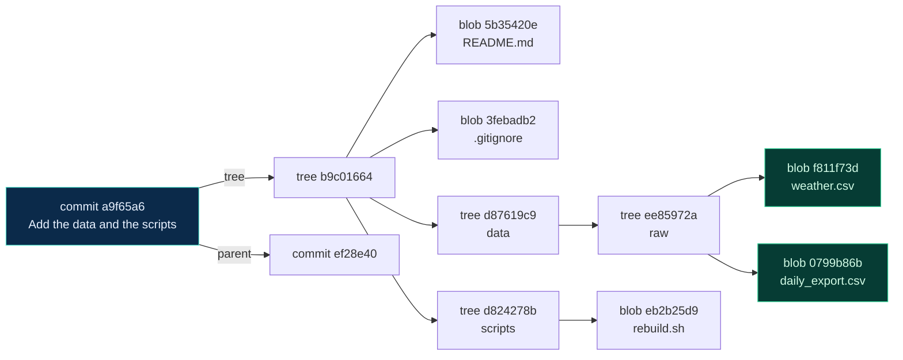
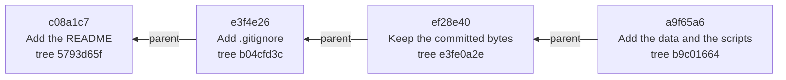
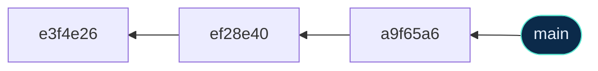
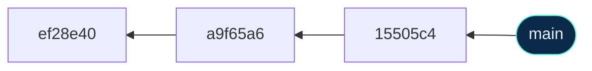
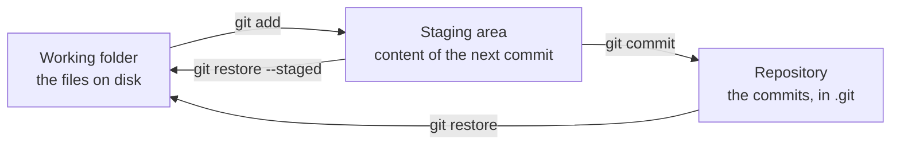
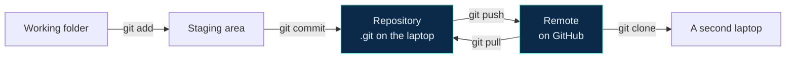
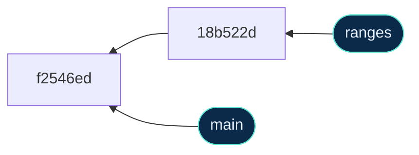
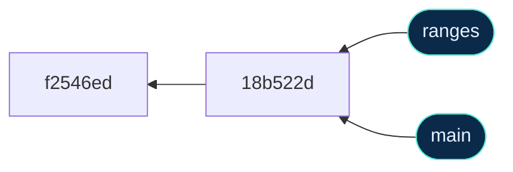
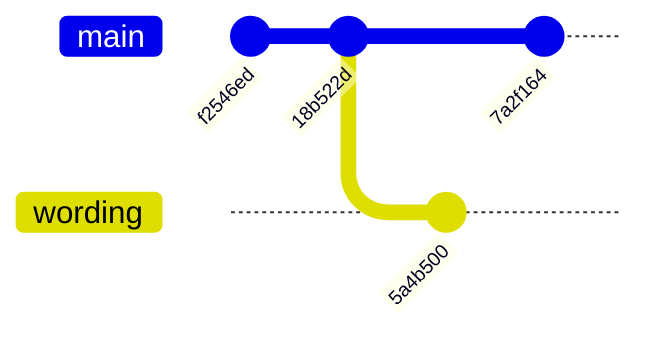

# Dr. Mindaugas Šarpis

# Best Research and Data Analysis Practices from CERN

## Version Control

##### <span class="aims-badge">♻️ reproducibility · 🔧 tool-agnostic</span>

---
hideInToc: true
layout: quote
---

# **Version control** keeps every state a project went through, with who changed what, when and why.

<!--
**Say:** read the line, then go straight to the two copies of the export.
(~1 min)
-->

---
hideInToc: true
---

# Learning **Objectives**

<div class="stack-tight mt-sm">

<div class="card card-primary card-glass pad-compact">

🧱 Say what a **commit** is: a snapshot, a parent, and an id computed from the content

</div>

<div class="card card-secondary card-glass pad-compact">

✍️ Record changes as commits, in the **Source Control** view of VS Code and typed

</div>

<div class="card card-accent card-glass pad-compact">

📦 Decide which files of a data project go into the repository, and write a `.gitignore`

</div>

<div class="card card-success card-glass pad-compact">

🕰️ Read the **history** of a project and undo a change at each stage

</div>

<div class="card card-info card-glass pad-compact">

☁️ Keep a copy on a **remote** and move commits both ways

</div>

<div class="card card-warning card-glass pad-compact">

🌿 Work on a **branch**, **merge** it, and resolve a conflict

</div>

</div>

<!--
(~1 min)
-->

---
hideInToc: true
---

# Two Copies of the **Export**

<div class="card card-info card-glass pad-compact mt-sm">

Smiltė keeps `data/raw/daily_export.csv` of the weather project. Her colleague Tomas sends back his copy of the same file. Both have 180 bytes.

</div>

<div class="card card-primary card-glass pad-compact mt-md">

## 💻 **zsh · Git Bash**

```text
$ shasum -a 256 smilte/daily_export.csv tomas/daily_export.csv
9d849815d88eceb18366ee66ac72f26b72e195bea8bb20aa9a1474372513bbdb  smilte/daily_export.csv
13fbcae6a7a4d67ec30fdf3bedc0b666209f7a4dc453ea72ff6de7370ffd6aee  tomas/daily_export.csv
```

Git Bash: `sha256sum` in place of `shasum -a 256`, with the same output.

</div>

<div class="card card-warning card-glass pad-compact mt-md">

The checksums say that the two files differ. They do not say where, who changed the file, or why.

</div>

<!--
**Ask:** which copy is the file as it arrived from the station? Nobody can tell from 64 digits.
**If asked:** `$` stands for the prompt of both shells; zsh on a Mac shows `%`.
**Do:** a show of hands: who has files named final, final_v2, final_corrected?
(~3 min)
-->

---
hideInToc: true
---

# Compare Two Copies: `git diff`

<div class="grid-2 gap-md mt-md" style="grid-template-columns: 3fr 2fr;">

<div class="card card-primary card-glass pad-compact">

## 🔍 **Line by line**

```text
$ git diff --no-index smilte/daily_export.csv tomas/daily_export.csv
diff --git a/smilte/daily_export.csv b/tomas/daily_export.csv
index 0799b86..a2093bf 100644
--- a/smilte/daily_export.csv
+++ b/tomas/daily_export.csv
@@ -1,5 +1,5 @@
 nr;date;temp_c
-1;2025-10-01;6,3
+1;2025-10-01;6,4
 2;2025-10-02;5,0
 3;2025-10-03;5,6
 4;2025-10-04;7,0
```

</div>

<div class="card card-secondary card-glass pad-compact table-compact">

## 🧾 **What the two copies tell**

| Question | Answer |
| --- | --- |
| Do they differ? | Yes, by the checksum |
| Where? | Line 2: `6,3` against `6,4`, by `git diff` |
| Who changed it, when, and why? | Nothing in either file says |

</div>

</div>

<div class="card card-info card-glass pad-compact mt-md">

A line with `-` is in the first file only, a line with `+` in the second only, a line with a space in both.

</div>

<!--
**Say:** Git was installed in Seminar 4; `--no-index` compares two files outside any project.
**Ask:** was 6,4 read off a paper log, or typed by mistake? The two copies cannot tell.
(~3 min)
-->

---
hideInToc: true
---

# Versions Kept as **Copies**

<div class="grid-2 gap-md mt-md">

<div class="card card-warning card-glass pad-tight">

## ⚠️ **What goes wrong**

- A file that changes gets copied: `report_final.md`, `report_final_v2.md`, `report_final_v2_corrected.md`
- No copy says who changed a line, when, or why
- Two copies edited on the same day have to be joined by hand
- A change that turned out wrong can be taken back only if the older copy was kept

</div>

<div>


</div>

</div>

<!--
**Say:** the third row of the table is the gap. A copy keeps the bytes and the name; who, when and why live in somebody's memory.
(~2 min)
-->

---
hideInToc: true
---

<div class="card card-info card-glass pad-tight">

## 🔍 **What a version control system records**

- Each state of the files, and what changed since the state before
- Who made the change, when, and a note that says why: the third row of the table
- Any earlier state can be brought back, and any two states compared line by line
- **Git** is the version control system of nearly all research software. It is free, and it works on a folder of the laptop without any server

</div>


<!--
**If asked:** Git was written in 2005 for the development of the Linux kernel.
(~2 min)
-->

---
layout: section
hideInToc: true
---

# The **Model**

To keep who, when and why, Git stores every version under a name computed from its bytes.

<!--
**Say:** four ideas, each built on the checksum of Lecture 4: a blob, a tree, a commit, a branch. With the model the commands need no memorising.
(~1 min)
-->

---
hideInToc: true
---

# What Has to Be **Kept**

<div class="grid-2 gap-md mt-md">

<div class="card card-primary card-glass pad-compact">

## 📁 **One version of the project**

- The bytes of every file
- The path of every file, such as `data/raw/weather.csv`
- Which version came before it
- Who made it, when, and why

</div>

<div class="card card-secondary card-glass pad-compact">

## 🗂️ **The obvious way: copy the folder**

```text
weather-project_2026-10-13/
weather-project_2026-10-20/
weather-project_2026-10-20_fixed/
```

The folder holds 5.06 MB, and 5.03 MB of it are the four data files. Twelve copies take 60.7 MB, with the same data in each.

</div>

</div>

<div class="card card-info card-glass pad-compact mt-md">

Git keeps the same four things and stores each content once. The tool is a checksum, as in Lecture 4: a short number computed from all the bytes of a content.

</div>

<!--
**Say:** a copied folder has the first two items and loses the last two. The two copies of the export were exactly this case.
**If asked:** 2 515 215 + 180 bytes in `data/raw`, 2 511 735 + 148 in `data/processed`; 12 × 5 056 982 bytes = 60.7 MB.
(~2 min)
-->

---
hideInToc: true
---

# A Name Made from the **Content**

<div class="card card-primary card-glass pad-compact mt-md">

## 💻 **zsh · Git Bash**

```text
$ echo "hello" | git hash-object --stdin
ce013625030ba8dba906f756967f9e9ca394464a
$ echo "hallo" | git hash-object --stdin
4cf5aa5f9a644263dbe3d6e78bcbef45487a802c
$ printf "hello\r\n" | git hash-object --stdin
ef0493b275aa2080237f676d2ef6559246f56636
```

</div>

<div class="grid-2 gap-md mt-md">

<div class="card card-info card-glass pad-compact">

## 📏 **What the number is**

- 40 hex digits are 160 bits. The hash is **SHA-1**, an older relative of the SHA-256 of Lecture 4, which has 64 digits
- One changed letter changes the whole number
- Git calls the number the **id** of the content, and stores the content under it

</div>

<div class="card card-warning card-glass pad-compact">

## 🔀 **The same word, another ending**

`printf` writes `hello` with `\r\n`, the line ending of Windows programs: `ef0493b2…`. The word is the same, so the bytes that reached Git must differ.

</div>

</div>

<!--
**Live:** `echo "hello" | git hash-object --stdin` on the lecture laptop.
**Ask:** read the first four digits to your neighbour: ce01 on every laptop, Mac or Windows.
(~3 min)
-->

---
hideInToc: true
---

# What Git **Hashes**

<div class="card card-primary card-glass pad-compact mt-sm">

```text
62 6c 6f 62 20 36 00 68 65 6c 6c 6f 0a          echo: 13 bytes
b  l  o  b     6     h  e  l  l  o  LF

62 6c 6f 62 20 37 00 68 65 6c 6c 6f 0d 0a       printf "hello\r\n": 14 bytes
b  l  o  b     7     h  e  l  l  o  CR LF
```

</div>

<div class="grid-2 gap-md mt-md">

<div class="card card-secondary card-glass pad-compact">

## 🧾 **A header, then the bytes**

The header is the word `blob`, a space, the number of bytes as decimal text, and one zero byte. A **blob** is Git's word for the content of a file. The id is the SHA-1 of the header and the content together.

</div>

<div class="card card-accent card-glass pad-compact">

## ↩️ **Where the 7 comes from**

`echo` ends the text with `0a`: 6 bytes. `printf` was told to write `0d 0a`, the ending a Windows program such as Notepad writes: 7 bytes. Other bytes, so another id.

</div>

</div>

<div class="note-text mt-sm">Read the bytes with the ASCII table of Lecture 3: 62 is b, 20 the space, 36 the digit 6, 37 the digit 7.</div>

<!--
**Say:** the id is no secret of Git. It is a SHA-1 of bytes that can be written down; the size in the header is 6 or 7.
(~3 min)
-->

---
hideInToc: true
---

# The Data File Has an **Id**

<div class="card card-primary card-glass pad-compact mt-md">

## 💻 **zsh · Git Bash: the same id on every laptop**

```text
$ git hash-object data/raw/weather.csv
f811f73d93226acc8a0c96562aef9f7825b85b0a
$ shasum -a 256 data/raw/weather.csv
3f1ad06d3bb5773eac79dfc964cdf8af998689ef58aa8623f25d2050fbe00756  data/raw/weather.csv
```

</div>

<div class="grid-2 gap-md mt-md">

<div class="card card-secondary card-glass pad-compact">

## 💻 **Bytes as they are**

Git hashes `blob 2515215`, a zero byte, then the 2 515 215 bytes of the file. A file is read as it is, so nothing is added. A copy under another name has the same id: name and date are not hashed.

</div>

<div class="card card-success card-glass pad-compact">

## 🗜️ **Stored once, compressed**

`git add` keeps the blob in `.git/objects/f8/`, in a file named by the other 38 digits. That file has 722 938 bytes: Git compresses with DEFLATE, the method of zip.

</div>

</div>

<!--
**Live:** `git hash-object data/raw/weather.csv` in the project folder.
**Ask:** read the first six digits aloud: f811f7 on every laptop. A laptop with another number has another file.
**Say:** the SHA-256 of Lecture 4 is another function of the same bytes.
(~2 min)
-->

---
hideInToc: true
---

# A Folder Is a **List**

<div class="card card-secondary card-glass pad-compact mt-sm">

## 📋 **The checksums of `data/raw`, as in Lecture 4**

```text
$ shasum -a 256 data/raw/*
9d849815d88eceb18366ee66ac72f26b72e195bea8bb20aa9a1474372513bbdb  data/raw/daily_export.csv
3f1ad06d3bb5773eac79dfc964cdf8af998689ef58aa8623f25d2050fbe00756  data/raw/weather.csv
```

</div>

<div class="card card-primary card-glass pad-compact mt-md">

## 🌳 **The list Git keeps for `data/raw`**

```text
$ git cat-file -p ee85972a
100644 blob 0799b86b8920dc0305f14957ed806fbaa6b29107    daily_export.csv
100644 blob f811f73d93226acc8a0c96562aef9f7825b85b0a    weather.csv
```

</div>

<div class="card card-info card-glass pad-compact mt-md">

Git's list of a folder is a **tree**: one line per file, a mode, the kind, the blob id and the name. `100644 blob` is an ordinary file. The tree is itself content, so it has an id of its own: `ee85972a…`.

</div>

<!--
**Say:** both lists hold one hash and one name per file, in the order of the names. Git adds the mode and the kind.
**If asked:** `git cat-file -p` prints any object in readable form. The `data/raw` tree is the same on every laptop with the same two files.
(~2 min)
-->

---
hideInToc: true
---

# The Tree of the Whole **Project**

<div class="card card-primary card-glass pad-compact mt-sm">

```text
$ git cat-file -p b9c01664
100644 blob f6a280d35eb8d7399aca4d204531729eb933e40e    .gitattributes
100644 blob 3febadb2ecf24b916a6e8b06b61a44ac77965e79    .gitignore
100644 blob 5b35420e27065df77187c89dd7602163cf8a2e80    README.md
040000 tree d87619c94923e48458c24349ca078fdf304b68e5    data
040000 tree d824278b278d8646a317896458a16a1b99f5b734    scripts
$ git cat-file -p d87619c9
040000 tree ee85972aa77240166e830bd65e5514b032637fd5    raw
```

</div>

<div class="grid-2 gap-md mt-md">

<div class="card card-secondary card-glass pad-compact">

## 📂 **A subfolder is a tree**

A line `040000 tree` names the list of a subfolder. The top list names `data`, and `data` names `raw`, the list of the slide before.

</div>

<div class="card card-accent card-glass pad-compact">

## 🔗 **One id for the whole project**

Change one byte of `weather.csv`: its blob id changes, so the list of `raw` changes, then `data`, then the top list. `b9c01664` fixes every byte and every name.

</div>

</div>

<!--
**Say:** `data/processed` has no line here: it is left out on purpose, as the next section shows. An empty folder has no entry either.
(~2 min)
-->

---
hideInToc: true
---

# A **Commit**

<div class="card card-primary card-glass pad-compact mt-md">

```text
$ git cat-file -p a9f65a6
tree b9c0166494b823a041989ceb23623d62173d923d
parent ef28e402d742c44c8c0a708e035794228ec32a2e
author Smiltė <smilte@example.org> 1792481100 +0300
committer Smiltė <smilte@example.org> 1792481100 +0300

Add the data and the scripts
```

</div>

<div class="grid-2 gap-md mt-md">

<div class="card card-secondary card-glass pad-compact">

- `tree`: the snapshot, as the id of the top list
- `parent`: the commit that came before
- `author`: who, and when. 1 792 481 100 seconds after 1 January 1970 is 20 October 2026, 10:25, at UTC+3

</div>

<div class="card card-info card-glass pad-compact">

The last line is the message: why. A commit is these 233 bytes of text. It holds no file and no difference between files. It points to a complete snapshot.

</div>

</div>

<!--
**Say:** the four things of "What Has to Be Kept" are all here: bytes and paths through the tree, the version before through the parent, who, when and why in the text itself.
(~2 min)
-->

---
hideInToc: true
---

# One Commit, Drawn

<div class="mt-sm" style="display: flex; justify-content: center;">



</div>

<div class="note-text mt-sm">Every arrow is an id written inside the object it starts from. <code>.gitattributes</code> and the two Python scripts are left out of the drawing.</div>

<!--
**Say:** follow one path from the commit to `weather.csv`: four ids, each computed from the one below it.
**Ask:** which boxes get a new id if one byte of `weather.csv` changes? All on the path to it, and the commit.
(~3 min)
-->

---
hideInToc: true
---

# The Id of a **Commit**

<div class="card card-primary card-glass pad-compact mt-sm">

```text
$ git cat-file -s a9f65a6
233
$ git cat-file commit a9f65a6 | git hash-object -t commit --stdin
a9f65a6cc855739979919aae1a861f1a0bc8d58e
```

The recipe of the blob, with `commit 233` and a zero byte as the header.

</div>

<div class="grid-2 gap-md mt-md">

<div class="card card-secondary card-glass pad-compact">

## 🔒 **What the id fixes**

The hashed text holds the id of the tree and the id of the parent. So one commit id fixes every file of this version and every version before it.

</div>

<div class="card card-accent card-glass pad-compact">

## 📌 **Consequences**

- An old version cannot be changed unnoticed: every later id would change
- The same files committed by two people give one tree and two commit ids: name and time differ

</div>

</div>

<!--
**Say:** -s prints the size, -t commit puts the word commit in the header. Seven digits are enough to name a commit.
**If asked:** 233 bytes, not 232: the ė of Smiltė takes two bytes in UTF-8, twice.
(~3 min)
-->

---
hideInToc: true
---

# History Is a **Graph**

<div class="mt-sm" style="display: flex; justify-content: center;">



</div>

<div class="grid-2 gap-md mt-md">

<div class="card card-primary card-glass pad-compact">

Every commit names its parent. The first has none, a merge has two. The arrows point back in time: from one commit the whole past can be reached, and nothing that came after it.

</div>

<div class="card card-secondary card-glass pad-compact">

Each commit has its own tree, a complete snapshot. Snapshots share every blob that did not change: `README.md` is blob `5b35420e…` in all four.

</div>

</div>

<!--
**Do:** draw the four circles on the board and keep them there for the rest of the lecture.
(~2 min)
-->

---
hideInToc: true
---

# A Branch Is a Name for a **Commit**

<div class="grid-2 gap-md mt-sm">

<div class="card card-primary card-glass pad-compact">

## 🏷️ **A file of 41 bytes**

```text
$ cat .git/HEAD
ref: refs/heads/main
$ cat .git/refs/heads/main
a9f65a6cc855739979919aae1a861f1a0bc8d58e
```



</div>

<div class="card card-secondary card-glass pad-compact">

## ➡️ **A commit moves the name**

```text
$ git commit -m "Give the mean temperature in the README"
[main 15505c4] Give the mean temperature in the README
$ cat .git/refs/heads/main
15505c482d25129590a630d023046267f7abb020
```



</div>

</div>

<div class="note-text mt-sm"><code>HEAD</code> says which branch is in use. A second branch is a second file of 41 bytes: no file of the project is copied.</div>

<!--
**Do:** on the board, write "main" beside the newest circle and move it when you draw a fifth.
**Say:** the word branch suggests a line of commits. What Git stores is one name on one commit.
(~2 min)
-->

---
hideInToc: true
---

# The Three **Areas**

<div style="display: flex; justify-content: center;">



</div>

<div class="grid-3 gap-md mt-md">

<div class="card card-primary card-glass pad-compact">

## 📂 **Working folder**

The files as they are now. You edit here.

</div>

<div class="card card-secondary card-glass pad-compact">

## 📋 **Staging area**

`git add` copies the present content of a file into it. An edit made afterwards is not in it.

</div>

<div class="card card-success card-glass pad-compact">

## 🗄️ **Repository**

`git commit` turns the staging area into a tree and a commit.

</div>

</div>

<div class="note-text mt-sm">The staging area lets one commit have one purpose: the first four commits were made from one folder, each part staged alone.</div>

<!--
**Say:** this closes the model: blob, tree, commit, branch, and the three areas a change passes through. The diagram comes back with every command.
(~2 min)
-->

---
layout: section
hideInToc: true
---

# First **Commits**

The weather project of Lecture 4, with a shorter `rebuild.sh`, goes into a repository, one commit at a time.

<!--
**Say:** each step once in the Source Control view and once typed: the button and the command are the same thing.
(~1 min)
-->

---
hideInToc: true
---

# Check Git and Its **Settings**

<div class="grid-2 gap-md mt-md">

<div class="card card-primary card-glass pad-compact">

## ⌨️ **In the terminal of VS Code**

```text
$ git --version
git version 2.56.0
$ git config --global user.name
Smiltė
$ git config --global user.email
smilte@example.org
```

Your version differs. Git for Windows prints `2.56.0.windows.1`, Apple's Git ends in `(Apple Git-…)`.

</div>

<div class="card card-secondary card-glass pad-compact">

## ➕ **Three more settings**

```text
$ git config --global init.defaultBranch main
$ git config --global pull.rebase false
$ git config --global core.autocrlf false
```

The first names the first branch `main` instead of `master`. The second lets `git pull` join two histories by a merge. The third keeps Git from rewriting line endings. None prints anything.

</div>

</div>

<div class="card card-warning card-glass pad-compact mt-md">

⚠️ An empty answer means the setting is missing: `git config --global user.name "Your Name"`, and the same for `user.email`. Both are written into every commit.

</div>

<!--
**Ask:** hands up, who gets a version number? Who gets a name?
**Say:** the three lines on the right are typed now, on every laptop. Git for Windows comes with master and with core.autocrlf true.
(~3 min)
-->

---
hideInToc: true
---

# Source Control in **VS Code**

<div class="grid-2 gap-md mt-md" style="grid-template-columns: 2fr 3fr;">

<div class="text-center">


</div>

<div class="card card-primary card-glass pad-tight">

## 🧭 **Two ways to the same Git**

- The **Source Control** view is the third icon of the Activity Bar: `Ctrl+Shift+G` (macOS `Cmd+Shift+G`)
- VS Code runs the Git that is installed. Every button of the view runs a Git command
- The same commands are typed in the terminal: **Terminal** > **New Terminal**
- Another editor has other buttons. The commands are the same everywhere 🔧

</div>

</div>

<!--
**Do:** open the weather project in VS Code, then the Source Control view.
(~2 min)
-->

---
hideInToc: true
---

# Create the **Repository**

<div class="grid-2 gap-md mt-md" style="grid-template-columns: 2fr 3fr;">

<div class="card card-primary card-glass pad-compact">

## 🖱️ **In Source Control**

Select **Initialize Repository**. The view then lists every file of the folder under **Changes**.

</div>

<div class="card card-secondary card-glass pad-compact">

## ⌨️ **Typed**

```text
$ git init
Initialized empty Git repository in /Users/smilte/weather-project/.git/
$ ls -a
.  ..  .git  README.md  data  results  scripts
```

</div>

</div>

<div class="grid-2 gap-md mt-md">

<div class="card card-info card-glass pad-compact">

A **repository** is the project folder together with its `.git` folder. All commits are in `.git`. It is made once per project.

</div>

<div class="card card-warning card-glass pad-compact">

⚠️ Deleting `.git` deletes the history and leaves the files. Never make a repository inside another one, and never in the home folder.

</div>

</div>

<!--
**Live:** select **Initialize Repository**, then `ls -a` in the terminal: the button made this one folder.
**If asked:** `-a` shows names that begin with a dot, which `ls` hides. Git Bash may list `README.md` after `data`.
(~2 min)
-->

---
hideInToc: true
---

# What Git Sees: `git status`

<div class="grid-2 gap-md mt-md" style="grid-template-columns: 2fr 3fr;">

<div class="text-center">


</div>

<div class="card card-secondary card-glass pad-compact">

```text
$ git status
On branch main

No commits yet

Untracked files:
  (use "git add <file>..." to include in what will be committed)
        README.md
        data/
        scripts/

nothing added to commit but untracked files present (use "git add" to track)
```

</div>

</div>

<div class="note-text mt-sm"><code>U</code> in the view and <em>untracked</em> in the terminal say the same: Git sees the file and has no version of it. The terminal names a folder once; <code>results</code> is empty and not listed. <code>git status</code> changes nothing.</div>

<!--
**Ask:** count the files in the view: 8. Which two did a script make? `daily.csv` and `weather_valid.csv`.
(~2 min)
-->

---
hideInToc: true
---

# Stage, Then **Commit**

<div class="grid-2 gap-md mt-md" style="grid-template-columns: 2fr 3fr;">

<div class="text-center">


</div>

<div class="card card-secondary card-glass pad-compact">

## ⌨️ **Typed**

```text
$ git add README.md
$ git commit -m "Add the README"
[main (root-commit) c08a1c7] Add the README
 1 file changed, 49 insertions(+)
 create mode 100644 README.md
```

The answer names the branch, the first seven digits of the id, the message, and 49 new lines.

</div>

</div>

<div class="card card-primary card-glass pad-compact mt-md">

🖱️ In the view: **+** beside `README.md` moves it to **Staged Changes**, and its letter turns to `A`. Type the message, then **Commit**, or `Ctrl+Enter` (macOS `Cmd+Enter`).

</div>

<!--
**Live:** stage `README.md` with **+**, type "Add the README", commit. The other seven files stay under Changes.
(~3 min)
-->

---
hideInToc: true
---

# What `git status --short` Says in Each **State**

<div class="card card-primary card-glass pad-compact table-compact mt-sm">

| State of the file | `git status --short` | Letter in the view |
| --- | --- | --- |
| New, Git has no version of it | <code style="white-space: pre">?? .gitignore</code> | `U` |
| New and staged | <code style="white-space: pre">A  data/raw/weather.csv</code> | `A` under **Staged Changes** |
| Changed since the last commit, not staged | <code style="white-space: pre"> M README.md</code> | `M` |
| Changed and staged | <code style="white-space: pre">M  README.md</code> | `M` under **Staged Changes** |
| Deleted from the folder, not staged | <code style="white-space: pre"> D data/raw/daily_export.csv</code> | `D` |
| Changed on two branches, a merge stopped | <code style="white-space: pre">UU README.md</code> | `!` |
| Ignored, shown with `--ignored` | <code style="white-space: pre">!! data/processed/</code> | not listed |

</div>

<div class="grid-2 gap-md mt-md">

<div class="card card-secondary card-glass pad-compact">

Two columns before the name: the left one is the staging area, the right one the working folder. `M` on the left is staged, `M` on the right is not.

</div>

<div class="card card-info card-glass pad-compact">

A file with no letter is as in the last commit. The Status Bar shows `main*` with changes, `main*+` with staged ones, `main!` during a conflict.

</div>

</div>

<!--
**Say:** every line of this table is an output of the lecture project. Read the two columns before the file name: left the staging area, right the working folder.
(~3 min)
-->

---
hideInToc: true
---

# The Commit **Message**

<div class="grid-2 gap-md mt-md">

<div class="card card-primary card-glass pad-tight">

## ✍️ **Rules**

- One commit has one purpose. If the message needs the word *and*, make two commits
- The first line has at most about 50 characters
- It says what the commit does, as an instruction: *Add*, *Give*, *Remove*
- The reason goes below an empty line, when the first line does not give it

</div>

<div class="card card-secondary card-glass pad-tight">

## 🔎 **Examples**

❌ `update`

❌ `fixed stuff`

❌ `final version`

✅ `Add the README`

✅ `Give the mean temperature in the README`

✅ `Mark the 120 hours of -999 in the README`

</div>

</div>

<div class="card card-info card-glass pad-compact mt-md">

The message is read months later, by someone who sees one line per commit and nothing else.

</div>

<!--
**Say:** "Add the data and the scripts" is two things that belong together: the scripts read the data.
(~2 min)
-->

---
layout: section
hideInToc: true
---

# Data in a **Repository**

The project holds raw data, scripts, and files that a script makes again. Not all of them belong in a repository.

<!--
**Say:** Git was made for text written by people, and the project has data files. Which go in, which stay out, and what the README then has to say.
(~1 min)
-->

---
hideInToc: true
---

# Which Files Go **In**

<div class="card card-primary card-glass pad-compact table-compact mt-md">

| File | In the repository | Reason |
| --- | --- | --- |
| `README.md`, the scripts | Yes | Written by hand. Nothing can make them again |
| Small raw data: `weather.csv`, 2.5 MB | Yes | The project is complete in one piece |
| Large raw data: one file of 3 GB | No | Too large for Git and for the host |
| `data/processed/*`, made by `rebuild.sh` | No | The script is in the repository and makes them again |
| `.DS_Store`, `Thumbs.db` | No | Made by the operating system, of no use to anyone |
| Passwords and access keys | Never | A pushed commit stays readable for good |

</div>

<div class="card card-info card-glass pad-compact mt-md">

`weather_valid.csv` has 2 511 735 bytes and would fit. It stays out because one line of `rebuild.sh` makes it again. The README promises its 87 553 lines, so a rebuilt copy can be checked.

</div>

<!--
**Ask:** where does `daily.csv` go? Out: the script writes it, and the README gives its checksum, 33fe5e77…
(~2 min)
-->

---
hideInToc: true
---

# Which Data Files Fit in a **Repository**

<div class="grid-2 gap-md mt-md">

<div class="card card-success card-glass pad-tight">

## ✅ **`weather.csv`, 2 515 215 bytes**

- Stored once, as 722 938 bytes
- After 14 commits `.git` takes 1.05 MB: the content of the data file never changed, so its blob was stored once
- Twelve copies of the folder would take 60.7 MB
- The first push sends 30 objects in 554 KiB

</div>

<div class="card card-warning card-glass pad-tight">

## ❌ **One file of 3 GB**

- GitHub refuses a file above 100 MB and warns above 50 MB
- A changed line gives new content and a new id: a second blob
- Every copy of the repository carries every version of every file
- A commit cannot be removed later without changing every id after it

</div>

</div>

<div class="card card-info card-glass pad-compact mt-md">

A file that stays out is still on the disk. Git is told to ignore it, and the README says where it comes from or which script makes it.

</div>

<!--
**Say:** the numbers on the left are measured on the lecture project. The last point on the right follows from the model: the id of a commit depends on everything before it.
(~3 min)
-->

---
hideInToc: true
---

# The File **`.gitignore`**

<div class="grid-2 gap-md mt-md">

<div class="card card-primary card-glass pad-compact">

## 📄 **`.gitignore`, in the project folder**

```text
# made by the operating system
.DS_Store
Thumbs.db

# made by scripts/rebuild.sh
data/processed/
```

One pattern per line, and `#` starts a comment. `*.tmp` is every file ending in `.tmp`. `data/processed/` is the whole folder.

</div>

<div class="card card-secondary card-glass pad-compact">

## ⌨️ **Before and after**

```text
$ git status --short
?? .gitignore
?? data/
?? scripts/
$ git add .gitignore
$ git commit -m "Add .gitignore"
[main e3f4e26] Add .gitignore
 1 file changed, 6 insertions(+)
```

🖱️ In the view: right-click a file, **Add to .gitignore**.

</div>

</div>

<div class="note-text mt-sm"><code>.gitignore</code> is a file of the project and is committed. It acts only on files that Git does not track yet.</div>

<!--
**Ask:** after this commit, how many files are left under Changes? Six: the two in `data/processed` are gone from the list.
(~3 min)
-->

---
hideInToc: true
---

# The Same Bytes on Every Laptop: **`.gitattributes`**

<div class="grid-2 gap-md mt-md">

<div class="card card-primary card-glass pad-compact">

## 📄 **`.gitattributes`**

```text
# Check out every file with the bytes it was committed with:
# no CRLF line endings on Windows, the same checksums on every laptop.
* -text
```

```text
$ git add .gitattributes
$ git commit -m "Keep the committed bytes of every file on checkout"
[main ef28e40] Keep the committed bytes of every file on checkout
 1 file changed, 3 insertions(+)
```

</div>

<div class="card card-warning card-glass pad-compact">

## 🪟 **Without it, on Windows**

Git for Windows comes with `core.autocrlf true`. A clone then gets `0d 0a` at the end of each of the 87 673 lines of `weather.csv`: 87 673 bytes more, and `sha256sum` no longer gives `3f1ad06d…`.

`* -text` says: no file of this project is text to convert. It travels with the repository, on every laptop that clones it.

</div>

</div>

<!--
**Say:** the global setting of the check slide acts on one laptop; this file acts on every clone.
**If asked:** `git status` stays clean even with the extra bytes, because Git takes the `0d` out again when it reads. Only the checksum shows it.
(~3 min)
-->

---
hideInToc: true
---

# Commit the **Rest**

<div class="grid-2 gap-md mt-md">

<div class="card card-primary card-glass pad-compact">

```text
$ git add .
$ git status --short --ignored
A  data/raw/daily_export.csv
A  data/raw/weather.csv
A  scripts/clean_export.py
A  scripts/column_stats.py
A  scripts/rebuild.sh
!! data/processed/
$ git commit -m "Add the data and the scripts"
[main a9f65a6] Add the data and the scripts
 5 files changed, 87798 insertions(+)
```

</div>

<div class="card card-secondary card-glass pad-compact">

- `git add .` stages everything in the present folder that is not ignored. In the view it is the **+** on the **Changes** header
- Read the list before the commit: `!!` marks the ignored folder
- Insertions are lines, and 87 673 of the 87 798 are `weather.csv`

</div>

</div>

<div class="card card-info card-glass pad-compact mt-md">

The four commits so far: `c08a1c7`, `e3f4e26`, `ef28e40`, `a9f65a6`. They are the four circles of the graph in the model.

</div>

<!--
**Do:** stop after `git status` and let the room check the list against the Explorer.
**If asked:** the commit also prints one `create mode` line per file; they are left out here.
(~2 min)
-->

---
layout: section
hideInToc: true
---

# Changes & **History**

A file changes, and the history says what changed, when and why.

<!--
(~1 min)
-->

---
hideInToc: true
---

# A Change, Seen as a **Diff**

<div class="text-center mt-sm">


</div>

<div class="grid-2 gap-md mt-md">

<div class="card card-primary card-glass pad-compact">

## 🖱️ **In Source Control**

Smiltė adds a section **Result** to the README with the mean of Lecture 4. The file gets the letter `M`. Select it and the **diff view** opens: green lines are new, red lines gone.

</div>

<div class="card card-secondary card-glass pad-compact">

## 👀 **Read it before every commit**

The diff is what the commit will contain. It also shows an edit that was not meant: a deleted line, a stray character.

</div>

</div>

<!--
**Live:** add the three Result lines to `README.md`, save, select the file in Source Control; then stage and commit it with the message of the next slide.
**If asked:** a wide window shows the two versions side by side, a narrow one line under line as here.
(~2 min)
-->

---
hideInToc: true
---

# The Same Diff, **Typed**

<div class="grid-2 gap-md mt-md" style="grid-template-columns: 3fr 2fr;">

<div class="card card-primary card-glass pad-compact">

```text
$ git diff
diff --git a/README.md b/README.md
index 5b35420..be10053 100644
--- a/README.md
+++ b/README.md
@@ -43,6 +43,11 @@ It writes `data/processed/…
 120 rows marked `-999` (87 553 lines), and …
 cleaned export (148 bytes, SHA-256 `33fe5e77…
 
+## Result
+
+- **Mean air temperature, 2016 to 2025:** 7.16 °C
+- **From:** `column_stats.py` on `data/processed/…
+
 ## Licence
 
 Data: CC0, from the station's operator.
```

</div>

<div class="card card-secondary card-glass pad-compact">

## 🔎 **Reading it**

- `---` and `+++` name the old and the new file
- `5b35420..be10053` are the blob ids of the two contents
- `@@ -43,6 +43,11 @@`: six lines from line 43 before, eleven after
- `-` a line that went, `+` a line that came, a space before an unchanged line

</div>

</div>

<div class="note-text mt-sm"><code>git diff</code> compares the working folder with the staging area, <code>git diff --staged</code> the staging area with the last commit. After <code>git add</code> the first prints nothing.</div>

<!--
**Say:** the three lines around a change are context, so the change can be found again. Long lines are cut here with …
**Do:** stage and commit: "Give the mean temperature in the README", `15505c4`.
(~3 min)
-->

---
hideInToc: true
---

# Reading the History: **log**

<div class="grid-2 gap-md mt-md" style="grid-template-columns: 3fr 2fr;">

<div class="card card-primary card-glass pad-compact">

```text
$ git log --oneline
15505c4 (HEAD -> main) Give the mean temperature in the README
a9f65a6 Add the data and the scripts
ef28e40 Keep the committed bytes of every file on checkout
e3f4e26 Add .gitignore
c08a1c7 Add the README
$ git log -1
commit 15505c482d25129590a630d023046267f7abb020 (HEAD -> main)
Author: Smiltė <smilte@example.org>
Date:   Tue Oct 20 10:35:00 2026 +0300

    Give the mean temperature in the README
```

</div>

<div class="card card-secondary card-glass pad-compact">

- Newest first. `(HEAD -> main)` is the branch name of the model, printed beside its commit
- `-1` shows one commit in full: id, author, date, message
- `git log --oneline -- README.md` lists only the commits that changed that file
- The **Graph** at the bottom of Source Control lists the same commits

</div>

</div>

<!--
**If asked:** a list longer than the window ends in a colon: the arrow keys scroll, q leaves.
(~2 min)
-->

---
hideInToc: true
---

# Read a Commit, Trace a Line: **show** and **blame**

<div class="card card-primary card-glass pad-compact mt-sm">

```text
$ git show --stat 15505c4
commit 15505c482d25129590a630d023046267f7abb020 (HEAD -> main)
Author: Smiltė <smilte@example.org>
Date:   Tue Oct 20 10:35:00 2026 +0300

    Give the mean temperature in the README

 README.md | 5 +++++
 1 file changed, 5 insertions(+)
```

</div>

<div class="card card-secondary card-glass pad-compact mt-sm">

```text
$ git blame -s -L 48,49 README.md
15505c4 48) - **Mean air temperature, 2016 to 2025:** 7.16 °C
15505c4 49) - **From:** `column_stats.py` on `data/processed/weather_valid.csv`, 87 552 hours
```

</div>

<div class="note-text mt-sm"><code>git show</code> prints one commit with what it changed; without <code>--stat</code> the full diff. <code>git blame</code> names, for every line, the commit that last changed it; <code>-L 48,49</code> limits it to two lines, <code>-s</code> leaves out name and date.</div>

<!--
**Say:** blame answers "since when does this line read like this, and why": take the id from blame and give it to git show.
**If asked:** in VS Code the Status Bar shows the author and age of the commit behind the line the cursor is in.
(~2 min)
-->

---
layout: section
hideInToc: true
---

# **Undoing**

A change can be wrong. How it is taken back depends on how far it got.

<!--
**Say:** three cases, by how far the change got: an edit in the working folder, the last commit, an older commit.
(~1 min)
-->

---
hideInToc: true
---

# Undo an Edit: **restore**

<div class="grid-2 gap-md mt-md">

<div class="card card-primary card-glass pad-compact">

## 🖱️ **In Source Control**

- The bent arrow beside a changed file is **Discard Changes**
- VS Code asks: *Are you sure you want to discard changes in 'README.md'?* **Discard File** puts back the content of the last commit
- **−** beside a staged file unstages it. The edit stays in the file

</div>

<div class="card card-secondary card-glass pad-compact">

## ⌨️ **Typed**

```text
$ git diff --stat
 README.md | 11 -----------
 1 file changed, 11 deletions(-)
$ git restore README.md
$ git status
On branch main
nothing to commit, working tree clean
```

`git restore --staged README.md` unstages.

</div>

</div>

<div class="card card-warning card-glass pad-compact mt-md">

⚠️ An edit that was never committed and is discarded is gone. Git has no copy of it. Read the diff first.

</div>

<!--
**Live:** in the README select one whole section, delete it, save; `git diff --stat`; `git restore README.md`.
**Say:** this undo works after the editor was closed.
(~2 min)
-->

---
hideInToc: true
---

# Correct the Last Commit: **amend**

<div class="grid-2 gap-md mt-md" style="grid-template-columns: 3fr 2fr;">

<div class="card card-primary card-glass pad-compact">

```text
$ git add LICENSE
$ git commit -m "Add teh LICENSE named in the README"
[main c2422af] Add teh LICENSE named in the README
 1 file changed, 21 insertions(+)
 create mode 100644 LICENSE
$ git commit --amend -m "Add the LICENSE named in the README"
[main 2eab6b2] Add the LICENSE named in the README
 Date: Tue Oct 20 10:40:00 2026 +0300
 1 file changed, 21 insertions(+)
 create mode 100644 LICENSE
```

</div>

<div class="card card-secondary card-glass pad-compact">

## 🔁 **A new commit replaces the old**

The README names a file `LICENSE` that did not exist yet. The id went from `c2422af` to `2eab6b2`: the message is part of the hashed text, so a corrected commit is another commit.

In the view: the arrow on **Commit**, then **Commit (Amend)**.

</div>

</div>

<div class="card card-warning card-glass pad-compact mt-md">

⚠️ Amend only a commit that has not been pushed. A commit that others may already have is corrected by a new commit.

</div>

<!--
**Say:** the old commit `c2422af` leaves the history; nothing points to it any more.
**If asked:** the MIT text is copied from choosealicense.com, with the year and the name.
(~2 min)
-->

---
hideInToc: true
---

# A Commit That Breaks the **Rebuild**

<div class="card card-primary card-glass pad-compact mt-sm">

```text
$ git rm data/raw/daily_export.csv
rm 'data/raw/daily_export.csv'
$ git commit -m "Remove the raw export, daily.csv replaces it"
[main 172f06a] Remove the raw export, daily.csv replaces it
 1 file changed, 11 deletions(-)
 delete mode 100644 data/raw/daily_export.csv
$ ./scripts/rebuild.sh
no file data/raw/daily_export.csv
$ echo $?
1
```

</div>

<div class="card card-warning card-glass pad-compact mt-md">

`git rm` deletes the file and stages the deletion. The commit looked tidy: `daily.csv` holds the same nine values. Then the rebuild stops with status 1, because the script reads the raw export. Raw files are never deleted.

</div>

<!--
**Ask:** the commit is made. What now: copy the file back from an e-mail, or ask Git?
**If asked:** the stop at the first error is `set -e`, line 2 of `rebuild.sh`, from Lecture 4.
(~2 min)
-->

---
hideInToc: true
---

# Take Back a Commit: **revert**

<div class="card card-primary card-glass pad-compact mt-sm">

```text
$ git revert --no-edit 172f06a
[main 2eb3b1c] Revert "Remove the raw export, daily.csv replaces it"
 Date: Tue Oct 20 10:50:00 2026 +0300
 1 file changed, 11 insertions(+)
 create mode 100644 data/raw/daily_export.csv
$ git log --oneline -3
2eb3b1c (HEAD -> main) Revert "Remove the raw export, daily.csv replaces it"
172f06a Remove the raw export, daily.csv replaces it
2eab6b2 Add the LICENSE named in the README
$ ./scripts/rebuild.sh
9 rows written to data/processed/daily.csv
```

</div>

<div class="grid-2 gap-md mt-md">

<div class="card card-secondary card-glass pad-compact">

## ↩️ **A commit that does the opposite**

`revert` adds a commit with the reverse change. Nothing leaves the history, so it is safe for pushed commits. `--no-edit` keeps the proposed message.

</div>

<div class="card card-info card-glass pad-compact">

## 🗂️ **One file only**

`git restore --source=a9f65a6 data/raw/daily_export.csv` puts one file back as it was in an old commit. Many answers on the web use `git reset --hard`: it discards uncommitted work. Nothing here needs it.

</div>

</div>

<!--
**Say:** the history keeps both the mistake and its correction, with the reason in each message.
(~2 min)
-->

---
layout: section
hideInToc: true
---

# **Remotes**

Every commit so far lives in one `.git` folder on one laptop.

<!--
**Say:** a remote is the same history on a server, under the same ids.
(~1 min)
-->

---
hideInToc: true
---

# A Remote Is a Second **Copy**

<div style="display: flex; justify-content: center;">



</div>

<div class="grid-2 gap-md mt-md">

<div class="card card-primary card-glass pad-tight">

## ☁️ **What it is**

- The same repository on another computer: the same objects under the same ids
- A host keeps it reachable: GitHub, GitLab, Bitbucket. This lecture uses GitHub
- `origin` is the usual name of the first remote

</div>

<div class="card card-secondary card-glass pad-tight">

## 🎯 **What it is for**

- A copy of the project outside the laptop
- The same project on a second computer
- Work with other people on one history

</div>

</div>

<!--
**Say:** a push sends the objects the remote lacks, then moves the branch name there. A pull does the same the other way. Ids are compared, not files: an object already there is not sent again.
(~2 min)
-->

---
hideInToc: true
---

# A GitHub **Account**

<div class="grid-2 gap-md mt-md">

<div class="card card-primary card-glass pad-tight">

## 🪪 **Create it once**

1. Open `github.com` and select **Sign up**
2. Enter an e-mail address, a password and a user name
3. Type in the code that GitHub sends to that address
4. Stay on the free plan. It allows private and public repositories without limit

</div>

<div class="card card-secondary card-glass pad-tight">

## 🤔 **Choose with care**

- The user name is public and part of every address: `github.com/<user>/<repository>`
- Use an e-mail address that you keep after your studies
- A **private** repository is seen by you and those you invite, a **public** one by everyone
- The e-mail of `git config` is in every commit, readable in a public repository

</div>

</div>

<!--
**Ask:** who has an account already? The others create one in the seminar; it takes three minutes and the mailbox.
(~2 min)
-->

---
hideInToc: true
---

# Publish from **VS Code**

<div class="grid-2 gap-md mt-md" style="grid-template-columns: 2fr 3fr;">

<div class="text-center">


</div>

<div class="card card-primary card-glass pad-compact">

## 🖱️ **In Source Control**

1. When everything is committed, the button reads **Publish Branch**. Select it
2. VS Code asks: *The extension 'GitHub' wants to sign in using GitHub.* Select **Allow**, sign in in the browser and return
3. Choose **Publish to GitHub private repository**
4. **Open on GitHub** shows the project in the browser, with the README as its front page

</div>

</div>

<div class="card card-info card-glass pad-compact mt-md">

From now on the button reads **Sync Changes**, with the number of commits to fetch ↓ and to send ↑. **Sync** pulls, then pushes.

</div>

<!--
**Do:** publish with your own account, open the repository in the browser and show the files, the rendered README, and the commits with the same ids as in the terminal.
(~3 min)
-->

---
hideInToc: true
---

# Publish to GitHub, **Typed**

<div class="card card-secondary card-glass pad-compact mt-sm">

On `github.com`: **New repository**, the name `weather-project`, **Private**, no README, **Create repository**. The page then shows the address of the empty repository.

</div>

<div class="card card-primary card-glass pad-compact mt-sm">

```text
$ git remote add origin https://github.com/smilte-example/weather-project.git
$ git push -u origin main
Enumerating objects: 30, done.
…
Writing objects: 100% (30/30), 554.01 KiB | 2.90 MiB/s, done.
To https://github.com/smilte-example/weather-project.git
 * [new branch]      main -> main
branch 'main' set up to track 'origin/main'.
$ git push
Everything up-to-date
```

</div>

<div class="note-text mt-sm"><code>-u</code> ties <code>main</code> to <code>origin/main</code>; after that <code>git push</code> and <code>git pull</code> need no more words. The first push asks for the GitHub sign-in in the browser.</div>

<!--
**Say:** one of the two ways, not both: a repository published from VS Code already has its remote. Eight commits and the data travel as 554 KiB.
**Ask:** push again at once, with nothing new. How much is sent? Nothing: the ids are compared.
(~3 min)
-->

---
hideInToc: true
---

# Clone on a Second **Computer**

<div class="grid-2 gap-md mt-sm">

<div class="card card-primary card-glass pad-compact">

## 📥 **Tomas clones the project**

```text
$ git clone https://github.com/smilte-example/weather-project.git
Cloning into 'weather-project'...
$ cd weather-project
$ git log --oneline -1
2eb3b1c (HEAD -> main, origin/main, origin/HEAD) Revert "Remove …"
```

</div>

<div class="card card-secondary card-glass pad-compact">

## ♻️ **The ignored folder comes back**

```text
$ ls data
raw
$ ./scripts/rebuild.sh
9 rows written to data/processed/daily.csv
$ ls data
processed  raw
```

</div>

</div>

<div class="card card-info card-glass pad-compact mt-md">

The clone has every commit under the same ids, and every committed file. `data/processed` is not there: Git stores files, not folders, and this folder was ignored. Line 3 of `rebuild.sh`, `mkdir -p data/processed`, makes the folder; the next two lines fill it.

</div>

<!--
**Say:** Smiltė invited Tomas on GitHub (**Settings** > **Collaborators**), so he may push to her repository.
**If asked:** `origin/HEAD` is the remote's default branch, recorded by the clone.
(~3 min)
-->

---
hideInToc: true
---

# Pull: Fetch What Is **New**

<div class="card card-primary card-glass pad-compact mt-sm">

## 💻 **Tomas edits line 2 of the export, commits, pushes**

```text
$ git commit -m "Correct 1 October to 6,4" -m "The station's paper log says 6,4 for 1 October 2025."
[main f2546ed] Correct 1 October to 6,4
 1 file changed, 1 insertion(+), 1 deletion(-)
$ git push
   2eb3b1c..f2546ed  main -> main
```

</div>

<div class="card card-secondary card-glass pad-compact mt-sm">

## ⬇️ **Smiltė pulls**

```text
$ git pull
From https://github.com/smilte-example/weather-project
   2eb3b1c..f2546ed  main       -> origin/main
Updating 2eb3b1c..f2546ed
Fast-forward
 data/raw/daily_export.csv | 2 +-
 1 file changed, 1 insertion(+), 1 deletion(-)
```

</div>

<div class="note-text mt-sm"><code>git pull</code> fetches the new commit and moves <code>main</code> forward. Pull before you start to work, push when you stop: then two computers never hold different work.</div>

<!--
**Say:** a second `-m` gives the message a body, below an empty line: the reason.
**Ask:** one line of a raw file changed. Should it have? Keep the question open; the last section comes back to it.
(~3 min)
-->

---
layout: section
hideInToc: true
---

# Branches & **Merging**

A second name on the same computer is a branch. A merge joins the commits that two names point to.

<!--
**Say:** a branch is the file of 41 bytes of the model.
(~1 min)
-->

---
hideInToc: true
---

# Create a **Branch**

<div class="grid-2 gap-md mt-md">

<div class="card card-primary card-glass pad-compact">

## 🖱️ **In Source Control**


Select the branch name at the left of the Status Bar, then **Create new branch...**, type `ranges`, Enter. The Status Bar now reads `ranges`.

</div>

<div class="card card-secondary card-glass pad-compact">

## ⌨️ **Typed**

```text
$ git switch -c ranges
Switched to a new branch 'ranges'
$ git branch
  main
* ranges
$ cat .git/HEAD
ref: refs/heads/ranges
```

</div>

</div>

<div class="card card-info card-glass pad-compact mt-md">

Commits made now move `ranges`. `main` stays on its commit. Work that may fail is tried on a branch and reaches `main` when it is good.

</div>

<!--
**Ask:** how many bytes did `git switch -c` write? One file of 41 bytes; no file of the project was copied.
(~2 min)
-->

---
hideInToc: true
---

# Work on the Branch, Then **Merge**

<div class="grid-2 gap-md mt-sm" style="grid-template-columns: 3fr 2fr;">

<div class="card card-primary card-glass pad-compact">

```text
$ git commit -m "Give the range of each column"
[ranges 18b522d] Give the range of each column
 1 file changed, 6 insertions(+), 6 deletions(-)
$ git switch main
Switched to branch 'main'
$ git merge ranges
Updating f2546ed..18b522d
Fast-forward
 README.md | 12 ++++++------
 1 file changed, 6 insertions(+), 6 deletions(-)
$ git branch -d ranges
Deleted branch ranges (was 18b522d).
```

</div>

<div class="card card-secondary card-glass pad-compact">

## 🏷️ **Before the merge**



## 🏷️ **After it**



</div>

</div>

<div class="note-text mt-sm"><code>main</code> had no commit of its own, so the merge only moves the name <code>main</code> forward to <code>18b522d</code>: a <strong>fast-forward</strong>. <code>git branch -d</code> deletes the name; the commit stays. In the view: <strong>...</strong> > <strong>Branch</strong> > <strong>Merge...</strong></div>

<!--
**Say:** during `git switch main` the README in the editor loses its Range column; after the merge it is back.
**If asked:** the column ranges (-16.3 to 32.4 °C, 34 to 100 %, 0.0 to 12.0 m/s) are the minimum and maximum of the valid rows.
(~3 min)
-->

---
hideInToc: true
---

# Two Branches, Both **Changed**

<div class="mt-sm" style="display: flex; justify-content: center;">



</div>

<div class="card card-primary card-glass pad-compact mt-sm">

```text
$ git log --oneline --graph --all -4
* 7a2f164 (HEAD -> main) Give the number of hours in the first paragraph
| * 5a4b500 (wording) Reword the first paragraph
|/
* 18b522d Give the range of each column
* f2546ed (origin/main, origin/HEAD) Correct 1 October to 6,4
```

</div>

<div class="note-text mt-sm">The branch <code>wording</code> rewrites the first paragraph of the README. Meanwhile <code>main</code> changes the same two lines. Neither history contains the other, so a merge needs a new commit with two parents.</div>

<!--
**Say:** if the two branches had changed different lines, Git would make the merge commit without a question.
(~2 min)
-->

---
hideInToc: true
---

# A Merge **Conflict**

<div class="card card-warning card-glass pad-compact mt-md">

```text
$ git merge wording
Auto-merging README.md
CONFLICT (content): Merge conflict in README.md
Automatic merge failed; fix conflicts and then commit the result.
```

</div>

<div class="card card-secondary card-glass pad-compact mt-md">

## 📄 **`README.md` now**

<pre class="slidev-code conflict-block"><code># Weather Station

&lt;&lt;&lt;&lt;&lt;&lt;&lt; HEAD
The hourly log of one weather station, 2016 to 2025, 87 672 hours, and a
table of daily mean temperatures typed into a spreadsheet from it.
=======
Ten years of hourly readings from one weather station, and the daily
means of nine days of October 2025, typed into a spreadsheet from them.
&gt;&gt;&gt;&gt;&gt;&gt;&gt; wording</code></pre>

Above `=======` the lines of the branch in use, below them the lines that come in. Nothing is lost, and nothing is decided.

</div>

<!--
**Say:** a conflict is no error. Git reports that the same lines changed twice and asks which text is meant. `git status` now lists the file as `both modified`, `UU` in short.
(~2 min)
-->

---
hideInToc: true
---

# Resolve It in the **Editor**

<div class="text-center mt-sm">


</div>

<div class="grid-3 gap-md mt-md">

<div class="card card-primary card-glass pad-compact">

**1.** The file stands under **Merge Changes** with the sign `!`. Select it.

</div>

<div class="card card-secondary card-glass pad-compact">

**2.** Above the block: **Accept Current Change**, **Accept Incoming Change**, **Accept Both Changes**. Or edit the lines. The markers must go.

</div>

<div class="card card-success card-glass pad-compact">

**3.** **+** stages the file. **Continue** makes the merge commit. Its message is already filled in.

</div>

</div>

<!--
**Say:** here the incoming lines are accepted and "87 672 hours" is added by hand. The result has something of both, the usual case.
(~2 min)
-->

---
hideInToc: true
---

# Resolve It, **Typed**

<div class="grid-2 gap-md mt-md">

<div class="card card-primary card-glass pad-compact">

```text
$ git add README.md
$ git commit --no-edit
[main 7ff1df4] Merge branch 'wording'
$ git cat-file -p 7ff1df4
tree 889f04e15d56e858ec9f1426132a082db87c27a9
parent 7a2f164b942d0d81997bdbe4d903cf465e5c4883
parent 5a4b500ec42d934eb6faaa1fd1b7ae8232c7a71b
…
```

</div>

<div class="card card-secondary card-glass pad-compact">

```text
$ git log --oneline --graph -5
*   7ff1df4 (HEAD -> main) Merge branch 'wording'
|\
| * 5a4b500 (wording) Reword the first paragraph
* | 7a2f164 Give the number of hours in the …
|/
* 18b522d Give the range of each column
```

</div>

</div>

<div class="card card-info card-glass pad-compact mt-md">

Edit the file until it reads as it should, with no marker left. `git add` tells Git the conflict is settled, the commit closes the merge. A merge commit has two parents. `git merge --abort` puts everything back as it was before the merge.

</div>

<!--
**Say:** the two parent lines are the two arrows that join in the graph.
(~2 min)
-->

---
hideInToc: true
---

# Ahead and **Behind**

<div class="grid-2 gap-md mt-md" style="grid-template-columns: 2fr 3fr;">

<div class="text-center">


</div>

<div class="card card-primary card-glass pad-compact">

## ☁️ **Two names for `main`**

- `main` is where this laptop is, `origin/main` where the remote stood at the last contact
- Four commits lie between them, and the button reads **Sync Changes 4↑**

```text
$ git status
On branch main
Your branch is ahead of 'origin/main' by 4 commits.
  (use "git push" to publish your local commits)
$ git push
To https://github.com/smilte-example/weather-project.git
   f2546ed..7ff1df4  main -> main
```

</div>

</div>

<!--
**Say:** the merge happens on the laptop. The remote learns of it with the next push.
**If asked:** the Graph on the left is the end of the lecture's history; the purple cloud marks `origin/main`.
(~2 min)
-->

---
hideInToc: true
---

# Common Git Errors and Their **Fixes**

<div class="grid-2 gap-md mt-md">

<div class="card card-warning card-glass pad-compact">

```text
fatal: not a git repository (or any of
the parent directories): .git
```

The terminal is not in the project folder. `pwd` says where it is, and `cd` goes to the project.

</div>

<div class="card card-warning card-glass pad-compact">

```text
 ! [rejected]        main -> main (fetch first)
error: failed to push some refs to '…'
```

The remote has a commit that this laptop lacks. Fetch and merge it with <code style="white-space: nowrap;">git pull --no-edit</code>, then push again.

</div>

<div class="card card-warning card-glass pad-compact">

```text
Your branch and 'origin/main' have diverged,
and have 1 and 1 different commits each
```

`git status` after such a fetch. Both sides have a commit of their own. The same pull joins them.

</div>

<div class="card card-warning card-glass pad-compact">

A screen full of `~` signs after `git commit` or `git merge`: Git opened the editor Vim for a message. Type `:q!` and press Enter. Then give the message with `-m`, or use `--no-edit`.

</div>

</div>

<div class="note-text mt-sm">Read the last lines of a long answer first: Git usually names the command that helps.</div>

<!--
**Say:** these four cover most of what stops a beginner. None of them means that anything is lost.
**If asked:** the editor depends on the choice made when Git was installed; on a Mac it is Vim.
(~2 min)
-->

---
hideInToc: true
---

<div class="card card-primary card-glass pad-compact table-compact">

| Step | In Source Control | Typed |
| --- | --- | --- |
| Create the repository | **Initialize Repository** | `git init` |
| See what changed | The **Changes** list. Select a file for its diff | `git status`, `git diff` |
| Stage, unstage | **+**, **−** | `git add <file>`, `git restore --staged <file>` |
| Commit | Message, then **Commit** | `git commit -m "…"` |
| Discard an edit | **Discard Changes** | `git restore <file>` |
| Read the history | **Graph**, **Timeline** | `git log --oneline`, `git show <id>`, `git blame <file>` |
| Take back a commit | right-click it in the **Graph**, **Revert** | `git revert <id>` |
| New branch | Branch name in the Status Bar | `git switch -c <name>` |
| Merge | **...** > **Branch** > **Merge...** | `git merge <name>` |
| Send and fetch | **Sync Changes** | `git push`, `git pull` |

</div>

<div class="note-text mt-sm">A working day: pull, edit, read the diff, stage, commit with a message that says why, push.</div>

<!--
(~2 min)
-->

---
layout: section
hideInToc: true
---

# A Result and Its **Commit**

The question of the two copies, answered from the history.

<!--
**Say:** back to the first slide: one line of the raw export differs. Who changed it, when, and why?
(~1 min)
-->

---
hideInToc: true
---

# Who Changed the Raw **Export**

<div class="card card-primary card-glass pad-compact mt-sm">

```text
$ git log --oneline -- data/raw
f2546ed Correct 1 October to 6,4
2eb3b1c Revert "Remove the raw export, daily.csv replaces it"
172f06a Remove the raw export, daily.csv replaces it
a9f65a6 Add the data and the scripts
$ git blame -L 2,2 data/raw/daily_export.csv
f2546ed (Tomas 2026-10-20 11:30:00 +0300 2) 1;2025-10-01;6,4
```

</div>

<div class="grid-2 gap-md mt-md">

<div class="card card-secondary card-glass pad-compact">

## 📜 **`-- data/raw`**

Only the commits that changed something in `data/raw`. A folder of files that are never edited should have one: the commit that added them. Here it has four.

</div>

<div class="card card-info card-glass pad-compact">

## 🔎 **`blame -L 2,2`**

Line 2 of the export, `6,4`, comes from commit `f2546ed`, by Tomas, at 11:30.

</div>

</div>

<!--
**Ask:** two of the four we know: the deletion and its revert. Which one is new?
(~2 min)
-->

---
hideInToc: true
---

# Read Tomas's Commit **Line by Line**

<div class="grid-2 gap-md mt-sm" style="grid-template-columns: 3fr 2fr;">

<div class="card card-primary card-glass pad-compact">

```text
$ git show f2546ed
commit f2546ed4cd7ed6d64259cacbd6d0d6e2532203ca
Author: Tomas <tomas@example.org>
Date:   Tue Oct 20 11:30:00 2026 +0300

    Correct 1 October to 6,4

    The station's paper log says 6,4 for 1 October 2025.

diff --git a/data/raw/daily_export.csv b/data/raw/daily_export.csv
index 0799b86..a2093bf 100644
--- a/data/raw/daily_export.csv
+++ b/data/raw/daily_export.csv
@@ -1,5 +1,5 @@
 nr;date;temp_c
-1;2025-10-01;6,3
+1;2025-10-01;6,4
 2;2025-10-02;5,0
```

</div>

<div class="card card-secondary card-glass pad-compact table-compact">

## 🧾 **The table of the start**

| Question | Answer |
| --- | --- |
| Which copy? | Blob `0799b86b`, as committed in `a9f65a6` |
| Which line? | Line 2, `6,3` to `6,4` |
| Who? | Tomas |
| When? | 20 October, 11:30 |
| Why? | The paper log, in the message body |

</div>

</div>

<!--
**Do:** point at the third row of the table on the second slide, then at Author, Date and the message here.
**Say:** `0799b86` and `a2093bf` are the blob ids of the two copies of the first slide.
(~3 min)
-->

---
hideInToc: true
---

# The Edit Changes the **Result**

<div class="card card-primary card-glass pad-compact mt-sm">

```text
$ ./scripts/rebuild.sh
9 rows written to data/processed/daily.csv
$ shasum -a 256 data/processed/daily.csv
58709abc8e3c698e4dd32feb2dae7db128d29138c6c1883d1f08f46fb40d36b1  data/processed/daily.csv
```

</div>

<div class="grid-2 gap-md mt-md">

<div class="card card-warning card-glass pad-compact">

## ❌ **Not the promised file**

The README promises `daily.csv` with SHA-256 `33fe5e77…f705483d`. With `6,4` the rebuild gives `58709abc…fb40d36b`: the cleaned copy of the export with `6,4`.

</div>

<div class="card card-info card-glass pad-compact">

## 📁 **Where the paper log belongs**

`data/raw` holds the files as they arrived. A value from another source goes into the README, as a note with its source, and the raw file stays as it came.

</div>

</div>

<!--
**Say:** Tomas may well be right about the paper log. The fault is the place: a raw file edited in place breaks the checksum and hides what the station sent.
(~2 min)
-->

---
hideInToc: true
---

# Take It Back and **Check**

<div class="card card-primary card-glass pad-compact mt-sm">

```text
$ git revert --no-edit f2546ed
[main 06db171] Revert "Correct 1 October to 6,4"
 Date: Tue Oct 20 12:05:00 2026 +0300
 1 file changed, 1 insertion(+), 1 deletion(-)
$ ./scripts/rebuild.sh
9 rows written to data/processed/daily.csv
$ shasum -a 256 data/processed/daily.csv
33fe5e77a97900b6e8f94776f266da4d6e3c96590088d21bc9842987f705483d  data/processed/daily.csv
$ git push
   7ff1df4..06db171  main -> main
```

</div>

<div class="card card-success card-glass pad-compact mt-md">

♻️ Tomas's commit stays in the history, with its reason, and so does the revert. The rebuilt file has the checksum of the README again.

</div>

<!--
**Say:** revert, not amend: the commit was pushed and Tomas has it. Amend would give Smiltė and Tomas two different histories.
(~2 min)
-->

---
hideInToc: true
---

# A Tag Names a **Version**

<div class="card card-primary card-glass pad-compact mt-md">

```text
$ git tag -a v1.0 -m "Data as received; mean 7.16 °C"
$ git log --oneline -2
06db171 (HEAD -> main, tag: v1.0, origin/main, origin/HEAD) Revert "Correct 1 October to 6,4"
7ff1df4 Merge branch 'wording'
$ git push origin v1.0
To https://github.com/smilte-example/weather-project.git
 * [new tag]         v1.0 -> v1.0
```

</div>

<div class="grid-2 gap-md mt-md">

<div class="card card-secondary card-glass pad-compact">

## 🏷️ **A name that does not move**

A branch name moves with every commit. The tag `v1.0` stays on `06db171`. `-a` stores who set it, when, and a message. A tag is pushed by its name.

</div>

<div class="card card-success card-glass pad-compact">

## ♻️ **Which files made this number?**

Tag the commit behind every result that leaves the project: a mean in an e-mail, a figure in a thesis. `git switch --detach v1.0` brings those files back, `git switch main` returns.

</div>

</div>

<!--
**Say:** the 7.16 of Lecture 1, sent as one number, now comes with a name that fixes every file behind it.
(~2 min)
-->

---
hideInToc: true
---

# **Recap**: You Can Now…

<div class="grid-2 gap-md mt-sm">

<div class="card card-success card-glass pad-compact">

✅ Say what a blob, a tree, a commit and a branch are, and which bytes give an **id**

</div>

<div class="card card-success card-glass pad-compact">

✅ Stage and **commit**, in the Source Control view and typed

</div>

<div class="card card-success card-glass pad-compact">

✅ Keep made files out with `.gitignore`, and the bytes of every file with `.gitattributes`

</div>

<div class="card card-success card-glass pad-compact">

✅ Read a **diff** and the history, and undo an edit or a commit

</div>

<div class="card card-success card-glass pad-compact">

✅ Push to a **remote**, clone and pull

</div>

<div class="card card-success card-glass pad-compact">

✅ **Branch**, **merge**, and resolve a conflict

</div>

</div>

<div class="card card-accent card-glass pad-tight mt-md">

## 🔬 **A result and its commit**

A number that leaves the project carries the id or the tag of the commit that made it. With the id, the files behind the result come back exactly.

</div>

<!--
**Do:** go through the six cards; let the room nod or object.
(~1 min)
-->

---
layout: section
hideInToc: true
---

# Check **Yourself**

Questions on this lecture, for after it. They are not part of the lecture time.

---
hideInToc: true
---

<MCQ
  question="A student keeps `analysis.py`, `analysis_v2.py`, `analysis_final.py` and `analysis_final_REAL.py` side by side. What does Git give that these copies do not?"
  :options="[
    'Smaller files on the disk',
    'A faster program',
    'A conversion of the script into Markdown',
    'One file with its full history: what changed, when, and why'
  ]"
  :correct="3"
  explanation="Git keeps the present file apart from its history. Renamed copies mix the two, and none of them says what changed or why."
/>

---
hideInToc: true
---

<MCQ
  question="In zsh or Git Bash, `echo &quot;hi&quot; | git hash-object --stdin` prints an id. Which bytes does Git hash?"
  :options="[
    'The two letters h and i',
    'The word blob, a space, the digit 3, a zero byte, then h, i and a line break',
    'The word blob, a space, the digit 2, a zero byte, then h and i',
    'The name of the file and its date, then the letters'
  ]"
  :correct="1"
  explanation="echo hands h, i and a line break to git: three bytes. Git puts the header blob 3 and a zero byte in front and hashes all ten bytes: 45b983be36b73c0788dc9cbcb76cbb80fc7bb057, on every laptop. With a Windows line ending, 0d 0a, the header says blob 4 and the id is edf0effbb6851d0055229878b4bf0d7212167642."
/>

---
hideInToc: true
---

<MCQ
  question="A repository has 40 commits. `weather.csv` (2 515 215 bytes) was added in the first commit and never changed. How often is its content stored in `.git`?"
  :options="[
    '40 times, once per commit',
    'Once',
    'Never: Git stores only differences',
    'Twice: in the first commit and in the newest'
  ]"
  :correct="1"
  explanation="The content has one SHA-1, so it is one blob. Each of the 40 trees names that blob by its id. Compressed it takes 722 938 bytes."
/>

---
hideInToc: true
---

<MCQ
  question="`git cat-file -p` of a commit prints two lines that begin with `parent`. What kind of commit is it?"
  :options="[
    'The first commit of the repository',
    'A commit that was amended',
    'A merge: it joins two histories',
    'A commit that exists on two computers'
  ]"
  :correct="2"
  explanation="An ordinary commit has one parent and the first commit has none. A merge commit names the two commits it joins, so both histories can be reached from it."
/>

---
hideInToc: true
---

<MCQ
  question="The message of your last commit has a typing error. The commit is not pushed. What is the clean correction?"
  :options="[
    'git commit --amend -m with the corrected message',
    'git revert of the commit, then the same commit again',
    'git reset --hard and all the work once more',
    'Nothing can change a commit message'
  ]"
  :correct="0"
  explanation="For a commit that exists on one computer only, --amend replaces it with a corrected one. The id changes, because the message is part of the hashed text. After a push the commit may be on other computers, and then a new commit is the correction."
/>

---
hideInToc: true
---

<MCQ
  question="A colleague pushed a commit that edits a raw data file. You have pulled it. How do you take it back?"
  :options="[
    'git revert with the id of that commit, then push',
    'git commit --amend, then push',
    'Delete the commit on the GitHub website',
    'Copy the old file from an e-mail over the new one'
  ]"
  :correct="0"
  explanation="The commit is on the remote and on the colleague's laptop. git revert adds a commit with the reverse change, so every history stays the same and gains one commit. Amend would rewrite a commit others already have, and a copied file loses the reason."
/>

---
hideInToc: true
---

<MCQ
  question="After `git clone`, the folder `data/processed` is missing. `.gitignore` lists `data/processed/`. Why, and what brings it back?"
  :options="[
    'The clone failed: clone again',
    'Git stores files, not folders, and the files in it were ignored; the rebuild script makes them',
    'GitHub deletes folders larger than 1 MB',
    'The folder is hidden: ls -a shows it'
  ]"
  :correct="1"
  explanation="Ignored files were never committed, and an empty folder has no entry in a tree. ./scripts/rebuild.sh makes the folder and writes daily.csv and weather_valid.csv again."
/>

---
hideInToc: true
---

<MCQ
  question="On a new computer `git init` is followed by `git status`, and it says: On branch master. Why?"
  :options="[
    'Git found an old project and changed it',
    'init.defaultBranch is not set on this computer, so Git uses its old default name',
    'master is required as soon as there is more than one branch',
    'git status says master until the first commit exists'
  ]"
  :correct="1"
  explanation="A new repository gets the branch name main only when init.defaultBranch says so. Git for Windows even writes master into its own system settings. One line sets it for all later repositories: git config --global init.defaultBranch main. The branch of an existing repository is renamed with git branch -m main."
/>
