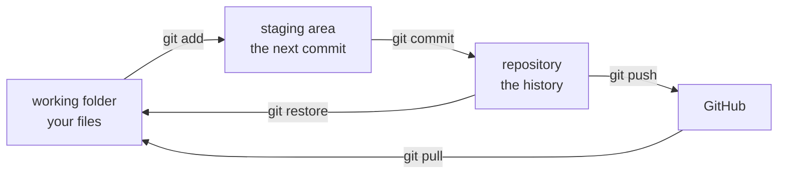
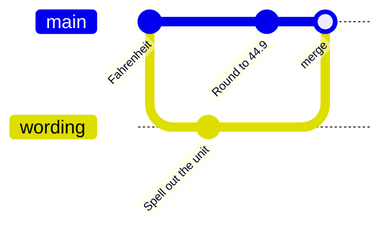

# Seminar 5 — Who Changed the Mean? Git on the Weather Project

**Paired lecture:** 05 Version Control with Git · **Format:** follow-along · **~120 min**
in class

**Today's goal:** every student clones the weather project, finds the commit
that changed its mean temperature, takes it back, commits their own work and
pushes it to their own GitHub repository.

Everything is typed in PowerShell 7, in the terminal of VS Code, the same on
macOS and Windows. The **Source Control** view (`Ctrl+Shift+G`, macOS
`Cmd+Shift+G`) stays open and shows each change.

## Run sheet

| Clock | Section | Typed | The room ends with |
|--|--|--|--|
| | **Part 1 · Git and the project** · 20 min | | |
| 0:00 | [1. Check Git, give it your name](#check) | `git config --global user.name "…"` | three settings |
| 0:10 | [2. Clone the weather project](#clone) | `git clone https://github.com/MindaugasSarpis/weather-project.git` | `weather-project` open in VS Code |
| | **Part 2 · Who changed the mean?** · 35 min | | |
| 0:20 | [3. Read the history: `git log`](#log) | `git log --oneline` | 7 commits, 2 authors |
| 0:30 | [4. Find who wrote a line: `git blame`](#blame) | `git blame -L 38,38 README.md` | `2cca38a`, Tomas, 19 Oct |
| 0:40 | [5. See what a commit changed: `git show`](#show) | `git show 2cca38a -- scripts/rebuild.ps1` | the line that reads the raw file |
| | **Part 3 · Put it right** · 30 min | | |
| 0:55 | [6. Take the commit back: `git revert`](#revert) | `git revert 2cca38a --no-edit` | 7.16 in the README again |
| 1:05 | [7. Rebuild and check the mean](#rebuild) | `./scripts/rebuild.ps1` | `mean 7.15997` |
| 1:10 | [8. Leave made files out: `.gitignore`](#ignore) | `git add .gitignore` | `working tree clean` |
| 1:15 | [9. Your own commit](#commit) | `git diff`, `git add`, `git commit` | 10 commits |
| | **Part 4 · Your copy on GitHub** · 35 min | | |
| 1:25 | [10. A GitHub account](#account) | `github.com` | signed in |
| 1:35 | [11. Publish, then push and pull](#publish) | **Publish Branch**, `git push` | the project on GitHub |
| 1:55 | [12. Wrap up](#wrap-up) | `git log --oneline` | |
| | **Optional, if the room is fast** | | |
| — | [13. A branch and a merge](#branch) | `git switch -c fahrenheit` | a merged branch |
| — | [14. A conflict](#conflict) | `git merge wording` | a conflict resolved |
| — | [15. Tag the result](#tag) | `git tag -a v1.0` | a tag on GitHub |

**If time runs short:** stop after section 11; sections 13 to 15 are optional.

??? info "Before the session"
    - **Room:** internet, and a mailbox each student can open (GitHub sends a
      code). Python from Miniforge is used once, in section 7.
    - **You:** nothing to prepare. The repository
      [MindaugasSarpis/weather-project](https://github.com/MindaugasSarpis/weather-project)
      is small (about 0.5 MB to download) and the same for everyone, so its
      ids on this page are the ids in the room. Ids of commits made today
      differ on every laptop.
    - **Page:** the **▶ Steps** button (bottom right) shows one step at a
      time; arrows or swipe to move, `Esc` to close.

---

## Part 1 · Git and the project { #part-1 }

**0:00 to 0:20**

---

### 1. Check Git, give it your name { #check }

**0:00 · 10 min** · Every commit records a name and an e-mail. Set them once.

1. Open VS Code, then the terminal: **View** > **Terminal**. It shows `PS>`.

    ??? warning "The terminal shows `%` (zsh on a Mac): install PowerShell 7"
        In the terminal, install Homebrew (it asks for your Mac password):

        ```text
        /bin/bash -c "$(curl -fsSL https://raw.githubusercontent.com/Homebrew/install/HEAD/install.sh)"
        ```

        Run the two `Next steps` lines it prints, then:

        ```text
        brew install --cask powershell
        ```

        In VS Code: `Cmd+Shift+P` > **Terminal: Select Default Profile** >
        **pwsh**. Close the terminal (bin icon) and open a new one.

2. Check Git.

    ```text
    git --version
    ```

    ```text
    git version 2.56.0
    ```

    Any version from 2.40 on is fine.

    ??? warning "`git` is not recognized: install it"
        === "macOS"

            ```text
            brew install git
            ```

        === "Windows"

            ```text
            winget install --id Git.Git -e
            ```

        Close the terminal and open a new one.

3. Your name, as it should appear on every commit.

    ```text
    git config --global user.name "Your Name"
    ```

4. Your e-mail; use the one you will give GitHub in section 10.

    ```text
    git config --global user.email "you@example.org"
    ```

5. Let `git pull` join two histories with a merge.

    ```text
    git config --global pull.rebase false
    ```

6. Check.

    ```text
    git config --global --list
    ```

    ```text
    user.name=Your Name
    user.email=you@example.org
    pull.rebase=false
    ```

**Check:** your own name and e-mail in the list.

---

### 2. Clone the weather project { #clone }

**0:10 · 10 min** · `git clone` downloads a project with its whole history.

1. Go to the home folder.

    ```text
    cd ~
    ```

2. Keep the folder of Seminar 4 under another name, so the clone can use
   the name `weather-project`.

    ```text
    Move-Item weather-project weather-project-s4
    ```

    No folder of that name: PowerShell says it cannot find the path. Go on.

3. Clone.

    ```text
    git clone https://github.com/MindaugasSarpis/weather-project.git
    ```

    ```text
    Cloning into 'weather-project'...
    remote: Enumerating objects: 37, done.
    remote: Counting objects: 100% (37/37), done.
    remote: Compressing objects: 100% (20/20), done.
    remote: Total 37 (delta 15), reused 37 (delta 15), pack-reused 0 (from 0)
    Receiving objects: 100% (37/37), 554.33 KiB | 4.05 MiB/s, done.
    Resolving deltas: 100% (15/15), done.
    ```

4. Open it: **File** > **Open Folder...** > `weather-project` > **Open**.
   Answer **Yes, I trust the authors**.
5. Open the terminal again (**View** > **Terminal**). It starts in the
   project folder.

    ```text
    git status
    ```

    ```text
    On branch main
    Your branch is up to date with 'origin/main'.

    nothing to commit, working tree clean
    ```

**Check:** the Explorer shows `data`, `scripts`, `LICENSE`, `README.md`.

---

## Part 2 · Who changed the mean? { #part-2 }

**0:20 to 0:55** · Lecture 1 said 7.16 °C. Open `README.md`: its
**Result** says 5.78 °C.

---

### 3. Read the history: `git log` { #log }

**0:20 · 10 min** · A commit is one saved state: id, author, date, message.

1. One line per commit, newest first.

    ```text
    git log --oneline
    ```

    ```text
    c964141 (HEAD -> main, origin/main, origin/HEAD) Add a licence
    2cca38a Take the mean over all rows of weather.csv
    5cfde5c Write the mean temperature into results and the README
    2770cef Add the rebuild script
    96f2dc4 Describe the columns and the -999 rows
    2d282c7 Add the two scripts handed out with the data
    3e72263 Add the station's hourly log and the spreadsheet export
    ```

    `HEAD -> main` marks where you are; `origin/main`, where GitHub was at
    the clone. As a graph, oldest at the left:

    ```mermaid
    gitGraph
      commit id: "3e72263 data"
      commit id: "2d282c7 scripts"
      commit id: "96f2dc4 columns"
      commit id: "2770cef rebuild"
      commit id: "5cfde5c 7.16"
      commit id: "2cca38a Tomas" type: HIGHLIGHT
      commit id: "c964141 licence"
    ```

2. The last two commits in full.

    ```text
    git log -n 2
    ```

    ```text
    commit c96414183e432f7c687b242d4d41e459640f5dda (HEAD -> main, origin/main, origin/HEAD)
    Author: Smiltė <smilte@example.org>
    Date:   Mon Oct 19 17:05:00 2026 +0300

        Add a licence

    commit 2cca38a4df60b96a8756316ce62e292e8e20a7fe
    Author: Tomas <tomas@example.org>
    Date:   Mon Oct 19 11:45:00 2026 +0300

        Take the mean over all rows of weather.csv

        The valid file leaves 120 hours out. The raw file has every hour.
    ```

3. Only the commits that touched the raw data.

    ```text
    git log --oneline -- data/raw
    ```

    ```text
    3e72263 Add the station's hourly log and the spreadsheet export
    ```

    The raw files are as they arrived: nobody changed them since.

4. In Source Control, open the **Graph** section: the same seven commits.

**Check:** seven commits, by Smiltė and Tomas; one commit for `data/raw`.

!!! warning "The terminal shows `:` or `(END)` and takes no commands"
    Git shows long output one screen at a time. Press `q`.

---

### 4. Find who wrote a line: `git blame` { #blame }

**0:30 · 10 min** · `git blame` gives, for each line, the commit that wrote it.

1. Find the line with 5.78.

    ```text
    Select-String '5.78' README.md
    ```

    ```text
    README.md:38:Mean `temp_c`, 2016 to 2025: **5.78 °C**, over all 87 672 hours of
    ```

2. Ask who wrote line 38.

    ```text
    git blame -L 38,38 README.md
    ```

    ```text
    2cca38a (Tomas 2026-10-19 11:45:00 +0300 38) Mean `temp_c`, 2016 to 2025: **5.78 °C**, …
    ```

3. Ask which commits added or removed the text `5.78`.

    ```text
    git log -S "5.78" --oneline
    ```

    ```text
    2cca38a Take the mean over all rows of weather.csv
    ```

**Check:** commit `2cca38a`, Tomas, 19 October.

---

### 5. See what a commit changed: `git show` { #show }

**0:40 · 15 min** · `git show` prints a commit and its changes: `-` is the old line, `+` the new.

1. The files it changed.

    ```text
    git show --stat 2cca38a
    ```

    ```text
    commit 2cca38a4df60b96a8756316ce62e292e8e20a7fe
    Author: Tomas <tomas@example.org>
    Date:   Mon Oct 19 11:45:00 2026 +0300

        Take the mean over all rows of weather.csv

        The valid file leaves 120 hours out. The raw file has every hour.

     README.md           | 4 ++--
     scripts/rebuild.ps1 | 2 +-
     2 files changed, 3 insertions(+), 3 deletions(-)
    ```

2. The change in `rebuild.ps1`.

    ```text
    git show 2cca38a -- scripts/rebuild.ps1
    ```

    The end of its output:

    ```text
    @@ -3,4 +3,4 @@ $PSNativeCommandUseErrorActionPreference = $true
     New-Item -ItemType Directory -Force data/processed, results | Out-Null
     Select-String ',-999,' data/raw/weather.csv -NotMatch -Raw > data/processed/weather_valid.csv
     python scripts/clean_export.py data/raw/daily_export.csv data/processed/daily.csv
    -python scripts/column_stats.py data/processed/weather_valid.csv temp_c > results/temp_c.txt
    +python scripts/column_stats.py data/raw/weather.csv temp_c > results/temp_c.txt
    ```

3. Count the rows that the raw file has and the valid file has not.

    ```text
    (Select-String ',-999,' data/raw/weather.csv).Count
    ```

    ```text
    120
    ```

    Each adds −999 to the sum: that pulls the mean from 7.16 down to 5.78.

**Check:** the mean now reads `data/raw/weather.csv`, with its 120 rows of
`-999`.

!!! question "Task: where did 7.16 come from, and is the data file the same as Smiltė's?"
    1. Find the commit that first wrote 7.16 into the README, and its day.
    2. Print `scripts/rebuild.ps1` as it was in that commit.
    3. Ask Git for the id of `data/raw/weather.csv`, and compare it with
       your neighbour's.

??? note "Answer"
    1. `5cfde5c`, 16 October: the older of the two lines.

        ```text
        git log -S "7.16" --oneline
        ```

        ```text
        2cca38a Take the mean over all rows of weather.csv
        5cfde5c Write the mean temperature into results and the README
        ```

    2. The last line still reads `weather_valid.csv`.

        ```text
        git show 5cfde5c:scripts/rebuild.ps1
        ```

        ```text
        $ErrorActionPreference = 'Stop'
        $PSNativeCommandUseErrorActionPreference = $true
        New-Item -ItemType Directory -Force data/processed, results | Out-Null
        Select-String ',-999,' data/raw/weather.csv -NotMatch -Raw > data/processed/weather_valid.csv
        python scripts/clean_export.py data/raw/daily_export.csv data/processed/daily.csv
        python scripts/column_stats.py data/processed/weather_valid.csv temp_c > results/temp_c.txt
        ```

    3. The same id on every laptop: Git names a file by a hash of its
       bytes (Lecture 3), so equal ids mean equal bytes.

        ```text
        git hash-object data/raw/weather.csv
        ```

        ```text
        f811f73d93226acc8a0c96562aef9f7825b85b0a
        ```

---

## Part 3 · Put it right { #part-3 }

**0:55 to 1:25**

---

### 6. Take the commit back: `git revert` { #revert }

**0:55 · 10 min** · `git revert` makes a new commit that undoes an old one. The history keeps both.

1. Revert Tomas's commit.

    ```text
    git revert 2cca38a --no-edit
    ```

    ```text
    Auto-merging README.md
    [main 884e155] Revert "Take the mean over all rows of weather.csv"
     Date: Tue Oct 20 10:32:00 2026 +0300
     2 files changed, 3 insertions(+), 3 deletions(-)
    ```

    Your id and date differ.

2. Look at the history.

    ```text
    git log --oneline -n 3
    ```

    ```text
    884e155 (HEAD -> main) Revert "Take the mean over all rows of weather.csv"
    c964141 (origin/main, origin/HEAD) Add a licence
    2cca38a Take the mean over all rows of weather.csv
    ```

    ```mermaid
    gitGraph
      commit id: "5cfde5c 7.16"
      commit id: "2cca38a Tomas" type: HIGHLIGHT
      commit id: "c964141 licence"
      commit id: "884e155 revert" type: REVERSE
    ```

3. In `README.md` the **Result** says 7.16 °C again. Smiltė's licence of
   `c964141` is still there.

**Check:** 7.16 in the README, eight commits.

---

### 7. Rebuild and check the mean { #rebuild }

**1:05 · 5 min** · The README's number must come out of the script.

1. Run the rebuild script.

    ```text
    ./scripts/rebuild.ps1
    ```

    ```text
    9 rows written to data/processed/daily.csv
    ```

2. Read the result.

    ```text
    Get-Content results/temp_c.txt
    ```

    ```text
    file    data/processed/weather_valid.csv
    column  temp_c
    rows    87552
    min     -16.3
    max     32.4
    mean    7.15997
    ```

3. Ask Git.

    ```text
    git status
    ```

    ```text
    On branch main
    Your branch is ahead of 'origin/main' by 1 commit.
      (use "git push" to publish your local commits)

    Untracked files:
      (use "git add <file>..." to include in what will be committed)
            data/processed/
            results/
    ```

**Check:** `mean 7.15997`, and two untracked folders.

!!! warning "`python` is not recognized"
    Miniforge is missing ([Seminar 4](seminar_04.md), section 1). The script
    made `data/processed/weather_valid.csv` before it stopped; go on.

---

### 8. Leave made files out: `.gitignore` { #ignore }

**1:10 · 5 min** · The script makes these folders again at any time, so they stay out of the history.

1. **File** > **New File...**, type `.gitignore`, press `Enter`. Write two
   lines and save.

    ```text
    data/processed/
    results/
    ```

2. The two folders are gone from Source Control; `.gitignore` is there.

    ```text
    git status --short
    ```

    ```text
    ?? .gitignore
    ```

3. Stage it, then commit it.

    ```text
    git add .gitignore
    ```

    ```text
    git commit -m "Leave out the files the rebuild script makes"
    ```

    ```text
    [main 6765177] Leave out the files the rebuild script makes
     1 file changed, 2 insertions(+)
     create mode 100644 .gitignore
    ```

**Check:** `git status` ends with `nothing to commit, working tree clean`.

---

### 9. Your own commit { #commit }

**1:15 · 10 min** · Edit, look at the change, stage, commit: the loop of every day.



1. In `README.md`, under the **Result** paragraph, add one line and save.

    ```text
    Checked on 2026-10-20: the rebuild gives 7.15997.
    ```

2. What changed.

    ```text
    git status --short
    ```

    ```text
     M README.md
    ```

3. How it changed. Also: click `README.md` in Source Control.

    ```text
    git diff
    ```

    ```text
    @@ -38,6 +38,8 @@ the temperature sensor was down.
     Mean `temp_c`, 2016 to 2025: **7.16 °C**, over 87 552 hours. The 120 hours
     marked `-999` are left out. The script writes it to `results/temp_c.txt`.

    +Checked on 2026-10-20: the rebuild gives 7.15997.
    +
     ## How to rebuild
    ```

4. Stage, then commit.

    ```text
    git add README.md
    ```

    ```text
    git commit -m "Record the check of the mean"
    ```

    ```text
    [main 4076046] Record the check of the mean
     1 file changed, 2 insertions(+)
    ```

**Check:** `git log --oneline` shows ten commits, three of them yours.

!!! question "Task: break the raw data, then repair it"
    In VS Code, delete line 2 of `data/raw/weather.csv` and save. Find the
    change with Git, then undo it with one command.

??? note "Answer"
    ```text
    git status --short
    ```

    ```text
     M data/raw/weather.csv
    ```

    ```text
    git diff --stat
    ```

    ```text
     data/raw/weather.csv | 1 -
     1 file changed, 1 deletion(-)
    ```

    ```text
    git restore data/raw/weather.csv
    ```

    `git status --short` prints nothing: the file has its committed bytes
    again.

---

## Part 4 · Your copy on GitHub { #part-4 }

**1:25 to 2:00**

---

### 10. A GitHub account { #account }

**1:25 · 10 min** · GitHub keeps a copy of the repository online.

1. Open [github.com](https://github.com) > **Sign up**.
2. E-mail, password, a username. The username is in the address of every
   repository you make.
3. Type the code that GitHub e-mails you.

**Check:** you are signed in on github.com.

---

### 11. Publish, then push and pull { #publish }

**1:35 · 20 min** · The clone still points at the course repository, which you cannot write to.

1. Where the clone points.

    ```text
    git remote -v
    ```

    ```text
    origin  https://github.com/MindaugasSarpis/weather-project.git (fetch)
    origin  https://github.com/MindaugasSarpis/weather-project.git (push)
    ```

2. Remove that remote.

    ```text
    git remote remove origin
    ```

3. In Source Control, click **Publish Branch** > **Publish to GitHub private
   repository**. Keep the name `weather-project`, press `Enter`.
4. VS Code asks to sign in: **Allow**, then **Continue** and **Authorize**
   in the browser, then back to VS Code.
5. Where the clone points now.

    ```text
    git remote -v
    ```

    ```text
    origin  https://github.com/your-username/weather-project.git (fetch)
    origin  https://github.com/your-username/weather-project.git (push)
    ```

6. Open `https://github.com/your-username/weather-project`: the files, and
   **10 Commits**.

**Check:** your repository on GitHub, marked **Private**.

!!! question "Task: one change each way"
    1. On github.com, edit `README.md` (the pencil), add a line, click
       **Commit changes**. Bring that commit to your laptop.
    2. On your laptop, add another line to `README.md`, commit it, and send
       it to GitHub.

??? note "Answer"
    The ids below are from one run; yours differ.

    1. ```text
       git pull
       ```

        ```text
        From https://github.com/your-username/weather-project
           4076046..9a5ae80  main       -> origin/main
        Updating 4076046..9a5ae80
        Fast-forward
         README.md | 1 +
         1 file changed, 1 insertion(+)
        ```

    2. ```text
       git add README.md
       ```

        ```text
        git commit -m "Add a line"
        ```

        ```text
        git push
        ```

        ```text
        To https://github.com/your-username/weather-project.git
           9a5ae80..1da24de  main -> main
        ```

---

### 12. Wrap up { #wrap-up }

**1:55 · 5 min**

| To | Type |
|--|--|
| copy a project with its history | `git clone URL` |
| see the history | `git log --oneline` |
| find who wrote a line | `git blame -L 38,38 FILE` |
| see a commit | `git show ID` |
| undo a commit, keep the history | `git revert ID` |
| undo an edit not yet committed | `git restore FILE` |
| commit | `git status`, `git diff`, `git add FILE`, `git commit -m "…"` |
| sync with GitHub | `git push`, `git pull` |

Seminar 6 starts from this repository.

---

## Optional, if the room is fast { #optional }

---

### 13. A branch and a merge { #branch }

**— · 10 min** · A branch is a second line of commits; merge brings it back. Ids on sections 13 to 15 are from one run; yours differ.

1. Make a branch and go to it.

    ```text
    git switch -c fahrenheit
    ```

2. In `README.md`, under the line that ends with `results/temp_c.txt`,
   add a line and save.

    ```text
    In Fahrenheit: 44.89 °F.
    ```

3. Commit all changed files at once.

    ```text
    git commit -am "Give the mean in Fahrenheit"
    ```

4. Back to `main`: the line is gone from `README.md`.

    ```text
    git switch main
    ```

5. Merge.

    ```text
    git merge fahrenheit
    ```

    ```text
    Updating 1da24de..c592876
    Fast-forward
     README.md | 1 +
     1 file changed, 1 insertion(+)
    ```

6. Delete the branch name, push.

    ```text
    git branch -d fahrenheit
    ```

    ```text
    git push
    ```

**Check:** the Fahrenheit line in `README.md` on `main`.

---

### 14. A conflict { #conflict }

**— · 15 min** · Two branches change the same line; Git asks which to keep.



1. A branch that rewrites the line.

    ```text
    git switch -c wording
    ```

    Change the line to `In degrees Fahrenheit: 44.89.`, save.

    ```text
    git commit -am "Spell out the unit"
    ```

2. On `main`, change the same line differently.

    ```text
    git switch main
    ```

    Change the line to `In Fahrenheit: 44.9 °F.`, save.

    ```text
    git commit -am "Round the Fahrenheit mean to one decimal"
    ```

3. Merge.

    ```text
    git merge wording
    ```

    ```text
    Auto-merging README.md
    CONFLICT (content): Merge conflict in README.md
    Automatic merge failed; fix conflicts and then commit the result.
    ```

4. `README.md` now holds both lines.

    ```text
    <<<<<<< HEAD
    In Fahrenheit: 44.9 °F.
    =======
    In degrees Fahrenheit: 44.89.
    >>>>>>> wording
    ```

    Above the block VS Code offers **Accept Current Change** (`main`),
    **Accept Incoming Change** (`wording`), **Accept Both Changes**. Click
    one, save.

5. Mark it resolved, commit the merge.

    ```text
    git add README.md
    ```

    ```text
    git commit --no-edit
    ```

6. The history has two lines that join.

    ```text
    git log --oneline --graph -n 5
    ```

    ```text
    *   52a0aaa (HEAD -> main) Merge branch 'wording'
    |\
    | * d669a9d (wording) Spell out the unit
    * | 597d7ac Round the Fahrenheit mean to one decimal
    |/
    * c592876 (origin/main, origin/HEAD) Give the mean in Fahrenheit
    * 1da24de Add a line
    ```

**Check:** no `<<<<<<<` left in `README.md`, `git status` clean.

---

### 15. Tag the result { #tag }

**— · 5 min** · A tag is a name for one commit that never moves: "the state that gave 7.16".

1. Tag the last commit.

    ```text
    git tag -a v1.0 -m "Mean 7.16 °C, checked"
    ```

2. Send the tag to GitHub; tags are not pushed by `git push` alone.

    ```text
    git push origin v1.0
    ```

    ```text
    To https://github.com/your-username/weather-project.git
     * [new tag]         v1.0 -> v1.0
    ```

**Check:** on GitHub, the branch menu has a **Tags** tab with `v1.0`.

---

## Aims practised

- ♻️ **Reproducibility:** the README's number is checked against the script
  that makes it, and the history says who changed what, when and why.
- 🔧 **Tool-agnostic:** the same lines in PowerShell 7 on macOS and Windows;
  the Source Control view shows the same state.
- 📁 **Files:** made files stay out of the repository; raw data is restored
  from the history in one command.
