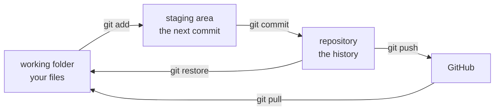
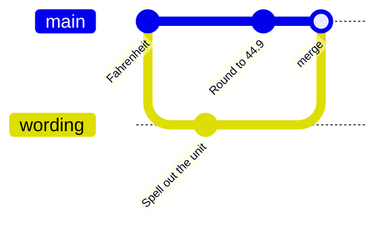

# Seminar 6 · Git

**Paired lecture:** 06 Version Control with Git · **Format:** type-along tutorial, in class

<!-- ~120 min: the length pnpm timing:check reads -->

**Today's question:** Who changed the mean?

**Today's goal:** every student clones the weather project, finds the commit
that changed its mean temperature, takes it back, commits their own work and
pushes it to their own GitHub repository.

Everything is typed in the terminal of VS Code (zsh on macOS, Git Bash on
Windows; the lines are the same in both). In the blocks, a line that starts
with `$` is typed, and every other line is what comes back. The **Source
Control** view (`Ctrl+Shift+G`, macOS `Cmd+Shift+G`) stays open and shows
each change.

**If time runs short:** stop after section 11; sections 13 to 16 are optional.

??? info "Before the session"
    - **Room:** Git and Miniforge on every laptop (the [Setup](../setup.md)
      page), internet, and a mailbox each student can open (GitHub sends a
      code). Nothing from earlier seminars is needed: the clone and one zip
      bring every file.
    - **You:** nothing to prepare. The repository
      [MindaugasSarpis/weather-project](https://github.com/MindaugasSarpis/weather-project)
      is small (about 0.5 MB to download) and the same for everyone, so its
      ids on this page are the ids in the room. Ids of commits made today
      differ on every laptop.
    - **Page:** the **▶ Steps** button (bottom right) shows one step at a
      time; arrows or swipe to move, `Esc` to close.

---

## Part 1 · Git and the project { #part-1 }

<!-- 0:00 to 0:20 -->

**Git** keeps every saved state of a project. A folder together with that history is a **repository**.

Further reading: [Pro Git, chapter 2: Git Basics](https://git-scm.com/book/en/v2/Git-Basics-Getting-a-Git-Repository);
[HSF Analysis Essentials, Git](https://hsf-training.github.io/analysis-essentials/git/README.html).

---

### 1. Check Git, give it your name { #check }

<!-- 0:00 · 10 min -->

Every commit records a name and an e-mail. Set them once.

1. Open VS Code, then the terminal: **View** > **Terminal**. The prompt
   ends in `%` on a Mac (zsh) and `$` on Windows (Git Bash).

    ??? warning "Windows: the terminal shows `PS` (PowerShell)"
        `Ctrl+Shift+P` > **Terminal: Select Default Profile** > **Git Bash**.
        Close the terminal (bin icon) and open a new one. No **Git Bash** in
        the list: Git is missing, see step 2.

2. Check Git.

    ```text
    $ git --version
    git version 2.56.0
    ```

    Any version from 2.40 on is fine.

    ??? warning "`command not found: git`: install it"
        === "macOS"

            ```text
            $ brew install git
            ```

        === "Windows"

            In the Windows terminal (PowerShell), then restart VS Code and
            take **Git Bash** as in step 1:

            ```text
            winget install --id Git.Git -e
            ```

        Close the terminal and open a new one.

3. Your name, as it should appear on every commit.

    ```text
    $ git config --global user.name "Your Name"
    ```

4. Your e-mail; use the one you will give GitHub in section 10.

    ```text
    $ git config --global user.email "you@example.org"
    ```

5. Let `git pull` join two histories with a merge.

    ```text
    $ git config --global pull.rebase false
    ```

6. Check.

    ```text
    $ git config --global --list
    user.name=Your Name
    user.email=you@example.org
    pull.rebase=false
    ```

**Check:** your own name and e-mail in the list.

---

### 2. Clone the weather project { #clone }

<!-- 0:10 · 10 min -->

`git clone` downloads a project with its whole history.

1. Go to the home folder.

    ```text
    $ cd ~
    ```

2. Clone it into a new folder, `weather-s06`: the name after the address
   names the folder.

    ```text
    $ git clone https://github.com/MindaugasSarpis/weather-project.git weather-s06
    Cloning into 'weather-s06'...
    remote: Enumerating objects: 37, done.
    remote: Counting objects: 100% (37/37), done.
    remote: Compressing objects: 100% (20/20), done.
    remote: Total 37 (delta 15), reused 37 (delta 15), pack-reused 0 (from 0)
    Receiving objects: 100% (37/37), 554.27 KiB | 4.43 MiB/s, done.
    Resolving deltas: 100% (15/15), done.
    ```

3. Open it: **File** > **Open Folder...** > `weather-s06` > **Open**.
   Answer **Yes, I trust the authors**.
4. Open the terminal again (**View** > **Terminal**). It starts in the
   project folder.

    ```text
    $ git status
    On branch main
    Your branch is up to date with 'origin/main'.

    nothing to commit, working tree clean
    ```

5. The history lives in a hidden folder, `.git`, inside the project.
   `ls` hides names that start with a dot; `-a` shows them, `-d` names the
   folder instead of listing what is in it.

    ```text
    $ ls -d .git
    .git
    ```

    Delete `.git` and the folder is a plain folder again; keep it and every
    command below works.

**Check:** the Explorer shows `data`, `scripts`, `LICENSE`, `README.md`.

---

## Part 2 · Who changed the mean? { #part-2 }

<!-- 0:20 to 0:55 -->

Without the 120 rows of `-999`, the mean temperature is 7.16 °C. Open the clone's `README.md`: its **Result** says 5.78 °C. The history says who changed it, when and why.

---

### 3. Read the history: `git log` { #log }

<!-- 0:20 · 10 min -->

A commit is one saved state: id, author, date, message.

1. One line per commit, newest first.

    ```text
    $ git log --oneline
    0f19f54 (HEAD -> main, origin/main, origin/HEAD) Add a licence
    85e435e Take the mean over all rows of weather.csv
    a9c513d Write the mean temperature into results and the README
    9f28b51 Add the rebuild script
    96f2dc4 Describe the columns and the -999 rows
    2d282c7 Add the two scripts handed out with the data
    3e72263 Add the station's hourly log and the spreadsheet export
    ```

    The seven-character code is the commit's **id**. `HEAD -> main` marks
    where you are; `origin/main`, where GitHub was at the clone.

2. The same seven commits as a graph, oldest at the left.

    ```mermaid
    gitGraph
      commit id: "3e72263 data"
      commit id: "2d282c7 scripts"
      commit id: "96f2dc4 columns"
      commit id: "9f28b51 rebuild"
      commit id: "a9c513d 7.16"
      commit id: "85e435e Tomas" type: HIGHLIGHT
      commit id: "0f19f54 licence"
    ```

3. The last two commits in full.

    ```text
    $ git log -n 2
    commit 0f19f54e1b79db8133153f28d76be685862182b5 (HEAD -> main, origin/main, origin/HEAD)
    Author: Smiltė <smilte@example.org>
    Date:   Mon Oct 19 17:05:00 2026 +0300

        Add a licence

    commit 85e435ef56fe4308debf88b5b2d546e4000bbce6
    Author: Tomas <tomas@example.org>
    Date:   Mon Oct 19 11:45:00 2026 +0300

        Take the mean over all rows of weather.csv

        The valid file leaves 120 hours out. The raw file has every hour.
    ```

4. Only the commits that touched the raw data. `--` separates the
   options from the paths.

    ```text
    $ git log --oneline -- data/raw
    3e72263 Add the station's hourly log and the spreadsheet export
    ```

    The raw files are as they arrived: nobody changed them since.

5. In Source Control, open the **Graph** section: the same seven commits.

**Check:** seven commits, by Smiltė and Tomas; one commit for `data/raw`.

!!! warning "The terminal shows `:` or `(END)` and takes no commands"
    Git shows long output one screen at a time. Press `q`.

---

### 4. Find who wrote a line: `git blame` { #blame }

<!-- 0:30 · 10 min -->

`git blame` gives, for each line, the commit that wrote it.

1. Find the line with 5.78.

    ```text
    $ grep -n '5.78' README.md
    38:Mean `temp_c`, 2016 to 2025: **5.78 °C**, over all 87 672 hours of
    ```

2. Ask who wrote line 38.

    ```text
    $ git blame -L 38,38 README.md
    85e435e (Tomas 2026-10-19 11:45:00 +0300 38) Mean `temp_c`, 2016 to 2025: **5.78 °C**, …
    ```

3. Ask which commits added or removed the text `5.78`.

    ```text
    $ git log -S "5.78" --oneline
    85e435e Take the mean over all rows of weather.csv
    ```

**Check:** commit `85e435e`, Tomas, 19 October.

---

### 5. See what a commit changed: `git show` { #show }

<!-- 0:40 · 15 min -->

`git show` prints a commit and its changes: `-` is the old line, `+` the new.

1. The files it changed.

    ```text
    $ git show --stat 85e435e
    commit 85e435ef56fe4308debf88b5b2d546e4000bbce6
    Author: Tomas <tomas@example.org>
    Date:   Mon Oct 19 11:45:00 2026 +0300

        Take the mean over all rows of weather.csv

        The valid file leaves 120 hours out. The raw file has every hour.

     README.md          | 4 ++--
     scripts/rebuild.sh | 2 +-
     2 files changed, 3 insertions(+), 3 deletions(-)
    ```

2. The change in `rebuild.sh`.

    ```text
    $ git show 85e435e -- scripts/rebuild.sh
    ...
    @@ -3,4 +3,4 @@ set -e
     mkdir -p data/processed results
     grep -v ',-999,' data/raw/weather.csv > data/processed/weather_valid.csv
     python scripts/clean_export.py data/raw/daily_export.csv data/processed/daily.csv
    -python scripts/column_stats.py data/processed/weather_valid.csv temp_c > results/temp_c.txt
    +python scripts/column_stats.py data/raw/weather.csv temp_c > results/temp_c.txt
    ```

3. Count the rows that the raw file has and the valid file has not.

    ```text
    $ grep -c ',-999,' data/raw/weather.csv
    120
    ```

    Each adds −999 to the sum: that pulls the mean from 7.16 down to 5.78.

**Check:** the mean now reads `data/raw/weather.csv`, with its 120 rows of
`-999`.

!!! question "Task: where did 7.16 come from, and is the data file the same as Smiltė's?"
    1. Find the commit that first wrote 7.16 into the README, and its day.
    2. Print `scripts/rebuild.sh` as it was in that commit.
    3. Ask Git for the id of `data/raw/weather.csv`, and compare it with
       your neighbour's.

??? success "Answer"
    1. `a9c513d`, 16 October: the older of the two lines.

        ```text
        $ git log -S "7.16" --oneline
        85e435e Take the mean over all rows of weather.csv
        a9c513d Write the mean temperature into results and the README
        ```

    2. The last line still reads `weather_valid.csv`.

        ```text
        $ git show a9c513d:scripts/rebuild.sh
        #!/usr/bin/env bash
        set -e
        mkdir -p data/processed results
        grep -v ',-999,' data/raw/weather.csv > data/processed/weather_valid.csv
        python scripts/clean_export.py data/raw/daily_export.csv data/processed/daily.csv
        python scripts/column_stats.py data/processed/weather_valid.csv temp_c > results/temp_c.txt
        ```

    3. The same id on every laptop: Git names a file by a **hash** of its
       bytes, a 40-digit number that changes when a single byte changes, so
       equal ids mean equal bytes.

        ```text
        $ git hash-object data/raw/weather.csv
        f811f73d93226acc8a0c96562aef9f7825b85b0a
        ```

---

## Part 3 · Put it right { #part-3 }

<!-- 0:55 to 1:25 -->

Undo the change without losing the history, check the number against the script, then add your own work.

---

### 6. Take the commit back: `git revert` { #revert }

<!-- 0:55 · 10 min -->

`git revert` makes a new commit that undoes an old one. The history keeps both.

1. Revert Tomas's commit.

    ```text
    $ git revert 85e435e --no-edit
    Auto-merging README.md
    [main 32855d4] Revert "Take the mean over all rows of weather.csv"
     Date: Tue Oct 27 10:32:00 2026 +0200
     2 files changed, 3 insertions(+), 3 deletions(-)
    ```

    Your id and date differ.

2. Look at the history.

    ```text
    $ git log --oneline -n 3
    32855d4 (HEAD -> main) Revert "Take the mean over all rows of weather.csv"
    0f19f54 (origin/main, origin/HEAD) Add a licence
    85e435e Take the mean over all rows of weather.csv
    ```

3. As a graph: Tomas's commit stays, and the new one undoes it.

    ```mermaid
    gitGraph
      commit id: "a9c513d 7.16"
      commit id: "85e435e Tomas" type: HIGHLIGHT
      commit id: "0f19f54 licence"
      commit id: "32855d4 revert" type: REVERSE
    ```

4. In `README.md` the **Result** says 7.16 °C again. Smiltė's licence of
   `0f19f54` is still there.

**Check:** 7.16 in the README, eight commits.

---

### 7. Rebuild and check the mean { #rebuild }

<!-- 1:05 · 5 min -->

The README's number must come out of the script.

1. Run the rebuild script.

    ```text
    $ ./scripts/rebuild.sh
    9 rows written to data/processed/daily.csv
    ```

2. Read the result.

    ```text
    $ cat results/temp_c.txt
    file    data/processed/weather_valid.csv
    column  temp_c
    rows    87552
    min     -16.3
    max     32.4
    mean    7.15997
    ```

3. Ask Git.

    ```text
    $ git status
    On branch main
    Your branch is ahead of 'origin/main' by 1 commit.
      (use "git push" to publish your local commits)

    Untracked files:
      (use "git add <file>..." to include in what will be committed)
            data/processed/
            results/
    ```

**Check:** `mean 7.15997`, and two untracked folders.

!!! warning "`command not found: python`"
    Miniforge is missing (the [Setup](../setup.md) page). The script made
    `data/processed/weather_valid.csv` before it stopped; go on.

---

### 8. Leave made files out: `.gitignore` { #ignore }

<!-- 1:10 · 5 min -->

Files that programs make again at any time stay out of the history.

1. **File** > **New File...**, type `.gitignore`, press `Enter`. Write four
   lines and save. The first two folders come from `rebuild.sh`;
   `__pycache__` from Python's `import`, `.ipynb_checkpoints` from
   JupyterLab; the files of section 9 make both.

    ```text
    data/processed/
    results/
    __pycache__/
    .ipynb_checkpoints/
    ```

2. The two folders of the rebuild are gone from Source Control;
   `.gitignore` is there.

    ```text
    $ git status --short
    ?? .gitignore
    ```

3. Stage it, then commit it.

    ```text
    $ git add .gitignore
    $ git commit -m "Leave out the files the rebuild script makes"
    [main 0f56dc6] Leave out the files the rebuild script makes
     1 file changed, 4 insertions(+)
     create mode 100644 .gitignore
    ```

**Check:** `git status` ends with `nothing to commit, working tree clean`.

---

### 9. Commit the work of Seminar 5 { #commit }

<!-- 1:15 · 10 min -->

Copy, look at the change, stage, commit: the loop of every day.



1. The work of Seminar 5 comes as one zip: on the
   [Releases page](https://github.com/MindaugasSarpis/weather-project/releases),
   under **Assets**, click `weather-s06.zip`. It holds a folder
   `weather-s06` with the Python scripts, the notebook and the environment
   file of Seminar 5. The clone has the same name, so unzipping it into the
   home folder puts the files into the clone.

    ```text
    $ unzip ~/Downloads/weather-s06.zip -d ~
    Archive:  /Users/smilte/Downloads/weather-s06.zip
       creating: /Users/smilte/weather-s06/notebooks/
      inflating: /Users/smilte/weather-s06/environment.yml
      inflating: /Users/smilte/weather-s06/notebooks/explore.ipynb
      inflating: /Users/smilte/weather-s06/scripts/coldest_hour.py
      inflating: /Users/smilte/weather-s06/scripts/hours.py
      inflating: /Users/smilte/weather-s06/scripts/mean_temp.py
      inflating: /Users/smilte/weather-s06/scripts/now.py
      inflating: /Users/smilte/weather-s06/scripts/weather.py
    ```

    Safari unpacks a zip by itself: then the folder `weather-s06` is in
    `Downloads`, and `cp -R ~/Downloads/weather-s06/ ~/weather-s06/` copies
    its files into the clone.

2. What changed: seven new files, shown as untracked (`??`).

    ```text
    $ git status --short
    ?? environment.yml
    ?? notebooks/
    ?? scripts/coldest_hour.py
    ?? scripts/hours.py
    ?? scripts/mean_temp.py
    ?? scripts/now.py
    ?? scripts/weather.py
    ```

3. In `README.md`, under the **Result** paragraph, add two lines and save.

    ```text
    Checked in Python, `scripts/mean_temp.py`: 7.16 °C over 87 552 hours.
    The coldest hour, `scripts/coldest_hour.py`: 2025-01-07T05:00, -16.3 °C.
    ```

4. How the README changed. Also: click `README.md` in Source Control.

    ```text
    $ git diff
    @@ -38,6 +38,9 @@ the temperature sensor was down.
     Mean `temp_c`, 2016 to 2025: **7.16 °C**, over 87 552 hours. The 120 hours
     marked `-999` are left out. The script writes it to `results/temp_c.txt`.

    +Checked in Python, `scripts/mean_temp.py`: 7.16 °C over 87 552 hours.
    +The coldest hour, `scripts/coldest_hour.py`: 2025-01-07T05:00, -16.3 °C.
    +
     ## How to rebuild
    ```

    `git diff` shows changed files only; new files have no old version yet.

5. Stage all of it, look again.

    ```text
    $ git add scripts notebooks environment.yml README.md
    $ git status --short
    M  README.md
    A  environment.yml
    A  notebooks/explore.ipynb
    A  scripts/coldest_hour.py
    A  scripts/hours.py
    A  scripts/mean_temp.py
    A  scripts/now.py
    A  scripts/weather.py
    ```

6. Commit.

    ```text
    $ git commit -m "Add the Python work of Seminar 5"
    [main b982e59] Add the Python work of Seminar 5
     8 files changed, 460 insertions(+)
     create mode 100644 environment.yml
     create mode 100644 notebooks/explore.ipynb
     create mode 100644 scripts/coldest_hour.py
     create mode 100644 scripts/hours.py
     create mode 100644 scripts/mean_temp.py
     create mode 100644 scripts/now.py
     create mode 100644 scripts/weather.py
    ```

    Your id and numbers differ.

**Check:** `git log --oneline` shows ten commits, three of them yours.

!!! question "Task: break the raw data, then repair it"
    In VS Code, delete line 2 of `data/raw/weather.csv` and save. Find the
    change with Git, then undo it with one command.

??? success "Answer"
    ```text
    $ git status --short
     M data/raw/weather.csv
    $ git diff --stat
     data/raw/weather.csv | 1 -
     1 file changed, 1 deletion(-)
    $ git restore data/raw/weather.csv
    ```

    `git status --short` prints nothing: the file has its committed bytes
    again.

---

## Part 4 · Your copy on GitHub { #part-4 }

<!-- 1:25 to 2:00 -->

A **remote** is another copy of the repository, here on GitHub: `git push` sends your commits there, `git pull` brings its commits here.

---

### 10. A GitHub account { #account }

<!-- 1:25 · 10 min -->

GitHub keeps a copy of the repository online.

1. Open [github.com](https://github.com) > **Sign up**.
2. E-mail, password, a username. The username is in the address of every
   repository you make.
3. Type the code that GitHub e-mails you.

**Check:** you are signed in on github.com.

---

### 11. Publish, then push and pull { #publish }

<!-- 1:35 · 20 min -->

The clone still points at the course repository, which you cannot write to.

1. Where the clone points.

    ```text
    $ git remote -v
    origin  https://github.com/MindaugasSarpis/weather-project.git (fetch)
    origin  https://github.com/MindaugasSarpis/weather-project.git (push)
    ```

2. Remove that remote.

    ```text
    $ git remote remove origin
    ```

3. In Source Control, click **Publish Branch** > **Publish to GitHub private
   repository**. VS Code proposes the folder's name, `weather-s06`; keep
   it, press `Enter`.
4. VS Code asks to sign in: **Allow**, then **Continue** and **Authorize**
   in the browser, then back to VS Code.
5. Where the clone points now.

    ```text
    $ git remote -v
    origin  https://github.com/your-username/weather-s06.git (fetch)
    origin  https://github.com/your-username/weather-s06.git (push)
    ```

6. Open `https://github.com/your-username/weather-s06`: the files, and
   **10 Commits**.
**Check:** your repository on GitHub, marked **Private**.

!!! question "Task: one change each way"
    1. On github.com, edit `README.md` (the pencil), add a line, click
       **Commit changes**. Bring that commit to your laptop.
    2. On your laptop, add another line to `README.md`, commit it, and send
       it to GitHub.

??? success "Answer"
    The ids below are from one run; yours differ.

    1. `git pull` brings the commit made on github.com.

        ```text
        $ git pull
        From https://github.com/your-username/weather-s06
           b982e59..631a247  main       -> origin/main
        Updating b982e59..631a247
        Fast-forward
         README.md | 1 +
         1 file changed, 1 insertion(+)
        ```

    2. Stage, commit, push.

        ```text
        $ git add README.md
        $ git commit -m "Add a line"
        $ git push
        To https://github.com/your-username/weather-s06.git
           631a247..066dcb5  main -> main
        ```

---

### 12. Wrap up { #wrap-up }

<!-- 1:55 · 5 min -->


| To | Type |
|--|--|
| copy a project with its history | `git clone URL` |
| see the history | `git log --oneline` |
| find who wrote a line | `git blame -L 38,38 FILE` |
| see a commit | `git show ID` |
| undo a commit, keep the history | `git revert ID` |
| undo an edit not yet committed | `git restore FILE` |
| commit | `git status`, `git diff`, `git add FILE`, `git commit -m "…"` |
| sync with GitHub | `git push`, `git pull` |

---

## Optional, if the room goes fast { #optional }

---

### 13. A branch and a merge { #branch }

<!-- — · 10 min -->

A branch is a second line of commits; merge brings it back. Ids on sections 13 to 15 are from one run; yours differ.

1. Make a branch and go to it.

    ```text
    $ git switch -c fahrenheit
    ```

2. In `README.md`, under the line that ends with `results/temp_c.txt`,
   add a line and save.

    ```text
    In Fahrenheit: 44.89 °F.
    ```

3. Commit all changed files at once.

    ```text
    $ git commit -am "Give the mean in Fahrenheit"
    ```

4. Back to `main`: the line is gone from `README.md`.

    ```text
    $ git switch main
    ```

5. Merge.

    ```text
    $ git merge fahrenheit
    Updating 066dcb5..8f1c7d7
    Fast-forward
     README.md | 1 +
     1 file changed, 1 insertion(+)
    ```

6. Delete the branch name, push.

    ```text
    $ git branch -d fahrenheit
    $ git push
    ```

**Check:** the Fahrenheit line in `README.md` on `main`.

---

### 14. A conflict { #conflict }

<!-- — · 15 min -->

Two branches change the same line; Git asks which to keep.



1. A branch that rewrites the line.

    ```text
    $ git switch -c wording
    ```

    Change the line to `In degrees Fahrenheit: 44.89.`, save.

    ```text
    $ git commit -am "Spell out the unit"
    ```

2. On `main`, change the same line differently.

    ```text
    $ git switch main
    ```

    Change the line to `In Fahrenheit: 44.9 °F.`, save.

    ```text
    $ git commit -am "Round the Fahrenheit mean to one decimal"
    ```

3. Merge.

    ```text
    $ git merge wording
    Auto-merging README.md
    CONFLICT (content): Merge conflict in README.md
    Automatic merge failed; fix conflicts and then commit the result.
    ```

4. `README.md` now holds both lines.

    ```text
    <<<<<<< HEAD
    In Fahrenheit: 44.9 °F.
    =======
    In degrees Fahrenheit: 44.89.
    >>>>>>> wording
    ```

    Above the block VS Code offers **Accept Current Change** (`main`),
    **Accept Incoming Change** (`wording`), **Accept Both Changes**. Click
    one, save.

5. Mark it resolved, commit the merge.

    ```text
    $ git add README.md
    $ git commit --no-edit
    ```

6. The history has two lines that join.

    ```text
    $ git log --oneline --graph -n 5
    *   e5e6111 (HEAD -> main) Merge branch 'wording'
    |\
    | * ece21fe (wording) Spell out the unit
    * | c798c1e Round the Fahrenheit mean to one decimal
    |/
    * 8f1c7d7 (origin/main, origin/HEAD) Give the mean in Fahrenheit
    * 066dcb5 Add a line
    ```

**Check:** no `<<<<<<<` left in `README.md`, `git status` clean.

---

### 15. Tag the result { #tag }

<!-- — · 5 min -->

A tag is a name for one commit that never moves: "the state that gave 7.16".

1. Tag the last commit.

    ```text
    $ git tag -a v1.0 -m "Mean 7.16 °C, checked"
    ```

2. Send the tag to GitHub; tags are not pushed by `git push` alone.

    ```text
    $ git push origin v1.0
    To https://github.com/your-username/weather-s06.git
     * [new tag]         v1.0 -> v1.0
    ```

**Check:** on GitHub, the branch menu has a **Tags** tab with `v1.0`.

### 16. Advanced tasks { #advanced }

<!-- — · 20 min -->

Harder questions about the same history, for a room that is done early. Each answer is folded under its task; the outputs are from a fresh clone, so your own commits come on top of them.

!!! question "Advanced task: let Git find the commit"
    `git bisect` finds the first commit with a property by halving the
    history, testing one commit at each step. Mark `0f19f54` as bad and the
    first commit, `3e72263`, as good, and let Git run a test that fails
    when the README says 5.78. How many commits does it test?

??? success "Answer"
    `sh -c '...'` runs the test; `!` turns its result round, so "5.78 found"
    counts as bad.

    ```text
    $ git bisect start 0f19f54 3e72263
    $ git bisect run sh -c '! grep -q "5.78" README.md'
    Bisecting: 2 revisions left to test after this (roughly 2 steps)
    [9f28b51be4d356315e48263d9037af025ee83553] Add the rebuild script
    ...
    85e435ef56fe4308debf88b5b2d546e4000bbce6 is the first bad commit
    ...
    $ git bisect reset
    ```

    Three tests for six commits; a thousand commits would take ten. With a
    test script that checks the mean, this finds a wrong number in any
    history.

!!! question "Advanced task: the life of one line"
    Show every version of README line 38, the mean, with the commit that
    wrote it, in one command.

??? success "Answer"
    `-L 38,38:FILE` follows a range of lines back through the history.

    ```text
    $ git log -L 38,38:README.md --oneline
    85e435e Take the mean over all rows of weather.csv
    ...
    -Mean `temp_c`, 2016 to 2025: **7.16 °C**, over 87 552 hours. The 120 hours
    -marked `-999` are left out. The script writes it to `results/temp_c.txt`.
    +Mean `temp_c`, 2016 to 2025: **5.78 °C**, over all 87 672 hours of
    a9c513d Write the mean temperature into results and the README
    ...
    +Mean `temp_c`, 2016 to 2025: **7.16 °C**, over 87 552 hours. The 120 hours
    +marked `-999` are left out. The script writes it to `results/temp_c.txt`.
    ```

    In your repository, your revert is the newest entry.

!!! question "Advanced task: who did what"
    How many commits did each person make, and which files did Tomas
    change? Use one command for each question.

??? success "Answer"
    ```text
    $ git shortlog -sn HEAD
         6  Smiltė
         1  Tomas
    $ git log --author=Tomas --stat --oneline
    85e435e Take the mean over all rows of weather.csv
     README.md          | 4 ++--
     scripts/rebuild.sh | 2 +-
     2 files changed, 3 insertions(+), 3 deletions(-)
    ```

    In your repository your own name has a line too. `--author` takes part
    of a name or e-mail.

---

## Aims practised

- ♻️ **Reproducibility:** the README's number is checked against the script
  that makes it, and the history says who changed what, when and why.
- 🔧 **Tool-agnostic:** the same lines in zsh on macOS and Git Bash on Windows;
  the Source Control view shows the same state.
- 📁 **Files:** made files stay out of the repository; raw data is restored
  from the history in one command.
