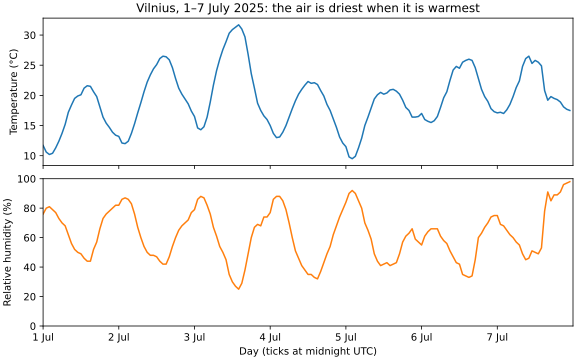
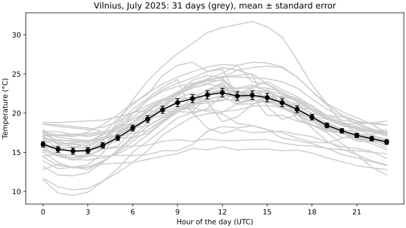

# Seminar 7 · Visualisation

**Paired lecture:** 07 Data Visualisation · **Format:** a showcase, then a problem, in class

<!-- ~120 min: the length pnpm timing:check reads -->

**Today's question:** Has Vilnius got warmer since 1881, and by how much?

The lecturer runs Part 2 from this page; in Part 3 the room works in pairs.
Everything is typed in VS Code: the scripts in the editor, the commands in its
terminal (zsh on macOS, Git Bash on Windows; the same lines in both). A line
that starts with `$` is typed without the `$`; `...` stands for lines left out.

**If time runs short:** leave out section 6 (the log axis); its calls are on the library card.

??? info "Before the session"
    - **Room:** Miniforge and VS Code with its Python extension on every
      laptop (the [Setup](../setup.md) page), internet for conda: Python
      about 25 MB on a Mac and 37 MB on Windows, Matplotlib with what it
      needs about 55 MB more on a Mac and 160 MB on Windows.
    - **No file is handed out.** Each script fetches its data from the
      public address in its code:
        - the hourly weather of Vilnius in July 2025: Open-Meteo's
          historical weather API, CC BY 4.0, "Weather data by Open-Meteo.com";
        - the monthly CO₂ at Mauna Loa: NOAA Global Monitoring Laboratory,
          free to use, credit asked;
        - life expectancy and income of 142 countries in 2007: Gapminder
          (gapminder.org, CC BY 4.0), the excerpt of the R package
          gapminder (CC0), as a CSV file of the Rdatasets collection;
        - the daily mean temperature of Vilnius since 1881 (6.1 MB, about
          2 s): NOAA NCEI, GHCN-Daily, free for research and education
          (WMO Resolution 40), citation in section 8;
        - the yearly temperature of the Earth and of its bands of latitude:
          NASA GISS, GISTEMP v4, public domain.
    - **Open-Meteo's free service** allows one internet address 10 000
      calls a day and counts a request of more than two weeks as several
      (days ÷ 14). The two requests on this page count 1 and 2; 86 years
      of daily data would count about 2 200. A room usually shares one
      address.
    - **The numbers** on this page come from runs on 10 November 2026. The
      CO₂ file gains a month every month, so the line that `co2.py` prints
      changes. The Vilnius file ends on 24 August 2025; days added later
      change 2025 and may make it a complete year. GISTEMP is recomputed
      every month, so its last digit can move.
    - **Missing a tool?** VS Code: [Setup, step 1](../setup.md#vscode);
      `conda` (Miniforge): [Setup, steps 2–4](../setup.md#shell); the Python
      extension: [Setup, step 7](../setup.md#extensions). A laptop that
      already has `s07`: `conda env remove -n s07`, and rename an old
      `weather-s07` folder.
    - **Keys** are written for Windows, macOS in brackets. Paths are shown
      for a Mac (`/Users/smilte/...`); Git Bash shows `/c/Users/smilte/...`.

---

## Part 1 · Set up { #part-1 }

### 1. A new folder and an environment { #start }

<!-- 0:00 · 7 min -->

An environment is a folder with its own Python and its own packages; today's is named `s07`.

1. In VS Code, **View** > **Terminal**. Make the folder and go into it.

    ```text
    $ mkdir ~/weather-s07
    $ cd ~/weather-s07
    $ pwd
    /Users/smilte/weather-s07
    ```

2. **File** > **Open Folder...** > `weather-s07` (in your home folder) >
   **Open**, then **View** > **Terminal**. The Explorer on the left is empty.

3. Make the environment, with Python in it. At `Proceed ([y]/n)?` press `Enter`.

    ```text
    $ conda create -n s07 python=3.14
    ...
      added / updated specs:
        - python=3.14
    ...
    Proceed ([y]/n)?
    ...
    #     $ conda activate s07
    ```

    `conda: command not found`: install Miniforge as on the
    [Setup page, steps 2–4](../setup.md#shell), then open a new terminal.

4. Switch it on, and ask which Python answers.

    ```text
    $ conda activate s07
    $ python --version
    Python 3.14.10
    ```

**Check:** `(s07)` at the start of the prompt, and a Python `3.14` (the last number may be higher).

---

### 2. Install Matplotlib, write it down { #install }

<!-- 0:07 · 8 min -->

Matplotlib is the Python library that draws figures. A new package goes into the active environment, and into the file that lists it.

1. Install it, with its version. At `Proceed ([y]/n)?` press `Enter`.

    ```text
    $ conda install matplotlib-base=3.11
    ...
    ## Package Plan ##

      environment location: /Users/smilte/miniforge3/envs/s07

      added / updated specs:
        - matplotlib-base=3.11
    ...
    Proceed ([y]/n)?
    ```

    `matplotlib-base` is Matplotlib without an extra window library of
    several hundred MB.

2. Ask for the version.

    ```text
    $ python -c "import matplotlib; print(matplotlib.__version__)"
    3.11.2
    ```

3. Write the environment into a file.

    ```text
    $ conda env export --from-history -f environment.yml
    ```

4. Click `environment.yml` in the Explorer, delete its last line,
   `prefix: ...` (a folder on this laptop), save (`Ctrl+S`, macOS `Cmd+S`).

    ```text
    name: s07
    channels:
      - conda-forge
    dependencies:
      - python=3.14
      - matplotlib-base=3.11
    ```

5. Tell VS Code which Python to use: `Ctrl+Shift+P` (macOS `Cmd+Shift+P`),
   `Python: Select Interpreter`, pick the entry with `envs/s07` in its path.
   The Status Bar shows `s07`.

**Check:** `3.11.2` (the last digit may be higher), and `- matplotlib-base=3.11` at the end of
`environment.yml`.

---

## Part 2 · Showcase { #part-2 }

The lecturer runs four complete scripts on real data; the room watches or
types along. For each: in the Explorer, right-click > **New File...**, the name
above the code, paste, save, run it in the terminal. A window opens with the
figure; close it and the prompt comes back. The figure is also saved as an SVG
file in the folder.

### 3. A week of temperature and humidity: two panels, one time axis { #two-panels }

<!-- 0:15 · 9 min -->

Two quantities in different units go into two panels that share the time axis, not onto one panel with two y-axes.

```python title="week.py"
import urllib.request
import matplotlib.pyplot as plt

URL = ("https://archive-api.open-meteo.com/v1/archive?latitude=54.69"
       "&longitude=25.28&start_date=2025-07-01&end_date=2025-07-07"
       "&hourly=temperature_2m,relative_humidity_2m&format=csv")
with urllib.request.urlopen(URL) as response:
    lines = response.read().decode().splitlines()
print(lines[3], len(lines[4:]), "rows")   # lines 0 to 2 describe the place
temps = []
humidity = []
for line in lines[4:]:
    parts = line.split(",")
    temps.append(float(parts[1]))
    humidity.append(float(parts[2]))

fig, (top, bottom) = plt.subplots(2, 1, sharex=True, figsize=(8, 5),
                                  layout="constrained")
top.plot(temps)
top.set_ylabel("Temperature (°C)")
top.set_title("Vilnius, 1–7 July 2025: the air is driest when it is warmest")
bottom.plot(humidity, color="C1")
bottom.set_ylabel("Relative humidity (%)")
bottom.set_ylim(0, 100)
bottom.set_xlim(0, 168)
days = ["1 Jul", "2 Jul", "3 Jul", "4 Jul", "5 Jul", "6 Jul", "7 Jul"]
bottom.set_xticks(range(0, 168, 24), days)
bottom.set_xlabel("Day (ticks at midnight UTC)")
fig.savefig("week.svg")
plt.show()
```

```text
$ python week.py
time,temperature_2m (°C),relative_humidity_2m (%) 168 rows
```



**Notice:** with `sharex=True` an hour stands at the same x in both panels: every peak of the temperature stands over a dip of the humidity.

**Ask the room:** draw the humidity on a second y-axis of the upper panel instead (`top.twinx()`). Where would the two curves cross?

??? note "Answer"
    Wherever the two ranges put them: `set_ylim` on either axis moves every
    crossing. A degree and a percent cannot be compared, so the crossings
    mean nothing. Two panels on one time axis compare what can be compared:
    the moments.

!!! warning "No window, or an error"
    - `ModuleNotFoundError: No module named 'matplotlib'`: the prompt says
      `(base)`. Type `conda activate s07`.
    - `UserWarning: FigureCanvasAgg is non-interactive, and thus cannot be
      shown`: this Python cannot open a window. The figure is in the file:
      `open week.svg` (macOS) or `start week.svg` (Git Bash) shows it.
    - No window and no new prompt: the window is open behind VS Code. Look
      for a new icon in the Dock (macOS) or on the taskbar (Windows).
    - `HTTP Error 429`: the service counted too many calls from the room's
      address today. Wait, or go on with section 5.
    - `URLError`: no internet, or the server does not answer for a while
      (NOAA's did not, for a few minutes, on 10 November 2026). Run it again.

---

### 4. The hours of July: the spread of the days and the error of their mean { #error-bars }

<!-- 0:24 · 9 min -->

An error bar shows how well a mean is known: the standard deviation of the values divided by √n. It is not the spread of the values.

```python title="july.py"
import statistics
import urllib.request
import matplotlib.pyplot as plt

URL = ("https://archive-api.open-meteo.com/v1/archive?latitude=54.69"
       "&longitude=25.28&start_date=2025-07-01&end_date=2025-07-31"
       "&hourly=temperature_2m&format=csv")
with urllib.request.urlopen(URL) as response:
    lines = response.read().decode().splitlines()
temps = []
for line in lines[4:]:
    temps.append(float(line.split(",")[1]))

fig, ax = plt.subplots(figsize=(8, 4.5), layout="constrained")
for day in range(31):
    ax.plot(range(24), temps[24 * day:24 * day + 24], color="0.8")
means = []
errors = []
for hour in range(24):
    values = temps[hour::24]            # this hour on each of the 31 days
    spread = statistics.stdev(values)   # how far the days lie from their mean
    means.append(statistics.mean(values))
    errors.append(spread / len(values) ** 0.5)   # the standard error
    if hour % 6 == 0:
        print(f"{hour} h: spread {spread:.1f}, error {errors[-1]:.1f}")
ax.errorbar(range(24), means, yerr=errors, fmt="o-", color="black", capsize=3)
ax.set_xticks(range(0, 24, 3))
ax.set_xlabel("Hour of the day (UTC)")
ax.set_ylabel("Temperature (°C)")
ax.set_title("Vilnius, July 2025: 31 days (grey), mean ± standard error")
fig.savefig("july.svg")
plt.show()
```

```text
$ python july.py
0 h: spread 1.9, error 0.3
6 h: spread 2.1, error 0.4
12 h: spread 3.2, error 0.6
18 h: spread 2.0, error 0.4
```



**Notice:** at 12 h the days spread 3.2 °C around their mean (the grey lines), and the mean is known to 0.6 °C (the bar): 3.2 / √31 = 0.57.

**Ask the room:** with ten Julys, 310 days, what happens to the grey lines, and what to the bars?

??? note "Answer"
    The grey lines spread as widely: a day does not become more
    predictable. The bars shrink √10 ≈ 3.2 times, to about 0.2 °C at noon.
    Days of one warm spell are alike, so 31 days count as fewer independent
    ones, and the true error is somewhat larger than s / √n.

---

### 5. CO₂ at Mauna Loa: five months cut from the record, then the whole record { #window }

<!-- 0:33 · 9 min -->

The same data with two pairs of axis limits: a window of five months shows the opposite of the whole record.

```python title="co2.py"
import urllib.request
import matplotlib.pyplot as plt

URL = "https://gml.noaa.gov/webdata/ccgg/trends/co2/co2_mm_mlo.csv"
with urllib.request.urlopen(URL) as response:
    lines = response.read().decode().splitlines()
dates = []
ppm = []
for line in lines:
    parts = line.split(",")
    if parts[0].isdigit():  # a year, not a '#' note or the header
        dates.append(float(parts[2]))   # 2025.375 is May 2025
        ppm.append(float(parts[3]))
print(len(dates), "months,", dates[0], "to", dates[-1])

fig, (cut, whole) = plt.subplots(1, 2, figsize=(10, 4), layout="constrained")
for ax in (cut, whole):
    ax.set_ylabel("CO₂ at Mauna Loa (ppm)")
cut.plot(dates, ppm, "o-")
cut.set_xlim(2025.33, 2025.75)
cut.set_ylim(423, 432)
cut.set_xticks([2025.375, 2025.458, 2025.542, 2025.625, 2025.708],
               ["May", "Jun", "Jul", "Aug", "Sep"])
cut.set_xlabel("Month of 2025")
cut.set_title("May to September 2025: CO₂ fell by 6 ppm")
whole.plot(dates, ppm)
whole.annotate("May to Sep 2025", xy=(2025.5, 428), xytext=(1975, 415),
               arrowprops={"arrowstyle": "->"})
whole.set_xlabel("Year")
whole.set_title("March 1958 to the last month: CO₂ rises every year")
fig.savefig("co2.svg")
plt.show()
```

```text
$ python co2.py
823 months, 1958.2027 to 2026.7083
```

Your first line may differ: the file gains a month every month.


**Notice:** both panels draw all the months of the file; only `set_xlim` and `set_ylim` of the left one differ.

**Ask the room:** which window of the same file gives the opposite headline, and how large a rise?

??? note "Answer"
    September 2025 to May 2026: 424.4 to 432.3 ppm, +8 ppm in eight
    months. Any window shorter than a year shows the season: the plants of
    the northern continents take CO₂ up in summer and give it back in
    winter. Choose the window before looking at the data, in whole years,
    and show the whole record.

---

### 6. Life expectancy and income of 142 countries: a linear and a log axis { #log-axis }

<!-- 0:42 · 9 min -->

On a log axis every factor of ten takes the same length, so incomes from 278 to 49 357 US$ spread out.

```python title="countries.py"
import csv
import urllib.request
import matplotlib.pyplot as plt

URL = ("https://vincentarelbundock.github.io/Rdatasets/csv/gapminder/"
       "gapminder.csv")
with urllib.request.urlopen(URL) as response:
    lines = response.read().decode().splitlines()
income = []
life = []
for row in csv.reader(lines[1:]):       # csv reads "Korea, Rep." as one name
    if row[3] == "2007":
        life.append(float(row[4]))
        income.append(float(row[6]))
print(f"{len(income)} countries, {min(income):.0f} to {max(income):.0f} US$")

fig, (linear, log) = plt.subplots(1, 2, sharey=True, figsize=(10, 4),
                                  layout="constrained")
for ax in (linear, log):
    ax.scatter(income, life, s=12)
    ax.set_xlabel("GDP per person (US$, inflation-adjusted)")
linear.set_ylabel("Life expectancy at birth (years)")
linear.set_title("Linear axis: most countries crowd at the left")
log.set_xscale("log")
log.set_xticks([300, 1000, 3000, 10000, 30000],
               ["300", "1 000", "3 000", "10 000", "30 000"])
log.set_title("Log axis: life expectancy rises along one slope")
fig.savefig("countries.svg")
plt.show()
```

```text
$ python countries.py
142 countries, 278 to 49357 US$
```


**Notice:** `sharey=True` gives both panels one y-axis, so only the x-axis differs; on the log axis 300 to 3 000 takes the same length as 3 000 to 30 000.

**Ask the room:** which country gains more years from 1 000 US$ more a person: one at 1 000, or one at 30 000?

??? note "Answer"
    The one at 1 000: for it 1 000 more doubles the income, a long step to
    the right where the points rise steeply. At 30 000 it is 3 % more, a step
    too short to see. A log axis shows effects that go with the factor, not
    with the amount.

---

### 7. Library card: the calls of this page { #card }

<!-- 0:51 · 3 min -->

Every call of the examples and of the solution below, one line each.

| Call | What it does |
|--|--|
| `fig, ax = plt.subplots(figsize=(8, 4.5), layout="constrained")` | a figure of 8 × 4.5 inches with one panel, `ax`; the labels kept inside the figure |
| `plt.subplots(2, 1, sharex=True)` | two panels, one above the other, with one x-axis |
| `plt.subplots(1, 2, sharey=True)` | two panels side by side, with one y-axis |
| `ax.plot(x, y, "o-", color="0.8")` | a line through the points, a circle at each; `"0.8"` is a light grey |
| `ax.scatter(x, y, s=12)` | points only, of size 12 |
| `ax.errorbar(x, y, yerr=errors, fmt="o-", capsize=3)` | the points with a bar of ± `errors` at each |
| `ax.set_xlim(a, b)`, `ax.set_ylim(a, b)` | the range of an axis |
| `ax.set_xticks(positions, labels)` | where the ticks stand, and their text |
| `ax.set_xscale("log")` | a log axis: each factor of ten the same length |
| `ax.set_xlabel(...)`, `ax.set_ylabel(...)`, `ax.set_title(...)` | what an axis shows, with its unit; the title states the finding |
| `ax.annotate(text, xy=(x, y), xytext=(tx, ty), arrowprops={"arrowstyle": "->"})` | a text at (tx, ty) with an arrow to (x, y) |
| `ax.axhline(y)`, `ax.axvspan(a, b)`, `ax.fill_between([a, b], low, high)` | a line across the panel at y; a band across it from a to b; a band from low to high over a to b |
| `ax.legend(frameon=False)` | the labels of the lines, without a frame |
| `ax.twinx()` | a second y-axis on the same panel: two panels instead |
| `fig.savefig("name.svg")`, `plt.show()` | the figure into a file; then a window |

---

## Part 3 · The problem { #part-3 }

### 8. Has Vilnius got warmer since 1881, and by how much? { #problem }

<!-- 0:54 · 51 min -->

NOAA's GHCN-Daily holds the weather station of Vilnius day by day since
1 January 1881: one line per day, the daily mean temperature in the column
`TAVG`. The file, 6.1 MB:

```text
https://www.ncei.noaa.gov/data/global-historical-climatology-network-daily/access/LH000026730.csv
```

Source: NOAA NCEI, GHCN-Daily version 3.35 (Menne et al. 2012, doi:10.7289/V5D21VHZ, read on 10 November 2026); exchanged under WMO Resolution 40, free for research, education and other non-commercial use.

Work in pairs, with any tools, an LLM too: the work is the idea and the checks, not the typing.

1. **Predict**, before any code. Warmer, colder or the same, by about how
   much, and one reason. Write it down.
2. **Solve.** One figure that answers the question, and one number with its
   uncertainty: how much warmer or colder the last ten years were than the
   first thirty.
3. **Check the machine's work.**
    - Work out by hand the mean of the last five days in the file, 20 to 24
      August 2025, from their `TAVG`; compare it with your code's on the
      same rows.
    - Read off your result: the size of the numbers (a yearly mean of
      Vilnius is a few degrees, not tens), how many days stand behind each
      yearly mean and how many years behind each period, whether a line in
      your figure runs across missing years.
    - Set the answer against your prediction; where they differ, say which
      was wrong, and why.
4. **Hand in.** The figure, the number with its error, and two sentences in
   your own words, ready to show.

!!! warning "This question needs the NOAA file, not Open-Meteo"
    86 years of the daily weather of Vilnius from Open-Meteo count as about
    2 200 of the 10 000 calls a day that its free service allows the room's
    shared address: four pairs would use up the day for everyone.

??? tip "Hint 1: reading the file"
    Every field is in quotes, and some hold commas (`"VILNIUS, LH"`, and
    flags such as `",,r"`): `line.split(",")` cuts a line into 21 pieces
    where the first line names 16 columns; `csv.reader` gives the 16.
    `TAVG` is in tenths of a degree (`"  118"` is 11.8 °C), and empty on a
    day without a mean.

??? tip "Hint 2: from days to years"
    Count the days of each year before averaging them: 1883 has 59, January
    and February; 2025 ends on 24 August; 1916, 1917 and 1944 are missing.
    A year with part of its days is no yearly mean: keep the years with,
    say, 350 days or more, and say how many years each period keeps.

??? tip "Hint 3: the number and the figure"
    Choose the periods before you look: the first thirty years, 1881–1910,
    and the last ten, 2016–2025. For each, the mean of its complete years
    and its standard error, s / √n; the difference of two means has the
    error √(e₁² + e₂²). In the figure every complete year as a point, without
    a line (years are missing), and each period as a band:
    `ax.fill_between([first, last], mean - error, mean + error)`.

??? note "One solution"
    ```python title="vilnius.py"
    import csv
    import statistics
    import urllib.request
    import matplotlib.pyplot as plt

    URL = ("https://www.ncei.noaa.gov/data/global-historical-climatology-network"
           "-daily/access/LH000026730.csv")
    with urllib.request.urlopen(URL) as response:
        rows = list(csv.reader(response.read().decode().splitlines()))
    column = rows[0].index("TAVG")      # the daily mean, in tenths of a degree
    days = {}                           # year -> the daily means of that year
    for row in rows[1:]:
        if row[column]:                 # empty on a day without a mean
            year = int(row[1][:4])
            days[year] = days.get(year, []) + [int(row[column]) / 10]
    means = {}
    for year in days:
        if len(days[year]) >= 350:      # fewer days make no yearly mean
            means[year] = statistics.mean(days[year])
    print(len(rows) - 1, "days,", len(days), "years,", len(means), "complete")

    fig, ax = plt.subplots(figsize=(9, 4.5), layout="constrained")
    ax.plot(list(means), list(means.values()), "o", color="0.5", markersize=4,
            zorder=3)                   # the years and their means, on top


    def period(first, last, color):
        """The mean of the complete years first to last, ± its standard error."""
        values = []
        for year in range(first, last + 1):
            if year in means:
                values.append(means[year])
        mean = statistics.mean(values)
        error = statistics.stdev(values) / len(values) ** 0.5
        label = f"{first}–{last}: {mean:.2f} ± {error:.2f} °C"
        print(label, f"({len(values)} years)")
        ax.fill_between([first, last], mean - error, mean + error,
                        color=color, alpha=0.6, label=label)
        return mean, error


    old, old_error = period(1881, 1910, "C0")
    normal, normal_error = period(1961, 1990, "C2")
    new, new_error = period(2016, 2025, "C3")
    print(f"2016-2025 minus 1881-1910: {new - old:.2f} ± "
          f"{(new_error ** 2 + old_error ** 2) ** 0.5:.2f} °C")
    print(f"2016-2025 minus 1961-1990: {new - normal:.2f} ± "
          f"{(new_error ** 2 + normal_error ** 2) ** 0.5:.2f} °C")
    ax.set_ylim(4, 10.5)
    ax.set_xlabel("Year")
    ax.set_ylabel("Yearly mean temperature (°C)")
    ax.set_title("Vilnius: 2016–2025 1.5 °C warmer than 1881–1910, "
                 "2.1 °C warmer than 1961–1990")
    ax.legend(frameon=False, loc="upper left",
              title="Grey: one year. Bands: mean ± standard error")
    fig.savefig("vilnius.svg")
    plt.show()
    ```

    ```text
    $ python vilnius.py
    51041 days, 142 years, 134 complete
    1881–1910: 6.51 ± 0.16 °C (26 years)
    1961–1990: 5.95 ± 0.18 °C (30 years)
    2016–2025: 8.01 ± 0.27 °C (9 years)
    2016-2025 minus 1881-1910: 1.50 ± 0.31 °C
    2016-2025 minus 1961-1990: 2.07 ± 0.32 °C
    ```

    

    By hand, 20 to 24 August 2025: (14.1 + 13.3 + 15.2 + 12.7 + 11.8) / 5
    = 13.42 °C.

    In Vilnius the years 2016–2025 (nine of them complete) were 1.50 ± 0.31 °C
    warmer than 1881–1910 and 2.07 ± 0.32 °C warmer than 1961–1990. The four
    warmest years of the record are 2024, 2020, 2019 and 2023.

**With your own project data:** a quantity of your own project measured over
time. Count what stands behind each mean (days, samples) and leave out the
incomplete ones; then the same question: has the last stretch moved away from
the first by more than the standard error?

---

## Part 4 · Show and discuss { #part-4 }

### 9. Three questions about the pairs' figures { #discuss }

<!-- 1:45 · 15 min -->

Two or three pairs show their figure and read their two sentences.

**Ask the room:** one pair's figure has 1883 as the coldest year of Vilnius, at −5.6 °C, and 2025 among the warmest. What went wrong?

??? note "Answer"
    1883 has 59 days in the file, January and February: the mean of two
    winter months, not of a year. 2025 ends on 24 August, without its
    autumn and winter. A mean is as complete as the days behind it: count
    them first.

**Ask the room:** in this file 1881–1910 is 0.56 °C warmer than 1961–1990, while NASA's band of 44° to 64° north (section 10) has 1881–1910 about half a degree colder than 1961–1990. Which do you trust for the early years, and why?

??? note "Answer"
    NCEI writes that GHCN-Daily "has not been homogenized to account for
    artifacts associated with the various eras in reporting practice at any
    particular station". Over 145 years a station's surroundings,
    instruments and hours of observation can change; this file's flags also
    show a change of source, `r` until 1993 and `S` from 1994. NASA averages
    many stations and adjusts them for such steps. A second, independent
    data set is the check of a single raw station (section 10).

**Ask the room:** one pair compared 2024, 9.32 °C, with 1881, 5.61 °C, and found 3.7 °C. Why are the means of the periods a better answer?

??? note "Answer"
    The years scatter by about 0.8 °C around their period's mean; two
    single years picked from them are a window chosen for its story, as in
    section 5. The mean of a period has a standard error, and the periods
    were chosen before looking.

A figure answers a question when what the question compares stands on one axis, over the whole record, against a reference, with its uncertainty.

---

## Optional, if the room is fast { #optional }

### 10. Has the band of latitudes of Vilnius warmed faster than the Earth? { #band }

<!-- — · 15 min -->

NASA's GISTEMP v4 gives the yearly mean temperature of the whole Earth and of
eight bands of latitude, 1880 to 2025, each as its difference from the mean of
1951–1980 at the same place, in °C. Vilnius, at 54.7° north, lies in the band
44° to 64° north, the column `44N-64N` (NASA Goddard Institute for Space
Studies, public domain, 10 kB):

```text
https://data.giss.nasa.gov/gistemp/tabledata_v4/ZonAnn.Ts+dSST.csv
```

Predict, solve, check the machine's work, hand in, as in section 8: one figure, and for the band and for the Earth the warming of 2016–2025 against 1951–1980 with its error.

??? note "One solution"
    ```python title="warming.py"
    import statistics
    import urllib.request
    import matplotlib.pyplot as plt

    URL = "https://data.giss.nasa.gov/gistemp/tabledata_v4/ZonAnn.Ts+dSST.csv"
    with urllib.request.urlopen(URL) as response:
        lines = response.read().decode().splitlines()
    print(lines[0])
    names = lines[0].split(",")
    years = []
    earth = []
    band = []
    for line in lines[1:]:
        parts = line.split(",")
        years.append(int(parts[0]))
        earth.append(float(parts[names.index("Glob")]))
        band.append(float(parts[names.index("44N-64N")]))
    print(len(years), "years,", years[0], "to", years[-1])


    def mean_and_error(values, first, last):
        """The mean of the years first to last, and its standard error."""
        chosen = values[years.index(first):years.index(last) + 1]
        error = statistics.stdev(chosen) / len(chosen) ** 0.5
        return statistics.mean(chosen), error


    for name, values in [("Earth", earth), ("44N-64N", band)]:
        old, old_error = mean_and_error(values, 1951, 1980)
        new, new_error = mean_and_error(values, 2016, 2025)
        error = (old_error ** 2 + new_error ** 2) ** 0.5
        print(f"{name}: 2016-2025 is {new - old:.2f} ± {error:.2f} °C warmer")

    fig, ax = plt.subplots(figsize=(8, 4.5), layout="constrained")
    ax.axvspan(1951, 1980, color="0.92")
    ax.axvspan(2016, 2025, color="0.92")
    ax.axhline(0, color="grey", linewidth=0.8)
    ax.plot(years, band, color="C3", label="44°N to 64°N, the band of Vilnius")
    ax.plot(years, earth, color="black", label="The whole Earth")
    ax.set_xlabel("Year")
    ax.set_ylabel("Difference from the 1951–1980 mean (°C)")
    ax.set_title("The band of Vilnius warmed 1.6 °C, the Earth 1.0 °C")
    ax.legend(frameon=False)
    fig.savefig("warming.svg")
    plt.show()
    ```

    ```text
    $ python warming.py
    Year,Glob,NHem,SHem,24N-90N,24S-24N,90S-24S,64N-90N,44N-64N,24N-44N,EQU-24N,24S-EQU,44S-24S,64S-44S,90S-64S
    146 years, 1880 to 2025
    Earth: 2016-2025 is 1.01 ± 0.05 °C warmer
    44N-64N: 2016-2025 is 1.57 ± 0.11 °C warmer
    ```

    

    In 2016–2025 the band of 44° to 64° north was 1.57 ± 0.11 °C warmer
    than in 1951–1980, the whole Earth 1.01 ± 0.05 °C: the band warmed about
    one and a half times as much, a difference far larger than the errors.

---

## Aims practised

- ♻️ **Reproducibility:** every figure comes from one script that fetches
  its data from a public address; `environment.yml` lists the package with
  its version, and the page names the date of the data.
- 🔧 **Tool-agnosticism:** the data are plain CSV files read with Python's
  standard library, and the figures SVG files that any browser opens.
- ⚙️ **Automation:** run a script again and its figure follows the newest
  data, with the same axes, labels and title.
