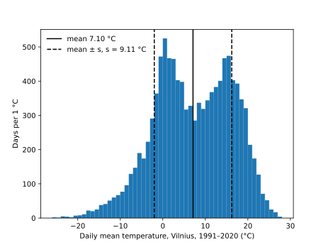

# Seminar 8 · pandas

**Paired lecture:** 08 Data Quality and Uncertainty · **Format:** a showcase, then a problem, in class

<!-- ~120 min: the length pnpm timing:check reads -->

**Today's question:** Was July 2025 in Vilnius warmer than usual, and how sure can we be?

Everything is typed in VS Code: the scripts in the editor, the commands in
its terminal (zsh on macOS, Git Bash on Windows; the lines are the same in
both). In the blocks, a line that starts with `$` is typed in the terminal,
without the `$`; every other line is what comes back; `...` stands for lines
left out.

**If time runs short:** leave out section 5 (the histogram); Part 3 keeps
its 50 minutes.

??? info "Before the session"
    - **Room:** Miniforge and VS Code with its Python extension on every
      laptop (the [Setup](../setup.md) page), internet for conda (Python and
      Matplotlib about 80 MB on a Mac and 200 MB on Windows, pandas about
      16 MB more; less when conda has them from Seminar 7) and for the data.
      Nothing from earlier seminars is needed.
    - **No file is handed out.** The scripts fetch two public files when
      they run: the daily record of the Vilnius station, `LH000026730.csv`
      (6.1 MB, 1881 to 24 August 2025; each run of sections 3, 5 and 6
      downloads it, a pair in Part 3 downloads it once), and NOAA's monthly
      CO₂ at Mauna Loa (39 kB).
    - **Terms:** the station file is from GHCN-Daily, NOAA NCEI, "for free
      and unrestricted use in research, education, and other non-commercial
      activities" (WMO Resolution 40); cite Menne et al. 2012, *Global
      Historical Climatology Network - Daily (GHCN-Daily)*, Version 3.35,
      NOAA NCDC, [doi:10.7289/V5D21VHZ](https://doi.org/10.7289/V5D21VHZ),
      accessed 10 November 2026. The CO₂ file is
      [NOAA GML's](https://gml.noaa.gov/ccgg/trends/), free to use with
      credit to NOAA GML.
    - **The numbers:** every output on this page was printed on 10 November
      2026 from complete past periods, so the scripts print the same on the
      day. If an address does not answer, show the output on this page.
      `TAVG` comes from two sources in 1991–2020, which NCEI's
      [readme](https://www.ncei.noaa.gov/pub/data/ghcn/daily/readme.txt)
      says compute the daily mean in different ways; the page uses it as one
      series.
    - **Missing a tool?** VS Code: [Setup, step 1](../setup.md#vscode);
      `conda` (Miniforge): [Setup, steps 2–4](../setup.md#shell); the Python
      extension: [Setup, step 7](../setup.md#extensions).
    - **You:** if you made `analysis` before, remove it (`conda env remove
      -n analysis`) to make it with the room. Paths are shown for a Mac
      (`/Users/smilte/...`); Git Bash shows `/c/Users/smilte/...`.

---

## Part 1 · Set up { #part-1 }

### 1. Make the folder and the environment `analysis` { #start }

<!-- 0:00 · 8 min -->

An environment is a folder with its own Python and its own packages; `analysis` serves weeks 8 to 12, and each week adds its package.

1. In VS Code, **View** > **Terminal**. Make the folder and go into it.

    ```text
    $ mkdir ~/weather-s08
    $ cd ~/weather-s08
    ```

2. **File** > **Open Folder...** > `weather-s08` (in your home folder) >
   **Open**, then **View** > **Terminal**. The Explorer on the left is empty.

3. Make the environment, with Python in it. At `Proceed ([y]/n)?` press `Enter`.

    ```text
    $ conda create -n analysis python=3.14
    ...
      added / updated specs:
        - python=3.14
    ...
    Proceed ([y]/n)?
    ...
    #     $ conda activate analysis
    ```

    `conda: command not found`: install Miniforge as on the
    [Setup page, steps 2–4](../setup.md#shell), then open a new terminal.

4. Switch it on, and ask which Python answers.

    ```text
    $ conda activate analysis
    $ python --version
    Python 3.14.10
    ```

**Check:** `(analysis)` at the start of the prompt, and a Python `3.14` (the last number may be higher).

---

### 2. Install pandas and Matplotlib, write them down { #install }

<!-- 0:08 · 7 min -->

pandas reads a table into Python and computes with its columns; Matplotlib draws. A package goes into the active environment, and into the file that lists it.

1. Install both, each with its version. At `Proceed ([y]/n)?` press `Enter`.

    ```text
    $ conda install pandas=3.1 matplotlib-base=3.11
    ...
    ## Package Plan ##

      environment location: /Users/smilte/miniforge3/envs/analysis

      added / updated specs:
        - matplotlib-base=3.11
        - pandas=3.1
    ...
    Proceed ([y]/n)?
    ```

    `matplotlib-base`: Matplotlib without a window library of several hundred MB.

2. Ask for the versions.

    ```text
    $ python -c "import pandas, matplotlib; print(pandas.__version__, matplotlib.__version__)"
    3.1.1 3.11.2
    ```

3. Write the environment into a file.

    ```text
    $ conda env export --from-history -f environment.yml
    ```

4. Click `environment.yml` in the Explorer, delete its last line,
   `prefix: ...` (a folder on this laptop), save (`Ctrl+S`, macOS `Cmd+S`).
   The packages may stand in another order.

    ```text
    name: analysis
    channels:
      - conda-forge
    dependencies:
      - python=3.14
      - pandas=3.1
      - matplotlib-base=3.11
    ```

5. Tell VS Code which Python to use: `Ctrl+Shift+P` (macOS `Cmd+Shift+P`),
   `Python: Select Interpreter`, pick the entry with `envs/analysis` in its
   path. The Status Bar shows `analysis`.

**Check:** `3.1.1 3.11.2` (the last digits may be higher), `- pandas=3.1`
in `environment.yml`, and `analysis` in the Status Bar.

---

## Part 2 · Showcase { #part-2 }

The lecturer runs four complete scripts; the room watches and may type
along. Each script is one file in `weather-s08`: **New File...**, the name
given above the code, paste, save, run it in the terminal.

### 3. Read a station's daily file from its address, look at the table { #look }

<!-- 0:15 · 8 min -->

`pd.read_csv` reads a CSV file, from a disk or from an address, into a **DataFrame**: a table with named columns and numbered rows. This file holds every day of the Vilnius weather station since 1881.

`look.py`:

```python
import pandas as pd

url = ("https://www.ncei.noaa.gov/data/global-historical-climatology-network-daily"
       "/access/LH000026730.csv")
df = pd.read_csv(url, usecols=["DATE", "TMIN", "TMAX", "TAVG"], parse_dates=["DATE"])

print(df.shape)
print(df.head())
print(df.dtypes)
print(df.describe())
```

`usecols` keeps four of the file's 16 columns: the date, the lowest, the
highest and the mean temperature of the day.

```text
$ python look.py
(51041, 4)
        DATE  TMAX  TMIN  TAVG
0 1881-01-01   NaN   NaN  12.0
1 1881-01-02   NaN   NaN  -8.0
2 1881-01-03   NaN   NaN  16.0
3 1881-01-04   NaN   NaN  16.0
4 1881-01-05   NaN   NaN   2.0
DATE    datetime64[us]
TMAX           float64
TMIN           float64
TAVG           float64
dtype: object
                             DATE          TMAX          TMIN          TAVG
count                       51041  42719.000000  43525.000000  50814.000000
mean   1954-09-06 14:54:44.089262    103.992696     25.637105     65.183906
min           1881-01-01 00:00:00   -270.000000   -372.000000   -335.000000
25%           1919-07-25 00:00:00     17.000000    -26.000000     -1.000000
50%           1955-09-27 00:00:00    105.000000     28.000000     66.000000
75%           1990-09-03 00:00:00    194.000000     97.000000    145.000000
max           2025-08-24 00:00:00   1980.000000    223.000000    292.000000
std                           NaN    106.230959     88.015406     94.750055
```

**Notice:** the temperatures are in tenths of °C, as the file's readme says (`TAVG` 12.0 is 1.2 °C); empty fields are read as NaN, so `count` differs per column.

**Ask the room:** which number of `describe()` cannot be a day in Vilnius?

??? note "Answer"
    The largest `TMAX`, 1980: 198.0 °C, on 27 August 1911. The file marks
    it: the column `TMAX_ATTRIBUTES` holds `X` for that day, "failed bounds
    check" in the readme. Look at the smallest and largest values before
    any mean, and leave flagged values out.

---

### 4. A missing-value mark in NOAA's CO₂ file: the mean with it and without it { #marks }

<!-- 0:23 · 9 min -->

A file may mark a missing value with a number; read as a number, the mark goes into every mean. In NOAA's monthly CO₂ table, `ndays` is the number of days of the month with a measurement, and `-1` means "not known".

`marks.py`:

```python
import pandas as pd

url = "https://gml.noaa.gov/webdata/ccgg/trends/co2/co2_mm_mlo.csv"

co2 = pd.read_csv(url, comment="#")
co2 = co2[co2["year"] <= 2025]
print(co2[["year", "month", "average", "ndays"]].head(3))
print("mean ndays, as read:", round(co2["ndays"].mean(), 1))
print("smallest ndays:", co2["ndays"].min())

co2 = pd.read_csv(url, comment="#", na_values={"ndays": [-1]})
co2 = co2[co2["year"] <= 2025]
print("missing:", co2["ndays"].isna().sum(), "of", len(co2))
print("mean ndays, -1 as missing:", round(co2["ndays"].mean(), 1))
```

`co2[co2["year"] <= 2025]` keeps the rows up to 2025, so the numbers stay
when NOAA adds a month; `na_values` reads `-1` as missing (NaN), which every
mean leaves out.

```text
$ python marks.py
   year  month  average  ndays
0  1958      3   315.71     -1
1  1958      4   317.45     -1
2  1958      5   317.51     -1
mean ndays, as read: 19.1
smallest ndays: -1
missing: 195 of 814
mean ndays, -1 as missing: 25.5
```

**Notice:** 195 marks (March 1958 to April 1974, the Scripps years, and December 1975) pull the mean from 25.5 to 19.1 days: a wrong number that looks possible.

**Ask the room:** which printed line shows that the first mean is wrong?

??? note "Answer"
    `smallest ndays: -1`: a count of days cannot be negative. Look at the
    smallest and largest values (`describe()`) before any mean, and read
    the file's header: NOAA writes there that months with no information
    are "indicated by negative numbers".

---

### 5. The days of 1991–2020 in a histogram, with the mean and the mean ± s { #histogram }

<!-- 0:32 · 9 min -->

A histogram counts the values in bins of equal width and shows their shape; the mean and s describe that shape well only when it has one peak.

`days.py`:

```python
import matplotlib.pyplot as plt
import pandas as pd

url = ("https://www.ncei.noaa.gov/data/global-historical-climatology-network-daily"
       "/access/LH000026730.csv")
df = pd.read_csv(url, usecols=["DATE", "TAVG"], parse_dates=["DATE"])
df = df[df["DATE"].dt.year.between(1991, 2020)]
temp = df["TAVG"] / 10                     # the file stores tenths of °C

m, s = temp.mean(), temp.std()
print(f"days {len(temp)}, measured {temp.count()}, mean {m:.2f}, s {s:.2f}")
print(f"within mean ± s: {temp.between(m - s, m + s).mean():.3f}")

fig, ax = plt.subplots()
ax.hist(temp, bins=range(-26, 29))
ax.axvline(m, color="black", label=f"mean {m:.2f} °C")
ax.axvline(m - s, color="black", linestyle="--", label=f"mean ± s, s = {s:.2f} °C")
ax.axvline(m + s, color="black", linestyle="--")
ax.set_xlabel("Daily mean temperature, Vilnius, 1991–2020 (°C)")
ax.set_ylabel("Days per 1 °C")
ax.legend(frameon=False)
fig.savefig("days.svg")
```

`between(a, b)` is `True` for each value from a to b; the mean of `True`
and `False` is the share of `True`.

```text
$ python days.py
days 10958, measured 10956, mean 7.10, s 9.11
within mean ± s: 0.659
```



**Notice:** two peaks, winter days near 0 °C and summer days near 15 °C, and the mean, 7.10 °C, in the dip between them; two days of the thirty years have no `TAVG`.

**Ask the room:** a bell-shaped (Gaussian) distribution holds 68.3 % of its values within the mean ± s. Why do these days hold fewer, 65.9 %?

??? note "Answer"
    The two peaks lie near the dashed lines and the mean sits in the dip,
    so fewer days lie near the mean than under one bell. With two peaks,
    the mean and s alone hide the shape: draw the histogram.

---

### 6. The ± of the mean of 1991–2020: from the days and from the years { #how-sure }

<!-- 0:41 · 10 min -->

The standard error s / √n says how far a mean of n **independent** values typically lies from the long-run mean; a day nearly repeats the day before, but one year says little about the next.

`how_sure.py`:

```python
import pandas as pd

url = ("https://www.ncei.noaa.gov/data/global-historical-climatology-network-daily"
       "/access/LH000026730.csv")
df = pd.read_csv(url, usecols=["DATE", "TAVG"], parse_dates=["DATE"])
df = df[df["DATE"].dt.year.between(1991, 2020)]
df["temp"] = df["TAVG"] / 10               # the file stores tenths of °C

s, n = df["temp"].std(), df["temp"].count()
print(f"from the days:  {df['temp'].mean():.2f} ± {s / n ** 0.5:.2f} (s {s:.2f}, n {n})")

years = df.groupby(df["DATE"].dt.year)["temp"].mean()
print(f"yearly means: {years.min():.2f} in {years.idxmin()} to {years.max():.2f} in {years.idxmax()}")
s, n = years.std(), years.count()
print(f"from the years: {years.mean():.2f} ± {s / n ** 0.5:.2f} (s {s:.2f}, n {n})")
```

```text
$ python how_sure.py
from the days:  7.10 ± 0.09 (s 9.11, n 10956)
yearly means: 5.42 in 1996 to 8.70 in 2020
from the years: 7.10 ± 0.14 (s 0.75, n 30)
```

**Notice:** the same mean, two ±: 0.09 treats the 10 956 days as independent and is too small; 0.14 from the thirty yearly means is the one to write down.

**Ask the room:** how many years would halve ± 0.14?

??? note "Answer"
    Four times as many, 120: √4 = 2. The file has 142 years, but they do
    not share one long-run mean: the ten years 2011–2020 averaged 7.68 °C,
    those of 1991–2000 6.73 °C. More years from a changing climate do not
    shrink the ± of one mean.

---

### 7. Library card { #card }

<!-- 0:51 · 4 min -->

The calls of the four scripts, one line each.

| Call | What it does |
|--|--|
| `pd.read_csv(url, usecols=["DATE", "TAVG"])` | read a CSV file from a disk or an address; keep only these columns |
| `parse_dates=["DATE"]` | read a column as dates |
| `comment="#"` | leave out the lines that start with `#` |
| `na_values={"ndays": [-1]}` | read a mark as missing (NaN) |
| `df.shape`, `df.head()`, `df.dtypes` | (rows, columns); the first five rows; the type of each column |
| `df.describe()` | count, mean, std, min, quartiles and max of each column |
| `df["TAVG"] / 10` | the whole column divided by 10: tenths of °C to °C |
| `df[df["year"] <= 2025]` | keep the rows where the condition is `True` |
| `df["DATE"].dt.year` | the year of each date (`.dt.month`: the month, 1 to 12) |
| `.between(a, b)` | `True` for each value from a to b; with `.mean()`, their share |
| `.isna().sum()` | count the missing values |
| `.mean()`, `.std()`, `.count()`, `.min()`, `.idxmin()` | mean, standard deviation s, values present, smallest value, its label |
| `df.groupby(df["DATE"].dt.year)["temp"].mean()` | one mean per year |
| `s / n ** 0.5` | the standard error of a mean of n independent values |
| `ax.hist(values, bins=...)`, `ax.axvline(x)`, `fig.savefig("days.svg")` | a histogram; a vertical line at x; save the figure |

---

## Part 3 · The problem { #part-3 }

### 8. Was July 2025 warmer than usual? { #problem }

<!-- 0:55 · 50 min: predict 5, solve 25, check 10, hand in 10 -->

"Usual" is the mean of the thirty Julys 1991–2020, the period weather services call the climate normal. The data: the Vilnius station's file of sections 3, 5 and 6 (GHCN-Daily, NOAA NCEI; terms and citation under "Before the session"). Download it once (6.1 MB) into the folder and read it from there; the times in curl's last line differ per laptop.

```text
$ curl -O https://www.ncei.noaa.gov/data/global-historical-climatology-network-daily/access/LH000026730.csv
  % Total    % Received % Xferd  Average Speed   Time    Time     Time  Current
                                 Dload  Upload   Total   Spent    Left  Speed
100 5976k  100 5976k    0     0  3619k      0  0:00:01  0:00:01 --:--:-- 3619k
```

Work in pairs. Any tools are allowed, an LLM too; what counts is the prediction, the checks and the answer in your own words.

1. **Predict**, before any code, on paper: warmer or colder than the usual
   July, by how many °C, and by how much one July differs from the next.
   One reason for each guess.
2. **Solve.** Find the mean of July 2025, the mean of the Julys 1991–2020
   with its standard error, and the difference.
3. **Check the machine's work.**
    - By hand: print the first five days of July 2025, add them on paper,
      divide by 5; the program on the same five rows must agree.
    - The data: are the values in °C, not tenths? How many days of July
      2025 are measured?
    - The n of the ±: 30 Julys or about 900 days? Only one of the two counts
      independent values.
    - Against your prediction: if the answer differs, write why.
4. **Hand in** one number with its ± (the difference from the usual July)
   and two sentences in your own words: what it means, and how sure it is.

??? tip "Hint 1: the rows of July, one mean per year"
    ```python
    df["temp"] = df["TAVG"] / 10
    jul = df[df["DATE"].dt.month == 7]
    means = jul.groupby(jul["DATE"].dt.year)["temp"].mean()
    ```

    `means` holds one value per July, with the year as the label:
    `means[2025]`, `means.loc[1991:2020]`.

??? tip "Hint 2: the ± of the usual July"
    The standard error of the mean of the 30 values `means.loc[1991:2020]`:
    their `std()` divided by √30. One value per July, not one per day.

??? tip "Hint 3: how unusual one July is"
    Set the difference against two numbers: the standard error of the usual
    July (is the difference larger?) and s of single Julys (how many s from
    usual?). Or count how many Julys since 1991 were warmer.

??? note "One solution"
    `july.py`:

    ```python
    import pandas as pd

    df = pd.read_csv("LH000026730.csv", usecols=["DATE", "TAVG"], parse_dates=["DATE"])
    df["temp"] = df["TAVG"] / 10               # the file stores tenths of °C

    jul = df[df["DATE"].dt.month == 7]
    print(jul[jul["DATE"].dt.year == 2025].head())
    means = jul.groupby(jul["DATE"].dt.year)["temp"].mean()

    normal = means.loc[1991:2020]
    m, s, n = normal.mean(), normal.std(), normal.count()
    print(f"Julys 1991-2020: {m:.2f} ± {s / n ** 0.5:.2f} (s {s:.2f}, n {n})")
    print(f"July 2025: {means[2025]:.2f}, days measured: {jul[jul['DATE'].dt.year == 2025]['temp'].count()}")
    print(f"difference: {means[2025] - m:+.2f} ± {s / n ** 0.5:.2f}, {(means[2025] - m) / s:+.2f} s")
    print("Julys since 1991 warmer than 2025:", (means.loc[1991:] > means[2025]).sum(), "of", len(means.loc[1991:]))

    days = jul[jul["DATE"].dt.year.between(1991, 2020)]["temp"]
    print(f"if the {days.count()} days were independent: ± {days.std() / days.count() ** 0.5:.2f}")
    ```

    ```text
    $ python july.py
                DATE   TAVG  temp
    50986 2025-07-01  165.0  16.5
    50987 2025-07-02  208.0  20.8
    50988 2025-07-03  235.0  23.5
    50989 2025-07-04  171.0  17.1
    50990 2025-07-05  161.0  16.1
    Julys 1991-2020: 18.41 ± 0.31 (s 1.71, n 30)
    July 2025: 18.88, days measured: 31
    difference: +0.47 ± 0.31, +0.28 s
    Julys since 1991 warmer than 2025: 14 of 35
    if the 930 days were independent: ± 0.11
    ```

    By hand: (16.5 + 20.8 + 23.5 + 17.1 + 16.1) / 5 = 94.0 / 5 = 18.80 °C.

    Handed in: *July 2025 in Vilnius was 0.47 ± 0.31 °C warmer than the
    mean of the Julys 1991–2020 (18.88 against 18.41 °C; the ± is the
    standard error of 30 July means). That is 1.5 standard errors, so
    probably warmer than that mean but not certainly; single Julys scatter
    by 1.71 °C, and 14 of the 35 since 1991 were warmer: an ordinary July.*

**With your own project data:** the same question on your file: one value
(a month, a run, a sample) against the mean of comparable ones, with the ±
from independent groups (one value per year, per run, per person), not from
the rows. A file saved by a spreadsheet with `;` between values and `,` in
decimals reads with `pd.read_csv(path, sep=";", decimal=",")`.

---

## Part 4 · Show and discuss { #part-4 }

### 9. Compare the answers of two or three pairs { #discuss }

<!-- 1:45 · 15 min -->

Two or three pairs show their number with its ± and read their two sentences.

**Ask the room:** two pairs hand in +0.47 ± 0.11 and +0.47 ± 0.31. Which ± belongs to the answer?

??? note "Answer"
    ± 0.31, the standard error of 30 July means, one per year. ± 0.11
    divides the spread of the 930 July days by √930 as if every day were
    independent; a day nearly repeats the day before, so 930 days hold far
    less than 930 independent values.

**Ask the room:** was July 2025 warmer than usual?

??? note "Answer"
    By 0.47 ± 0.31 °C, 1.5 standard errors; chance alone gives 1.5 standard
    errors or more, either way, about one time in eight. Probably warmer
    than the Julys 1991–2020 on average, but single Julys scatter by
    1.71 °C, and 14 of the 35 since 1991 were warmer: an ordinary July.

**Ask the room:** the ± of a whole year's normal is 0.14 (section 6), that of July 0.31. Both come from 30 values: why is July's larger?

??? note "Answer"
    Julys scatter by 1.71 °C from year to year, whole years by 0.75 °C. A
    month holds the weather of a few weeks, which one heat wave can move; a
    year averages twelve months, whose deviations partly cancel. With the
    same n, the ± follows s.

A difference is read next to its ±, and the ± is computed from independent values: here the 30 July means, not the 930 days.

---

## Optional, if the room is fast { #optional }

### 10. Which month of 2025 lay furthest from its usual temperature? { #months-2025 }

<!-- — · 15 min -->

The same file as section 8, every month at once: how far each month of 2025 lay from its mean of 1991–2020, in °C and in units of s of that month, with the number of days measured.

??? note "One solution"
    `months_2025.py`, in the folder with `LH000026730.csv`; `unstack()`
    turns the means of (year, month) into a table, one row per year and one
    column per month.

    ```python
    import pandas as pd

    df = pd.read_csv("LH000026730.csv", usecols=["DATE", "TAVG"], parse_dates=["DATE"])
    df["temp"] = df["TAVG"] / 10               # the file stores tenths of °C

    by_month = df.groupby([df["DATE"].dt.year, df["DATE"].dt.month])["temp"]
    table = by_month.mean().unstack()
    normal = table.loc[1991:2020]
    diff = table.loc[2025] - normal.mean()
    print(pd.DataFrame({"days": by_month.count().unstack().loc[2025], "2025": table.loc[2025],
                        "normal": normal.mean(), "s": normal.std(), "diff": diff,
                        "in s": diff / normal.std()}).round(2))
    ```

    ```text
    $ python months_2025.py
          days   2025  normal     s  diff  in s
    DATE
    1     31.0   1.26   -3.88  2.90  5.14  1.77
    2     28.0  -3.84   -3.26  3.40 -0.58 -0.17
    3     31.0   4.85    0.60  2.51  4.25  1.69
    4     30.0   9.26    7.41  1.68  1.85  1.10
    5     31.0  10.03   12.86  1.75 -2.83 -1.62
    6     30.0  15.64   16.28  1.80 -0.64 -0.35
    7     31.0  18.88   18.41  1.71  0.47  0.28
    8     24.0  16.51   17.50  1.31 -0.99 -0.76
    9      NaN    NaN   12.44  1.29   NaN   NaN
    10     NaN    NaN    6.65  1.71   NaN   NaN
    11     NaN    NaN    1.76  2.36   NaN   NaN
    12     NaN    NaN   -2.18  3.27   NaN   NaN
    ```

    January lay furthest, +5.14 °C or 1.77 s. August has 24 days (the
    file ends on 24 August 2025): its mean leaves out the last week and is
    no August mean. Winter months scatter about twice as much as summer
    months, so +4.25 °C in March (1.69 s) is about as unusual as −2.83 °C
    in May (−1.62 s).

---

## Aims practised

- ♻️ **Reproducibility:** every number comes from a script that reads its
  data from a public address; `environment.yml` lists pandas and
  Matplotlib with their versions.
- 📁 **Files:** the unit (tenths of °C), the marks (`-1`, empty fields) and
  the quality flags are read from the file's documentation and handled in
  the script, never edited out of the data.
- 🔧 **Tool-agnostic:** an answer is checked by hand on five rows, by its
  unit, by the n of its ±, and against a prediction, whichever tool or LLM
  wrote the code.
