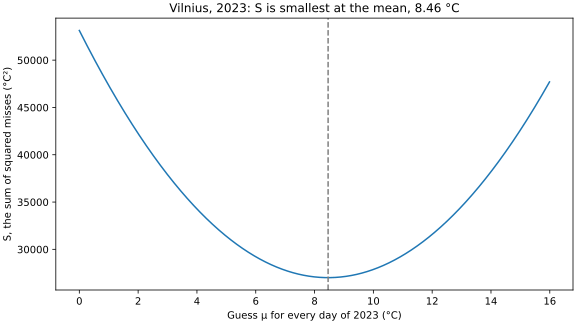
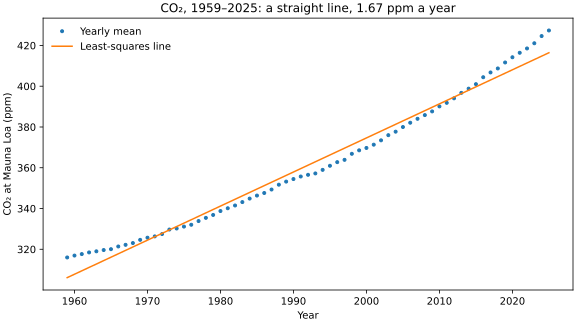
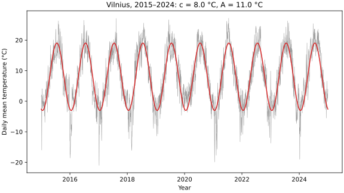

# Seminar 9 · NumPy

**Paired lecture:** 09 Parameter Estimation and Fitting · **Format:** a showcase, then a problem, in class

<!-- ~120 min: the length pnpm timing:check reads -->

**Today's question:** How fast is Vilnius getting warmer, and does a straight line say it right?

The lecturer runs Part 2 from this page; in Part 3 the room works in pairs.
Everything is typed in VS Code: the scripts in the editor, the commands in
its terminal (zsh on macOS, Git Bash on Windows; the lines are the same in
both). A line that starts with `$` is typed without the `$`; every other
line is what comes back; `...` stands for lines left out.

**If time runs short:** leave out section 7 (polynomials of high degree); its calls are on the library card.

??? info "Before the session"
    - **Room:** Miniforge and VS Code with its Python extension on every
      laptop (the [Setup](../setup.md) page), internet for the data and,
      on a laptop without the environment `analysis`, for conda (Python,
      pandas and Matplotlib: about 80 MB on a Mac, 200 MB on Windows).
      Nothing from earlier seminars is needed.
    - **No file is handed out.** The data come from their public addresses:
        - the daily weather of the Vilnius station since 1881 (6.1 MB,
          fetched once with `curl` in section 3): NOAA NCEI, GHCN-Daily
          version 3.35, station `LH000026730` (Menne et al. 2012,
          doi:10.7289/V5D21VHZ, read on 10 November 2026); exchanged under
          WMO Resolution 40, free for research, education and other
          non-commercial use;
        - the yearly mean CO₂ at Mauna Loa, 1959–2025, with its uncertainty
          (3 kB, read by the scripts of sections 5 and 6): NOAA Global
          Monitoring Laboratory, free to use, credit asked.
    - **The numbers:** every output on this page was printed on
      10 November 2026. The scripts use the years up to 2024, so days that
      NOAA adds at the end of the station file change nothing. NOAA may
      revise the CO₂ of recent years a little ("usually these changes are
      minor", its file says); then the last digits of sections 5 and 6
      move.
    - **Missing a tool?** VS Code: [Setup, step 1](../setup.md#vscode);
      `conda` (Miniforge): [Setup, steps 2–4](../setup.md#shell); the Python
      extension: [Setup, step 7](../setup.md#extensions).
    - **Keys** are written for Windows, macOS in brackets. Paths are shown
      for a Mac (`/Users/smilte/...`); Git Bash shows `/c/Users/smilte/...`.

---

## Part 1 · Set up { #part-1 }

### 1. A new folder, and the environment `analysis` { #start }

<!-- 0:00 · 8 min -->

An environment is a folder with its own Python and its own packages; `analysis` serves weeks 8 to 12.

1. In VS Code, **View** > **Terminal**. Make the folder and go into it.

    ```text
    $ mkdir ~/weather-s09
    $ cd ~/weather-s09
    ```

2. **File** > **Open Folder...** > `weather-s09` (in your home folder) >
   **Open**, then **View** > **Terminal**. The Explorer on the left is empty.

3. Switch on `analysis`, the environment of Seminar 8.

    ```text
    $ conda activate analysis
    ```

    Conda answers `Could not find conda environment: analysis`: this laptop
    has none yet. Make it with Python, pandas and Matplotlib in one line (a
    few minutes; at `Proceed ([y]/n)?` press `Enter`), then switch it on:

    ```text
    $ conda create -n analysis python=3.14 pandas=3.1 matplotlib-base=3.11
    ...
    Proceed ([y]/n)?
    ...
    $ conda activate analysis
    ```

4. Ask which Python answers.

    ```text
    $ python --version
    Python 3.14.10
    ```

**Check:** `(analysis)` at the start of the prompt, and a Python `3.14` (the last number may be higher).

---

### 2. Find NumPy in the environment, write the list { #numpy }

<!-- 0:08 · 4 min -->

pandas and Matplotlib are built on NumPy, so conda installed it with them, unasked: a package that another package needs is a **dependency**.

1. Ask conda for NumPy, then Python for its version.

    ```text
    $ conda list numpy
    # packages in environment at /Users/smilte/miniforge3/envs/analysis:
    #
    # Name                    Version                   Build  Channel
    numpy                     2.5.4           py314hd3a7d6b_0  conda-forge
    $ python -c "import numpy; print(numpy.__version__)"
    2.5.4
    ```

    The build, the third column, differs from laptop to laptop.

2. Write the environment into today's folder.

    ```text
    $ conda env export --from-history -f environment.yml
    ```

3. Click `environment.yml` in the Explorer, delete its last line,
   `prefix: ...` (a folder on this laptop), save (`Ctrl+S`, macOS `Cmd+S`).
   The packages may stand in another order.

    ```text
    name: analysis
    channels:
      - conda-forge
    dependencies:
      - python=3.14
      - pandas=3.1
      - matplotlib-base=3.11
    ```

    No NumPy line: the file lists what was asked for, and conda brings
    what those packages need.

4. Tell VS Code which Python to use: `Ctrl+Shift+P` (macOS `Cmd+Shift+P`),
   `Python: Select Interpreter`, pick the entry with `envs/analysis` in its
   path. The Status Bar shows `analysis`.

**Check:** `2.5.4` (the last digit may be higher), and `analysis` in the Status Bar.

---

### 3. Fetch the daily weather of Vilnius, once { #data }

<!-- 0:12 · 3 min -->

NOAA's GHCN-Daily keeps the weather station of Vilnius day by day since 1 January 1881, one line per day; `curl` copies the file into the folder once, and the scripts read the copy.

1. Fetch it. `-O` keeps the name the file has at its address: `LH` is
   Lithuania, `26730` the number of the station.

    ```text
    $ curl -O https://www.ncei.noaa.gov/data/global-historical-climatology-network-daily/access/LH000026730.csv
      % Total    % Received % Xferd  Average Speed   Time    Time     Time  Current
    ...
    ```

2. Its first two lines: the names of the columns, and 1 January 1881.

    ```text
    $ head -2 LH000026730.csv
    "STATION","DATE","LATITUDE","LONGITUDE","ELEVATION","NAME","PRCP","PRCP_ATTRIBUTES","SNWD","SNWD_ATTRIBUTES","TMAX","TMAX_ATTRIBUTES","TMIN","TMIN_ATTRIBUTES","TAVG","TAVG_ATTRIBUTES"
    "LH000026730","1881-01-01","54.6331","25.1","156.0","VILNIUS, LH","    0",",,r",,,,,,,"   12",",,r"
    ```

    `TAVG` is the mean of the day in tenths of a degree: `"   12"` is
    1.2 °C. `TMAX` and `TMIN` are the highest and the lowest of the day;
    a field is empty when that day has no value.

**Check:** `LH000026730.csv` in the Explorer, about 6.1 MB.

---

## Part 2 · Showcase { #part-2 }

The lecturer runs four complete scripts; the room watches and may type
along. For each: in the Explorer, right-click > **New File...**, the name
above the code, paste, save, run it in the terminal. A window opens with
the figure; close it and the prompt comes back. The figure is also saved
as an SVG file in the folder.

### 4. The days of 2023 as one array: the squared misses are smallest at the mean { #least-squares }

<!-- 0:15 · 9 min -->

A NumPy **array** holds numbers of one type, and arithmetic on it works on every element at once; with it, S(μ) = Σ(Tᵢ − μ)² of 365 days is one line for each guess μ.

```python title="mean.py"
import matplotlib.pyplot as plt
import numpy as np
import pandas as pd

df = pd.read_csv("LH000026730.csv", parse_dates=["DATE"])
days = df[df["DATE"].dt.year == 2023]
t = days["TAVG"].to_numpy() / 10   # tenths of a degree to °C, all at once
print(t.size, "days; the first three:", t[:3])

guesses = np.arange(0, 16, 0.01)   # 1600 values for mu
S = []
for mu in guesses:
    S.append(((t - mu) ** 2).sum())  # 365 misses, squared, added
S = np.array(S)
k = S.argmin()                     # the position of the smallest S
print(f"S is smallest at mu = {guesses[k]:.2f}; the mean is {t.mean():.2f}")
print(f"S at the mean: {S[k]:.0f}; one degree higher: {S[k + 100]:.0f}")

fig, ax = plt.subplots(figsize=(8, 4.5), layout="constrained")
ax.plot(guesses, S)
ax.axvline(t.mean(), color="grey", linestyle="--")
ax.set_xlabel("Guess μ for every day of 2023 (°C)")
ax.set_ylabel("S, the sum of squared misses (°C²)")
ax.set_title("Vilnius, 2023: S is smallest at the mean, 8.46 °C")
fig.savefig("mean.svg")
plt.show()
```

`.to_numpy()` turns a column of the pandas table into an array; `t - mu`
subtracts μ from all 365 days, `** 2` squares each, `.sum()` adds them.

```text
$ python mean.py
365 days; the first three: [9.9 6.1 4.4]
S is smallest at mu = 8.46; the mean is 8.46
S at the mean: 27010; one degree higher: 27374
```



**Notice:** one degree away from the mean, S grows by 364, about 365: one for each day. S is a parabola, S(μ) = S(x̄) + N (μ − x̄)².

**Ask the room:** 1 January 2023 is mistyped as 99 °C instead of 9.9 °C. Where does the lowest point of S move?

??? note "Answer"
    To the new mean, 8.70 °C: the mean moves by 89.1 / 365 = 0.24 °C. A
    squared miss weighs a far point most, so one wrong value pulls the
    least-squares answer towards it; look at the smallest and largest
    values before any fit.

!!! warning "An error instead of a figure"
    - `FileNotFoundError: ... 'LH000026730.csv'`: the terminal is not in
      `weather-s09`, or section 3 was left out: `cd ~/weather-s09`, `ls`.
    - `ModuleNotFoundError: No module named 'pandas'`: the prompt says
      `(base)`. Type `conda activate analysis`.
    - `UserWarning: FigureCanvasAgg is non-interactive`: this Python opens
      no window. The figure is in the file: `open mean.svg` (macOS) or
      `start mean.svg` (Git Bash).

---

### 5. A straight line through 67 years of CO₂: the five sums and `np.polyfit` { #line }

<!-- 0:24 · 8 min -->

The least-squares line y = a x + b comes from five sums of the data, n, Σx, Σy, Σx² and Σxy; with arrays each sum is one expression, and `np.polyfit(x, y, 1)` returns the same a and b.

```python title="co2_line.py"
import matplotlib.pyplot as plt
import numpy as np
import pandas as pd

URL = "https://gml.noaa.gov/webdata/ccgg/trends/co2/co2_annmean_mlo.csv"
co2 = pd.read_csv(URL, comment="#")
x = co2["year"].to_numpy() - 1959   # years since 1959
y = co2["mean"].to_numpy()          # the yearly mean, ppm
sigma = co2["unc"].to_numpy()[0]    # NOAA's ± of one yearly mean, ppm
n = x.size
sx, sy, sxx, sxy = x.sum(), y.sum(), (x * x).sum(), (x * y).sum()
d = n * sxx - sx ** 2
a = (n * sxy - sx * sy) / d
b = (sxx * sy - sx * sxy) / d
print(f"{n} years; the five sums: a = {a:.4f}, b = {b:.2f}")
print("np.polyfit(x, y, 1):", np.polyfit(x, y, 1))
print(f"a = {a:.4f} ± {sigma * np.sqrt(n / d):.4f} ppm a year")

fig, ax = plt.subplots(figsize=(8, 4.5), layout="constrained")
ax.plot(x + 1959, y, "o", markersize=3, label="Yearly mean")
ax.plot(x + 1959, a * x + b, label="Least-squares line")
ax.set_xlabel("Year")
ax.set_ylabel("CO₂ at Mauna Loa (ppm)")
ax.set_title("CO₂, 1959–2025: a straight line, 1.67 ppm a year")
ax.legend(frameon=False)
fig.savefig("co2_line.svg")
plt.show()
```

`x * y` multiplies year by year; `sigma * np.sqrt(n / d)` is the ± of the
slope when every point has the same error σ. NOAA's file gives σ = 0.12 ppm
for every year: how far its yearly means and those of the Scripps
Institution, measured independently, typically differ.

```text
$ python co2_line.py
67 years; the five sums: a = 1.6720, b = 306.08
np.polyfit(x, y, 1): [  1.67196584 306.07617208]
a = 1.6720 ± 0.0008 ppm a year
```



**Notice:** the five sums and `np.polyfit` agree to every printed digit, and with σ = 0.12 ppm the slope comes out to ± 0.0008 ppm a year.

**Ask the room:** 1.6720 ± 0.0008 ppm a year: does CO₂ rise by 1.672 ppm every year?

??? note "Answer"
    No. The points lie above the line at both ends and below it in the
    middle: the yearly rise has grown. The ± says how well the best line is
    pinned down by points of ± 0.12 ppm, not whether a straight line is the
    right model; section 6 tests that.

---

### 6. The residuals of the line and of a parabola: χ² with NOAA's σ { #residuals }

<!-- 0:32 · 9 min -->

A **residual** is a point minus the model. With σ known from outside the fit, χ² = Σ(r / σ)² of a right model comes out near ndf, the number of points minus the number of parameters.

```python title="co2_resid.py"
import matplotlib.pyplot as plt
import numpy as np
import pandas as pd

URL = "https://gml.noaa.gov/webdata/ccgg/trends/co2/co2_annmean_mlo.csv"
co2 = pd.read_csv(URL, comment="#")
x = co2["year"].to_numpy() - 1959
y = co2["mean"].to_numpy()
sigma = co2["unc"].to_numpy()       # 0.12 ppm for every year

fig, axes = plt.subplots(2, 1, sharex=True, figsize=(8, 5.5),
                         layout="constrained")
for ax, degree in zip(axes, [1, 2]):
    p = np.polyfit(x, y, degree)    # the line, then a parabola
    r = y - np.polyval(p, x)        # the residuals
    chi2 = ((r / sigma) ** 2).sum()
    ndf = x.size - (degree + 1)
    print(f"degree {degree}: chi2 = {chi2:.0f} for ndf = {ndf},",
          f"{chi2 / ndf:.0f} per degree of freedom")
    ax.errorbar(x + 1959, r, yerr=sigma, fmt="o", markersize=3)
    ax.axhline(0, color="grey", linewidth=0.8)
    ax.set_ylabel("Residual (ppm)")
    ax.set_title(f"Degree {degree}: χ² / ndf = {chi2 / ndf:.0f}")
axes[1].set_xlabel("Year")
fig.savefig("co2_resid.svg")
plt.show()
```

`np.polyfit(x, y, 2)` fits a parabola, a x² + b x + c; `np.polyval(p, x)`
computes the polynomial `p` at every x.

```text
$ python co2_resid.py
degree 1: chi2 = 96464 for ndf = 65, 1484 per degree of freedom
degree 2: chi2 = 2565 for ndf = 64, 40 per degree of freedom
```


**Notice:** the line leaves a U of ± 10 ppm; the parabola takes it out and leaves ± 2 ppm, still in runs of years, with error bars too short to cover them.

**Ask the room:** the parabola's χ² is 40 times ndf. Is NOAA's 0.12 ppm too small, or does the parabola miss something?

??? note "Answer"
    The parabola misses something real. 0.12 ppm is how well one year is
    measured; the residuals are changes in the yearly rise itself: they
    fall by 1.8 ppm from 1991 to 1993, after the eruption of Pinatubo, and
    jump by about 1 ppm in 1998, 2016 and 2024, years of El Niño. A smooth
    curve describes the acceleration; the years around it need a model of
    their own.

---

### 7. Polynomials of degree 0 to 9 through ten years of Vilnius, and the year after { #too-many }

<!-- 0:41 · 9 min -->

Every parameter more lowers the squared misses; ten parameters pass through ten points, and then say nothing about the next one.

```python title="too_many.py"
import matplotlib.pyplot as plt
import numpy as np
import pandas as pd

df = pd.read_csv("LH000026730.csv", parse_dates=["DATE"])
means = (df["TAVG"] / 10).groupby(df["DATE"].dt.year).mean()
x = np.arange(10)                   # 2013 to 2022 as 0 to 9
y = means.loc[2013:2022].to_numpy()
print("2013-2022:", y.round(2))

fig, ax = plt.subplots(figsize=(8, 4.5), layout="constrained")
ax.plot(x + 2013, y, "o", color="black", label="Yearly mean, 2013–2022")
fine = np.linspace(0, 10, 201)      # 201 points from 2013 to 2023
for degree in [0, 1, 3, 9]:
    p = np.polyfit(x, y, degree)
    misses = ((y - np.polyval(p, x)) ** 2).sum()
    guess = np.polyval(p, 10)       # x = 10 is 2023
    print(f"degree {degree}: squared misses {misses:5.2f},",
          f"2023 would be {guess:8.2f} °C")
    if degree in [1, 9]:
        ax.plot(fine + 2013, np.polyval(p, fine), label=f"Degree {degree}")
print(f"2023 as measured: {means[2023]:.2f} °C")
ax.plot(2023, means[2023], "s", color="C3", label="2023, measured")
ax.set_ylim(4, 12)
ax.set_xlabel("Year")
ax.set_ylabel("Mean temperature (°C)")
ax.set_title("Vilnius: degree 9 passes all ten years, then says 44.7 °C")
ax.legend(frameon=False)
fig.savefig("too_many.svg")
plt.show()
```

`groupby(...).mean()` gives one mean per year (pandas, Seminar 8);
`means.loc[2013:2022]` takes ten of them, 2022 included. Every one of the
ten years has all its days.

```text
$ python too_many.py
2013-2022: [7.28 7.7  8.21 7.27 7.23 7.92 8.61 8.7  7.05 7.55]
degree 0: squared misses  3.14, 2023 would be     7.75 °C
degree 1: squared misses  3.07, 2023 would be     7.92 °C
degree 3: squared misses  2.48, 2023 would be     6.58 °C
degree 9: squared misses  0.00, 2023 would be    44.71 °C
2023 as measured: 8.46 °C
```


**Notice:** degree 9 leaves no miss at all and says 44.71 °C for 2023; the constant and the line miss the measured 8.46 °C by 0.71 and 0.54 °C, about the scatter of one year.

**Ask the room:** which degree would you use for 2024, and how would you choose it without looking at 2024?

??? note "Answer"
    The constant. A parameter earns its place when it lowers χ² by clearly
    more than 1. The ten years scatter by about √(3.14 / 9) = 0.59 °C; in
    units of that σ², the line lowers χ² by (3.14 − 3.07) / 0.35 = 0.2, and
    the two terms more of degree 3 by 1.7. Choose on the years you fit,
    then check on a year kept back, as 2023 here.

---

### 8. Library card: the calls of this page { #card }

<!-- 0:50 · 3 min -->

Every NumPy call of the examples and of the solution below, one line each.

| Call | What it does |
|--|--|
| `import numpy as np` | NumPy under its usual short name |
| `df["TAVG"].to_numpy()` | a column of a pandas table as an array |
| `t / 10`, `t - mu`, `(t - mu) ** 2`, `x * y` | arithmetic on every element at once |
| `a.sum()`, `a.mean()`, `a.size` | the sum, the mean, the number of elements |
| `a.std(ddof=1)` | the standard deviation s, with n − 1 |
| `np.array(values)` | an array from a list |
| `np.arange(0, 16, 0.01)`, `np.linspace(0, 10, 201)` | from 0 in steps of 0.01, 16 left out; 201 numbers from 0 to 10, both ends in |
| `a.argmin()` | the position of the smallest element |
| `a[k]`, `a[:3]`, `a[a > 0]` | one element; the first three; the elements where a condition holds |
| `np.diff(a)` | the differences of neighbouring elements |
| `np.sqrt(v)` | the square root, of a number or of every element |
| `np.polyfit(x, y, deg)` | the least-squares polynomial of degree `deg`, highest power first |
| `np.polyfit(x, y, 1, cov=True)` | the line and its 2 × 2 covariance table: `np.sqrt(cov[0, 0])` is the ± of a |
| `np.polyval(p, x)` | the polynomial `p` at x, a number or an array |
| `ax.errorbar(x, r, yerr=sigma, fmt="o")` | points with error bars of ± σ |

---

## Part 3 · The problem { #part-3 }

### 9. How fast has Vilnius warmed, and does one straight line say it? { #problem }

<!-- 0:53 · 52 min: predict 5, solve 27, check 10, hand in 10 -->

The data are the yearly means of `TAVG` in `LH000026730.csv`, the file of
section 3, for the 134 years 1881–2024 that have 350 days or more.

Source: NOAA NCEI, GHCN-Daily version 3.35 (Menne et al. 2012, doi:10.7289/V5D21VHZ, read on 10 November 2026); exchanged under WMO Resolution 40, free for research, education and other non-commercial use.

Work in pairs, with any tools, an LLM too: the work is the idea and the checks, not the typing.

1. **Predict**, before any code, on paper. The slope of one straight line
   through all 134 yearly means, in °C per decade: its sign and size. The
   slope of a line through 1981–2024 alone: larger, smaller or the same.
   Will the residuals of the long line look like scatter? One reason each.
2. **Solve.** Both lines with the ± of their slopes in °C per decade, χ²
   of each against its ndf, and one figure: the yearly means with both
   lines, and under them the residuals of the line from 1881.
3. **Check the machine's work.**
    - One residual by hand: 2024's yearly mean minus the long line at 2024,
      b + a × (2024 − 1881) with your a and b. Your code's residual for 2024
      must agree.
    - Read off: how many points stand behind each line (years, not days),
      the unit of each slope (per year × 10 = per decade), and where the σ
      of your χ² came from. σ taken from the residuals of the same line
      makes χ² ≈ ndf whatever the model.
    - Count the residuals of the long line above zero in the last ten
      years, 2015–2024. If one line were the right model, each would be a
      coin toss: about five.
    - Set the answer against your prediction; where they differ, say which
      was wrong, and why.
4. **Hand in** the two slopes with their ±, the figure, and two sentences
   in your own words: how fast Vilnius is warming, and whether one line
   since 1881 says it.

??? tip "Hint 1: from days to yearly means"
    `TAVG` is in tenths of a degree, empty (`NaN`) on a day without a
    value. Count the days of each year before averaging: 1883 has 59,
    2025 ends in August, and 1916, 1917 and 1944 are missing. With
    `t = df["TAVG"] / 10` and `year = df["DATE"].dt.year`,
    `t.groupby(year).count()` and `t.groupby(year).mean()` give one number
    per year; keep the years with 350 days or more, up to 2024.

??? tip "Hint 2: the line and its ±"
    `(a, b), cov = np.polyfit(x, y, 1, cov=True)` returns the slope and
    the intercept, and a 2 × 2 table; `np.sqrt(cov[0, 0])` is the ± of a,
    from the scatter of the residuals around the line. Count x from the
    first year, `x = years - 1881`, so that b is the line in 1881; a × 10
    is per decade.

??? tip "Hint 3: is the line the right model?"
    χ² = Σ(r / σ)² needs a σ from outside the fit. Two neighbouring years
    share the climate and differ by the weather of two years: the
    standard deviation of their differences is σ √2. For a right model χ²
    lands near ndf = n − 2, give or take √(2 ndf); far above it, the
    residuals hold a pattern the line misses. Draw them under the data,
    `plt.subplots(2, 1, sharex=True)`.

??? note "One solution"
    ```python title="warming.py"
    import matplotlib.pyplot as plt
    import numpy as np
    import pandas as pd

    df = pd.read_csv("LH000026730.csv", parse_dates=["DATE"])
    t = df["TAVG"] / 10                   # °C; NaN where a day has no value
    by_year = t.groupby(df["DATE"].dt.year)
    means = by_year.mean()[by_year.count() >= 350].loc[:2024]
    years = means.index.to_numpy()
    y = means.to_numpy()
    print(y.size, "years,", years[0], "to", years[-1])

    # Two neighbouring years differ by two years' scatter: sigma times √2.
    step = np.diff(y)[np.diff(years) == 1]
    sigma = step.std(ddof=1) / np.sqrt(2)
    print(f"sigma from {step.size} pairs of neighbouring years: {sigma:.2f} °C")

    fig, (top, bottom) = plt.subplots(2, 1, sharex=True, figsize=(8, 6),
                                      layout="constrained")
    top.plot(years, y, "o", markersize=3, color="black", label="Yearly mean")
    for first in [1881, 1981]:
        x = years[years >= first] - first          # years since the first
        part = y[years >= first]
        (a, b), cov = np.polyfit(x, part, 1, cov=True)
        r = part - (a * x + b)
        chi2 = ((r / sigma) ** 2).sum()
        print(f"from {first}: a = {a:.4f} °C a year, b = {b:.2f} °C")
        print(f"   {10 * a:.2f} ± {10 * np.sqrt(cov[0, 0]):.2f} °C per decade,",
              f"chi2 = {chi2:.0f} for ndf = {x.size - 2}")
        top.plot(x + first, a * x + b,
                 label=f"Line from {first}: {10 * a:+.2f} °C per decade")
        if first == 1881:
            print(f"residual of 2024: {r[-1]:.2f};",
                  "above 0 in 2015-2024:", (r[x + first >= 2015] > 0).sum())
            bottom.plot(x + first, r, "o", markersize=3)
    bottom.axhline(0, color="grey", linewidth=0.8)
    top.set_ylim(3.5, 11)
    top.set_ylabel("Yearly mean (°C)")
    top.set_title("Vilnius: 0.05 °C warmer a decade since 1881, 0.48 since 1981")
    top.legend(frameon=False, loc="upper left")
    bottom.set_ylabel("Residual of the line\nfrom 1881 (°C)")
    bottom.set_xlabel("Year")
    fig.savefig("warming.svg")
    plt.show()
    ```

    ```text
    $ python warming.py
    134 years, 1881 to 2024
    sigma from 126 pairs of neighbouring years: 0.82 °C
    from 1881: a = 0.0054 °C a year, b = 6.12 °C
       0.05 ± 0.02 °C per decade, chi2 = 187 for ndf = 132
    residual of 2024: 2.43; above 0 in 2015-2024: 10
    from 1981: a = 0.0484 °C a year, b = 5.97 °C
       0.48 ± 0.09 °C per decade, chi2 = 36 for ndf = 42
    ```

    

    By hand, 2024: 9.32 − (6.12 + 0.0054 × 143) = 9.32 − 6.89 = 2.43 °C,
    as the code. The residuals of the long line: 10 of the last 10 above
    zero, and 24 of the 31 years 1960–1990 below it.

    Handed in: *From 1981 to 2024 the yearly mean of Vilnius rose
    0.48 ± 0.09 °C per decade, and the residuals of that line look like
    scatter (χ² = 36 for 42, σ = 0.82 °C from neighbouring years). One
    line through 1881–2024 gives 0.05 ± 0.02 °C per decade but is the
    wrong model: its residuals stay below zero for most of 1960–1990 and
    above it in all of the last ten years, and χ² = 187 for 132.*

**With your own project data:** a quantity of your project against time or
against another quantity: one straight line with the ± of its slope, the
residuals under the data, and χ² against ndf with a σ from outside the fit
(an instrument's stated error, repeated measurements, or the differences of
neighbouring points). Do the residuals look like scatter?

---

## Part 4 · Show and discuss { #part-4 }

### 10. Three questions about the pairs' slopes { #discuss }

<!-- 1:45 · 15 min -->

Two or three pairs show their figure and read their two sentences.

**Ask the room:** two pairs hand in +0.05 ± 0.02 and +0.48 ± 0.09 °C per decade for the same station. Which one answers "how fast"?

??? note "Answer"
    Both are least-squares slopes of the same file; only the second comes
    from a model that leaves scatter. The long line averages a century of
    little change with four decades of fast warming: χ² = 187 for 132 is
    55 above ndf, 3.4 times the √(2 × 132) = 16 by which a right model
    scatters, and the residuals run in blocks.
    Its ± of 0.02 is also too small: it treats residuals that run in
    blocks as independent. A slope answers "how fast" only for a model
    that fits.

**Ask the room:** one pair took σ from the residuals of its own line and found χ² / ndf = 1.00 for both lines. What does that show?

??? note "Answer"
    Nothing about the model: a σ computed from the residuals of the same
    fit makes χ² equal ndf whatever the residuals look like. A test needs a
    σ from outside the fit: here the differences of neighbouring years;
    in sections 5 and 6, NOAA's 0.12 ppm, from a comparison with a second
    laboratory.

**Ask the room:** the flags of `TAVG` change in 1994: until 1993 the values come mostly from one source (`r`), from 1994 from another (`S`). Suppose the second reads 0.3 °C high. What happens to the slope from 1981, and to its χ²?

??? note "Answer"
    Taking 0.3 °C off every year from 1994 gives 0.40 instead of
    0.48 °C per decade, and χ² = 38.5 instead of 36 for 42: still a good
    fit. A step shared by many years is a systematic error; χ² and the
    residuals cannot see it. It is found in the station's records, or in a
    second, independent data set.

A fitted slope answers "how fast" when it comes with its ± and its model leaves only scatter: residuals without runs, and χ² near ndf with a σ from outside the fit.

---

## Optional, if the room is fast { #optional }

### 11. The yearly cycle with SciPy: three parameters and their ± { #cycle }

<!-- — · 20 min -->

The seasons of Vilnius as T = c − A cos(2π(d − d₀)/365.25): the level c, the amplitude A, the coldest day d₀. With d₀ inside the cosine, no five sums give the answer; `curve_fit` of **SciPy**, a library of scientific methods built on NumPy, walks downhill from starting values.

1. Install SciPy into `analysis`. At `Proceed ([y]/n)?` press `Enter`.

    ```text
    $ conda install scipy=1.18
    ...
      added / updated specs:
        - scipy=1.18
    ...
    Proceed ([y]/n)?
    ...
    $ python -c "import scipy; print(scipy.__version__)"
    1.18.1
    ```

2. Write the list again, `conda env export --from-history -f
   environment.yml`, and delete the `prefix:` line: `- scipy=1.18` is the
   last line.

3. The ten years 2015–2024, day by day: one fit of all 3639 days, then one
   fit for each year.

    ```python title="cycle.py"
    import matplotlib.pyplot as plt
    import numpy as np
    import pandas as pd
    from scipy.optimize import curve_fit

    df = pd.read_csv("LH000026730.csv", parse_dates=["DATE"])
    df = df[df["DATE"].dt.year.between(2015, 2024)].dropna(subset=["TAVG"])
    d = (df["DATE"] - pd.Timestamp("2015-01-01")).dt.days.to_numpy()
    T = df["TAVG"].to_numpy() / 10
    print(T.size, "days")


    def cycle(d, c, A, d0):
        return c - A * np.cos(2 * np.pi * (d - d0) / 365.25)


    p, cov = curve_fit(cycle, d, T, p0=[7, 11, 15])
    print("c, A, d0:", p.round(2), "±", np.sqrt(np.diag(cov)).round(2))

    year = df["DATE"].dt.year.to_numpy()
    amps = []
    for k in range(2015, 2025):         # one fit for each year
        one = year == k
        amps.append(curve_fit(cycle, d[one], T[one], p0=p)[0][1])
    amps = np.array(amps)
    print("A year by year:", amps.round(1))
    print(f"A = {amps.mean():.2f} ± {amps.std(ddof=1) / np.sqrt(10):.2f}")

    fig, ax = plt.subplots(figsize=(8, 4.5), layout="constrained")
    ax.plot(d / 365.25 + 2015, T, color="0.6", linewidth=0.5)
    ax.plot(d / 365.25 + 2015, cycle(d, *p), color="C3")
    ax.set_xlabel("Year")
    ax.set_ylabel("Daily mean temperature (°C)")
    ax.set_title(f"Vilnius, 2015–2024: c = {p[0]:.1f} °C, A = {p[1]:.1f} °C")
    fig.savefig("cycle.svg")
    plt.show()
    ```

    `p0` holds the starting values, read off a plot: level 7, amplitude 11,
    coldest day 15. `curve_fit` returns the best values and their
    covariance table, whose diagonal holds the squared ±.

    ```text
    $ python cycle.py
    3639 days
    c, A, d0: [ 8.01 11.03 15.8 ] ± [0.06 0.09 0.48]
    A year by year: [ 9.7 11.5 10.4 12.9 10.5  9.5 12.5 10.9 11.  11.5]
    A = 11.04 ± 0.35
    ```

    

**Notice:** the coldest day is day 15.8, 16 January; summer and winter differ by 2A = 22.1 °C. The fit of all days says A = 11.03 ± 0.09; ten separate years say ± 0.35, four times as much.

**Ask the room:** which ± of A belongs in a report, and why are they different?

??? note "Answer"
    ± 0.35, from ten years fitted separately. The fit of all days treats
    3639 days as independent, but a warm or a cold week repeats its miss
    seven times; ten separate years are close to independent, and their
    scatter, 1.1 °C, divided by √10 gives the honest ±.

---

## Aims practised

- ♻️ **Reproducibility:** the station's file is fetched once and kept as
  received; every number and figure comes from one script that reads it,
  and the page names the date of the data.
- 🔧 **Tool-agnostic:** the same line by the five sums and by
  `np.polyfit`; the checks (a residual by hand, χ² against ndf with an
  outside σ) hold whichever tool or LLM wrote the code.
- ⚙️ **Automation:** 1600 sums of squares, 134 yearly means and every
  residual in one line each, on whole arrays instead of loops.
