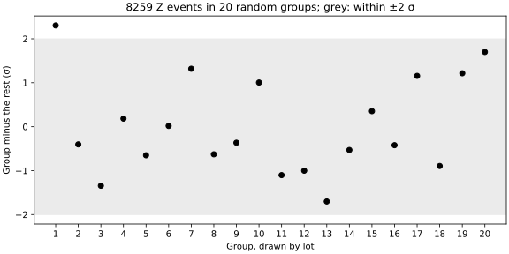

# Seminar 14 · Data Analysis

**Paired lecture:** 14 Concepts of Data Analysis · **Format:** a showcase, then a problem, in class

<!-- ~120 min: the length pnpm timing:check reads -->

**Today's question:** Are weekends in Vilnius warmer or colder than weekdays?

The lecturer runs Part 2 from this page; in Part 3 the room works in pairs.
Everything is typed in VS Code: the scripts in the editor, the commands in its
terminal (zsh on macOS, Git Bash on Windows; the same lines in both). A line
that starts with `$` is typed without the `$`; `...` stands for lines left out.

**If time runs short:** leave out section 5 (the admissions at Berkeley); its calls are on the library card.

??? info "Before the session"
    - **Room:** Miniforge, Git with your name set, and VS Code with its
      Python extension on every laptop (the [Setup](../setup.md) page);
      internet for conda, if `analysis` has to be made, and for the data.
      Nothing from earlier seminars is needed.
    - **No file is handed out.** The scripts fetch their data from public
      addresses:
        - 10 000 muon pairs near the Z mass, recorded by CMS in 2011 (970 kB):
          CERN Open Data Portal, record 5208, "Z to two muons from 2011",
          CC0; selected for education, "not suitable for a full physics
          analysis", as the record says;
        - the applications to the six largest graduate departments of
          UC Berkeley in 1973 (1 kB): R's `datasets` package (GPL-2 or
          GPL-3, as R), as a CSV file of the Rdatasets collection; the
          counts of Bickel, Hammel and O'Connell, *Science* 187 (1975) 398;
        - in Part 3, the daily record of the Vilnius station,
          `LH000026730.csv` (6.1 MB, 1881 to 24 August 2025), from
          GHCN-Daily, NOAA NCEI, "for free and unrestricted use in research,
          education, and other non-commercial activities" (WMO Resolution
          40); cite Menne et al. 2012, *Global Historical Climatology
          Network - Daily (GHCN-Daily)*, Version 3.35, NOAA NCDC,
          [doi:10.7289/V5D21VHZ](https://doi.org/10.7289/V5D21VHZ), accessed
          10 November 2026.
    - **The world average of the Z mass**, 91.1880 ± 0.0020 GeV: Particle
      Data Group, *Review of Particle Physics*, Phys. Rev. D 110 (2024)
      030001.
    - **The numbers** on this page come from runs on 10 November 2026. The
      CMS and Berkeley files do not change; Part 3 uses complete past years
      of the station file. Times printed by pytest and curl differ per
      laptop.
    - **Missing a tool?** VS Code: [Setup, step 1](../setup.md#vscode);
      `conda` (Miniforge) and Git: [Setup, steps 2–4](../setup.md#shell);
      your name for Git: [Setup, step 6](../setup.md#github).
    - **Keys** are written for Windows, macOS in brackets. Paths are shown
      for a Mac (`/Users/smilte/...`); Git Bash shows `/c/Users/smilte/...`.

---

## Part 1 · Set up { #part-1 }

### 1. A new folder, and the environment `analysis` { #start }

<!-- 0:00 · 8 min -->

An environment is a folder with its own Python and its own packages; `analysis` serves weeks 8 to 16, and today needs pandas, Matplotlib and pytest in it.

1. In VS Code, **View** > **Terminal**. Make the folder and go into it.

    ```text
    $ mkdir ~/weather-s14
    $ cd ~/weather-s14
    ```

2. **File** > **Open Folder...** > `weather-s14` (in your home folder) >
   **Open**, then **View** > **Terminal**. The Explorer on the left is empty.

3. **If `analysis` is on this laptop** (Seminars 8 to 12): switch it on and
   add pytest. conda says so when it is there already.

    ```text
    $ conda activate analysis
    $ conda install pytest=9.2
    ```

4. **If it is not:** make it in one line, with today's packages. At
   `Proceed ([y]/n)?` press `Enter`. Then switch it on.

    ```text
    $ conda create -n analysis python=3.14 pandas=3.1 matplotlib-base=3.11 pytest=9.2
    ...
    Proceed ([y]/n)?
    ...
    $ conda activate analysis
    ```

    `conda: command not found`: install Miniforge as on the
    [Setup page, steps 2–4](../setup.md#shell), then open a new terminal.

5. Ask for the versions.

    ```text
    $ python -c "import pandas, matplotlib, pytest; print(pandas.__version__, matplotlib.__version__, pytest.__version__)"
    3.1.1 3.11.2 9.2.0
    ```

**Check:** `(analysis)` at the start of the prompt, and `3.1.1 3.11.2 9.2.0` (the last digits may be higher).

---

### 2. Write the environment down { #install }

<!-- 0:08 · 7 min -->

`environment.yml` lists what the environment holds, so that another laptop can make the same one.

1. Write it into the folder.

    ```text
    $ conda env export --from-history -f environment.yml
    ```

2. Click `environment.yml` in the Explorer, delete its last line,
   `prefix: ...` (a folder on this laptop), save (`Ctrl+S`, macOS `Cmd+S`).
   Made today, it reads as below; an `analysis` from earlier weeks lists
   more packages.

    ```text
    name: analysis
    channels:
      - conda-forge
    dependencies:
      - python=3.14
      - pandas=3.1
      - matplotlib-base=3.11
      - pytest=9.2
    ```

3. Tell VS Code which Python to use: `Ctrl+Shift+P` (macOS `Cmd+Shift+P`),
   `Python: Select Interpreter`, pick the entry with `envs/analysis` in its
   path. The Status Bar shows `analysis`.

**Check:** `- pytest=9.2` in `environment.yml`, and `analysis` in the Status Bar.

---

## Part 2 · Showcase { #part-2 }

The lecturer runs four complete scripts on real data; the room watches or
types along. For each: in the Explorer, right-click > **New File...**, the name
above the code, paste, save, run it in the terminal. A window opens with the
figure; close it and the prompt comes back. The figure is also saved as an SVG
file in the folder.

### 3. The Z mass from 10 000 CMS events, against the world average { #z-mass }

<!-- 0:15 · 10 min -->

A ± that counts only the statistics says nothing about the choices of the method: here, which window of masses is averaged.

```python title="zmass.py"
import numpy as np
import pandas as pd
import matplotlib.pyplot as plt

url = "https://opendata.cern.ch/record/5208/files/Zmumu.csv"
z = pd.read_csv(url)
# the mass of the muon pair from the two muons' pt, eta and phi (GeV)
z["M"] = np.sqrt(2 * z["pt1"] * z["pt2"] * (np.cosh(z["eta1"] - z["eta2"])
                                            - np.cos(z["phi1"] - z["phi2"])))
print(len(z), "events")
WORLD = 91.1880                       # Particle Data Group, ± 0.0020 GeV
for low, high in [(70, 110), (80, 100), (86, 96)]:
    m = z.loc[(z["M"] > low) & (z["M"] < high), "M"]
    error = m.std() / len(m) ** 0.5   # the standard error of the mean
    zscore = (m.mean() - WORLD) / error
    print(f"{low}-{high} GeV: {len(m)} events, mean {m.mean():.2f} "
          f"± {error:.2f}, {zscore:.0f} σ from {WORLD}")

fig, ax = plt.subplots(figsize=(8, 4.5), layout="constrained")
ax.hist(z["M"], bins=120, range=(60, 120), histtype="step", color="black")
ax.axvline(WORLD, color="C3", label="world average, 91.19 GeV")
ax.axvspan(80, 100, color="0.9", label="the window 80 to 100 GeV")
ax.set_xlabel("Mass of the muon pair (GeV)")
ax.set_ylabel("Events per 0.5 GeV")
ax.set_title("CMS 2011, Z → μμ: the peak has a tail to lower masses")
ax.legend(frameon=False)
fig.savefig("zmass.svg")
plt.show()
```

```text
$ python zmass.py
10000 events
70-110 GeV: 9192 events, mean 89.61 ± 0.06, -27 σ from 91.188
80-100 GeV: 8259 events, mean 90.35 ± 0.04, -23 σ from 91.188
86-96 GeV: 7109 events, mean 90.82 ± 0.02, -15 σ from 91.188
```


**Notice:** the window moves the mean by 1.2 GeV, from 89.61 to 90.82, while its ± is 0.02 to 0.06 GeV.

**Ask the room:** CMS's events give a Z 0.8 GeV lighter than the world average, at 23 σ. Is the world average wrong?

??? note "Answer"
    No. The ± says how well 8259 events fix the mean of the window, and
    nothing else. The mean of a window is not the mass: the peak has a tail
    to lower masses (a muon that radiates a photon loses energy, and some
    pairs come from no Z at all), and the window decides how much of the
    tail is averaged in. That is a systematic effect of the method, 1.2 GeV
    across three reasonable windows. A result is value ± statistical ±
    systematic; a mass needs a fit of the peak's shape.

---

### 4. Twenty groups drawn by lot from the same events { #lots }

<!-- 0:25 · 9 min -->

Split one data set at random into 20 groups and test each against the rest: by chance alone, most splits have a group beyond 2 σ.

```python title="lots.py"
import numpy as np
import pandas as pd
import matplotlib.pyplot as plt

z = pd.read_csv("https://opendata.cern.ch/record/5208/files/Zmumu.csv")
z["M"] = np.sqrt(2 * z["pt1"] * z["pt2"] * (np.cosh(z["eta1"] - z["eta2"])
                                            - np.cos(z["phi1"] - z["phi2"])))
m = z.loc[(z["M"] > 80) & (z["M"] < 100), "M"].to_numpy()
rng = np.random.default_rng(2026)


def pulls(lot):
    """Each group's mean minus the rest's, in units of its uncertainty."""
    result = []
    for g in range(20):
        inside, rest = m[lot == g], m[lot != g]
        error = np.sqrt(inside.var() / len(inside) + rest.var() / len(rest))
        result.append((inside.mean() - rest.mean()) / error)
    return np.array(result)


first = pulls(rng.integers(0, 20, len(m)))  # a number from 0 to 19 per event
print("the 20 groups, in σ:", first.round(1))
alarms = sum(np.any(abs(pulls(rng.integers(0, 20, len(m)))) > 2)
             for lot in range(1000))
print(f"lots with a group beyond 2 σ: {alarms} of 1000")
print(f"1 - 0.9545 ** 20 = {1 - 0.9545 ** 20:.3f}")

fig, ax = plt.subplots(figsize=(8, 4), layout="constrained")
ax.axhspan(-2, 2, color="0.92")
ax.plot(range(1, 21), first, "o", color="black")
ax.set_xticks(range(1, 21))
ax.set_xlabel("Group, drawn by lot")
ax.set_ylabel("Group minus the rest (σ)")
ax.set_title(f"{len(m)} Z events in 20 random groups; grey: within ±2 σ")
fig.savefig("lots.svg")
plt.show()
```

```text
$ python lots.py
the 20 groups, in σ: [ 2.3 -0.4 -1.3  0.2 -0.7  0.   1.3 -0.6 -0.4  1.  -1.1 -1.  -1.7 -0.5
  0.4 -0.4  1.2 -0.9  1.2  1.7]
lots with a group beyond 2 σ: 593 of 1000
1 - 0.9545 ** 20 = 0.606
```



**Notice:** group 1 lies 2.3 σ above the rest, and only the random generator set its events apart; 593 of 1000 lots have such a group.

**Ask the room:** a colleague finds that the events of one run of the detector give a Z mass 2.1 σ above the other runs. What do you ask first?

??? note "Answer"
    How many groups were looked at: runs, months, regions of the detector,
    charges. One look has a 4.55 % chance of 2 σ; twenty looks have at
    least one such result 61 % of the time (1 − 0.9545²⁰). Then: was this
    grouping chosen before the data was looked at? A finding from a scan is
    a question for new data, not a result.

---

### 5. Admissions at Berkeley in 1973: lower for women overall, not within departments { #simpson }

<!-- 0:34 · 8 min -->

A third quantity that drives both columns can reverse a comparison when the groups are added together.

```python title="berkeley.py"
import pandas as pd

url = ("https://vincentarelbundock.github.io/Rdatasets/csv/datasets/"
       "UCBAdmissions.csv")
df = pd.read_csv(url)
print(df.head(4))

table = df.pivot_table(index=["Dept", "Gender"], columns="Admit",
                       values="Freq", aggfunc="sum")
table["applied"] = table["Admitted"] + table["Rejected"]
whole = table.groupby("Gender")[["Admitted", "applied"]].sum()
print("admitted, all six departments:")
print((whole["Admitted"] / whole["applied"]).round(2))
print("admitted, by department:")
print((table["Admitted"] / table["applied"]).unstack().round(2))
print("applied, by department:")
print(table["applied"].unstack())
```

```text
$ python berkeley.py
   rownames     Admit  Gender Dept  Freq
0         1  Admitted    Male    A   512
1         2  Rejected    Male    A   313
2         3  Admitted  Female    A    89
3         4  Rejected  Female    A    19
admitted, all six departments:
Gender
Female    0.30
Male      0.45
dtype: float64
admitted, by department:
Gender  Female  Male
Dept                
A         0.82  0.62
B         0.68  0.63
C         0.34  0.37
D         0.35  0.33
E         0.24  0.28
F         0.07  0.06
applied, by department:
Gender  Female  Male
Dept                
A          108   825
B           25   560
C          593   325
D          375   417
E          393   191
F          341   373
```

**Notice:** most women applied to C to F, which admitted a third or less of everyone; most men to A and B, which admitted two thirds.

**Ask the room:** to judge whether the departments treated women and men alike, which rates do you compare: the two of all departments, or the twelve by department?

??? note "Answer"
    The rates by department, where each decision was made: women were
    admitted at a higher rate in four of the six. The 0.30 against 0.45 of
    all departments mixes the departments' own rates with where each group
    applied. Bickel, Hammel and O'Connell (1975) found no bias against
    women in the decisions; the difference came from the choice of
    department. Why those departments admitted so few is another question,
    which these counts cannot answer.

---

### 6. A test with a known answer, and a test that passes for the wrong reason { #known-answer }

<!-- 0:42 · 10 min -->

Code from anyone, an LLM included, is checked on input whose answer is worked out by hand; that input has to exercise every part of the formula.

Asked for the mass formula of section 3, an LLM wrote this function: one letter differs.

```python title="mass.py"
import numpy as np


def pair_mass(pt1, eta1, phi1, pt2, eta2, phi2):
    """The mass of two muons from their pt (GeV), eta and phi (radians)."""
    return np.sqrt(2 * pt1 * pt2
                   * (np.cos(eta1 - eta2) - np.cos(phi1 - phi2)))
```

Two tests, each a case worked out by hand. pytest runs every function whose name starts with `test_` in the files whose names start with `test_`.

```python title="test_mass.py"
import math

from mass import pair_mass


def test_back_to_back():
    # 45.594 GeV each, at eta 0, opposite in phi: M = 2 × 45.594 GeV
    assert math.isclose(pair_mass(45.594, 0, 0, 45.594, 0, math.pi), 91.188)


def test_one_forward_one_backward():
    # 10 GeV each, at eta +1 and -1, opposite in phi: M = 2 × 10 × cosh(1)
    expected = 2 * 10 * math.cosh(1)
    assert math.isclose(pair_mass(10, 1, 0, 10, -1, math.pi), expected)
```

```text
$ python -m pytest -q
.F                                                                       [100%]
=================================== FAILURES ===================================
________________________ test_one_forward_one_backward _________________________
...
E       assert False
E        +  where False = <built-in function isclose>(np.float64(10.806046117362795), 30.861612696304874)
...
FAILED test_mass.py::test_one_forward_one_backward - assert False
1 failed, 1 passed in 0.07s
```

In `mass.py`, change `np.cos(eta1 - eta2)` to `np.cosh(eta1 - eta2)`, save, run again.

```text
$ python -m pytest -q
..                                                                       [100%]
2 passed in 0.03s
```

Your times differ.

**Notice:** the first test passes with the wrong formula too: at η = 0, cos 0 and cosh 0 are both 1.

**Ask the room:** how do you find cases with a known answer for code you did not write?

??? note "Answer"
    A case simple enough to work out by hand (two equal muons, back to
    back), a published number (the Z peak near 91 GeV), or a second,
    independent method. Then make each part of the formula count: here a
    difference in η, so that cosh matters, and two different pt. A test
    that never reaches the wrong line passes for the wrong reason.

---

### 7. Library card: the calls of this page { #card }

<!-- 0:52 · 3 min -->

Every call of the examples and of the solution below, one line each.

| Call | What it does |
|--|--|
| `pd.read_csv(url, usecols=[...], parse_dates=["DATE"])` | a CSV file from its address or disk; only these columns; dates as dates |
| `np.sqrt(...)`, `np.cosh(...)`, `np.cos(...)` | element by element, over whole columns |
| `z.loc[(z["M"] > 80) & (z["M"] < 100), "M"]` | the rows that meet both conditions, one column |
| `m.std() / len(m) ** 0.5` | the standard error of a mean of independent values |
| `(value - reference) / error` | the distance in σ |
| `rng = np.random.default_rng(2026)`, `rng.integers(0, 20, n)` | a random generator with a fixed seed; n whole numbers from 0 to 19 |
| `df.pivot_table(index=..., columns=..., values=..., aggfunc="sum")` | a table of sums (or `"mean"`, `"count"`) by two keys |
| `table.groupby("Gender")[...].sum()`, `series.unstack()` | sums per group; the inner label as columns |
| `df["DATE"].dt.day_of_week` | 0 for Monday to 6 for Sunday |
| `df["DATE"].dt.to_period("W")` | the week, Monday to Sunday, of each date |
| `df["DATE"].dt.year.between(1951, 2023)` | True for the years 1951 to 2023 |
| `ax.hist(x, bins=120, range=(60, 120), histtype="step")` | a histogram drawn as an outline |
| `ax.axvline(x)`, `ax.axvspan(a, b)`, `ax.axhspan(a, b)` | a vertical line; a vertical or a horizontal band |
| `math.isclose(a, b)` | equal to about nine significant digits |
| `python -m pytest -q` | runs every `test_` function of the `test_*.py` files, one dot per test passed |

---

## Part 3 · The problem { #part-3 }

### 8. Are weekends in Vilnius warmer or colder than weekdays? { #problem }

<!-- 0:55 · 50 min: predict and plan 7, solve 23, check 10, hand in 10 -->

At weekends fewer cars drive and fewer factories work. Forster and Solomon
(PNAS, 2003) found a weekly cycle in the daily range of temperature at many
stations in the United States, Mexico, Japan and China. Does the Vilnius
station see one in its daily mean? The data: the station's daily record (GHCN-Daily, NOAA
NCEI; terms and citation under "Before the session"), `TAVG` in tenths of °C.
Download it once (6.1 MB) into the folder; the times in curl's last line
differ per laptop.

```text
$ curl -O https://www.ncei.noaa.gov/data/global-historical-climatology-network-daily/access/LH000026730.csv
  % Total    % Received % Xferd  Average Speed   Time    Time     Time  Current
                                 Dload  Upload   Total   Spent    Left  Speed
100 5976k  100 5976k    0     0  3602k      0  0:00:01  0:00:01 --:--:-- 3600k
```

Work in pairs, with any tools, an LLM too: the work is the plan, the checks and the answer in your own words.

1. **Predict and plan**, before any code. In a new file `plan.md`, write
   your guess (warmer, colder or the same, by how much, one reason) and the
   rule you will follow: which years, which days count as the weekend, what
   is compared with what, and which result counts as "a difference". Then
   commit it: the commit records when the plan was written.

    ```text
    $ git init
    ...
    Initialized empty Git repository in /Users/smilte/weather-s14/.git/
    $ git add plan.md
    $ git commit -m "Plan: weekend against weekdays, before looking"
    [master (root-commit) f71f705] Plan: weekend against weekdays, before looking
    ...
    ```

    Your id differs, and the branch may be `main`. `Author identity
    unknown`: set your name as on [Setup, step 6](../setup.md#github).

2. **Solve.** The difference between the weekend and Monday to Friday,
   in °C, with its standard error, by the rule of your plan.
3. **Check the machine's work.**
    - The days: which weekday does your code give for 10 November 2026? (A
      Tuesday.) What share of your days are weekend days? (2/7 = 0.286.)
    - By hand: take the first complete week of your table, its five
      weekdays and its two weekend days; the means and their difference on
      paper must agree with your code's first difference.
    - The unit and the n: is the mean near 6.5 °C, not 65? Does your ±
      count weeks (about 3800) or days (about 26 000)? Which of the two are
      closer to independent?
    - Against the plan and the prediction: did the code do what the plan
      says? Where the answer differs from your guess, write why.
4. **Hand in** the difference with its ± and two sentences in your own
   words: what it means and how sure it is.

??? tip "Hint 1: the weekday and the week"
    `df["DATE"].dt.day_of_week` gives 0 for Monday to 6 for Sunday, so the
    weekend is `>= 5`. Python's `date.isoweekday()` counts 1 to 7 instead,
    with Saturday 6 and Sunday 7: a mix of the two leaves out Saturdays
    without an error. `df["DATE"].dt.to_period("W")` labels each day with
    its Monday-to-Sunday week.

??? tip "Hint 2: why compare within a week"
    Over a year the mean of a calendar day goes from −5.9 °C in January to
    18.7 °C in August, and a cold spell moves it by up to 10 °C in a few
    days. The days of one week share both. Take for each week the
    mean of its weekend minus the mean of its five weekdays: the season and
    most of the weather cancel. The weeks are close to independent, so the
    ± is the standard deviation of the weekly differences divided by √(the
    number of weeks). Keep only weeks with all seven days measured.

??? tip "Hint 3: which years"
    Choose them in the plan, for a reason that has nothing to do with the
    answer: for example 1951 to 2023, the whole years since the war, in
    which 7 of 26 663 days have no `TAVG`; the record of 2025 ends on
    24 August.

??? note "One solution"
    A plan, committed before anything was computed:

    ```text
    # Plan: are weekends in Vilnius warmer or colder than weekdays?

    - Guess: the same, within 0.1 °C. Traffic changes, the air mass does not.
    - Data: LH000026730.csv, TAVG / 10, the years 1951 to 2023.
    - Weekend: Saturday and Sunday. Weekdays: Monday to Friday.
    - For each week with all 7 days: weekend mean minus weekday mean.
    - Answer: the mean of these differences ± std / sqrt(number of weeks).
    - "A difference" if it lies more than 2 standard errors from 0.
    ```

    ```python title="weekend.py"
    import pandas as pd

    df = pd.read_csv("LH000026730.csv", usecols=["DATE", "TAVG"],
                     parse_dates=["DATE"])
    df["temp"] = df["TAVG"] / 10                     # the file holds tenths of °C
    df = df[df["DATE"].dt.year.between(1951, 2023)].dropna()
    df["week"] = df["DATE"].dt.to_period("W")        # Monday to Sunday
    df["weekend"] = df["DATE"].dt.day_of_week >= 5   # 5 Saturday, 6 Sunday
    print(df.head(7))
    print(f"weekend days: {df['weekend'].mean():.4f} of all days")

    table = df.pivot_table(index="week", columns="weekend", values="temp",
                           aggfunc=["mean", "count"])
    full = table[(table[("count", True)] == 2) & (table[("count", False)] == 5)]
    diff = full[("mean", True)] - full[("mean", False)]
    error = diff.std() / len(diff) ** 0.5
    print(diff.head(3).round(2))
    print(f"{len(diff)} complete weeks: weekend minus Monday to Friday")
    print(f"{diff.mean():.3f} ± {error:.3f} °C, z = {diff.mean() / error:.1f}")

    ends, days = df[df["weekend"]], df[~df["weekend"]]
    error = (ends["temp"].var() / len(ends)
             + days["temp"].var() / len(days)) ** 0.5
    print(f"all days instead: {ends['temp'].mean() - days['temp'].mean():.3f}"
          f" ± {error:.3f} °C")
    ```

    ```text
    $ python weekend.py
                DATE  TAVG  temp                   week  weekend
    23790 1951-01-01 -76.0  -7.6  1951-01-01/1951-01-07    False
    23791 1951-01-02 -64.0  -6.4  1951-01-01/1951-01-07    False
    23792 1951-01-03 -10.0  -1.0  1951-01-01/1951-01-07    False
    23793 1951-01-04 -26.0  -2.6  1951-01-01/1951-01-07    False
    23794 1951-01-05  -7.0  -0.7  1951-01-01/1951-01-07    False
    23795 1951-01-06   0.0   0.0  1951-01-01/1951-01-07     True
    23796 1951-01-07 -10.0  -1.0  1951-01-01/1951-01-07     True
    weekend days: 0.2857 of all days
    week
    1951-01-01/1951-01-07    3.16
    1951-01-08/1951-01-14    3.63
    1951-01-15/1951-01-21   -0.13
    Freq: W-SUN, dtype: float64
    3803 complete weeks: weekend minus Monday to Friday
    -0.035 ± 0.056 °C, z = -0.6
    all days instead: -0.033 ± 0.126 °C
    ```

    By hand, the first week: weekdays (−7.6 − 6.4 − 1.0 − 2.6 − 0.7) / 5 =
    −3.66 °C, weekend (0.0 − 1.0) / 2 = −0.50 °C, difference 3.16 °C.

    Over 3803 weeks of 1951–2023, weekends in Vilnius were 0.035 ± 0.056 °C
    colder than Monday to Friday: 0.6 standard errors, no difference by the
    rule of the plan. A weekend effect on the daily mean larger than about
    0.15 °C would have shown.

**With your own project data:** a quantity of your project that might depend
on a grouping nobody chose for a reason (the weekday, the operator, the
instrument, the batch). Write the comparison into a plan and commit it before
computing it; then the difference with its standard error, and two sentences.

---

## Part 4 · Show and discuss { #part-4 }

### 9. Three questions about the pairs' answers { #discuss }

<!-- 1:45 · 15 min -->

Two or three pairs show their number and read their two sentences.

**Ask the room:** one pair also split the weeks by month. September weekends came out 0.77 °C colder than the weekdays, at 4.6 σ; April and May 0.6 °C warmer. Is that chance, from twelve looks?

??? note "Answer"
    Not chance: twelve looks give a result beyond 4.6 σ less than once in
    10 000 tries. It is the method. A week runs from Monday to Sunday, so
    the weekend is its last two days, 3.5 days after the middle of Monday
    to Friday. In September each day is on average 0.19 °C colder than the
    day before (14.7 °C on the 1st, 9.0 °C on the 30th): 3.5 × 0.19 =
    0.7 °C. In spring the days warm, and the weekend comes out warmer. Subtract from each day the mean of its
    calendar day over 1951–2023 first, and no month is beyond 2 σ; over
    the whole year spring and autumn cancel, and the answer stays −0.035.

    ```python title="months.py"
    import pandas as pd
    import matplotlib.pyplot as plt

    df = pd.read_csv("LH000026730.csv", usecols=["DATE", "TAVG"],
                     parse_dates=["DATE"])
    df["temp"] = df["TAVG"] / 10
    df = df[df["DATE"].dt.year.between(1951, 2023)].dropna()
    df["week"] = df["DATE"].dt.to_period("W")
    df["weekend"] = df["DATE"].dt.day_of_week >= 5
    day = df["DATE"].dt.day_of_year              # 1 to 366, the calendar day
    df["anomaly"] = df["temp"] - df.groupby(day)["temp"].transform("mean")


    def weekend_minus_weekdays(part, column):
        t = part.pivot_table(index="week", columns="weekend", values=column,
                             aggfunc=["mean", "count"])
        t = t[(t[("count", True)] == 2) & (t[("count", False)] == 5)]
        d = t[("mean", True)] - t[("mean", False)]
        return d.mean(), d.std() / len(d) ** 0.5


    fig, ax = plt.subplots(figsize=(8, 4.5), layout="constrained")
    LINES = [("temp", "temperature", -0.1),
             ("anomaly", "minus the mean of its calendar day", 0.1)]
    for column, label, shift in LINES:
        year, error = weekend_minus_weekdays(df, column)
        rows = [weekend_minus_weekdays(df[df["DATE"].dt.month == month], column)
                for month in range(1, 13)]
        print(f"{column}: year {year:.3f} ± {error:.3f}; months in σ:")
        print(" ".join(f"{mean / err:+.1f}" for mean, err in rows))
        ax.errorbar([month + shift for month in range(1, 13)],
                    [mean for mean, err in rows], yerr=[err for mean, err in rows],
                    fmt="o", capsize=2, label=label)
    ax.axhline(0, color="grey", linewidth=0.8)
    ax.set_xticks(range(1, 13))
    ax.set_xlabel("Month")
    ax.set_ylabel("Weekend minus Monday to Friday (°C)")
    ax.set_title("Vilnius 1951–2023: the pattern of the months is the season")
    ax.legend(frameon=False)
    fig.savefig("months.svg")
    plt.show()
    ```

    ```text
    $ python months.py
    temp: year -0.035 ± 0.056; months in σ:
    -0.6 -0.1 +1.7 +2.9 +2.9 +1.5 +1.9 -2.7 -4.6 -3.5 -2.4 -0.8
    anomaly: year -0.035 ± 0.055; months in σ:
    -0.2 -0.9 -1.6 -0.8 +0.6 +0.2 +0.8 +0.3 -0.6 -0.2 +0.8 +0.3
    ```

    

**Ask the room:** two pairs report the same difference, one with ± 0.126 °C and one with ± 0.056 °C. Where does each ± come from, and which one answers the question?

??? note "Answer"
    ± 0.126 comes from all weekend days against all weekdays, each set's
    spread divided by √(its number of days): that spread holds the season
    and every cold spell, which have nothing to do with the weekday, and it
    treats neighbouring days as independent, which they are not. ± 0.056
    compares days of the same week, which share the season and much of the
    weather. Both differences are honest; the second can see an effect half
    as large.

**Ask the room:** nothing was found. Is −0.035 ± 0.056 °C worth reporting?

??? note "Answer"
    Yes. It answers the question the plan asked, and it sets a limit: a
    weekend effect on the daily mean of Vilnius larger than about 0.15 °C
    would have shown. If results within 2 σ stay in drawers, what gets
    printed are the lucky groups of section 4.

The answer is the comparison fixed in the plan before the data was opened, with its ±; a pattern found afterwards by cutting the data more ways is first a question about chance and about the method.

---

## Optional, if the room is fast { #optional }

### 10. The daily range of temperature at weekends { #range }

<!-- — · 15 min -->

Forster and Solomon looked at the daily range, the highest minus the lowest
temperature of the day, not at the mean. The Vilnius file has both every day
from 1951 to 2009 (`TMAX` and `TMIN`, tenths of °C). Plan, predict, solve,
check, hand in, as in section 8.

??? note "One solution"
    `weekend.py` with three lines changed: the columns, the range, the years.

    ```python title="range.py"
    import pandas as pd

    df = pd.read_csv("LH000026730.csv", usecols=["DATE", "TMAX", "TMIN"],
                     parse_dates=["DATE"])
    df["range"] = (df["TMAX"] - df["TMIN"]) / 10    # tenths of °C in the file
    df = df[df["DATE"].dt.year.between(1951, 2009)].dropna()
    df["week"] = df["DATE"].dt.to_period("W")
    df["weekend"] = df["DATE"].dt.day_of_week >= 5
    print(f"mean daily range {df['range'].mean():.2f} °C")

    table = df.pivot_table(index="week", columns="weekend", values="range",
                           aggfunc=["mean", "count"])
    full = table[(table[("count", True)] == 2) & (table[("count", False)] == 5)]
    diff = full[("mean", True)] - full[("mean", False)]
    error = diff.std() / len(diff) ** 0.5
    print(f"{len(diff)} complete weeks: weekend minus Monday to Friday")
    print(f"{diff.mean():.3f} ± {error:.3f} °C, z = {diff.mean() / error:.1f}")
    ```

    ```text
    $ python range.py
    mean daily range 7.76 °C
    3077 complete weeks: weekend minus Monday to Friday
    -0.039 ± 0.054 °C, z = -0.7
    ```

    The daily range at weekends differed from Monday to Friday by
    −0.039 ± 0.054 °C over 3077 weeks of 1951–2009: no difference this
    record can see.

---

## Aims practised

- ♻️ **Reproducibility:** the plan is committed before the data is opened,
  and the answer reruns from one script and one public file.
- 🔧 **Tool-agnosticism:** the checks (a ± that counts the statistics
  only, chance in many looks, a test with a known answer) hold whoever
  wrote the code, a person or an LLM.
- 📁 **Data & files:** three open data sets read from their public
  addresses, each with its source and licence.
